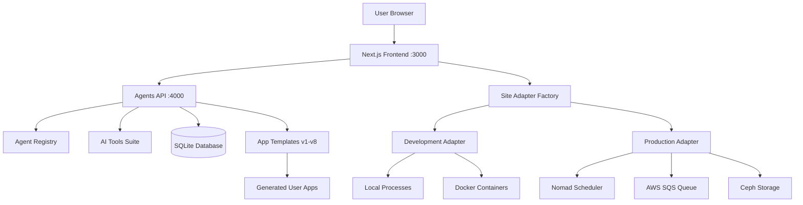
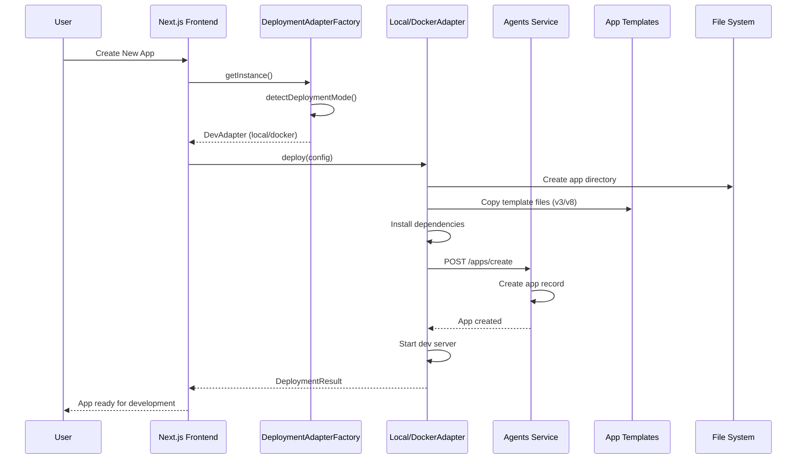
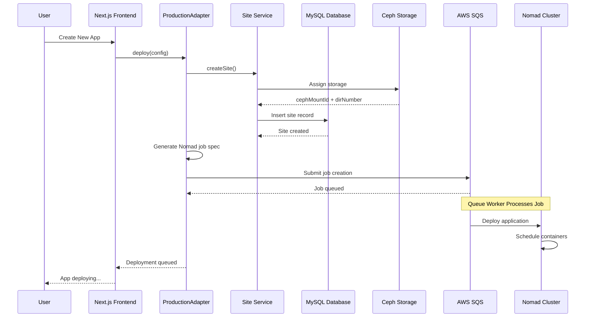

# Airo AI Builder - Complete Architecture Documentation

## Table of Contents

1. [System Overview](#system-overview)
2. [Component Inventory](#component-inventory)
3. [Architectural Patterns](#architectural-patterns)
4. [Deployment Modes](#deployment-modes)
5. [App Creation Flow](#app-creation-flow)
6. [Authentication System](#authentication-system)
7. [Template System](#template-system)
8. [Database Architecture](#database-architecture)
9. [Integration Points](#integration-points)

## System Overview

Airo AI Builder is an AI-powered application development platform that combines artificial intelligence with enterprise-grade hosting and development tools. The system uses a multi-service architecture with AI agents, real-time collaboration, and flexible deployment options.

### High-Level Architecture



## Component Inventory

### Core Services

#### 1. Agents Service (`/agents` - Port 4000)

**Technology**: Express.js with TypeScript
**Purpose**: Backend API service for AI agent management and execution

Key Components:

- `/src/server/app.ts` - Main Express application server
- `/src/registry/agent-registry.ts` - Agent discovery and lifecycle management
- `/src/base/base-agent.ts` - Abstract base class for all AI agents
- `/src/tools/` - Comprehensive file operation and development tools
- `/src/database/` - SQLite database with repositories for apps and token usage
- `/src/logging/` - Structured logging system with typed events

#### 2. Main Application (`/app` - Port 3000)

**Technology**: Next.js with TypeScript
**Purpose**: Primary user interface and deployment management

Key Components:

- `/src/components/` - React UI components and authentication
- `/src/lib/deployment/` - Deployment adapter pattern implementation
- `/src/lib/account-adapters/` - Account management abstraction
- `/src/lib/database/` - Database management with MySQL/SQLite adapters
- `/src/stores/` - Zustand state management
- `/src/services/` - API service layer

#### 3. App Templates (`/app-templates`)

**Technology**: Various (Vite + React, Next.js, etc.)
**Purpose**: Template system for new application generation

Available Templates:

- **v8** - Latest: Vite + React + Shadcn/ui
- **v7** - Vite + React + API layer
- **v3** - Full-stack with frontend/backend separation
- **v2** - Basic React template
- **v1** - Legacy template

### AI Agent System

#### Agent Registry Pattern

The system uses a singleton registry pattern for agent management:

```typescript
// Core agent interface
interface IAgent {
  getConfig(): AgentConfig;
  getSystemPrompt(context?: AgentExecutionContext): Promise<string>;
  initialize(): Promise<void>;
  cleanup(): Promise<void>;
}

// Registry manages agent lifecycle
class AgentRegistry {
  register(agentConstructor: AgentConstructor): void;
  getAgent(agentId: string): Promise<IAgent>;
  initializeAll(): Promise<void>;
}
```

#### Available Agents

1. **DevelopAgent** - Main AI developer for building applications
2. **ExampleAgent** - Demonstration agent
3. **ColorSchemeAgent** - UI color theme specialist
4. **DatabaseAgent** - Database setup and integration

### Tool System

Agents have access to a comprehensive tool suite:

- **File Operations**: `file-edit.ts`, `read-file.ts`, `directory-listing.ts`
- **Development**: `terminal.ts`, `git-tool.ts`, `server-management-tool.ts`
- **Code Analysis**: `grep-tool.ts`, `ast-style-editor.ts`
- **Media**: `image-generation-tool.ts`, `image-search-tool.ts`

## Architectural Patterns

### 1. Adapter Pattern

The system extensively uses the adapter pattern to abstract different deployment strategies:

#### Deployment Adapters

```typescript
interface DeploymentAdapter {
  deploy(config: DeploymentConfig): Promise<DeploymentResult>;
  getStatus(siteId: string): Promise<StatusResult>;
  destroy(siteId: string): Promise<DestroyResult>;
}

// Three implementations:
// - LocalDeploymentAdapter (Node.js processes)
// - DockerDeploymentAdapter (Docker containers)
// - ProductionDeploymentAdapter (Nomad + SQS + Ceph)
```

#### Account Adapters

```typescript
interface IAccountAdapter {
  // Development vs Production account management
  // DevAccountAdapter - Mock authentication for development
  // ProdAccountAdapter - Full authentication with billing
}
```

### 2. Factory Pattern

Environment-aware factories automatically select appropriate implementations:

```typescript
class DeploymentAdapterFactory {
  static getInstance(): DeploymentAdapter {
    const mode = detectDeploymentMode(); // local | docker | production
    return createAdapter(mode);
  }
}
```

### 3. Repository Pattern

Database operations are abstracted through repositories:

- `AppRepository` - App lifecycle management
- `SiteService` - Site metadata and Ceph storage
- `AccountService` - User account management

## Deployment Modes

### Development Mode Detection

The system automatically detects deployment mode based on environment variables:

```typescript
function detectDeploymentMode(): "local" | "docker" | "production" {
  // Production indicators
  if (NODE_ENV === "production" || MYSQL_DB_USERNAME || AWS_REGION_NOMAD) {
    return "production";
  }

  // Development mode selection
  if (NODE_ENV === "development") {
    // DOC_APPS=true (default) or DOC_APPS=false
    return process.env.DOC_APPS !== "false" ? "docker" : "local";
  }

  return "local"; // fallback
}
```

### Local Development Mode

- **Command**: `DOC_APPS=false pnpm run dev`
- **Process Management**: Node.js child processes
- **Port Allocation**: Dynamic port assignment (3001+)
- **Storage**: Local filesystem (`/tmp/apps`)
- **Database**: SQLite

### Docker Development Mode

- **Command**: `DOC_APPS=true pnpm run dev` (default)
- **Container Management**: Docker containers with dev-supervisor service
- **Port Mapping**: Host port mapping
- **Storage**: Volume mounts
- **Database**: SQLite (shared via volume)

### Production Mode

- **Environment**: Production infrastructure
- **Orchestration**: Nomad scheduler
- **Queue**: AWS SQS for job management
- **Storage**: Ceph distributed storage
- **Database**: MySQL
- **Domain**: Custom domains with SSL

## App Creation Flow

### Development Mode Sequence



### Production Mode Sequence



## Authentication System

### Account Adapter Factory

Automatically selects authentication mode:

```typescript
class AccountAdapterFactory {
  static getInstance(): IAccountAdapter {
    const isProduction = isProductionMode();
    return isProduction ? new ProdAccountAdapter() : new DevAccountAdapter();
  }

  private static isProductionMode(): boolean {
    return (
      NODE_ENV === "production" ||
      !!MYSQL_DB_USERNAME ||
      !!AWS_REGION_NOMAD ||
      !!PRODUCTION_DOMAIN
    );
  }
}
```

### Development Authentication

- **DevAccountAdapter**: Mock authentication system
- **Purpose**: Quick development without billing/auth complexity
- **Features**: Temporary user sessions, no billing validation

### Production Authentication

- **ProdAccountAdapter**: Full authentication integration
- **Features**: Real user accounts, billing integration, plan limits
- **Database**: MySQL with accounts, plans, and sites tables

## Template System

### Template Architecture

Templates are versioned application skeletons that provide different architectural approaches:

#### Template Comparison

| Template | Architecture | Frontend     | Backend           | Key Features                  |
| -------- | ------------ | ------------ | ----------------- | ----------------------------- |
| **v8**   | Vite         | React + Vite | Vite              | Latest, Shadcn/ui, TypeScript |
| **v7**   | Vite + API   | React + Vite | API Layer         | Simplified API structure      |
| **v3**   | Full-stack   | React SSR    | Node.js + Express | Frontend/backend separation   |
| **v2**   | Basic React  | React SPA    | None              | Simple frontend-only          |
| **v1**   | Legacy       | React        | Basic             | Minimal features              |

#### Template Detection

The system dynamically detects which template to use:

```typescript
class BaseAgent {
  protected getTemplateForComposition(context?: AgentExecutionContext): string {
    // 1. Check explicit configuration
    const composition = this._config.promptComposition;
    if (composition?.templates?.[0]) return composition.templates[0];

    // 2. Check app metadata
    const appTemplateVersion = context?.metadata?.templateVersion;
    if (appTemplateVersion) return appTemplateVersion;

    // 3. Environment variable fallback
    const templateDir = process.env.APP_TEMPLATE_DIR || "app-templates/v3";
    return extractVersionFromPath(templateDir);
  }
}
```

### Template Structure (v8 Example)

```
app-templates/v8/
├── package.json          # Dependencies and scripts
├── vite.config.ts        # Vite configuration
├── tailwind.config.js    # Tailwind CSS setup
├── src/
│   ├── App.tsx          # Main React component
│   ├── main.tsx         # Entry point
│   └── components/      # Reusable components
├── dev-tools/           # Development utilities
├── source-mapper/       # Source mapping tools
└── .api/               # Backend API
    ├── server.js
    ├── routers.js
    └── handler.js
```

## Database Architecture

### Development Database (SQLite)

**Location**: `/tmp/dev-env.db` or memory
**Schema**:

```sql
-- Apps table (Agents service)
CREATE TABLE apps (
    id TEXT PRIMARY KEY,
    name TEXT NOT NULL,
    path TEXT NOT NULL,
    port INTEGER NOT NULL,
    initial_prompt TEXT,
    template_version TEXT DEFAULT 'v3',
    status TEXT DEFAULT 'creating',
    created_at TEXT DEFAULT CURRENT_TIMESTAMP,
    updated_at TEXT DEFAULT CURRENT_TIMESTAMP
);

-- Running processes (Development mode)
CREATE TABLE running_processes (
    id INTEGER PRIMARY KEY AUTOINCREMENT,
    app_id TEXT NOT NULL,
    port INTEGER NOT NULL,
    pid INTEGER,
    status TEXT DEFAULT 'running',
    created_at TEXT DEFAULT CURRENT_TIMESTAMP,
    FOREIGN KEY (app_id) REFERENCES apps(id)
);

-- Token usage tracking
CREATE TABLE token_usage (
    id INTEGER PRIMARY KEY AUTOINCREMENT,
    app_id TEXT NOT NULL,
    agent_id TEXT NOT NULL,
    model TEXT NOT NULL,
    input_tokens INTEGER DEFAULT 0,
    output_tokens INTEGER DEFAULT 0,
    cost_usd REAL DEFAULT 0.0,
    created_at TEXT DEFAULT CURRENT_TIMESTAMP,
    FOREIGN KEY (app_id) REFERENCES apps(id)
);
```

### Production Database (MySQL)

**Schema**:

```sql
-- Accounts and billing
CREATE TABLE plans (
    id VARCHAR(255) PRIMARY KEY,
    name VARCHAR(255) NOT NULL,
    site_limit INT NOT NULL,
    price DECIMAL(10,2) NOT NULL,
    created_at TIMESTAMP DEFAULT CURRENT_TIMESTAMP,
    updated_at TIMESTAMP DEFAULT CURRENT_TIMESTAMP ON UPDATE CURRENT_TIMESTAMP
);

CREATE TABLE accounts (
    id VARCHAR(255) PRIMARY KEY,
    shopper_id VARCHAR(255) NOT NULL UNIQUE,
    customer_id VARCHAR(255) NOT NULL,
    plan_id VARCHAR(255),
    status ENUM('active', 'suspended', 'closed') DEFAULT 'active',
    created_at TIMESTAMP DEFAULT CURRENT_TIMESTAMP,
    updated_at TIMESTAMP DEFAULT CURRENT_TIMESTAMP ON UPDATE CURRENT_TIMESTAMP,
    FOREIGN KEY (plan_id) REFERENCES plans(id)
);

-- Sites with Ceph storage
CREATE TABLE sites (
    id VARCHAR(255) PRIMARY KEY,
    account_id VARCHAR(255) NOT NULL,
    title VARCHAR(255),
    initial_prompt TEXT,
    domain VARCHAR(255),
    agent_url VARCHAR(255),
    backend_url VARCHAR(255),
    preview_url VARCHAR(255),
    ceph_mount_id VARCHAR(255),
    ceph_dir_number VARCHAR(10),
    status ENUM('pending', 'queued', 'running', 'failed', 'stopped') DEFAULT 'pending',
    created_at TIMESTAMP DEFAULT CURRENT_TIMESTAMP,
    updated_at TIMESTAMP DEFAULT CURRENT_TIMESTAMP ON UPDATE CURRENT_TIMESTAMP,
    FOREIGN KEY (account_id) REFERENCES accounts(id)
);
```

### Database Adapter Pattern

```typescript
interface DatabaseAdapter {
  run(
    sql: string,
    params?: unknown[],
  ): DatabaseResult | Promise<DatabaseResult>;
  get<T>(
    sql: string,
    params?: unknown[],
  ): T | undefined | Promise<T | undefined>;
  all<T>(sql: string, params?: unknown[]): T[] | Promise<T[]>;
}

// Implementations:
// - SqliteAdapter (Development)
// - MySqlAdapter (Production)
```

## Integration Points

### 1. Frontend ↔ Agents Service

**Protocol**: HTTP REST API + WebSocket
**Port**: Frontend (3000) → Agents (4000)
**Key Endpoints**:

- `GET /agents` - List available AI agents
- `POST /apps/create` - Create new application
- `POST /agent/{id}/chat-streaming` - Real-time AI interaction
- `WS /ws/{id}` - WebSocket for live development

### 2. Frontend ↔ Deployment Adapters

**Pattern**: Factory-selected adapter based on environment
**Flow**:

1. DeploymentAdapterFactory detects mode
2. Creates appropriate adapter (Local/Docker/Production)
3. Adapter handles app lifecycle (deploy/status/destroy)

### 3. Agents Service ↔ Templates

**Pattern**: Template composition in agent prompts
**Flow**:

1. Agent loads base prompt from `prompts/{agent-id}.md`
2. Detects template version from app context or environment
3. Composes with template-specific instructions from `prompts/template-descriptions/{version}.md`

### 4. Production Mode Integrations

#### Nomad Scheduler

```typescript
// Job submission via SQS
const jobSpec = generateNomadJobSpec({
  jobName: generateJobName(siteId),
  cephMountId: metadata.cephMountId,
  cephDirNumber: metadata.cephDirNumber,
});

await sqsNomadService.submitJobCreation({
  siteId,
  jobId: jobName,
  jobSpec: jobSpec.Job,
  accountId,
});
```

#### Ceph Storage Assignment

```typescript
// Dynamic storage allocation
async getNextCephAssignment(): Promise<{cephMountId: string; cephDirNumber: string}> {
  const cephMounts = [
    'ac214cd3-b745-47a2-921c-61b4419679fe',
    'a2a8a675-dcb4-40ec-a719-27854cc0956c'
  ];

  // Find mount with lowest next available directory (0-99 per mount)
  // Returns: {cephMountId, cephDirNumber}
}
```

### 5. Real-time Communication

**WebSocket v2 Protocol**: Bidirectional communication between frontend and agents
**Features**:

- Live code editing
- Real-time AI assistance
- Development server logs
- Build status updates

### 6. Token Usage Tracking

**Pattern**: Always-on tracking regardless of UI settings
**Flow**:

1. All AI interactions logged to `token_usage` table
2. Cost calculation based on model pricing
3. Aggregation by app, agent, and time period
4. Optional UI display controlled by `SHOW_USAGE_COST` environment variable

## Environment Configuration

### Key Environment Variables

#### Agents Service (`agents/.env`)

```bash
NODE_ENV=development
OPENAI_API_KEY=""                    # Required: OpenAI API key
OPENAI_BASE_URL=""                   # Optional: Custom base URL
OPENAI_MODEL="claude-sonnet-4"       # AI model to use
APP_TEMPLATE_DIR='app-templates/v8'  # Template directory
SHOW_USAGE_COST=true                # Show token costs in UI
DOC_APPS=true                       # Docker mode (false for local)
```

#### Main App Environment

```bash
# Development mode selection
DOC_APPS=true                       # true=Docker, false=Local
NODE_ENV=development

# Production mode indicators
MYSQL_DB_USERNAME=""                # MySQL = Production
AWS_REGION_NOMAD=""                 # AWS = Production
PRODUCTION_DOMAIN=""                # Domain = Production

# Service URLs
AGENTS_SERVICE_URL="http://localhost:4000"
```

## Development Workflow

### Starting the System

```bash
# 1. Start Agents Service (required)
cd agents && pnpm run dev    # Port 4000

# 2. Start Main App (required)
cd app && pnpm run dev       # Port 3000

# 3. Install template dependencies (for new apps)
cd app-templates/v8 && pnpm install
```

### Creating a New App

1. User interacts with Next.js frontend (port 3000)
2. Frontend calls deployment adapter factory
3. Factory detects environment and creates appropriate adapter
4. Adapter handles app creation:
   - **Local Mode**: Creates directory, copies template, starts Node.js process
   - **Docker Mode**: Creates container with mounted template
   - **Production Mode**: Submits Nomad job via SQS with Ceph storage
5. Agents service creates app record for AI interaction
6. User can now interact with AI agents for development

### AI Development Flow

1. User sends message to AI agent via frontend
2. Frontend routes to `/agent/{agent-id}/chat-streaming`
3. Agent receives context (app metadata, visual context, etc.)
4. Agent composes system prompt with template-specific instructions
5. Agent uses tools to read/modify files, run commands, etc.
6. Real-time streaming response sent back to user
7. All token usage tracked for analytics

This architecture provides a flexible, scalable platform that seamlessly transitions from development to production while maintaining consistent AI-powered development experiences across all deployment modes.
