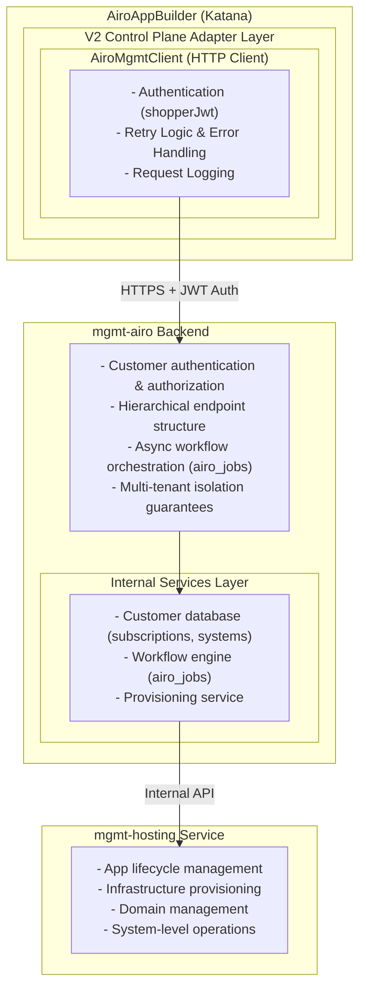
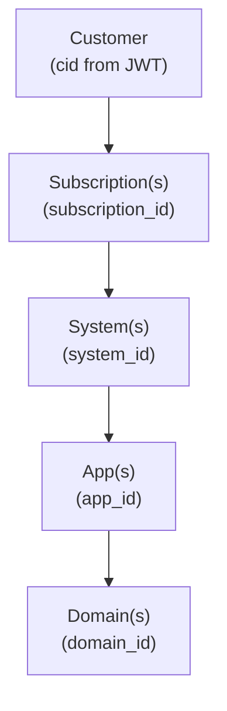
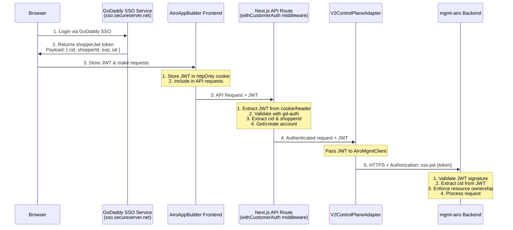
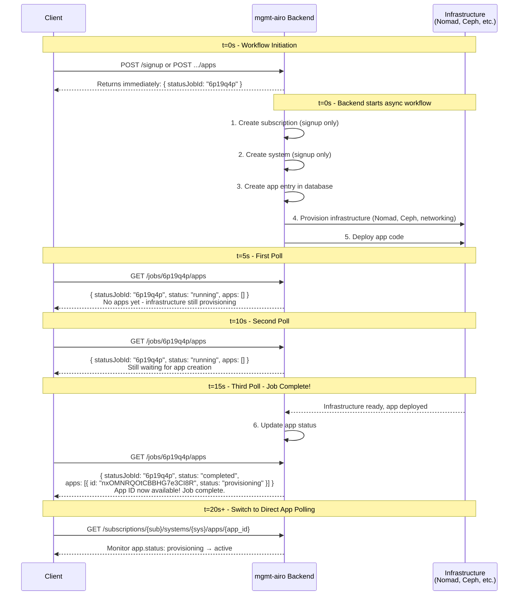
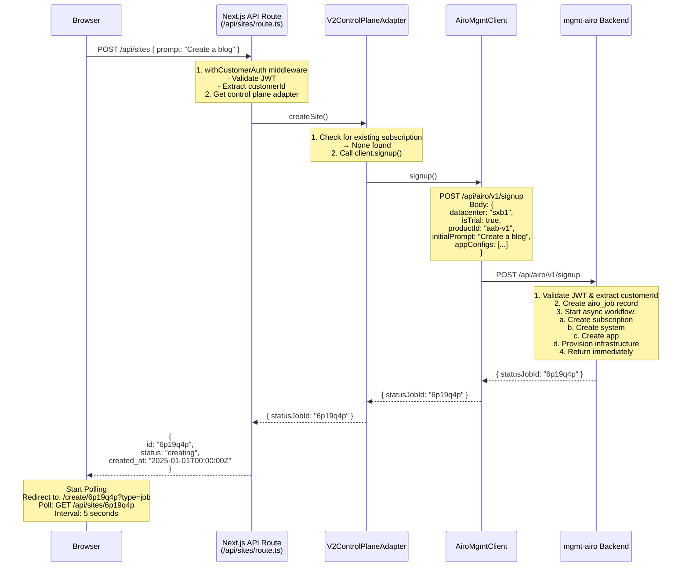
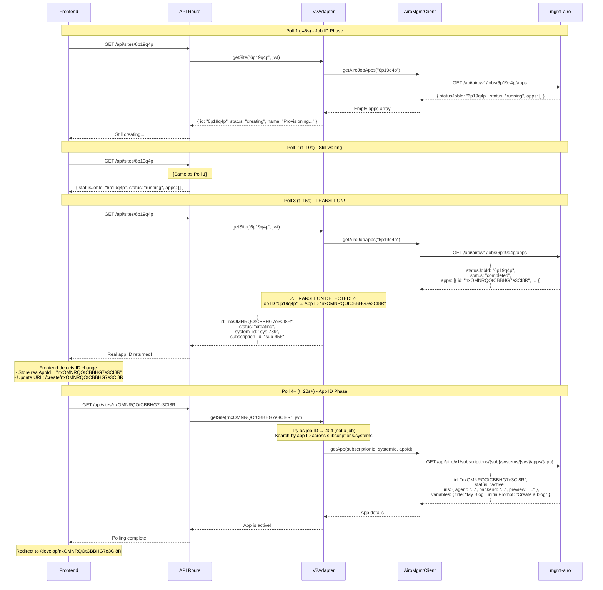
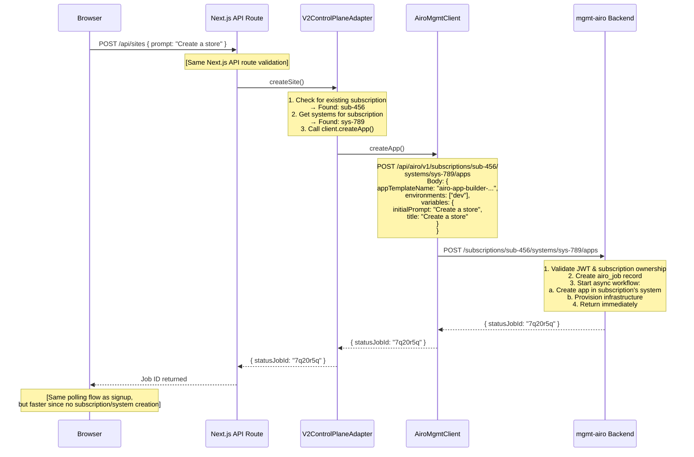
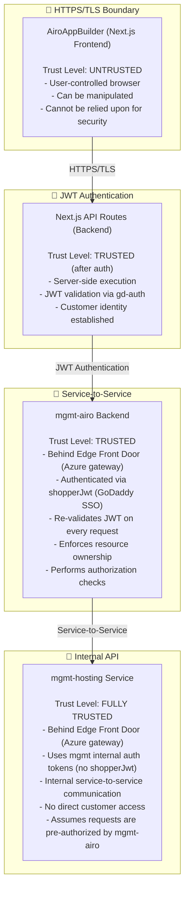

# V2 Control Plane Integration Architecture

## Executive Summary

The AiroAppBuilder (Katana) application integrates with the V2 Control Plane architecture through the `mgmt-airo` backend service. This document describes the architecture, data flows, security model, and implementation details of this integration.

**Key Points:**

- AiroAppBuilder **ONLY** calls `mgmt-airo` backend, **NOT** `mgmt-hosting` directly
- **Downstream consumer:** the `apps/paas` Next.js BFF in `gdcorp-partners/hosting-web-apps` wraps these `/api/airo/v1/*` routes as `/paas/api/airo/*`. Route paths, request/response shapes, and auth contracts here are part of paas's runtime contract — coordinate with hosting-web-apps before changing them. See [`CLAUDE.md`](CLAUDE.md) → "Cross-repo coupling" for the route table, PR checklist, and CI/CD rules.
- Authentication uses `shopperJwt` (SSO JWT tokens) validated via `gd-auth`
- Hierarchical resource model: Customer → Subscription → System → App → Domain
- Async workflows return job IDs, requiring polling to discover app IDs
- Adapter pattern provides backward compatibility with legacy database architecture

---

## Table of Contents

1. [Architecture Overview](#architecture-overview)
2. [Component Hierarchy](#component-hierarchy)
3. [Authentication & Authorization](#authentication--authorization)
4. [API Integration Layer](#api-integration-layer)
5. [Async Workflow Pattern](#async-workflow-pattern)
6. [Control Plane Adapter Pattern](#control-plane-adapter-pattern)
7. [Data Flow Diagrams](#data-flow-diagrams)
8. [Security Model & Threat Analysis](#security-model--threat-analysis)
9. [Error Handling & Resilience](#error-handling--resilience)
10. [Testing Strategy](#testing-strategy)
11. [Configuration](#configuration)
12. [Operational Considerations](#operational-considerations)

---

## Architecture Overview

### System Context



### Architecture Principles

1. **Single Entry Point**: All customer requests go through `mgmt-airo` API
2. **Hierarchical Authorization**: Resources are scoped to customer ownership hierarchy
3. **Async-First**: Long-running operations return job IDs, not immediate results
4. **Adapter Pattern**: Clean abstraction enables gradual migration from legacy architecture
5. **Fail-Safe Defaults**: Rate limiting, retry logic, and graceful degradation built-in

---

## Component Hierarchy

### Resource Model

The V2 Control Plane uses a strict hierarchical resource model that enforces ownership and isolation:



### Entity Relationships

#### Customer

- **Identifier**: `cid` (customer ID from JWT)
- **Purpose**: Top-level tenant in multi-tenant architecture
- **Attributes**: Created automatically on first API access
- **Relationships**: Can have multiple subscriptions

#### Subscription

- **Identifier**: `subscription_id` (nanoId - 10-char lowercase alphanumeric)
- **Purpose**: Billing and entitlement boundary
- **Attributes**:
  - `productId`: Product SKU (e.g., `aab-v1`)
  - `isTrial`: Trial vs. paid subscription
  - `status`: Subscription state (active, suspended, cancelled)
  - `entitlementId`: Linked entitlement
- **Relationships**:
  - Belongs to one customer
  - Can have multiple systems

#### System

- **Identifier**: `system_id` (nanoId - 10-char lowercase alphanumeric)
- **Purpose**: Infrastructure deployment unit (maps to a physical infrastructure deployment)
- **Attributes**:
  - `datacenter`: Physical datacenter location (e.g., `sxb1`)
  - `subscriptionId`: Parent subscription
- **Relationships**:
  - Belongs to one subscription
  - Can have multiple apps

#### App

- **Identifier**: `app_id` (nanoId - 10-char lowercase alphanumeric)
- **Purpose**: Running application instance
- **Attributes**:
  - `appTemplateName`: Template used for provisioning
  - `status`: App lifecycle state (`pending`, `provisioning`, `active`, `error`)
  - `variables`: Key-value configuration (includes `initialPrompt`, `title`)
  - `urls`: Service endpoints (`agent`, `backend`, `preview`)
  - `infrastructure`: Ceph mount info
- **Relationships**:
  - Belongs to one system
  - Can have multiple domains

#### Domain

- **Identifier**: `domain_id` (nanoId - 10-char lowercase alphanumeric)
- **Purpose**: Custom domain mapping
- **Attributes**: Domain name, SSL certificate info
- **Relationships**: Belongs to one app

### Hierarchical URL Pattern

All mgmt-airo endpoints follow a hierarchical structure that enforces authorization:

```
/api/airo/v1/customers/me                                    # Customer info
/api/airo/v1/subscriptions                                   # List subscriptions
/api/airo/v1/subscriptions/{subscription_id}                 # Get subscription
/api/airo/v1/subscriptions/{subscription_id}/systems         # List systems
/api/airo/v1/subscriptions/{subscription_id}/systems/{system_id}/apps          # List apps
/api/airo/v1/subscriptions/{subscription_id}/systems/{system_id}/apps/{app_id} # Get/update/delete app
```

**Security Guarantee**: The hierarchy ensures customers can only access resources they own. The `subscription_id` in the URL is validated against the customer's JWT.

---

## Authentication & Authorization

### Authentication Flow



### JWT Token Structure

```typescript
interface ShopperJWT {
  // Standard JWT claims
  exp: number; // Expiration timestamp
  iat: number; // Issued at timestamp
  iss: string; // Issuer (GoDaddy SSO)

  // Customer identification
  cid: string; // Customer ID (primary identifier)
  shopperId: string; // Shopper ID (GoDaddy account)

  // Additional claims
  sub?: string; // Subject (e.g., "Customer:12345")
}
```

### Authorization Model

#### Customer-Level Authorization

```typescript
// Customer can ONLY access their own resources
// All mgmt-airo endpoints validate: resource.customerId === jwt.cid

// Example: Get app
GET /api/airo/v1/subscriptions/{subscription_id}/systems/{system_id}/apps/{app_id}

// Backend validation:
if (subscription.customerId !== jwt.cid) {
  return 403 Forbidden
}
if (system.subscriptionId !== subscription_id) {
  return 403 Forbidden
}
if (app.systemId !== system_id) {
  return 403 Forbidden
}
```

#### Resource-Level Permissions

- **Subscriptions**: Customer owns all their subscriptions
- **Systems**: Customer owns systems through subscription ownership
- **Apps**: Customer owns apps through system ownership
- **No Cross-Customer Access**: Absolute isolation between customers

---

## API Integration Layer

### AiroMgmtClient Implementation

The `AiroMgmtClient` is a low-level HTTP client providing type-safe methods for all mgmt-airo API endpoints.

**Implementation**: `app/src/lib/mgmt-airo/client.ts`

**Key Responsibilities**:

- HTTP request/response handling
- JWT authentication (Authorization: sso-jwt {token})
- Retry logic with exponential backoff
- Error logging and transformation
- Type-safe API methods

**Method Categories**:

- Customer operations (checkCustomer)
- Subscription management (getSubscriptions, getActiveSubscription)
- System management (getSystems)
- App CRUD operations (getApp, updateApp, deleteApp, deployApp)
- Async workflows (signup, createApp - return job IDs)
- Job polling (getAiroJobApps)
- Bulk optimizations (getAllAppsForCustomer)

### Key API Endpoints

#### Customer Endpoints

```
GET    /api/airo/v1/customers/me
Purpose: Check if customer exists in mgmt-airo
Returns: { customerId: string }
```

#### Subscription Endpoints

```
GET    /api/airo/v1/subscriptions
Purpose: List all subscriptions for authenticated customer
Returns: AiroSubscription[]
```

#### System Endpoints

```
GET    /api/airo/v1/subscriptions/{subscription_id}/systems
Purpose: List systems for a subscription
Returns: AiroSystem[]
```

#### App Endpoints

```
GET    /api/airo/v1/subscriptions/{subscription_id}/systems/{system_id}/apps
Purpose: List apps for a system
Returns: { apps: AiroApp[] }

GET    /api/airo/v1/subscriptions/{subscription_id}/systems/{system_id}/apps/{app_id}
Purpose: Get full app details (includes variables)
Returns: AiroAppDetails

PATCH  /api/airo/v1/subscriptions/{subscription_id}/systems/{system_id}/apps/{app_id}
Purpose: Update app (variables, status)
Body:   { variables?: Record<string, any>, status?: string }
Returns: AiroAppDetails

DELETE /api/airo/v1/subscriptions/{subscription_id}/systems/{system_id}/apps/{app_id}
Purpose: Delete app
Returns: { success: boolean, message: string }

PUT    /api/airo/v1/subscriptions/{subscription_id}/systems/{system_id}/apps/{app_id}/deploy
Purpose: Trigger app redeployment
Returns: { success: boolean, message: string }
```

#### Bulk Endpoints (Performance Optimization)

```
GET    /api/airo/v1/customers/me/apps
Purpose: Get ALL apps for customer across all subscriptions/systems
Returns: { apps: AiroApp[] }
Note:    Used for efficient list operations without nested iteration
```

#### Async Workflow Endpoints

```
POST   /api/airo/v1/signup
Purpose: Create new subscription + system + app (trial provisioning)
Body:   AiroSignupPayload
Returns: { statusJobId: string }
Note:    Starts async workflow

POST   /api/airo/v1/subscriptions/{subscription_id}/systems/{system_id}/apps
Purpose: Add app to existing subscription
Body:   AiroCreateAppPayload
Returns: { statusJobId: string }
Note:    Starts async workflow

GET    /api/airo/v1/jobs/{job_id}/apps
Purpose: Check job status and get provisioned apps
Returns: { statusJobId, status, apps?: AiroApp[] }
Note:    Poll this endpoint until apps appear
```

---

## Async Workflow Pattern

### Overview

Two critical endpoints in mgmt-airo start **asynchronous workflows** tracked as `airo_jobs`:

1. **POST /signup** - Provision new subscription + system + app
2. **POST .../systems/{system_id}/apps** - Add app to existing subscription

These endpoints return a **job ID** immediately because the actual app ID is not yet available.

### Workflow Lifecycle



### Job ID to App ID Transition

This is a critical aspect of the V2 integration - the ID that represents a site changes during its lifecycle:

**Phase 1: Job ID** (temporary, ~10-30 seconds)

- Site creation returns a job ID (e.g., "6p19q4p")
- Polling `GET /jobs/{jobId}/apps` returns empty apps array
- Status: "creating"

**Phase 2: Transition** (single poll cycle)

- Job completes, apps array populated with app object
- App has permanent ID (e.g., "nxOMNRQOtCBBHG7e3CI8R")
- Frontend detects ID change, updates URL

**Phase 3: App ID** (permanent)

- Continue polling with real app ID
- Use hierarchical endpoints for operations
- Status progresses: provisioning → active

**Implementation**:

- Job polling logic: `app/src/lib/control-plane/v2-control-plane-adapter.ts` (getSite method)
- Frontend state management: `app/src/stores/useSiteCreationStore.ts`
- URL transition handling: `app/src/app/create/[id]/page.tsx`

### Frontend State Management

The frontend handles the job→app transition using several mechanisms:

**1. URL Transition**

- Initial: `/create/6p19q4p?type=job` (job ID)
- After transition: `/create/nxOMNRQOtCBBHG7e3CI8R` (app ID)
- Router automatically updates URL when ID changes
- `?type=job` query param indicates we started with a job ID

**2. Store State Tracking**

- Zustand store tracks both current ID and discovered app ID
- Detects ID changes during polling
- Maintains continuity across the transition
- See: `app/src/stores/useSiteCreationStore.ts`

**3. API Adapter Resolution**

- Automatically resolves job IDs to app IDs
- Transparent to calling code
- See: `app/src/app/api/lib/ApiAppIdAdapter.ts`

### Polling Strategy

**Adaptive Polling Behavior**:

- Base interval: 5 seconds
- Rate limit handling: Exponential backoff up to 30 seconds
- Max retries: 3 attempts before failure
- Automatic reset on successful poll

**Implementation**: `app/src/stores/useSiteCreationStore.ts`

---

## Control Plane Adapter Pattern

### Purpose

The adapter pattern provides:

1. **Abstraction**: Uniform interface across V2 and legacy control planes
2. **Migration Path**: Gradual rollout via feature flag
3. **Testing**: Easy to mock and test independently

### Interface Definition

The adapter provides a unified interface that both V2 and Legacy implementations conform to:

**Core Methods**:

- `createSite()` - Create new site (returns job ID in V2, db ID in legacy)
- `getSite()` - Get site info (handles job ID → app ID transition in V2)
- `listSites()` - List all customer sites
- `deleteSite()` - Delete site
- `deploySite()` - Trigger deployment (no-op in V2, manual in legacy)
- `updateSite()` - Update site metadata

**See**: `app/src/lib/control-plane/types.ts`

### V2 Adapter Implementation Highlights

**Implementation**: `app/src/lib/control-plane/v2-control-plane-adapter.ts`

#### createSite - Workflow Decision Logic

Determines which mgmt-airo workflow to use:

**Path 1: First Site (signup)**

- Customer has no existing subscription
- Calls `client.signup()` - creates subscription + system + app
- Returns job ID immediately

**Path 2: Additional Sites (add-app)**

- Customer has existing subscription
- Gets active subscription and first system
- Calls `client.createApp()` - adds app to existing system
- Returns job ID immediately

Both paths return `type: 'job'` to signal async provisioning.

#### getSite - Dual ID Resolution

Handles both job IDs and app IDs:

**Job ID Path**:

- Tries `client.getAiroJobApps(siteId)` first
- If apps empty → still provisioning, return creating status
- If apps present → extract real app ID, return app info

**App ID Path**:

- If job lookup fails (404), treat as app ID
- Search all subscriptions → systems → apps to find match
- Uses bulk endpoint `getAllAppsForCustomer()` for optimization

#### listSites - Performance Optimization

Uses bulk endpoint `GET /customers/me/apps` instead of nested iteration (subscriptions → systems → apps).

**Performance**: O(1) vs O(n\*m) where n=subscriptions, m=systems

#### deleteSite - Hierarchical Lookup

Requires subscriptionId and systemId for deletion:

- If not provided, looks up via `findAppMetadata()` helper
- Uses lightweight search (skips job ID polling logic)
- Calls hierarchical DELETE endpoint

**Note**: Avoids wasteful job ID lookups during deletion (sites being deleted are never jobs).

### Adapter Factory & Feature Flag

**Factory**: `app/src/lib/control-plane/adapter-factory.ts`

Returns appropriate adapter based on environment variable:

- `USE_V2_CONTROL_PLANE=true` → V2ControlPlaneAdapter
- `USE_V2_CONTROL_PLANE=false` → LegacyControlPlaneAdapter

Enables gradual rollout and easy rollback.

---

## Data Flow Diagrams

### Create Site Flow (New Customer - Signup)



### Polling Flow (Job ID → App ID Transition)



### Create Site Flow (Existing Customer - Add App)



---

## Security Model & Threat Analysis

### Security Boundaries



### Threat Model

#### Threat 1: Unauthorized Access to Customer Resources

**Attack Vector**: Attacker tries to access another customer's apps

**Scenario**:

```typescript
// Attacker has valid JWT for customer A (cid: "customer-a")
// Tries to access customer B's app

GET /api/airo/v1/subscriptions/sub-b-123/systems/sys-b-456/apps/app-b-789
Authorization: sso-jwt {customer-a-jwt}
```

**Mitigation**:

1. **mgmt-airo validates subscription ownership**:

   ```typescript
   const jwt = decodeJWT(authHeader);
   const subscription = await getSubscription(subscriptionId);

   if (subscription.customerId !== jwt.cid) {
     return 403 Forbidden;
   }
   ```

2. **Hierarchical validation** ensures system and app belong to subscription

3. **No cross-customer queries** - all endpoints scoped to authenticated customer

**Severity**: ⚠️ CRITICAL (prevented by design)

---

#### Threat 2: JWT Token Theft

**Attack Vector**: XSS or network interception steals JWT

**Mitigations**:

1. **HttpOnly cookies**: JWT stored in httpOnly cookie (not accessible to JavaScript)
2. **HTTPS only**: All communication over TLS
3. **Short expiration**: JWT expires after 1 hour (configurable)
4. **Token refresh**: Automatic refresh via gd-auth heartbeat
5. **Same-origin policy**: Cookies only sent to same origin

**Severity**: ⚠️ HIGH (mitigated by best practices)

---

#### Threat 3: Job ID Enumeration

**Attack Vector**: Attacker guesses job IDs to discover other customers' jobs

**Scenario**:

```typescript
// Attacker tries sequential job IDs
for (const jobId of ["6p19q4p", "6p19q4q", "6p19q4r"]) {
  GET /api/airo/v1/jobs/${jobId}/apps
}
```

**Mitigations**:

1. **Job IDs are customer-scoped** - mgmt-airo validates job.customerId === jwt.cid
2. **Short-format IDs** (base36) provide ~2 billion unique values
3. **Job records include customerId** - no anonymous job access

**Severity**: ⚠️ MEDIUM (prevented by scoping)

---

#### Threat 4: Race Condition in Job Polling

**Attack Vector**: Multiple concurrent polls cause inconsistent state

**Scenario**:

```typescript
// Two browser tabs polling the same job
Tab 1: GET /api/sites/6p19q4p
Tab 2: GET /api/sites/6p19q4p (concurrent)

// Both might see transition at different times
```

**Mitigations**:

1. **Idempotent operations** - polling is read-only
2. **Frontend state management** - store handles concurrent updates
3. **Server-side consistency** - mgmt-airo returns consistent view

**Severity**: ℹ️ LOW (no data corruption risk)

---

#### Threat 5: Subscription/System ID Exposure

**Attack Vector**: URLs expose subscription and system IDs

**Mitigations**:

1. **All IDs are nanoIds** - 10-char lowercase alphanumeric, not sequential or guessable
2. **Authorization still required** - knowing an ID doesn't grant access
3. **Customer scoping** - IDs are meaningless without corresponding JWT

**Severity**: ℹ️ LOW (defense in depth)

---

### Security Best Practices Implemented

✅ **Authentication**

- JWT validation on every request
- Token expiration and refresh
- Secure token storage (httpOnly cookies)

✅ **Authorization**

- Hierarchical resource ownership
- Customer-scoped queries
- No cross-customer access

✅ **Transport Security**

- HTTPS/TLS everywhere
- Secure headers (HSTS, CSP)

✅ **Rate Limiting**

- Request rate limiting
- Exponential backoff on 429
- Graceful degradation

✅ **Error Handling**

- No sensitive data in errors
- Consistent error responses
- Detailed logging (server-side only)

✅ **Defense in Depth**

- Multiple validation layers
- Principle of least privilege
- Fail-safe defaults

---

## Error Handling & Resilience

### Retry Logic

**Implementation**: `app/src/lib/mgmt-airo/client.ts` (request method)

**Strategy**:

- Max retries: 3 attempts
- Base delay: 1000ms
- Exponential backoff: 1s → 2s → 4s
- Optional 404 retry for eventually-consistent endpoints

**Use Cases**:

- Network timeouts
- Transient 5xx errors
- 404 on newly created apps (replication lag)

### Rate Limit Handling

**Implementation**: `app/src/stores/useSiteCreationStore.ts` (polling logic)

**Strategy**:

- Detect 429 responses
- Exponential backoff: 5s → 10s → 20s → 30s (capped)
- Reset to base interval on successful poll
- Continue polling (don't abort)

**Behavior**:

- No error shown to user
- Graceful degradation
- Automatic recovery

### Error Categories

#### 1. Transient Errors (Retryable)

- **Network timeouts**: Retry with exponential backoff
- **429 Rate Limits**: Increase polling interval, continue
- **503 Service Unavailable**: Retry after delay
- **404 on new apps**: App not synced yet, retry

#### 2. Client Errors (Non-Retryable)

- **400 Bad Request**: Invalid input, show user error
- **401 Unauthorized**: JWT expired, redirect to login
- **403 Forbidden**: Insufficient permissions, show error
- **404 on established apps**: App deleted, show error

#### 3. Server Errors (Context-Dependent)

- **500 Internal Server Error**: Log and show generic error
- **502 Bad Gateway**: Temporary, may retry
- **504 Gateway Timeout**: Temporary, may retry

### Graceful Degradation

**Approach**: Multi-tier fallback strategy

**Example: List Sites Operation**

1. **Primary**: Bulk endpoint `GET /customers/me/apps` (fast, single request)
2. **Fallback**: Manual iteration through subscriptions → systems → apps (slower, multiple requests)
3. **Ultimate Fallback**: Return empty list (prevents app crash)

**Characteristics**:

- Continues on partial failures
- Logs warnings at each fallback tier
- Returns best-effort results
- Never throws unhandled errors to UI

**Implementation**: See `listSites()` method in adapter implementations

---

## Testing Strategy

### Unit Tests

**Location**: `app/src/lib/mgmt-airo/__tests__/client.test.ts`

**Coverage**: AiroMgmtClient HTTP layer

- Retry logic (network errors, 404 retry)
- Authentication header inclusion
- Error handling and transformation
- Request/response parsing

**Test Count**: 30+ tests

---

**Location**: `app/src/lib/control-plane/__tests__/v2-control-plane-adapter-cache.test.ts`

**Coverage**: V2ControlPlaneAdapter cache optimization

- Direct lookup using cached subscription/system IDs
- Cache miss fallback to full search
- 404 error handling with cache invalidation
- Stale cache refresh logic
- Performance measurement (API call reduction)
- Cache updates on delete operations

**Test Count**: 8 tests, ✅ 100% passing

---

**Location**: `app/src/stores/__tests__/useSubscriptionCacheStore.test.ts`

**Coverage**: Subscription cache store functionality

- Cache initialization from customer tree API
- App location lookups (subscription + system ID)
- Cache hit/miss tracking
- Concurrent refresh handling
- Cache invalidation and cleanup
- Single app removal from cache

**Test Count**: 9 tests, ✅ 100% passing

---

**Location**: `app/src/lib/control-plane/__tests__/legacy-control-plane-adapter.test.ts`

**Coverage**: Legacy adapter for backward compatibility

- Database operations via Prisma
- Deployment adapter integration (Nomad/SQS)
- Site lifecycle management
- Error handling and recovery

**Test Count**: 21 tests, ✅ 100% passing

### Integration Tests

**Location**: `app/src/lib/control-plane/__tests__/integration.test.ts`

**Status**: Placeholder (1 skipped test)

**Planned Coverage**:

- Complete create → poll → active flow
- Concurrent operations
- Error recovery scenarios
- Rate limit handling
- JWT expiration handling

**Note**: Integration tests require actual API endpoints or comprehensive mocked services. Currently implemented as a placeholder for future development.

### End-to-End Tests

**Framework**: Playwright

**Coverage**: Full user flows

- Site creation UI → polling → development environment
- URL transitions (job ID → app ID)
- Authentication flows
- Error states and recovery

**Location**: `tests/e2e/` (planned)

---

## Configuration

### Environment Variables

```bash
# V2 Control Plane Configuration
USE_V2_CONTROL_PLANE=true                    # Enable V2 adapter
MGMT_AIRO_BASE_URL=https://mgmt.nstk.net    # mgmt-airo API base URL
MGMT_AIRO_DATACENTER=sxb1                    # Default datacenter for provisioning
MGMT_AIRO_PRODUCT_ID=aab-v1                  # Product ID for subscriptions

# Authentication
AUTH_TYPE=jwt                                 # Use JWT authentication
SSO_HOST=https://sso.secureserver.net        # GoDaddy SSO service

# Development/Testing
MOCK_LOGIN=false                             # Enable mock login for local dev
ENABLE_AUTH=true                             # Enable authentication (false = bypass)
```

### Feature Flag Strategy

**Primary Flag**: `USE_V2_CONTROL_PLANE` environment variable

**Rollout Phases**:

1. **Development**: 100% V2 for testing
2. **Staging**: 100% V2 for validation
3. **Production Canary**: 10% of customers (e.g., customerId ends with '0')
4. **Production Ramp**: Gradual increase to 100%

**Rollback**: Set flag to `false`, restart services, legacy adapter takes over

**Implementation**: `app/src/lib/control-plane/adapter-factory.ts`

---

## Operational Considerations

### Monitoring & Observability

#### Key Metrics

1. **Job Completion Time**
   - P50, P95, P99 time from job creation to app active
   - Alert if P95 > 60 seconds

2. **Job Failure Rate**
   - % of jobs that fail
   - Alert if > 5%

3. **Polling Frequency**
   - Requests/second to job endpoint
   - Monitor for rate limit hits

4. **Adapter Success Rate**
   - % of successful adapter operations
   - Alert if < 99%

#### Logging

```typescript
// Structured logging at key points
logger.info("v2-control-plane.create-site.start", { accountId, customerId });
logger.info("v2-control-plane.create-site.workflow", {
  workflow: "airo-provision",
});
logger.info("v2-control-plane.create-site.success", { jobId });
logger.error("v2-control-plane.create-site.error", { error, accountId });
```

### Performance Optimization

#### 1. Bulk Endpoints

**Optimization**: Use `GET /customers/me/apps` for listing operations

**Impact**:

- Old: O(n × m) - iterate subscriptions × systems
- New: O(1) - single request
- Reduction: ~90% fewer API calls for typical customer

**Implementation**: `V2ControlPlaneAdapter.listSites()`

#### 2. Subscription Caching

**Strategy**: Cache subscription + system + app mappings with 15-minute TTL

**Implementation**: Zustand store with Immer middleware (`useSubscriptionCacheStore`)

**Features**:

- Single API call to fetch entire customer tree (replaces 119+ sequential calls)
- O(1) app location lookups via Map-based storage
- Automatic stale cache refresh
- Cache hit/miss metrics tracking
- Concurrent refresh handling with deduplication

**Performance Impact**:

- **Cache hit**: 1 API call (direct app lookup)
- **Cache miss**: 1 API call (customer tree) + 1 API call (app lookup)
- **Previous**: N API calls (iterate subscriptions → systems → apps)
- **Improvement**: >50% reduction in API calls for typical operations

**Implementation**: `app/src/stores/useSubscriptionCacheStore.ts`

#### 3. Request Coalescing

**Strategy**: Prevent duplicate concurrent requests for same resource

**Use Case**: Multiple browser tabs polling same site

**Approach**: Map of pending promises, deduplicate by siteId

**Implementation**: API route layer (planned)

### Troubleshooting Guide

#### Issue: Job never completes

**Symptoms**: Polling shows empty apps array for > 60 seconds

**Diagnosis**:

- Check job status: `GET /api/airo/v1/jobs/{jobId}/apps`
- Review mgmt-airo logs for workflow errors
- Check airo_jobs table for error messages

**Resolution**:

- Verify infrastructure provisioning (Nomad allocations)
- Check mgmt-hosting sync status
- Review workflow step failures

---

#### Issue: Job completes but app stays in "provisioning"

**Symptoms**: App ID appears but status never reaches "active"

**Diagnosis**:

- Check app directly: `GET /subscriptions/{sub}/systems/{sys}/apps/{app}`
- Verify Nomad allocation status
- Check Ceph mount availability
- Test network connectivity

**Resolution**:

- Review app startup logs
- Verify infrastructure dependencies
- Trigger manual deployment if needed

---

#### Issue: 404 errors during polling

**Symptoms**: `getSite()` returns 404 even with valid app ID

**Root Cause**: Replication lag between mgmt-airo and mgmt-hosting

**Resolution**:

- Automatic: Retry logic handles this (3 attempts with backoff)
- Manual: Wait 5-10 seconds, verify app exists in mgmt-hosting
- If persistent: Check mgmt-hosting sync process

---

### Rollback Plan

**Emergency Rollback** (immediate):

1. Set `USE_V2_CONTROL_PLANE=false`
2. Restart services
3. New sites use legacy adapter
4. Existing V2 sites continue working (read-only)

**Gradual Re-enablement**:

1. Fix identified issues
2. Deploy to staging, monitor 24 hours
3. Enable for 10% prod, monitor 48 hours
4. Ramp to 50%, then 100%

---

## Future Enhancements

### Planned Improvements

1. **WebSocket Job Status**
   - Replace polling with WebSocket push notifications
   - Reduce API load and improve UX

2. **Bulk Operations**
   - Batch create multiple apps
   - Bulk delete/update operations

3. **Advanced Filtering**
   - Filter apps by status, template, datacenter
   - Search by variables (title, tags)

4. **Quota Management**
   - Per-subscription app limits
   - Storage quotas
   - API rate limit visibility

5. **Audit Logging**
   - Track all resource changes
   - Compliance and debugging

---

## Appendix

### API Endpoint Reference

#### Subscription Management

| Method | Endpoint                          | Purpose                  | Auth Required |
| ------ | --------------------------------- | ------------------------ | ------------- |
| GET    | `/api/airo/v1/subscriptions`      | List all subscriptions   | Yes (JWT)     |
| GET    | `/api/airo/v1/subscriptions/{id}` | Get subscription details | Yes (JWT)     |

#### System Management

| Method | Endpoint                                         | Purpose            | Auth Required |
| ------ | ------------------------------------------------ | ------------------ | ------------- |
| GET    | `/api/airo/v1/subscriptions/{sub}/systems`       | List systems       | Yes (JWT)     |
| GET    | `/api/airo/v1/subscriptions/{sub}/systems/{sys}` | Get system details | Yes (JWT)     |

#### App Management

| Method | Endpoint                                                           | Purpose            | Auth Required |
| ------ | ------------------------------------------------------------------ | ------------------ | ------------- |
| GET    | `/api/airo/v1/subscriptions/{sub}/systems/{sys}/apps`              | List apps          | Yes (JWT)     |
| POST   | `/api/airo/v1/subscriptions/{sub}/systems/{sys}/apps`              | Create app (async) | Yes (JWT)     |
| GET    | `/api/airo/v1/subscriptions/{sub}/systems/{sys}/apps/{app}`        | Get app details    | Yes (JWT)     |
| PATCH  | `/api/airo/v1/subscriptions/{sub}/systems/{sys}/apps/{app}`        | Update app         | Yes (JWT)     |
| DELETE | `/api/airo/v1/subscriptions/{sub}/systems/{sys}/apps/{app}`        | Delete app         | Yes (JWT)     |
| PUT    | `/api/airo/v1/subscriptions/{sub}/systems/{sys}/apps/{app}/deploy` | Deploy app         | Yes (JWT)     |

#### Workflow Management

| Method | Endpoint                         | Purpose                            | Auth Required |
| ------ | -------------------------------- | ---------------------------------- | ------------- |
| POST   | `/api/airo/v1/signup`            | Provision new subscription (async) | Yes (JWT)     |
| GET    | `/api/airo/v1/jobs/{jobId}/apps` | Poll job status                    | Yes (JWT)     |

#### Bulk Operations

| Method | Endpoint                         | Purpose               | Auth Required |
| ------ | -------------------------------- | --------------------- | ------------- |
| GET    | `/api/airo/v1/customers/me/apps` | Get all customer apps | Yes (JWT)     |
| GET    | `/api/airo/v1/customers/me`      | Get customer info     | Yes (JWT)     |

### Glossary

| Term              | Definition                                                                               |
| ----------------- | ---------------------------------------------------------------------------------------- |
| **airo_jobs**     | Database table tracking async workflows in mgmt-airo                                     |
| **App ID**        | Permanent identifier for a running application (nanoId - 10-char lowercase alphanumeric) |
| **Control Plane** | Backend infrastructure managing application lifecycle                                    |
| **Job ID**        | Temporary identifier for async provisioning workflow (short format)                      |
| **mgmt-airo**     | Customer-facing API layer for V2 Control Plane                                           |
| **mgmt-hosting**  | Internal service managing infrastructure and deployments                                 |
| **shopperJwt**    | JWT token issued by GoDaddy SSO for customer authentication                              |
| **Subscription**  | Billing and entitlement boundary for customer resources                                  |
| **System**        | Infrastructure deployment unit within a subscription                                     |

---

## Document Metadata

- **Version**: 1.0
- **Last Updated**: 2025-01-03
- **Authors**: Engineering Team
- **Status**: Active
- **Related Documents**:
  - [API Documentation](./API.md)
  - [Testing Strategy](./TESTING.md)
  - [Deployment Guide](./DEPLOYMENT.md)
