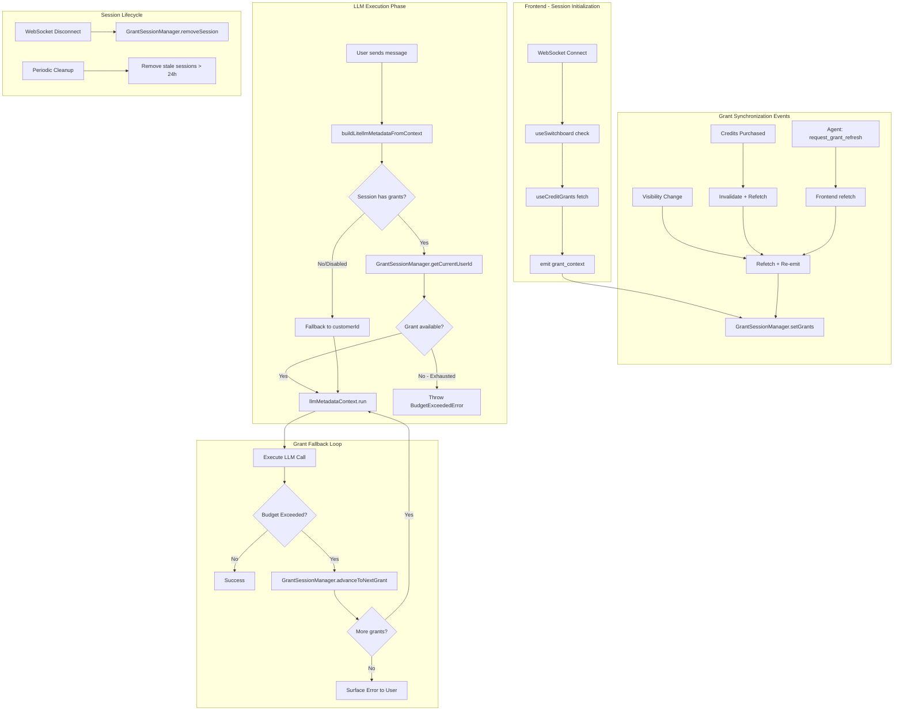

# Grant Consumption Mechanism (Revised)

## Architecture Overview



## Design Principles

| Principle | Implementation |

|-----------|----------------|

| **Session-scoped grants** | Grants sent once per session, not with every message |

| **Frontend owns auth** | Frontend fetches grants (has user JWT), agent consumes |

| **Single source of truth** | GrantSessionManager is authoritative for agent-side grant state |

| **Fail-safe defaults** | Feature disabled or fetch failed → fallback to customerId |

| **Fail-closed on exhaustion** | All grants exhausted → surface error, never fallback to customerId |

| **Type safety** | Proper interfaces for ExecutionContext and grant types |

## Key Files to Modify/Create

| File | Action | Purpose |

|------|--------|---------|

| `packages/ai-lib/package.json` | MODIFY | Add `./grants` subpath export |

| `packages/ai-lib/src/grants/types.ts` | CREATE | Grant types and enums |

| `packages/ai-lib/src/grants/grant-manager.ts` | CREATE | Pure functions for grant validation |

| `packages/ai-lib/src/grants/grant-session-manager.ts` | CREATE | Per-session grant state management |

| `packages/ai-lib/src/grants/build-metadata.ts` | CREATE | Centralized LiteLLM metadata builder |

| `packages/ai-lib/src/grants/index.ts` | CREATE | Public exports |

| `packages/ai-lib/src/core/types.ts` | MODIFY | Add ExecutionContext interface |

| `packages/ai-lib/src/core/agent-factory.ts` | MODIFY | Integrate grant fallback loop |

| `app/package.json` | MODIFY | Add `@airo/ai-lib` workspace dependency |

| `app/src/hooks/websocket/useGrantContext.ts` | CREATE | Frontend grant sync hook |

| `app/src/hooks/websocket/useWebSocket.ts` | MODIFY | Integrate useGrantContext |

| `app/src/utils/credits.ts` | MODIFY | Import from `@airo/ai-grants` (single source of truth) |

| `app/src/types/credits.ts` | MODIFY | Re-export types from `@airo/ai-grants` |

| `app/src/app/manage-plan/page.tsx` | MODIFY | Use imported getActiveGrant |

| `agents/src/server/ai-lib-websocket-server.ts` | MODIFY | Handle grant_context, cleanup |

| Tool files (8 files) | MODIFY | Use buildLitellmMetadataFromContext |

## DRY: Shared Grant Utilities via ai-lib Subpath Export

The grant utilities (`isGrantUsable`, `selectBestGrant`, `CreditGrant` type) are shared between

the frontend app and agents via a dedicated subpath export from `@airo/ai-lib`.

### Why Subpath Export?

- **Single source of truth**: No duplicate code to maintain
- **Tree-shakeable**: Frontend only imports grant utilities, not heavy agent dependencies
- **Type safety**: Shared TypeScript interfaces ensure consistency

### Package Configuration

**`packages/ai-lib/package.json`** - Add subpath export:

```json
{
  "exports": {
    ".": {
      "types": "./dist/index.d.ts",
      "import": "./dist/index.js"
    },
    "./grants": {
      "types": "./dist/grants/index.d.ts",
      "import": "./dist/grants/index.js"
    },
    "./react": {
      "types": "./dist/react/index.d.ts",
      "import": "./dist/react/index.js"
    }
  }
}
```

**`app/package.json`** - Add workspace dependency:

```json
{
  "dependencies": {
    "@airo/ai-lib": "workspace:*"
  }
}
```

### Frontend Usage

```typescript
// app/src/utils/credits.ts - Import from shared library
import { GrantManager, type CreditGrant } from '@airo/ai-grants';

export const isGrantUsable = GrantManager.isGrantUsable;
export const getActiveGrant = GrantManager.selectBestGrant;
```

```typescript
// app/src/types/credits.ts - Re-export types
export type { CreditGrant, GrantContextPayload } from '@airo/ai-grants';
export { GrantType, GrantFinalState } from '@airo/ai-grants';
```

### Tool Files Requiring Updates

| File | Current Pattern | Change Required |

|------|-----------------|-----------------|

| `agents/src/tools/ai-lib-tools/qa-analyze.ts` | Manual metadata | Use buildLitellmMetadataFromContext |

| `agents/src/tools/ai-lib-tools/font-theme.ts` | Manual metadata | Use buildLitellmMetadataFromContext |

| `agents/src/tools/ai-lib-tools/color-scheme.ts` | Manual metadata | Use buildLitellmMetadataFromContext |

| `agents/src/services/video-prompt-generation.ts` | Manual metadata | Use buildLitellmMetadataFromContext |

| `agents/src/services/name-suggestion.ts` | Manual metadata | Use buildLitellmMetadataFromContext |

| `agents/src/services/summarization/LLMSummarizationStrategy.ts` | Manual metadata | Use buildLitellmMetadataFromContext |

| `agents/src/services/summarization/DetailedLLMSummarizationStrategy.ts` | Manual metadata | Use buildLitellmMetadataFromContext |

| `packages/ai-lib/src/utils/embeddings.ts` | Direct metadata param | Use buildLitellmMetadataFromContext |

## Implementation Details

### 1. Grant Types (`packages/ai-lib/src/grants/types.ts`)

```typescript
/**
 * Grant types for LLM billing
 *
 * This is the SINGLE SOURCE OF TRUTH for grant types.
 * Frontend re-exports via @airo/ai-grants subpath.
 */

export enum GrantType {
  PlanMonthly = 'plan-monthly',
  CreditPack = 'credit-pack',
}

export enum GrantFinalState {
  Consumed = 'consumed',
  Expired = 'expired',
}

export interface CreditGrant {
  id: string;
  subscriptionId: string;
  type: GrantType;
  llmBudgetUserId: string;
  llmBudgetId: string;
  creditsMax: number;
  creditsSpent: number;
  isAvailable: boolean;
  finalState: GrantFinalState | null;
  useBefore: string;
  consumedAt: string | null;
  createdAt: string;
  updatedAt: string;
}

/**
 * Payload for grant_context WebSocket event
 */
export interface GrantContextPayload {
  grants: CreditGrant[];
  featureEnabled: boolean;
  timestamp: number;
}
```

### 2. Execution Context Types (`packages/ai-lib/src/core/types.ts`)

```typescript
/**
 * Execution context passed through the agent system
 * Provides type safety for context access throughout the codebase
 */
export interface ExecutionContext {
  /** WebSocket socket ID for session identification */
  socketId?: string;

  /** Application and user metadata */
  metadata?: ExecutionContextMetadata;
}

export interface ExecutionContextMetadata {
  appId?: string;
  customerId?: string;
  subscriptionId?: string;
  sessionId?: string;
  agentId?: string;

  /** State manager reference for tool access */
  stateManager?: unknown;

  /** User's original message (for context search) */
  _userMessage?: string;

  /** Whether app has unbuilt rebuild pages */
  hasUnbuiltRebuildPages?: boolean;
}

/**
 * Special subscription IDs for non-standard billing
 */
export enum SpecialSubscriptionId {
  CareAgent = 'airo-builder:care-agent',
}
```

### 3. Grant Manager (`packages/ai-lib/src/grants/grant-manager.ts`)

```typescript
import type { CreditGrant } from './types';
import { GrantFinalState } from './types';

/**
 * Reasons why a grant cannot be used for LLM requests
 */
export enum GrantUnusableReason {
  NotAvailable = 'not_available',
  Consumed = 'consumed',
  Exhausted = 'exhausted',
  Expired = 'expired',
}

/**
 * Pure functions for grant validation and selection
 *
 * This is the SINGLE SOURCE OF TRUTH for grant logic.
 * Frontend imports via @airo/ai-grants subpath export.
 */
export class GrantManager {
  /**
   * Check if a grant is currently usable for LLM requests
   *
   * A grant is usable when:
   * - isAvailable is true (not blocked by control plane)
   * - Not in a final state (consumed/expired)
   * - Has remaining capacity (creditsSpent < creditsMax)
   * - Not past expiration date (useBefore > now)
   */
  static isGrantUsable(grant: CreditGrant): boolean {
    return (
      grant.isAvailable &&
      grant.finalState === null &&
      grant.creditsSpent < grant.creditsMax &&
      new Date(grant.useBefore) > new Date()
    );
  }

  /**
   * Get reason why a grant is unusable (for logging/debugging)
   */
  static getUnusableReason(grant: CreditGrant): GrantUnusableReason | null {
    if (!grant.isAvailable) return GrantUnusableReason.NotAvailable;
    if (grant.finalState === GrantFinalState.Consumed) return GrantUnusableReason.Consumed;
    if (grant.creditsSpent >= grant.creditsMax) return GrantUnusableReason.Exhausted;
    if (new Date(grant.useBefore) <= new Date()) return GrantUnusableReason.Expired;
    return null;
  }

  /**
   * Select the best grant from a list
   * Returns first usable grant sorted by useBefore (earliest expiration first)
   */
  static selectBestGrant(grants: CreditGrant[]): CreditGrant | null {
    return (
      grants
        .filter((grant) => GrantManager.isGrantUsable(grant))
        .sort((a, b) => new Date(a.useBefore).getTime() - new Date(b.useBefore).getTime())[0] ??
      null
    );
  }
}
```

### 4. Grant Session Manager (`packages/ai-lib/src/grants/grant-session-manager.ts`)

```typescript
import apm from 'elastic-apm-node';

import type { CreditGrant } from './types';
import { GrantManager, GrantUnusableReason } from './grant-manager';
import { logger } from '../utils/logger';

interface SessionGrantState {
  grants: CreditGrant[];
  currentIndex: number;
  featureEnabled: boolean;
  lastUpdated: number;
}

/**
 * Manages grant state per WebSocket session
 *
 * Grants are received once per session via grant_context event and cached here.
 * This avoids sending grants with every message while keeping them reasonably fresh.
 *
 * Thread Safety: Map operations are atomic in Node.js single-threaded model.
 * Session IDs are unique per WebSocket connection.
 */
export class GrantSessionManager {
  private sessions = new Map<string, SessionGrantState>();
  private cleanupInterval: NodeJS.Timeout | null = null;

  /**
   * Update grants for a session
   * Called when frontend sends grant_context event
   */
  setGrants(sessionId: string, grants: CreditGrant[], featureEnabled: boolean): void {
    const sortedGrants = [...grants].sort(
      (a, b) => new Date(a.useBefore).getTime() - new Date(b.useBefore).getTime()
    );

    // Preserve currentIndex if current grant still exists in new list
    const existing = this.sessions.get(sessionId);
    let currentIndex = 0;

    if (existing?.grants.length && sortedGrants.length) {
      const currentGrantId = existing.grants[existing.currentIndex]?.id;
      const newIndex = sortedGrants.findIndex((g) => g.id === currentGrantId);
      if (newIndex >= 0) {
        currentIndex = newIndex;
      }
    }

    this.sessions.set(sessionId, {
      grants: sortedGrants,
      currentIndex,
      featureEnabled,
      lastUpdated: Date.now(),
    });

    // APM instrumentation
    apm.setLabel('grants.count', sortedGrants.length);
    apm.setLabel('grants.feature_enabled', featureEnabled);

    logger.info('grants.session.updated', {
      sessionId,
      grantCount: sortedGrants.length,
      featureEnabled,
      currentIndex,
    });
  }

  /**
   * Get current grant's llmBudgetUserId for LLM requests
   *
   * @param sessionId - WebSocket session ID
   * @param fallbackCustomerId - Customer ID to use if grants disabled/unavailable
   * @returns userId for LiteLLM, or undefined if all grants exhausted (signals error)
   */
  getCurrentUserId(sessionId: string, fallbackCustomerId?: string): string | undefined {
    const span = apm.startSpan('grants.get_current_user_id');

    try {
      const state = this.sessions.get(sessionId);

      // Feature disabled - use fallback (legacy behavior)
      if (!state?.featureEnabled) {
        span?.setLabel('result', 'feature_disabled');
        return fallbackCustomerId;
      }

      // No grants in session - use fallback (fetch may have failed)
      if (!state.grants.length) {
        logger.warn('grants.session.no_grants', { sessionId });
        span?.setLabel('result', 'no_grants');
        return fallbackCustomerId;
      }

      // Find first usable grant starting from current index
      for (let i = state.currentIndex; i < state.grants.length; i++) {
        const grant = state.grants[i];
        if (GrantManager.isGrantUsable(grant)) {
          if (i !== state.currentIndex) {
            // Skipped some unusable grants
            logger.info('grants.session.skipped_unusable', {
              sessionId,
              skippedCount: i - state.currentIndex,
              currentGrantId: grant.id,
            });
            state.currentIndex = i;
          }

          span?.setLabel('result', 'grant_found');
          span?.setLabel('grant.id', grant.id);
          span?.setLabel('grant.index', i);
          return grant.llmBudgetUserId;
        }
      }

      // All grants exhausted - return undefined to signal error
      // DO NOT fallback to customerId - user needs to purchase more credits
      logger.warn('grants.session.all_exhausted', {
        sessionId,
        grantCount: state.grants.length,
      });
      span?.setLabel('result', 'all_exhausted');
      return undefined;
    } finally {
      span?.end();
    }
  }

  /**
   * Advance to next grant after budget exceeded error
   * @returns true if advanced successfully, false if no more usable grants
   */
  advanceToNextGrant(sessionId: string): boolean {
    const state = this.sessions.get(sessionId);
    if (!state) return false;

    const previousGrantId = state.grants[state.currentIndex]?.id;

    // Find next usable grant after current
    for (let i = state.currentIndex + 1; i < state.grants.length; i++) {
      if (GrantManager.isGrantUsable(state.grants[i])) {
        state.currentIndex = i;

        // APM instrumentation
        apm.setLabel('grants.advanced', true);
        apm.setLabel('grants.new_index', i);
        apm.setLabel('grants.remaining', state.grants.length - i);

        logger.info('grants.session.advanced', {
          sessionId,
          previousGrantId,
          newGrantId: state.grants[i].id,
          newIndex: i,
          remainingGrants: state.grants.length - i,
        });
        return true;
      }
    }

    logger.warn('grants.session.advance_failed', {
      sessionId,
      message: 'No more usable grants available',
    });
    return false;
  }

  /**
   * Check if grants feature is enabled for session
   */
  isFeatureEnabled(sessionId: string): boolean {
    return this.sessions.get(sessionId)?.featureEnabled ?? false;
  }

  /**
   * Check if session has grant context
   */
  hasGrants(sessionId: string): boolean {
    const state = this.sessions.get(sessionId);
    return !!state && state.grants.length > 0;
  }

  /**
   * Check if session grant state is stale
   * @param maxAgeMs - Maximum age in milliseconds (default: 5 minutes)
   */
  isStale(sessionId: string, maxAgeMs: number = 5 * 60 * 1000): boolean {
    const state = this.sessions.get(sessionId);
    if (!state) return true;
    return Date.now() - state.lastUpdated > maxAgeMs;
  }

  /**
   * Clean up session on disconnect
   */
  removeSession(sessionId: string): void {
    if (this.sessions.delete(sessionId)) {
      logger.debug('grants.session.removed', { sessionId });
    }
  }

  /**
   * Start periodic cleanup of stale sessions
   * Prevents memory leaks if disconnect events are missed
   *
   * @param intervalMs - Cleanup interval (default: 1 hour)
   * @param maxAgeMs - Maximum session age (default: 24 hours)
   */
  startCleanupInterval(
    intervalMs: number = 60 * 60 * 1000,
    maxAgeMs: number = 24 * 60 * 60 * 1000
  ): void {
    if (this.cleanupInterval) {
      clearInterval(this.cleanupInterval);
    }

    this.cleanupInterval = setInterval(() => {
      const now = Date.now();
      let cleanedCount = 0;

      for (const [sessionId, state] of this.sessions) {
        if (now - state.lastUpdated > maxAgeMs) {
          this.sessions.delete(sessionId);
          cleanedCount++;
        }
      }

      if (cleanedCount > 0) {
        logger.info('grants.session.cleanup', {
          cleanedCount,
          remainingSessions: this.sessions.size,
        });
      }
    }, intervalMs);
  }

  /**
   * Stop periodic cleanup (for graceful shutdown)
   */
  stopCleanupInterval(): void {
    if (this.cleanupInterval) {
      clearInterval(this.cleanupInterval);
      this.cleanupInterval = null;
    }
  }

  /**
   * Get session state for debugging/logging
   */
  getState(sessionId: string): SessionGrantState | undefined {
    return this.sessions.get(sessionId);
  }

  /**
   * Get total number of active sessions (for monitoring)
   */
  getSessionCount(): number {
    return this.sessions.size;
  }
}

// Singleton instance
export const grantSessionManager = new GrantSessionManager();
```

### 5. Build Metadata Helper (`packages/ai-lib/src/grants/build-metadata.ts`)

```typescript
import apm from 'elastic-apm-node';

import { grantSessionManager } from './grant-session-manager';
import type { LitellmMetadata } from '../providers/unified-provider';
import type { ExecutionContext } from '../core/types';
import { SpecialSubscriptionId } from '../core/types';
import { logger } from '../utils/logger';

/**
 * LLM call source identifiers for cost attribution
 * Used in tags for filtering and analysis
 */
export enum LlmCallSource {
  UserChat = 'user-chat',
  ToolQaAnalyze = 'tool:qa-analyze',
  ToolFontTheme = 'tool:font-theme',
  ToolColorScheme = 'tool:color-scheme',
  ToolVideoPrompt = 'tool:video-prompt',
  ServiceNameSuggestion = 'service:name-suggestion',
  ServiceSummarization = 'service:summarization',
  ServiceEmbeddings = 'service:embeddings',
}

/**
 * Error codes for grant-related failures
 * Frontend maps these to localized messages via GrantErrorCode → translation key
 */
export enum GrantErrorCode {
  AllGrantsExhausted = 'GRANTS_ALL_EXHAUSTED',
  NoGrantsAvailable = 'GRANTS_NONE_AVAILABLE',
  GrantFetchFailed = 'GRANTS_FETCH_FAILED',
}

interface MetadataOptions {
  agentId?: string;
  source?: LlmCallSource | string;
}

/**
 * Build LiteLLM metadata from execution context
 *
 * Uses session-managed grants for efficiency (not per-message grants).
 * Single source of truth for all LLM calls in the system.
 *
 * @param context - Execution context with socketId and metadata
 * @param options - Optional agent ID and source for tagging
 * @returns LitellmMetadata with user and tags, or null if grants exhausted
 */
export function buildLitellmMetadataFromContext(
  context: ExecutionContext | undefined,
  options?: MetadataOptions
): LitellmMetadata | null {
  if (!context?.metadata) return null;

  const { appId, customerId, subscriptionId } = context.metadata;
  const socketId = context.socketId;

  if (!appId) return null;

  // Build tags for cost attribution and filtering
  const tags: string[] = [];
  if (customerId) tags.push(`cid:${customerId}`);
  tags.push(`appId:${appId}`);
  tags.push(`source:${options?.source ?? LlmCallSource.UserChat}`);
  if (options?.agentId) tags.push(`agent:${options.agentId}`);

  // E2S (care) sessions bypass grants entirely
  if (subscriptionId === SpecialSubscriptionId.CareAgent) {
    return { user: SpecialSubscriptionId.CareAgent, tags };
  }

  // Use session-managed grants if available
  if (socketId && grantSessionManager.isFeatureEnabled(socketId)) {
    const userId = grantSessionManager.getCurrentUserId(socketId, customerId);

    if (userId) {
      // APM: Track which grant is being used
      apm.setLabel('litellm.user_type', 'grant');
      return { user: userId, tags };
    }

    // All grants exhausted - return null to signal error upstream
    // DO NOT fallback to customerId - user needs to purchase more credits
    logger.error('grants.build_metadata.exhausted', {
      appId,
      socketId,
      customerId,
    });
    apm.setLabel('litellm.user_type', 'exhausted');
    return null;
  }

  // Feature disabled or no session - use customerId (legacy behavior)
  apm.setLabel('litellm.user_type', 'customer_id');
  return customerId ? { user: customerId, tags } : null;
}

/**
 * Check if metadata build would fail due to exhausted grants
 * Use this for early error detection before attempting LLM calls
 *
 * @param context - Execution context
 * @returns true if grants feature is active AND all grants are exhausted
 */
export function isGrantsExhausted(context: ExecutionContext | undefined): boolean {
  const socketId = context?.socketId;
  if (!socketId) return false;

  // Feature not enabled - not exhausted (will use customerId)
  if (!grantSessionManager.isFeatureEnabled(socketId)) return false;

  // No grants in session - not exhausted (will use customerId as fallback)
  if (!grantSessionManager.hasGrants(socketId)) return false;

  // Feature enabled + has grants + no usable grant = exhausted
  const customerId = context?.metadata?.customerId;
  return grantSessionManager.getCurrentUserId(socketId, customerId) === undefined;
}
```

### 6. Public Exports (`packages/ai-lib/src/grants/index.ts`)

```typescript
// Types
export type { CreditGrant, GrantContextPayload } from './types';
export { GrantType, GrantFinalState } from './types';

// Grant Manager
export { GrantManager, GrantUnusableReason } from './grant-manager';

// Session Manager
export { GrantSessionManager, grantSessionManager } from './grant-session-manager';

// Metadata Builder
export {
  buildLitellmMetadataFromContext,
  isGrantsExhausted,
  LlmCallSource,
  GrantErrorCode,
} from './build-metadata';
```

### 7. Frontend Grant Context Hook (`app/src/hooks/websocket/useGrantContext.ts`)

```typescript
import { useCallback, useEffect, useRef } from 'react';
import type { Socket } from 'socket.io-client';

import { useCreditGrants } from '@/hooks/useCreditGrants';
import { useSwitchboard } from '@/hooks/useSwitchboard';
import { logger } from '@/lib/request-context';

interface UseGrantContextOptions {
  socket: Socket | null;
  subscriptionId: string | undefined;
  isConnected: boolean;
}

/**
 * Compute hash of grants for change detection
 * Only includes fields that affect grant usability
 */
function computeGrantHash(grants: ReturnType<typeof useCreditGrants>['data']): string {
  if (!grants?.length) return 'empty';
  return grants.map((g) => `${g.id}:${g.creditsSpent}:${g.finalState}:${g.isAvailable}`).join('|');
}

/**
 * Manages grant context synchronization with the agent
 *
 * Sends grants to agent via grant_context event:
 * - On initial connection
 * - When grants data changes (purchase, consumption)
 * - On tab visibility change (handles stale data)
 * - When agent requests refresh
 *
 * Does NOT send grants with every message - agent caches per session.
 */
export function useGrantContext({
  socket,
  subscriptionId,
  isConnected,
}: UseGrantContextOptions): void {
  const lastSentHashRef = useRef<string | null>(null);
  const isInitialSendRef = useRef(true);

  // Feature flag check
  const { data: grantsEnabled = false, isLoading: isFlagLoading } =
    useSwitchboard('app-builder-grants');

  // Grants data
  const {
    data: grants,
    refetch: refetchGrants,
    isLoading: isGrantsLoading,
  } = useCreditGrants({
    subscriptionId,
    syncSpend: true,
  });

  // Send grants to agent
  const sendGrantContext = useCallback(
    function send(force = false) {
      if (!socket || !isConnected) return;
      if (isFlagLoading || isGrantsLoading) return;

      const grantHash = computeGrantHash(grants);

      // Skip if unchanged (unless forced)
      if (!force && grantHash === lastSentHashRef.current) {
        return;
      }

      const isInitial = isInitialSendRef.current;
      isInitialSendRef.current = false;

      logger.info('websocket.grant_context.send', {
        grantCount: grants?.length ?? 0,
        featureEnabled: grantsEnabled,
        isInitial,
        forced: force,
      });

      socket.emit('grant_context', {
        grants: grants ?? [],
        featureEnabled: grantsEnabled,
        timestamp: Date.now(),
      });

      lastSentHashRef.current = grantHash;
    },
    [socket, isConnected, grants, grantsEnabled, isFlagLoading, isGrantsLoading]
  );

  // Send on connection and data changes
  useEffect(
    function syncOnChange() {
      sendGrantContext();
    },
    [sendGrantContext]
  );

  // Handle reconnection - reset state and re-send
  useEffect(
    function handleReconnect() {
      if (!socket) return;

      function onConnect() {
        logger.info('websocket.grant_context.reconnect');
        lastSentHashRef.current = null;
        isInitialSendRef.current = true;
        // Will trigger sendGrantContext via isConnected change
      }

      socket.on('connect', onConnect);
      return () => {
        socket.off('connect', onConnect);
      };
    },
    [socket]
  );

  // Handle agent refresh requests
  useEffect(
    function handleRefreshRequest() {
      if (!socket) return;

      function onRequestRefresh() {
        logger.info('websocket.grant_context.refresh_requested');
        refetchGrants().then(() => {
          // Force send after refetch completes
          lastSentHashRef.current = null;
        });
      }

      socket.on('request_grant_refresh', onRequestRefresh);
      return () => {
        socket.off('request_grant_refresh', onRequestRefresh);
      };
    },
    [socket, refetchGrants]
  );

  // Re-send on visibility change (user returns to tab)
  useEffect(
    function handleVisibilityChange() {
      if (!socket || !isConnected) return;

      function onVisibilityChange() {
        if (document.visibilityState === 'visible') {
          logger.debug('websocket.grant_context.visibility_refresh');
          // Refetch and force send
          refetchGrants().then(() => {
            lastSentHashRef.current = null;
          });
        }
      }

      document.addEventListener('visibilitychange', onVisibilityChange);
      return () => document.removeEventListener('visibilitychange', onVisibilityChange);
    },
    [socket, isConnected, refetchGrants]
  );

  // Reset on disconnect
  useEffect(
    function resetOnDisconnect() {
      if (!isConnected) {
        lastSentHashRef.current = null;
        isInitialSendRef.current = true;
      }
    },
    [isConnected]
  );
}
```

### 8. Agent WebSocket Server Integration

Update `agents/src/server/ai-lib-websocket-server.ts`:

```typescript
// Add to imports
import { grantSessionManager, type CreditGrant, type GrantContextPayload } from '@airo/ai-grants';

// In setupAILibWebSocketServer, after creating the server:

// Start periodic cleanup of stale grant sessions
grantSessionManager.startCleanupInterval();

// Add grant_context event handler for each socket
socket.on('grant_context', (data: GrantContextPayload) => {
  logger.info('websocket.grant_context.received', {
    socketId: socket.id,
    grantCount: data.grants.length,
    featureEnabled: data.featureEnabled,
  });

  grantSessionManager.setGrants(socket.id, data.grants, data.featureEnabled);
});

// On disconnect, clean up grant session
socket.on('disconnect', (reason) => {
  logger.info('websocket.disconnect', { socketId: socket.id, reason });
  grantSessionManager.removeSession(socket.id);
  // ... existing disconnect handling
});

// In message handler, check for stale grants and request refresh if needed
if (grantSessionManager.isFeatureEnabled(socket.id) && grantSessionManager.isStale(socket.id)) {
  logger.info('websocket.grant_context.stale', { socketId: socket.id });
  socket.emit('request_grant_refresh');
}

// Handle race condition: message arrives before grant_context
// If grants feature expected but not received, wait briefly or proceed with fallback
if (grantSessionManager.isFeatureEnabled(socket.id) && !grantSessionManager.hasGrants(socket.id)) {
  // Option: emit request and continue (grants will arrive for next message)
  socket.emit('request_grant_refresh');
  logger.warn('websocket.grant_context.not_ready', {
    socketId: socket.id,
    message: 'Proceeding with customerId fallback',
  });
}

// Graceful shutdown
process.on('SIGTERM', () => {
  grantSessionManager.stopCleanupInterval();
});
```

### 9. Grant Fallback in Stream Execution

Update `packages/ai-lib/src/core/agent-factory.ts`:

```typescript
import {
  grantSessionManager,
  buildLitellmMetadataFromContext,
  isGrantsExhausted,
  GrantErrorCode,
} from '../grants'
import { BudgetExceededError } from '../utils/errors'
import type { ExecutionContext } from './types'

// In AgentWrapper class:

private async _executeStreamGenerate(prompt: string, options?: {
  messages?: ModelMessage[]
  context?: ContextMessage[]
  files?: ProcessedFile[]
  executionContext?: ExecutionContext
}): Promise<StreamResult> {
  const socketId = options?.executionContext?.socketId

  // Check if grants are already exhausted before starting
  if (isGrantsExhausted(options?.executionContext)) {
    throw new BudgetExceededError(
      'All credit grants have been exhausted. Please purchase more credits.',
      400,
      GrantErrorCode.AllGrantsExhausted
    )
  }

  return this._executeWithGrantFallback(prompt, options, socketId)
}

private async _executeWithGrantFallback(
  prompt: string,
  options: StreamOptions | undefined,
  socketId: string | undefined,
  retryCount = 0
): Promise<StreamResult> {
  const MAX_GRANT_RETRIES = 10 // Safety limit to prevent infinite loops

  try {
    // Build metadata and execute
    const litellmMetadata = buildLitellmMetadataFromContext(
      options?.executionContext,
      { agentId: this.config.id }
    )

    // If metadata is null and grants feature is active, grants are exhausted
    if (!litellmMetadata && socketId && grantSessionManager.isFeatureEnabled(socketId)) {
      throw new BudgetExceededError(
        'All credit grants have been exhausted. Please purchase more credits.',
        400,
        GrantErrorCode.AllGrantsExhausted
      )
    }

    // Execute with metadata context
    return await (litellmMetadata
      ? llmMetadataContext.run(litellmMetadata, () => this._doStreamGenerate(prompt, options))
      : this._doStreamGenerate(prompt, options))

  } catch (error) {
    // Only handle budget exceeded with grant fallback
    if (!BudgetExceededError.isInstance(error)) {
      throw error
    }

    // Check if grants feature is active for this session
    if (!socketId || !grantSessionManager.isFeatureEnabled(socketId)) {
      throw error // No grant fallback available
    }

    // Prevent infinite retry loops
    if (retryCount >= MAX_GRANT_RETRIES) {
      logger.error('grants.fallback.max_retries', { socketId, retryCount })
      throw new BudgetExceededError(
        'All credit grants have been exhausted.',
        400,
        GrantErrorCode.AllGrantsExhausted
      )
    }

    // Try to advance to next grant
    const advanced = grantSessionManager.advanceToNextGrant(socketId)

    if (!advanced) {
      // No more grants - surface error to user
      throw new BudgetExceededError(
        'All credit grants have been exhausted. Please purchase more credits.',
        400,
        GrantErrorCode.AllGrantsExhausted
      )
    }

    logger.info('grants.fallback.retry', {
      socketId,
      retryCount: retryCount + 1,
    })

    // Retry with next grant
    return this._executeWithGrantFallback(prompt, options, socketId, retryCount + 1)
  }
}
```

### 10. Frontend Credits Utilities Update

Update `app/src/utils/credits.ts` to import from the shared library:

```typescript
// Import from shared library - SINGLE SOURCE OF TRUTH
import { GrantManager, type CreditGrant } from '@airo/ai-grants';

/**
 * Check if a grant is currently usable for LLM requests
 * Delegated to GrantManager for consistency with agent-side logic.
 */
export const isGrantUsable = GrantManager.isGrantUsable;

/**
 * Get the currently active grant (the one being used for LLM requests)
 * Delegated to GrantManager for consistency with agent-side logic.
 */
export function getActiveGrant(grants: CreditGrant[]): CreditGrant | undefined {
  return GrantManager.selectBestGrant(grants) ?? undefined;
}

// Re-export types for convenience
export type { CreditGrant } from '@airo/ai-grants';
export { GrantType, GrantFinalState } from '@airo/ai-grants';

// ... existing getMonthlyPlanGrant, getCreditPackGrants unchanged
```

Update `app/src/types/credits.ts` to re-export from shared library:

```typescript
// Re-export all grant types from the shared library
// This ensures frontend and agent use identical type definitions
export type { CreditGrant, GrantContextPayload } from '@airo/ai-grants';
export { GrantType, GrantFinalState } from '@airo/ai-grants';

// Keep any frontend-specific credit types here
// ...
```

### 11. Frontend Error Handling

Update error handler to map grant error codes:

```typescript
// app/src/hooks/websocket/handlers/ErrorHandler.ts

/**
 * Translation key mapping for grant-related errors
 */
const GRANT_ERROR_TRANSLATION_KEYS: Record<string, string> = {
  GRANTS_ALL_EXHAUSTED: 'builder_error_grants_exhausted',
  GRANTS_NONE_AVAILABLE: 'builder_error_no_grants',
  GRANTS_FETCH_FAILED: 'builder_error_grants_fetch_failed',
};

// In error handling:
if (error.errorType === 'BUDGET_EXCEEDED') {
  const translationKey =
    GRANT_ERROR_TRANSLATION_KEYS[error.responseBody] ?? 'builder_error_budget_exceeded';

  // ... show localized error
}
```

Translation keys to add in `app/locales/en-US.json`:

```json
{
  "builder_error_grants_exhausted": "You've used all your AI credits. Purchase more credits to continue building.",
  "builder_error_no_grants": "No AI credits available. Please upgrade your plan to continue.",
  "builder_error_grants_fetch_failed": "Unable to verify your credit balance. Please try again.",
  "builder_error_budget_exceeded": "Your AI usage budget has been reached."
}
```

### 12. Tool Files Update Pattern

Example update for `agents/src/services/name-suggestion.ts`:

```typescript
// BEFORE
import { getModel } from '@airo/ai-lib'
import { llmMetadataContext, type LitellmMetadata } from '@airo/ai-common'

// Build metadata manually
const existingMetadata = llmMetadataContext.getStore()
const userIdentifier = existingMetadata?.user || 'airo-builder:name-suggestion'
const metadata: LitellmMetadata = {
  ...(userIdentifier && { user: userIdentifier }),
  tags: [...new Set([...(existingMetadata?.tags || []), 'source:name-suggestion'])]
}

// AFTER
import { getModel } from '@airo/ai-lib'
import { llmMetadataContext, buildLitellmMetadataFromContext, LlmCallSource } from '@airo/ai-common'
import type { ExecutionContext } from '@airo/ai-lib'

// Use centralized metadata builder
async suggestName(prompt: string, executionContext?: ExecutionContext): Promise<string | null> {
  // ...

  const metadata = buildLitellmMetadataFromContext(executionContext, {
    source: LlmCallSource.ServiceNameSuggestion,
  })

  // If no metadata and we have context, grants may be exhausted
  if (!metadata && executionContext) {
    logger.warn('name-suggestion.no_metadata', { appId: executionContext.metadata?.appId })
    // Proceed without metadata (will use default budget) or throw
  }

  const result = metadata
    ? await llmMetadataContext.run(metadata, generateFn)
    : await generateFn()

  // ...
}
```

## Error Handling Matrix

| Scenario | Behavior |

|----------|----------|

| **Feature flag OFF** | Use customerId (legacy behavior) |

| **Feature flag ON, grants provided** | Use grant.llmBudgetUserId |

| **Feature flag ON, no grants in session** | Use customerId (frontend may not have fetched yet) |

| **Feature flag ON, all grants exhausted** | Throw BudgetExceededError (NO fallback) |

| **Budget exceeded from GoCode** | Advance to next grant, retry |

| **All grants exhausted mid-prompt** | Surface BudgetExceededError to user |

| **Grant expired during use** | GoCode returns budget exceeded, triggers fallback |

| **WebSocket disconnect** | Clean up session state |

| **Stale grant data** | Request refresh from frontend |

## Feature Flag Behavior

| Flag State | Grant Context | Behavior |

|------------|---------------|----------|

| `app-builder-grants: true` | Provided | Use grants with fallback chain |

| `app-builder-grants: true` | Not provided | Fallback to customerId, request refresh |

| `app-builder-grants: false` | Any | Use customerId (legacy) |

| E2S session | Any | Always use `airo-builder:care-agent` |

## Testing Strategy

### Unit Tests

| Component | Test Cases |

|-----------|------------|

| `GrantManager` | `isGrantUsable` all conditions, `selectBestGrant` ordering, `getUnusableReason` |

| `GrantSessionManager` | `setGrants`, `getCurrentUserId`, `advanceToNextGrant`, `removeSession`, `isStale` |

| `buildLitellmMetadataFromContext` | With grants, without grants, E2S session, exhausted grants |

| `isGrantsExhausted` | Various session states |

Note: Frontend and agent share the same `GrantManager` code via `@airo/ai-grants`,

so unit tests only need to exist in `packages/ai-lib`. No duplicate testing required.

### Integration Tests

| Scenario | Verification |

|----------|--------------|

| Grant context flow | Frontend sends, agent receives and stores |

| Budget exceeded fallback | Triggers advance, retries with next grant |

| All grants exhausted | Surfaces error, no customerId fallback |

| Reconnection | Session state reset, grants re-sent |

| Visibility change | Triggers refresh and re-send |

| Stale data detection | Agent requests refresh |

### E2E Tests

| Scenario | Steps |

|----------|-------|

| Normal flow | Connect → grant_context → prompt → success |

| Grant exhaustion | Use credits → exhaust → error shown → purchase prompt |

| Feature flag off | Flag disabled → uses customerId → no grant behavior |

| Care session | E2S auth → bypasses grants → uses care-agent budget |

## Observability

### APM Labels

| Label | Value | Purpose |

|-------|-------|---------|

| `grants.count` | number | Grants in session |

| `grants.feature_enabled` | boolean | Feature flag state |

| `grants.advanced` | boolean | Grant fallback occurred |

| `grants.new_index` | number | Index after advancement |

| `grants.remaining` | number | Remaining grants |

| `litellm.user_type` | 'grant' \| 'customer_id' \| 'exhausted' | Which user type used |

| `grant.id` | string | Current grant being used |

| `grant.index` | number | Position in grant list |

### Log Events

| Event | Level | Trigger |

|-------|-------|---------|

| `grants.session.updated` | info | grant_context received |

| `grants.session.advanced` | info | Fallback to next grant |

| `grants.session.all_exhausted` | warn | No usable grants remain |

| `grants.session.skipped_unusable` | info | Skipped expired/consumed grants |

| `grants.session.removed` | debug | Session cleanup |

| `grants.session.cleanup` | info | Periodic stale cleanup |

| `grants.build_metadata.exhausted` | error | Metadata build failed |

| `grants.fallback.retry` | info | Retrying with next grant |

| `grants.fallback.max_retries` | error | Safety limit reached |

## Implementation Checklist

| Task                                                         | Status | Notes                                            |
| ------------------------------------------------------------ | ------ | ------------------------------------------------ |
| Update `packages/ai-lib/package.json`                        | ✅     | Add `./grants` subpath export                    |
| Create `packages/ai-lib/src/grants/types.ts`                 | ✅     | Grant types and enums                            |
| Create `packages/ai-lib/src/grants/grant-manager.ts`         | ✅     | Pure validation functions                        |
| Create `packages/ai-lib/src/grants/grant-session-manager.ts` | ✅     | Session state management                         |
| Create `packages/ai-lib/src/grants/build-metadata.ts`        | ✅     | Centralized metadata builder                     |
| Create `packages/ai-lib/src/grants/index.ts`                 | ✅     | Public exports                                   |
| Update `packages/ai-lib/src/core/types.ts`                   | ✅     | ExecutionContext in grants/build-metadata.ts     |
| Update `packages/ai-lib/src/core/agent-factory.ts`           | ✅     | Grant fallback loop                              |
| Update `app/package.json`                                    | ✅     | Add `@airo/ai-lib` workspace dependency          |
| Create `app/src/hooks/websocket/useGrantContext.ts`          | ✅     | Frontend sync hook                               |
| Update `app/src/hooks/useStreamingWebSocket.ts`              | ✅     | Integrate useGrantContext                        |
| Update `app/src/utils/credits.ts`                            | ✅     | Import from `@airo/ai-grants`                    |
| Update `app/src/types/credits.ts`                            | ✅     | Re-export types from `@airo/ai-grants`           |
| Update `agents/src/server/ai-lib-websocket-server.ts`        | ✅     | grant_context handler, cleanup                   |
| Update `agents/src/services/name-suggestion.ts`              | ✅     | Use buildLitellmMetadataFromContext              |
| Update `agents/src/tools/ai-lib-tools/qa-analyze.ts`         | ✅     | Use buildLitellmMetadataFromContext              |
| Update `agents/src/tools/ai-lib-tools/font-theme.ts`         | ✅     | Use buildLitellmMetadataFromContext              |
| Update `agents/src/tools/ai-lib-tools/color-scheme.ts`       | ✅     | Use buildLitellmMetadataFromContext              |
| Update `agents/src/services/video-prompt-generation.ts`      | ✅     | Use buildLitellmMetadataFromContext              |
| Update `agents/src/services/summarization/*.ts`              | ✅     | Use buildLitellmMetadataFromContext              |
| Update `app/src/hooks/websocket/handlers/ErrorHandler.ts`    | ✅     | Grant error code mapping                         |
| Add translation keys                                         | 🔲     | Via GoDaddy i18n Management UI                   |
| Write unit tests                                             | ✅     | Tests in `packages/ai-lib/src/grants/__tests__/` |
| Write integration tests                                      | 🔲     | WebSocket flows                                  |
| Write E2E tests                                              | 🔲     | Full user journeys                               |
