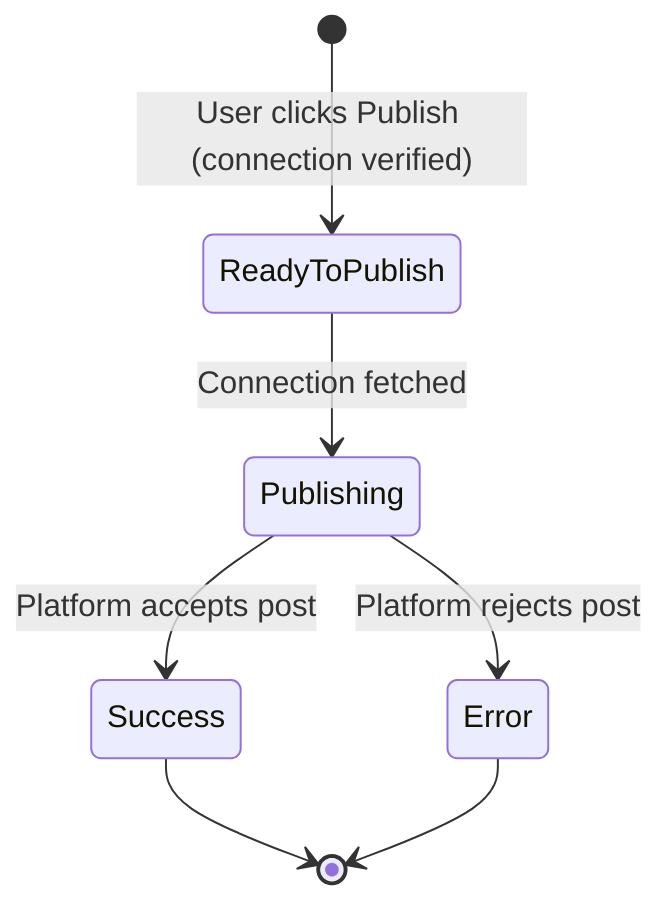
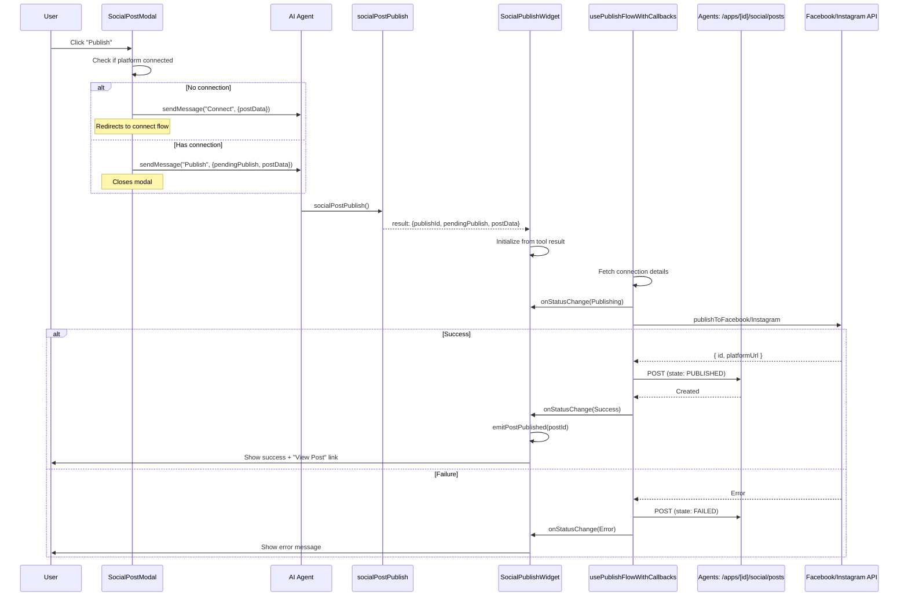
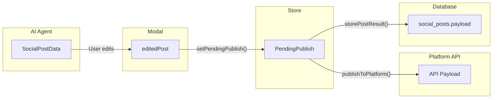

# Social Posts Architecture

This document describes the `social_posts` table schema and the publish flow for social media posts.

## ⚠️ Architecture Update (January 2026)

**Social posts data is now stored in SQLite (agents service).**

- **Location:** `agents/src/database/schema.ts` → SQLite database (`agents/data/apps.db`)
- **Reason:** Social posts are agent-generated content and should live with other agent data (conversations, files, memories)

---

## Table Schema

### `social_posts` (SQLite - Agents Service)

Stores publish attempts and results for social media posts.

```
┌─────────────────────┬──────────────┬─────────────────────────────────────────┐
│ Column              │ Type         │ Description                             │
├─────────────────────┼──────────────┼─────────────────────────────────────────┤
│ id                  │ TEXT (PK)    │ Unique identifier (nanoid)              │
│ app_id              │ TEXT (FK)    │ Reference to apps table                 │
│ association_id      │ TEXT? (FK)   │ Reference to social_associations        │
│ platform            │ TEXT         │ Platform: facebook, instagram, etc.     │
│ state               │ TEXT         │ SCHEDULED, PUBLISHED, FAILED (CHECK)    │
│ payload             │ TEXT         │ JSON: Post content (message, imageUrls) │
│ external_response   │ TEXT?        │ JSON: Platform API response or error    │
│ external_id         │ TEXT?        │ Platform's post ID                      │
│ scheduled_at        │ DATETIME?    │ When post should publish                │
│ completed_at        │ DATETIME?    │ When post was published/failed          │
│ campaign_id         │ TEXT?        │ Links to automated campaign             │
│ created_at          │ DATETIME     │ Record creation time                    │
│ updated_at          │ DATETIME     │ Last update time (auto-updated)         │
└─────────────────────┴──────────────┴─────────────────────────────────────────┘
```

**Database:** `agents/data/apps.db` (SQLite)
**Schema:** `agents/src/database/schema.ts`
**Repository:** `agents/src/database/repositories/SocialPostRepository.ts`

### Field Details

#### `payload` (JSON)

```typescript
{
  message: string,      // Combined content: text + callToAction + hashtags
  imageUrls: string[]   // Array of image URLs to publish
}
```

#### `external_response` (JSON)

```typescript
// Success - contains platform response directly
{
  id: string,         // Platform's post ID
  platformUrl: string // URL to view post on platform
}

// Error
{
  error: string       // Error message
}
```

### Indexes

- `idx_social_posts_app_id` - Filter posts by app
- `idx_social_posts_app_state` - Filter by app and state
- `idx_social_posts_association_id` - Filter by social connection
- `idx_social_posts_platform` - Filter by platform
- `idx_social_posts_scheduled_at` - Query scheduled posts
- `idx_social_posts_campaign_id` - Filter by campaign

### Foreign Key Constraints

- `app_id` → `apps(id)` ON DELETE CASCADE
- `association_id` → `social_associations(id)` ON DELETE SET NULL

### Triggers

- `update_social_posts_updated_at` - Auto-updates `updated_at` timestamp on row changes

---

## Publish Flow

### State Machine



> **Note:** Connection verification happens in `SocialPostModal` before entering this flow. If no connection exists, the user is sent to connect first via `SocialConnectToolRenderer`.

### Flow Status Enum

```typescript
enum PublishFlowState {
  ReadyToPublish = "ready-to-publish",
  Publishing = "publishing",
  Success = "success",
  Error = "error",
}

type PublishStatus = `${PublishFlowState}`;
```

> **Note:** Connection checking is now handled by the frontend before initiating the publish flow. If no connection exists, the user is redirected to the connect flow instead.

---

## Component Architecture

### Sequence Diagram



> **Note:** Data flows through context attachments in messages rather than global state. The `SocialPostCreateToolRenderer` listens for `postPublished` events to update post status.

---

## Data Flow

### Post Data Transformation



### Data Shapes

```typescript
// 1. SocialPostData (from AI agent)
{
  id: "sp_123",
  styleLabel: "Professional",
  content: "Check out our new product!",
  callToAction: "Shop now",
  hashtags: ["#sale", "#new"],
  images: [{ url: "...", width: 1200, height: 630 }],
  platform: "facebook"
}

// 2. PendingPublish (in store)
{
  platform: "facebook",
  message: "Check out our new product!\n\nShop now",
  imageUrls: ["..."],
  scheduledAt?: Date
}

// 3. API Payload (to Facebook)
{
  url: "...",
  caption: "Check out our new product!\n\nShop now"
}

// 4. Database Record
{
  platform: "facebook",
  state: "PUBLISHED",
  payload: { message: "...", imageUrls: [...] },
  external_response: { status: 200, body: { id: "fb_789", platformUrl: "..." } },
  external_id: "fb_789"
}
```

---

## Key Components

| Component                      | Location                          | Responsibility                          |
| ------------------------------ | --------------------------------- | --------------------------------------- |
| `SocialPostModal`              | `app/develop/components/widgets/` | UI for editing/publishing posts         |
| `SocialPublishWidget`          | `app/develop/components/widgets/` | Shows publish status in chat            |
| `SocialPostList`               | `app/develop/components/widgets/` | List view of posts with click-to-edit   |
| `PostCardPreview`              | `app/develop/components/widgets/` | Post preview card with platform styling |
| `usePublishFlowWithCallbacks`  | `hooks/social/`                   | Orchestrates the publish process        |
| `SocialV2Client`               | `lib/social.ts`                   | API client for Facebook/Instagram       |
| `POST /apps/[id]/social/posts` | `agents/src/server/routes/`       | Stores publish records in SQLite DB     |

---

## Utils (`utils/social/`)

Shared utilities for social post formatting, validation, and events.

| File            | Exports                                                                                   |
| --------------- | ----------------------------------------------------------------------------------------- |
| `format.ts`     | `formatHashtags()`, `formatPlatformName()`                                                |
| `validation.ts` | `getPlatformLimits()`, `getCharacterCount()`, `validateSocialPost()`, `isPostOverLimit()` |
| `events.ts`     | `emitPostPublished()`, `onPostPublished()`                                                |
| `index.ts`      | Barrel export for all utils                                                               |

### Platform Limits

| Platform  | Min Images | Max Images | Max Characters | Max Image Width | Max File Size |
| --------- | ---------- | ---------- | -------------- | --------------- | ------------- |
| Instagram | 1          | 20         | 2,200          | 1440px          | 8MB           |
| Facebook  | 0          | 9          | 63,206         | -               | -             |

### Usage

```typescript
import {
  formatHashtags,
  formatPlatformName,
  validateSocialPost,
} from "@/utils/social";

// Format hashtags for display
formatHashtags(["sale", "new"]); // → "#sale #new"

// Capitalize platform name
formatPlatformName("instagram"); // → "Instagram"

// Validate a post
const validation = validateSocialPost(post);
if (!validation.isValid) {
  console.log(validation.errorMessages);
}
```
