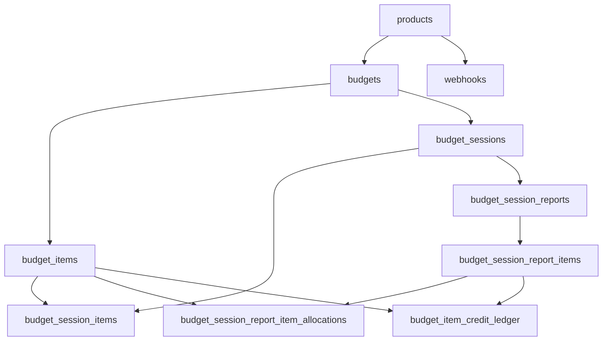

# Budget service database design

Source of truth for DDL: [`migrations/001_init.sql`](../migrations/001_init.sql). API-facing behavior is summarized in [`budget-service-spec.md`](budget-service-spec.md).

This document focuses on **tables**, **relationships**, **constraints**, **triggers**, **history**, and the **credit ledger** model.

---

## Domain overview

- A **product** (`product_key`) registers with the service; **budgets** belong to a product (optional FK for migration flexibility).
- A **budget** owns **budget items** (credit pools with terms: totals, USD-per-credit ratio, renewal, expiry, etc.).
- A **budget session** is an LLM-style spend window on one budget. **Session items** record GoCode USD lines and derived credits while the session is open.
- Closing a session uses a **session report** (one per session): report lines carry USD costs; the service allocates credits to budget items and **persists finalized credit movement** in the **credit ledger** and **report allocations**.
- **Webhooks** are product-scoped URLs for events (e.g. report created).

Live OLTP tables have **no soft-delete column**; deletes **archive** into `*_history` tables first where applicable.

---

## Numeric and type conventions

- Money and credit amounts use **`NUMERIC(20, 6)`** (at most 14 digits left of the decimal point).
- **Credit spend ratio** (`credit_spend_ratio`): USD **per one credit** (same meaning as API `costToCreditRatio`).
- **Credits from USD** (application layer): `internal/credits.DollarsToCredits` — rounding half away from zero at 6 decimal places.

---

## Entity relationships

**Cascade highlights**

- `DELETE budgets` cascades to `budget_items`, `budget_sessions`, and (through sessions) session children.
- `DELETE budget_items` cascades to `budget_item_credit_ledger` and `budget_session_report_item_allocations` (and indirectly anything solely tied through those).

---

## Core tables (live)

### `products`

- **PK:** `product_key` (text, non-empty, max 256 chars).
- **Purpose:** Registered product identity for budgets and webhooks.

### `budgets`

- **PK:** `id` (uuid).
- **FK:** `product_key` → `products(product_key)` (nullable in schema).
- **Purpose:** One customer purchase / budget container.

### `budget_items`

- **PK:** `id` (uuid). **FK:** `budget_id` → `budgets(id)` **ON DELETE CASCADE**.
- **Columns (business-relevant):**
  - `credits_total` — pool size (credits). **CHECK ≥ 0.**
  - `credits_used` — **cached** net credits consumed for this item (**CHECK ≥ 0**). Must stay aligned with the ledger (see triggers).
  - `credit_spend_ratio` — USD per credit. **CHECK > 0.**
  - `expire_at`, `starts_at`, `resets_at`, `renew_interval` — optional term fields. `renew_interval` ∈ `{ DAY, WEEK, MONTH, YEAR }` or null.
- **Consumption order** (application, not a DB constraint): rows with `renew_interval` set first, then `expire_at ASC NULLS LAST`, then `created_at`, `id`. Available credits = `credits_total - credits_used`.

### `budget_sessions`

- **PK:** `id`. **FK:** `budget_id` → `budgets` **CASCADE**.
- **`reconciled_at`:** null while session is open for PATCH spend; set when a report closes the session (unique report per session).

### `budget_session_items`

- **PK:** `id` (bigint, sequence).
- **FKs:** `session_id` → `budget_sessions` **CASCADE**; `budget_item_id` → `budget_items` **ON DELETE SET NULL**.
- **Purpose:** Append-only USD lines (`cost_usd`) and computed `credits_charged` while session is unreconciled. **CHECK:** `cost_usd ≥ 0`.

### `budget_session_reports`

- **PK:** `id`. **FK:** `session_id` → `budget_sessions` **CASCADE**.
- **UNIQUE(`session_id`)** — at most one report per session.

### `budget_session_report_items`

- **PK:** `id` (uuid). **FK:** `report_id` → `budget_session_reports` **CASCADE**.
- **Purpose:** Report lines with `budget_cost`, `product_cost`, `category`. **CHECK:** costs ≥ 0.

### `budget_session_report_item_allocations`

- **PK:** (`report_item_id`, `budget_item_id`).
- **FKs:** to report item and budget item; **ON DELETE CASCADE** on both sides.
- **Purpose:** Snapshot of how many **credits** each report line took from each budget item (`credits_used` column name here means “credits allocated on this report line,” not the item’s running total). **CHECK ≥ 0.**

### `budget_item_credit_ledger`

- **PK:** `id` (uuid). **FK:** `budget_item_id` → `budget_items` **ON DELETE CASCADE**.
- **Optional FK:** `report_item_id` → `budget_session_report_items` **ON DELETE SET NULL** (set for `session_spend` from reconciliation).
- **`entry_kind`:** `session_spend` | `periodic_reset` | `reimbursement`.
- **`credits_delta`:** signed movement applied to the item’s cached `credits_used` via trigger:
  - `session_spend` → **must be > 0**
  - `periodic_reset` | `reimbursement` → **must be < 0**
- **CHECK:** `credits_delta ≠ 0`.
- **Contract:** **Append-only.** Do not `UPDATE` or `DELETE` ledger rows; if you do, `budget_items.credits_used` will **diverge** from `SUM(credits_delta)` for that item. Table comment in SQL states this.

### `webhooks`

- **PK:** `id`. **FK:** `product_key` → `products` **ON DELETE CASCADE**.
- **CHECK:** non-empty trimmed `url`, max length 2048.

---

## Credit ledger vs `budget_items.credits_used`

| Concern | Mechanism |
|--------|-----------|
| **Audit / why credits moved** | Rows in `budget_item_credit_ledger` (`entry_kind`, `credits_delta`, optional `report_item_id`, `created_at`). |
| **Fast read / consumption input** | `budget_items.credits_used` — maintained **only** by the database trigger below (not read-then-write in application code). |
| **Invariant** (when ledger is append-only) | For each `budget_item_id`, `credits_used = SUM(credits_delta)` over all ledger rows for that item. |

**Persisted spend today:** the application inserts into `budget_item_credit_ledger` when finalizing a session report (per allocation chunk). Session PATCH lines do **not** by themselves write the ledger; they only record USD/credits on `budget_session_items` until reconciliation.

**Future writers** (e.g. periodic reset jobs, reimbursements) should **only** insert ledger rows with the appropriate `entry_kind` and `credits_delta`; the trigger keeps `credits_used` consistent for any client connection.

---

## Triggers and functions

### `trg_budget_session_items_check_item_budget` (function + trigger)

- **Trigger:** `BEFORE INSERT OR UPDATE OF budget_item_id, session_id` on `budget_session_items`.
- **Behavior:** If `budget_item_id` is not null, require that the item belongs to the **same budget** as the session and the session is **not** reconciled (`reconciled_at IS NULL`). Otherwise **RAISE EXCEPTION**.
- **Purpose:** Prevent attaching spend lines to the wrong budget’s items or to closed sessions.

### `trg_set_updated_at`

- **Used on:** `budget_sessions`, `budgets`, `products` — `BEFORE UPDATE`, sets `NEW.updated_at = now()`.

### `trg_budget_items_set_updated_at`

- **Trigger:** `BEFORE UPDATE` on `budget_items` (replaces generic `trg_set_updated_at` for this table).
- **Behavior:** If **only** `credits_used` changed (all other compared columns unchanged), **leave `updated_at` unchanged** so ledger-driven bumps do not noise the item’s “definition touched” timestamp. Any other column change → `updated_at := now()`.

### `trg_budget_item_credit_ledger_bump_credits_used`

- **Trigger:** `AFTER INSERT` on `budget_item_credit_ledger`.
- **Behavior:** `UPDATE budget_items SET credits_used = credits_used + NEW.credits_delta WHERE id = NEW.budget_item_id`.
- **Purpose:** Single place that applies credit deltas to the cached total, safe under **multiple DB connections** (atomic row update, serializes on the same `budget_items` row).

**Note:** The bump runs an `UPDATE` on `budget_items`, which fires `trg_budget_items_set_updated_at`; by design that trigger **does not** advance `updated_at` for credits-only changes.

---

## History tables (archive)

History rows are **inserted by application logic** before destructive operations; there are **no** triggers that write `budget_item_history` when `credits_used` changes from the ledger.

### `budget_item_history`

- **Purpose:** Snapshot of a **budget item’s definition and point-in-time `credits_used`** when:
  - The item is **updated** via PATCH / upsert-by-id (prior row copied **before** update), or
  - The item is **deleted** (single-item delete), or
  - The **budget** is deleted (all items copied).
- **Not used for:** every ledger insert — **credit movement history** is `budget_item_credit_ledger`.

### `budgets_history`

- Snapshot of a budget row when the budget is **deleted**.

### `products_history`

- Snapshot when a **product** is **deleted**.

### `webhooks_history`

- Snapshot when a **webhook** is **deleted**; includes `removed_at`.

**FKs:** History tables intentionally **do not** FK back to live rows (IDs are copied as values only), so archives survive after deletes.

---

## Application-enforced delete rules (409-style)

These are implemented in the service layer, not as DB constraints:

- **Delete budget:** rejected if any session has `reconciled_at` null or any session has a report.
- **Delete budget item:** rejected if the item appears in `budget_session_report_item_allocations`.
- **Delete product:** rejected if any budget references the product.

---

## Indexes (summary)

- `budget_items(budget_id)` — list items per budget.
- `budget_sessions(budget_id)` — sessions per budget.
- `budget_session_items(session_id)` — lines per session.
- `budget_session_reports(session_id)` — report by session.
- `budget_session_report_items(report_id)` — lines per report.
- `budget_session_report_item_allocations(budget_item_id)` — reverse lookup for delete guards.
- `budget_item_credit_ledger(budget_item_id)` — ledger by item.
- `budget_item_history(budget_item_id)` — history by item.
- `webhooks(product_key)`, `webhooks(product_key, event_type)` — webhook lookup.
- `webhooks_history(product_key)`.

---

## Migration

Fresh databases load **`001_init.sql`** only (no incremental migration chain in this package). Any environment using an older schema must be migrated separately if introduced later.
