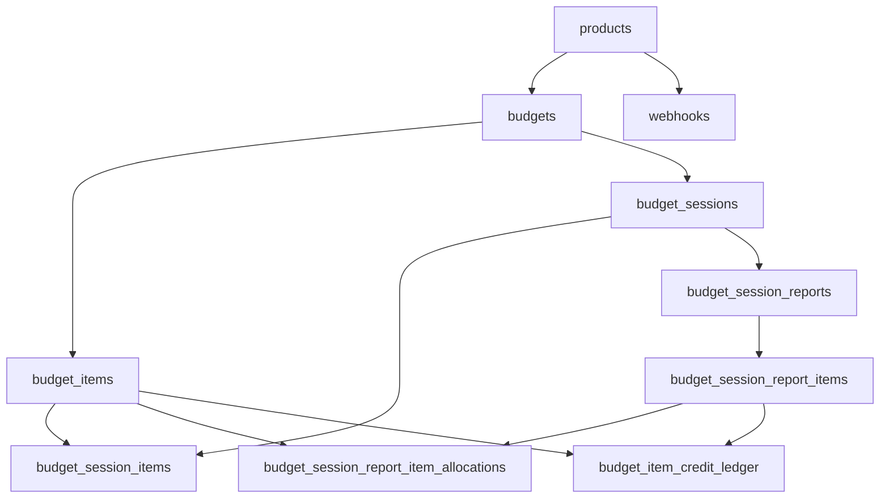

# Budget service database design

Source of truth for DDL: versioned files under [`migrations/`](../migrations/) (golang-migrate), starting with [`000001_init.up.sql`](../migrations/000001_init.up.sql). API-facing behavior is summarized in [`budget-service-spec.md`](budget-service-spec.md).

This document focuses on **tables**, **relationships**, **constraints**, **triggers**, **history**, and the **credit ledger** model.

---

## Domain overview

- A **product** (`product_key`) registers with the service; **budgets** belong to a product (optional FK for migration flexibility).
- A **budget** owns **budget items** (credit pools with terms: totals, USD-per-credit ratio, reset cadence, expiry, etc.).
- A **budget session** is an LLM-style spend window on one budget. **Session items** record GoCode USD lines and derived credits while the session is open.
- Closing a session uses a **session report** (one per session): report lines carry USD costs; the service allocates credits to budget items and **persists finalized credit movement** in the **credit ledger** and **report allocations**.
- Renewable budget items use **hybrid reset handling**: a periodic PostgreSQL job (`pg_cron`) processes due rows in the background, while budget write paths lazily apply due resets inside the same transaction before capacity or consumption decisions.
- **Webhooks** are product-scoped URLs for events (e.g. report created).

Live OLTP tables have **no soft-delete column**; deletes **archive** into `*_history` tables first where applicable.

---

## Numeric and type conventions

- Money and credit amounts use **`NUMERIC(20, 6)`** (at most 14 digits left of the decimal point).
- **Credit spend ratio** (`cost_credit_ratio`): USD **per one credit** (same meaning as API `costToCreditRatio`).
- **Credits from USD** (application layer): `internal/credits.DollarsToCredits` — rounding half away from zero at 6 decimal places.

---

## Entity relationships

**Cascade highlights**

- `DELETE budgets` cascades to `budget_items`, `budget_sessions`, and (through sessions) session children.
- `DELETE budget_items` cascades to `budget_item_credit_ledger` and `budget_session_report_item_allocations` (and indirectly anything solely tied through those).

---

## Core tables (live)

### `products`

- **PK:** `product_key` (text, non-empty, max 256 chars).
- **Purpose:** Registered product identity for budgets and webhooks.

### `budgets`

- **PK:** `id` (uuid).
- **FK:** `product_key` → `products(product_key)` (nullable in schema).
- **Purpose:** One customer purchase / budget container.

### `budget_items`

- **PK:** `id` (uuid). **FK:** `budget_id` → `budgets(id)` **ON DELETE CASCADE**.
- **Columns (business-relevant):**
  - `credits_total` — pool size (credits). **CHECK ≥ 0.**
  - `credits_used` — **cached** net credits consumed for this item (**CHECK ≥ 0**). Must stay aligned with the ledger (see triggers).
  - `cost_credit_ratio` — USD per credit. **CHECK > 0.**
  - `expires_at`, `starts_at`, `resets_at`, `reset_interval` — optional term fields. `reset_interval` matches `^[1-9][0-9]*(d|w|mo|y)$` (examples: `1d`, `2w`, `1mo`, `1y`) or null. When `reset_interval` is set, `resets_at` is the next reset boundary; due rows satisfy `resets_at <= now()`.
- **Consumption order** (application, not a DB constraint): rows with `reset_interval` set first, then `expires_at ASC NULLS LAST`, then `created_at`, `id`. Available credits = `credits_total - credits_used`.

### `budget_sessions`

- **PK:** `id`. **FK:** `budget_id` → `budgets` **CASCADE**.
- **`reconciled_at`:** null while session is open for PATCH spend; set when a report closes the session (unique report per session).

### `budget_session_items`

- **PK:** `id` (bigint, sequence).
- **FKs:** `session_id` → `budget_sessions` **CASCADE**; `budget_item_id` → `budget_items` **ON DELETE SET NULL**.
- **Purpose:** Append-only USD lines (`cost_usd`) and computed `credits_charged` while session is unreconciled. **CHECK:** `cost_usd ≥ 0`.

### `budget_session_reports`

- **PK:** `id`. **FK:** `session_id` → `budget_sessions` **CASCADE**.
- **UNIQUE(`session_id`)** — at most one report per session.

### `budget_session_report_items`

- **PK:** `id` (uuid). **FK:** `report_id` → `budget_session_reports` **CASCADE**.
- **Purpose:** Report lines with `budget_cost`, `product_cost`, `label`. **CHECK:** costs ≥ 0.

### `budget_session_report_item_allocations`

- **PK:** (`report_item_id`, `budget_item_id`).
- **FKs:** to report item and budget item; **ON DELETE CASCADE** on both sides.
- **Purpose:** Snapshot of how many **credits** each report line took from each budget item (`credits_used` column name here means “credits allocated on this report line,” not the item’s running total). **CHECK ≥ 0.**

### `budget_item_credit_ledger`

- **PK:** `id` (uuid). **FK:** `budget_item_id` → `budget_items` **ON DELETE CASCADE**.
- **Optional FK:** `report_item_id` → `budget_session_report_items` **ON DELETE SET NULL** (set for `session_spend` from reconciliation).
- **`entry_kind`:** `session_spend` | `periodic_reset` | `reimbursement`.
- **`credits_delta`:** signed movement applied to the item’s cached `credits_used` via trigger:
  - `session_spend` → **must be > 0**
  - `periodic_reset` | `reimbursement` → **must be < 0**
- **CHECK:** `credits_delta ≠ 0`.
- **Contract:** **Append-only.** Do not `UPDATE` or `DELETE` ledger rows; if you do, `budget_items.credits_used` will **diverge** from `SUM(credits_delta)` for that item. Table comment in SQL states this.

### `webhooks`

- **PK:** `id`. **FK:** `product_key` → `products` **ON DELETE CASCADE**.
- **Timestamps:** `created_at`, `updated_at` (both set on write; soft-delete updates `deleted_at` and `updated_at`).
- **CHECK:** non-empty trimmed `url`, max length 2048.

---

## Credit ledger vs `budget_items.credits_used`

| Concern                                    | Mechanism                                                                                                                  |
| ------------------------------------------ | -------------------------------------------------------------------------------------------------------------------------- |
| **Audit / why credits moved**              | Rows in `budget_item_credit_ledger` (`entry_kind`, `credits_delta`, optional `report_item_id`, `created_at`).              |
| **Fast read / consumption input**          | `budget_items.credits_used` — maintained **only** by the database trigger below (not read-then-write in application code). |
| **Invariant** (when ledger is append-only) | For each `budget_item_id`, `credits_used = SUM(credits_delta)` over all ledger rows for that item.                         |

**Persisted spend today:** the application inserts into `budget_item_credit_ledger` when finalizing a session report (per allocation chunk). Session PATCH lines do **not** by themselves write the ledger; they only record USD/credits on `budget_session_items` until reconciliation.

**Hybrid reset handling:** due resets are applied in two places:

- **Periodic path:** A Go background worker (`internal/worker`) runs on a configurable interval (default 1 minute) and sweeps due rows in batches, delivering `budget-item.reset` webhooks for items that had credits reset.
- **Lazy path:** budget write paths (`CreateBudgetSession`, `AppendSessionItems`, `CreateSessionReport`) call the SQL function `process_due_budget_item_resets` in-transaction for the target budget before checking capacity or consuming credits.

For a due item with `credits_used > 0`, the processor inserts a `periodic_reset` ledger row with `credits_delta = -credits_used`, which brings the cached usage back to zero through the trigger. For a due item already at zero usage, the processor advances `resets_at` without inserting a ledger row.

**Future writers** (e.g. reimbursements) should **only** insert ledger rows with the appropriate `entry_kind` and `credits_delta`; the trigger keeps `credits_used` consistent for any client connection.

---

## Triggers and functions

### `trg_budget_session_items_check_item_budget` (function + trigger)

- **Trigger:** `BEFORE INSERT OR UPDATE OF budget_item_id, session_id` on `budget_session_items`.
- **Behavior:** If `budget_item_id` is not null, require that the item belongs to the **same budget** as the session and the session is **not** reconciled (`reconciled_at IS NULL`). Otherwise **RAISE EXCEPTION**.
- **Purpose:** Prevent attaching spend lines to the wrong budget’s items or to closed sessions.

### `trg_set_updated_at`

- **Used on:** `budget_sessions`, `budgets`, `products` — `BEFORE UPDATE`, sets `NEW.updated_at = now()`.

### `trg_budget_items_set_updated_at`

- **Trigger:** `BEFORE UPDATE` on `budget_items` (replaces generic `trg_set_updated_at` for this table).
- **Behavior:** If **only** `credits_used` changed (all other compared columns unchanged), **leave `updated_at` unchanged** so ledger-driven bumps do not noise the item’s “definition touched” timestamp. Any other column change → `updated_at := now()`.

### `trg_budget_item_credit_ledger_bump_credits_used`

- **Trigger:** `AFTER INSERT` on `budget_item_credit_ledger`.
- **Behavior:** `UPDATE budget_items SET credits_used = credits_used + NEW.credits_delta WHERE id = NEW.budget_item_id`.
- **Purpose:** Single place that applies credit deltas to the cached total, safe under **multiple DB connections** (atomic row update, serializes on the same `budget_items` row).

**Note:** The bump runs an `UPDATE` on `budget_items`, which fires `trg_budget_items_set_updated_at`; by design that trigger **does not** advance `updated_at` for credits-only changes.

### `next_reset_from_interval`, `advance_reset_to_future`, `process_due_budget_item_resets`

- **Defined in:** migration `000004_periodic_resets.up.sql`.
- **Purpose:** implement renewable reset scheduling and execution entirely in SQL.
- **`next_reset_from_interval(base_at, reset_interval)`** — computes the next boundary from compact reset intervals using calendar-aware month/year math.
- **`advance_reset_to_future(reset_at, reset_interval, now_at)`** — repeatedly advances stale boundaries until the returned value is in the future.
- **`process_due_budget_item_resets(target_budget_id, batch_size)`** — selects due rows (`resets_at <= now()`), locks them with `FOR UPDATE SKIP LOCKED`, inserts `periodic_reset` ledger rows when `credits_used > 0`, advances `resets_at`, and returns the processed row count.
- **Scheduler:** The Go background worker (`internal/worker`) calls the equivalent logic via `Store.ProcessDueResetsWithResults()` on a configurable interval. The SQL function remains available for lazy in-transaction catch-up.

---

## Soft-delete (`deleted_at`)

`budgets`, `budget_items`, `products`, and `webhooks` use nullable **`deleted_at`**. Rows are retained so foreign keys to sessions, reports, allocations, and product keys stay valid.

## `budget_items_history` (update audit only)

Rows are **inserted by application logic** immediately before an **`UPDATE budget_items`** from PATCH (batch or single-item; prior row copied). There are **no** triggers that write this table when `credits_used` changes from the ledger. **Soft-delete** of an item or budget does **not** insert here — tombstones use **`deleted_at`** on `budget_items`.

**Credit movement** remains **`budget_item_credit_ledger`** (append-only).

---

## Application-enforced delete rules (409-style)

These are implemented in the service layer, not as DB constraints:

- **Delete budget:** rejected if any session has `reconciled_at` null (open session).
- **Delete budget item:** rejected if any open session exists for that budget.
- **Delete product:** rejected if any **active** budget (`deleted_at` null) references the product.

---

## Indexes (summary)

- `budget_items(budget_id)` — list items per budget.
- `budget_items(resets_at, id) WHERE resets_at IS NOT NULL AND reset_interval IS NOT NULL` — due-reset sweeps.
- `budget_sessions(budget_id)` — sessions per budget.
- `budget_session_items(session_id)` — lines per session.
- `budget_session_reports(session_id)` — report by session.
- `budget_session_report_items(report_id)` — lines per report.
- `budget_session_report_item_allocations(budget_item_id)` — per-report line splits.
- `budget_item_credit_ledger(budget_item_id)` — ledger by item.
- `budget_items_history(budget_item_id)` — prior-row snapshots before item UPDATE.
- `webhooks(product_key)`, `webhooks(product_key, event_type)` — webhook lookup.

---

## Migration

The server applies pending `.up.sql` files on startup (after a successful DB ping) via [golang-migrate](https://github.com/golang-migrate/migrate), using the same `DATABASE_URL` unless `MIGRATE_DATABASE_URL` is set for a DDL-capable role. Applied versions are recorded in **`schema_migrations`**.

Each `.up.sql` file is **one golang-migrate version**; the PostgreSQL driver applies the file as a single migration step (multiple DDL statements in that file are fine as one script). Do **not** enable golang-migrate’s `x-multi-statement` mode for files that contain PL/pgSQL (`$$` bodies): its `;` splitter breaks functions.

Add new files such as `000002_description.up.sql` for schema changes; deploy a new image. Reset processing is introduced by `000004_periodic_resets.up.sql`. The pg_cron extension and scheduled job are created by the migration when pg_cron is available; for local development, the custom Docker image installs pg_cron and [`docker-entrypoint-initdb.d/001_pg_cron.sql`](../docker-entrypoint-initdb.d/001_pg_cron.sql) enables it during container initialization.

### Baseline (legacy databases)

If the database already contains the full schema (e.g. created by an older `001_init.sql` / initdb hook) but **`schema_migrations` is missing or empty**, a blind `Up()` will fail with “already exists”. After verifying the live schema matches `000001_init.up.sql`, mark version **1** without re-running SQL, for example with the migrate CLI:

`migrate -path ./migrations -database "$DATABASE_URL" force 1`

(or insert the equivalent row into `schema_migrations` per golang-migrate’s table format). Use `force` only when the schema truly matches that version.
