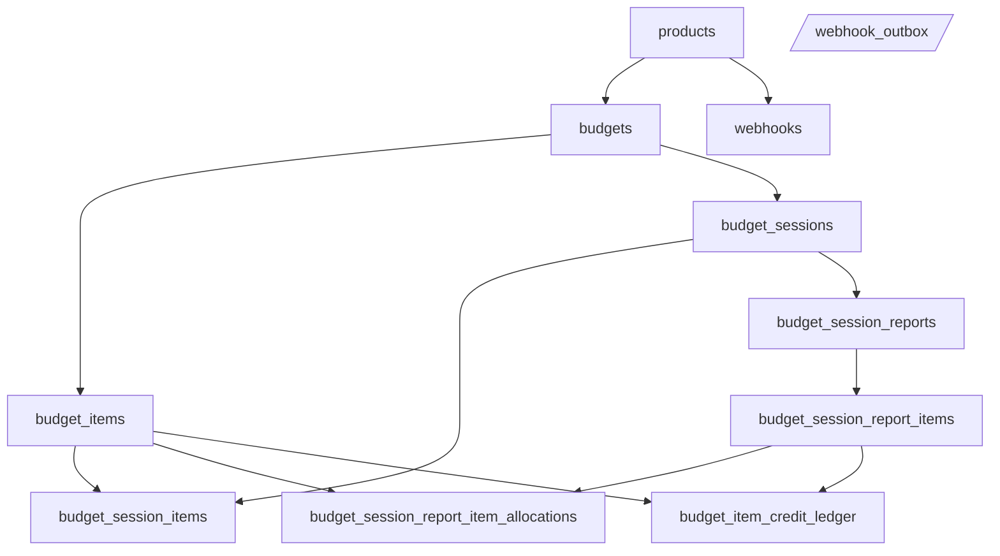

# Database Schema

Reference for the **current** PostgreSQL schema: tables, columns, constraints, triggers, functions, and indexes. The authoritative DDL lives in versioned files under [`migrations/`](../migrations/) (golang-migrate; versions recorded in `schema_migrations`). This document is a human-readable index over those files.

For *why* the schema is shaped this way (ledger model, hybrid resets, soft-delete philosophy, history-table semantics, application-enforced delete rules), see [Database Design](database-design.md).

**Keep this file in sync with migrations.** When you add or modify a migration, update the affected sections here in the same change.

## Entity relationships

**Cascade highlights**

- `DELETE budgets` cascades to `budget_items`, `budget_sessions`, and (through sessions) session children.
- `DELETE budget_items` cascades to `budget_item_credit_ledger` and `budget_session_report_item_allocations` (and indirectly anything solely tied through those).
- `webhook_outbox` (parallelogram) is intentionally drawn unconnected: rows hold `product_key` and `payload` but have **no foreign keys** to other tables, so they survive deletion of the originating entity.

## Core tables (live)

### `products`

- **PK:** `product_key` (text, non-empty, max 256 chars).
- **Soft-delete:** `deleted_at` (nullable). Standard timestamps: `created_at`, `updated_at`.
- **Purpose:** Registered product identity for budgets and webhooks.

### `budgets`

- **PK:** `id` (uuid).
- **FK:** `product_key` → `products(product_key)` (nullable in schema; no `ON DELETE` action — defaults to `NO ACTION`).
- **Soft-delete:** `deleted_at` (nullable). Standard timestamps: `created_at`, `updated_at`.
- **Purpose:** One customer purchase / budget container.

### `budget_items`

- **PK:** `id` (uuid). **FK:** `budget_id` → `budgets(id)` **ON DELETE CASCADE**.
- **Soft-delete:** `deleted_at` (nullable). Soft-deleted items are filtered out by the session-item insert trigger and by the periodic-reset worker.
- **Columns (business-relevant):**
  - `credits_total` — pool size (credits). **CHECK ≥ 0.**
  - `credits_used` — **cached** net credits consumed for this item (**CHECK ≥ 0**). Must stay aligned with the ledger (see triggers).
  - `cost_credit_ratio` — USD per credit. **CHECK > 0.**
  - `label` — optional human-readable label (nullable text).
  - `expires_at`, `starts_at`, `resets_at`, `reset_interval` — optional term fields. `reset_interval` matches `^[1-9][0-9]*(d|w|mo|y)$` (examples: `1d`, `2w`, `1mo`, `1y`) or null. When `reset_interval` is set, `resets_at` is the next reset boundary; due rows satisfy `resets_at <= now()`.
  - `expiration_notified_at` — set by the worker once an `item.expired` webhook has been queued for this item, so each expiration fires at most once.
- **Consumption order** (application, not a DB constraint): rows with `reset_interval` set first, then `expires_at ASC NULLS LAST`, then `created_at`, `id`. Available credits = `credits_total - credits_used`.

### `budget_sessions`

- **PK:** `id`. **FK:** `budget_id` → `budgets` **CASCADE**.
- **`reconciled_at`:** null while session is open for PATCH spend; set when a report closes the session (unique report per session).
- **`metadata`:** opaque `jsonb` for application-defined session context (no DB-level constraints).

### `budget_session_items`

- **PK:** `id` (bigint, sequence).
- **FKs:** `session_id` → `budget_sessions` **CASCADE**; `budget_item_id` → `budget_items` **ON DELETE SET NULL**.
- **Purpose:** Append-only USD lines (`cost_usd`) and computed `credits_charged` while session is unreconciled. **CHECK:** `cost_usd ≥ 0`; `char_length(call_request_id) BETWEEN 1 AND 256`.

### `budget_session_reports`

- **PK:** `id`. **FK:** `session_id` → `budget_sessions` **CASCADE**.
- **UNIQUE(`session_id`)** — at most one report per session.

### `budget_session_report_items`

- **PK:** `id` (uuid). **FK:** `report_id` → `budget_session_reports` **CASCADE**.
- **Purpose:** Report lines with `budget_cost`, `product_cost`, `label`. **CHECK:** costs ≥ 0.

### `budget_session_report_item_allocations`

- **PK:** (`report_item_id`, `budget_item_id`).
- **FKs:** to report item and budget item; **ON DELETE CASCADE** on both sides.
- **Purpose:** Snapshot of how many **credits** each report line took from each budget item (`credits_used` column name here means "credits allocated on this report line," not the item's running total). **CHECK ≥ 0.**

### `budget_item_credit_ledger`

- **PK:** `id` (uuid). **FK:** `budget_item_id` → `budget_items` **ON DELETE CASCADE**.
- **Optional FK:** `report_item_id` → `budget_session_report_items` **ON DELETE SET NULL** (set for `session_spend` from reconciliation).
- **`entry_kind`:** `initial_spend` | `session_spend` | `periodic_reset` | `reimbursement` | `upgrade` | `downgrade`.
- **`credits_delta`:** signed movement applied to the item's cached `credits_used` via trigger:
  - `session_spend` | `initial_spend` → **must be > 0**
  - `periodic_reset` | `reimbursement` → **must be < 0**
  - `upgrade` | `downgrade` → **any non-zero value** (positive or negative; these are reason labels for plan-tier changes, not direction indicators)
- **CHECK:** `credits_delta ≠ 0`.
- **Contract:** **Append-only.** Do not `UPDATE` or `DELETE` ledger rows; if you do, `budget_items.credits_used` will **diverge** from `SUM(credits_delta)` for that item. Table comment in SQL states this.

### `webhooks`

- **PK:** `id`. **FK:** `product_key` → `products` **ON DELETE CASCADE**.
- **Timestamps:** `created_at`, `updated_at` (both set on write; soft-delete updates `deleted_at` and `updated_at`).
- **CHECK:** non-empty trimmed `url`, max length 2048.

### `webhook_outbox`

- **PK:** `id` (uuid). **No FKs** to other tables (decoupled for asynchronous delivery).
- **Columns:** `event_type`, `product_key`, `payload` (jsonb), `status` (`pending` | `processing` | `completed` | `failed`, default `pending`), `attempt_count` (default 0), `last_attempt_at`, `next_attempt_at` (default `now()`), `last_error`, `idempotency_key` (text, **UNIQUE**, e.g. `reset:{itemId}:{resetsAt}`), `created_at`, `processed_at`.
- **Purpose:** Durable queue for outbound webhook delivery (payload, retries, status). See [Webhooks](webhooks.md).

### `budget_items_history`

- **PK:** `history_id` (uuid, default `gen_random_uuid()`).
- **`budget_item_id`** column links rows back to `budget_items` but is **not a foreign key** — there is no FK constraint, so history rows survive item deletion.
- **Purpose:** Prior-row snapshots inserted by application logic immediately before a `PATCH`-driven `UPDATE budget_items`. No trigger writes this table. Soft-delete does **not** insert here.

## Triggers and functions

### `trg_budget_session_items_check_item_budget` (function + trigger)

- **Trigger:** `BEFORE INSERT OR UPDATE OF budget_item_id, session_id` on `budget_session_items`.
- **Behavior:** If `budget_item_id` is not null, require that the item belongs to the **same budget** as the session, the session is **not** reconciled (`reconciled_at IS NULL`), and the item is **not** soft-deleted (`deleted_at IS NULL`). Otherwise **RAISE EXCEPTION**.

### `trg_set_updated_at`

- **Used on:** `budget_sessions`, `budgets`, `products` — `BEFORE UPDATE`, sets `NEW.updated_at = now()`. (Not attached to `webhooks`; that table's `updated_at` is set in application code.)

### `trg_budget_items_set_updated_at`

- **Trigger:** `BEFORE UPDATE` on `budget_items` (replaces generic `trg_set_updated_at` for this table).
- **Behavior:** If **only** `credits_used` changed (all other compared columns unchanged), **leave `updated_at` unchanged** so ledger-driven bumps do not noise the item's "definition touched" timestamp. Any other column change → `updated_at := now()`.

### `trg_budget_item_credit_ledger_bump_credits_used`

- **Trigger:** `AFTER INSERT` on `budget_item_credit_ledger`.
- **Behavior:** `UPDATE budget_items SET credits_used = credits_used + NEW.credits_delta WHERE id = NEW.budget_item_id`.
- **Note:** This `UPDATE` fires `trg_budget_items_set_updated_at`; by design that trigger does not advance `updated_at` for credits-only changes.

### `next_reset_from_interval`, `advance_reset_to_future`, `process_due_budget_item_resets`

- **Defined in:** migration `000004_periodic_resets.up.sql`.
- **`next_reset_from_interval(base_at, reset_interval)`** — computes the next boundary from compact reset intervals using calendar-aware month/year math.
- **`advance_reset_to_future(reset_at, reset_interval, now_at)`** — repeatedly advances stale boundaries until the returned value is in the future.
- **`process_due_budget_item_resets(target_budget_id, batch_size)`** — selects due rows (`resets_at <= now()`), locks them with `FOR UPDATE SKIP LOCKED`, inserts `periodic_reset` ledger rows when `credits_used > 0`, advances `resets_at`, and returns the processed row count.

## Indexes (summary)

- `budget_items(budget_id)` — list items per budget.
- `budget_items(resets_at, id) WHERE resets_at IS NOT NULL AND reset_interval IS NOT NULL` — due-reset sweeps.
- `budget_items(expires_at) WHERE expires_at IS NOT NULL AND expiration_notified_at IS NULL AND deleted_at IS NULL` — pending-expiration sweep used by the worker to queue `item.expired` webhooks.
- `budgets(product_key)` — list budgets for a product (`GET /api/v1/reports?productKey=…`).
- `budget_sessions(budget_id)` — sessions per budget.
- `budget_session_items(session_id)` — lines per session. (Also `UNIQUE (session_id, call_request_id)` for idempotent spend.)
- `budget_session_reports(session_id)` — served by the UNIQUE constraint on `session_id`.
- `budget_session_reports(created_at, id)` — list ordering for `GET /api/v1/reports`.
- `budget_session_report_items(report_id)` — lines per report.
- `budget_session_report_items(label)` — speeds aggregates filtered by label (`GET /api/v1/reports/aggregate?label=…`).
- `budget_session_report_item_allocations(budget_item_id)` — per-report line splits.
- `budget_item_credit_ledger(budget_item_id)` — ledger by item.
- `budget_items_history(budget_item_id)` — prior-row snapshots before item UPDATE.
- `webhooks(product_key, event_type)` — webhook lookup; the composite also serves `product_key`-only queries.
- `webhook_outbox(next_attempt_at) WHERE status IN ('pending', 'processing')` — outbox draining.
- `webhook_outbox(idempotency_key)` — provided by the `UNIQUE` constraint; prevents duplicate enqueues.
