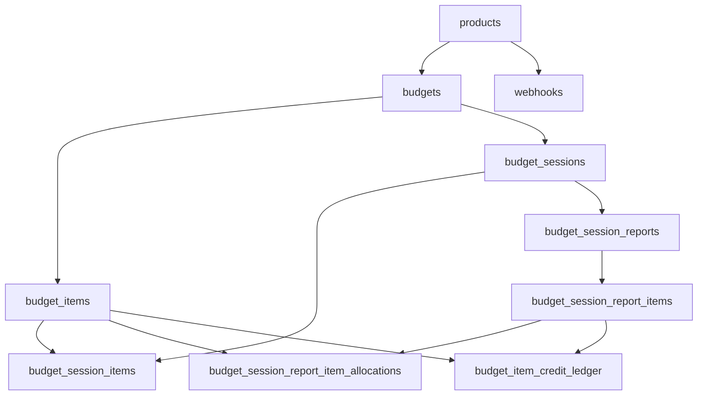

# budget-service database schema (summary)

Orientation for security and architecture reviewers. **Authoritative DDL** lives in versioned migrations under [`migrations/`](../migrations/) (golang-migrate; versions recorded in `schema_migrations`). **Full** table/column/trigger documentation is in [database-design.md](database-design.md).

## Entity relationships

Same high-level model as the detailed doc (see diagram there to avoid drift):

`webhook_outbox` is not shown above: it has **no foreign key** to other tables; rows hold `product_key` and `payload` for asynchronous delivery (see migrations).

## Table inventory

**Core OLTP**

| Table | Role |
| ----- | ---- |
| `products` | Product keys for budgets and webhooks. |
| `budgets` | Budget containers; optional `product_key` FK. |
| `budget_items` | Credit pools, ratios, resets, expiry; soft-delete via `deleted_at`. |
| `budget_sessions` | Spend windows; `reconciled_at` when closed. |
| `budget_session_items` | USD lines and derived credits while session open. |
| `budget_session_reports` | One report per session (reconciliation). |
| `budget_session_report_items` | Report lines (`budget_cost`, `product_cost`, `label`). |
| `budget_session_report_item_allocations` | Per-line credit allocation to items. |
| `budget_item_credit_ledger` | Append-only credit movements (`entry_kind`, `credits_delta`). |
| `webhooks` | Registered callback URLs per product/event; soft-delete. |
| `webhook_outbox` | Durable queue for outbound webhook delivery (payload, retries, status). |

**History / audit**

| Table | Role |
| ----- | ---- |
| `budget_items_history` | Prior row copies before certain `budget_items` updates (application-inserted). |

## Sensitive or business-meaningful data

- **Money and credits:** `NUMERIC(20,6)` columns and API-aligned string amounts—financial/usage sensitive.
- **Session `metadata`:** JSON from clients; treat as potentially sensitive or PII depending on upstream usage.
- **Webhook `url`:** Callback targets; sensitive for abuse if disclosed.
- **Identifiers:** UUIDs for budgets, sessions, reports—knowledge of id enables API access when combined with a valid service JWT (see [threat-model.md](threat-model.md)).

Encryption at rest and network path for PostgreSQL are **platform** concerns (not configured in application code beyond TLS to the DB URL if used).

## Related documents

- [Database design](database-design.md) — constraints, triggers, reset/ledger behavior, migration notes.
- [budget-service-spec.md](budget-service-spec.md) — API behavior vs schema.
- [Endpoint data flow](endpoint-data-flow.md) — which endpoints touch which tables.
