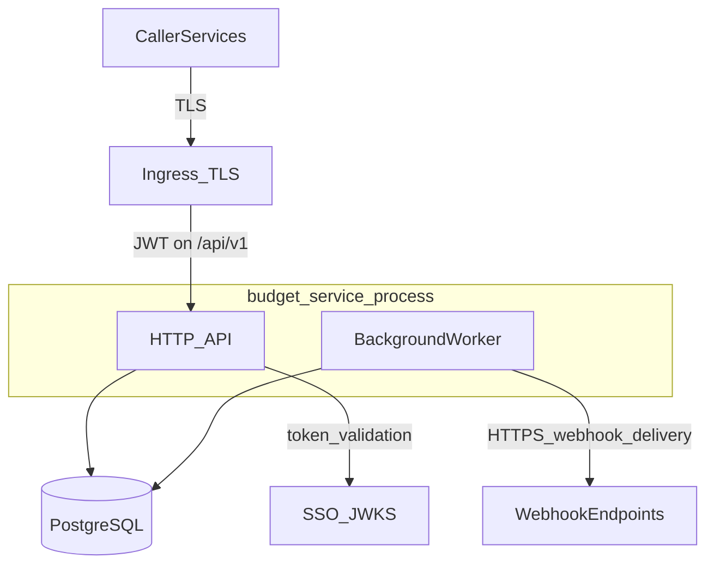

# budget-service architecture (overview)

Single-process Go service: HTTP server (Gorilla mux), optional TLS, PostgreSQL store, and an in-process **background worker** for periodic budget-item maintenance and **webhook outbox** delivery. JWT validation uses **GoDaddy SSO** via `gd-auth-lib` (`SSO_HOST`).

Deployment is described in [devops.md](devops.md) (Katana, artifacts, Kibana). The diagram below is logical—not a physical network map.

## Context diagram

`webhook_outbox` and all OLTP tables live **inside** PostgreSQL; the API inserts outbox rows in transactions, and the worker drains them.

**Notes**

- **OpenAPI** (`/openapi.yaml`, `/swagger/`) and **`/health`** are served by the same mux **without** JWT; **`/api/v1/*`** applies authentication middleware (see [README](../README.md)).
- The **worker** shares the process and DB with the API; it drains `webhook_outbox`, processes due resets/expirations per [webhooks.md](webhooks.md), and POSTs to registered URLs.

## Related documents

- [Threat model](threat-model.md)
- [Endpoint data flow](endpoint-data-flow.md)
- [Database schema summary](database-schema.md)
