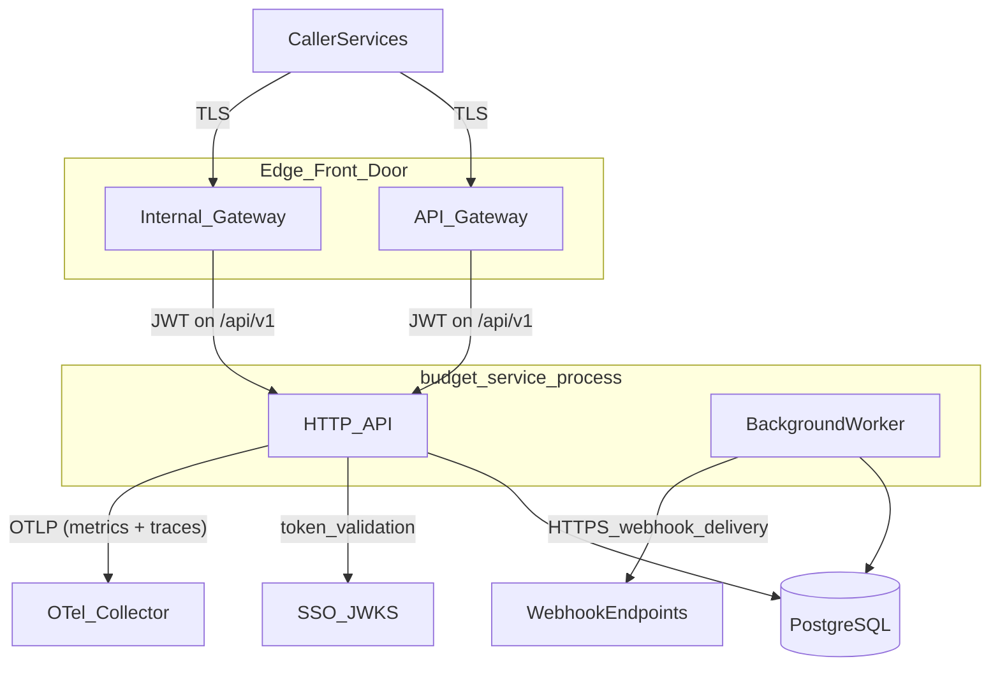
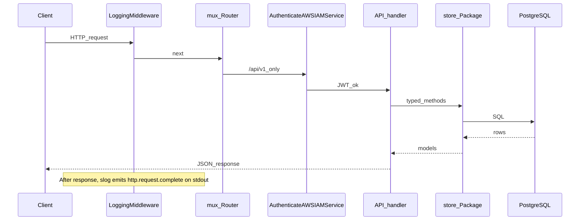
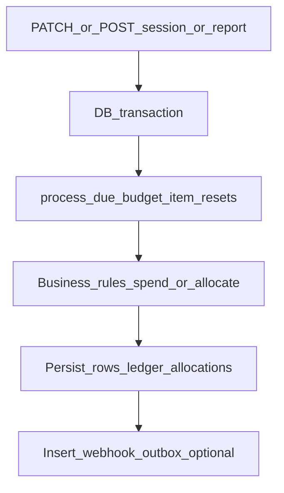
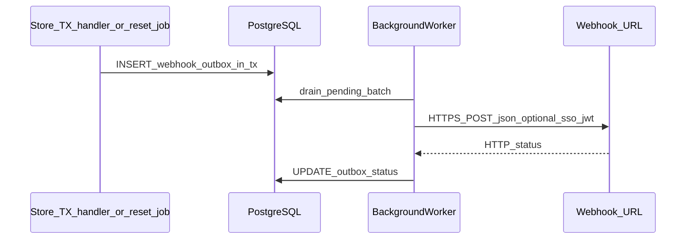

# Service Architecture

Single-process Go service: HTTP server (Gorilla mux), optional TLS, PostgreSQL store, and an in-process **background worker** for periodic budget-item maintenance and **webhook outbox** delivery.
JWT validation uses GoDaddy SSO via [gd-auth-lib](https://github.com/gdcorp-identity/gd-auth-lib/tree/main/go/gd_auth_lib) (`SSO_HOST`).

Deployment (Katana, artifacts, Kibana) is in [DevOps](devops.md). API behavior and numeric rules are in [Budget Service Spec](budget-service-spec.md). The diagrams below are logical, not a physical network map.

## Context

`webhook_outbox` and all OLTP tables live inside PostgreSQL; the API inserts outbox rows in transactions, and the worker drains them. `/openapi.yaml`, `/swagger/`, and `/health` are served by the same mux without JWT; `/api/v1/*` applies authentication middleware.

## Edge Front Door (EFD)

Public traffic does not reach the service directly. [Edge Front Door](https://github.com/gdcorp-engineering/frontdoor-config) (Envoy-based) terminates TLS, applies per-route RBAC, and proxies to the Katana upstream. budget-service is fronted by two virtual hosts that target the same upstream but serve different caller populations:

| Gateway              | Hostname (prod)                      | Purpose                                                                                                                                             | Per-route filters                         |
|----------------------|--------------------------------------|-----------------------------------------------------------------------------------------------------------------------------------------------------|-------------------------------------------|
| **API Gateway**      | `bms.api.int.godaddy.com`            | Entry point for callers in GCN-MAH (the hosting network where customer workloads run — treated as close-to-internet). Restricted by CIDR allowlist. | `authz-noauth` + `rbac-allowlist-gcn-mah` |
| **Internal Gateway** | `budget-service.api.int.godaddy.com` | Service-to-service calls from the trusted internal GoDaddy network. No IP filter — internal callers route here.                                     | `authz-noauth`                            |

`/health` is exempt from the RBAC filter on both gateways so Katana liveness probes succeed. JWT validation is enforced by the service itself via [gd-auth-lib](https://github.com/gdcorp-identity/gd-auth-lib) (`authz-noauth` disables EFD's authz filter — the edge does not validate tokens). Both gateways forward to the same Katana upstream (`airobuilde-budget-service-{env}.airobuilde-{env}.prod.onkatana.net`).

Config lives in [Edge Front Door](https://github.com/gdcorp-engineering/frontdoor-config):

- API Gateway: `config/gateway/{development,test,production}/budget-service/config.yml`
- Internal Gateway: `config/internal-gateway/{development,test,production}/budget-service/config.yml`

## Request flow

The router applies logging around the entire mux (`internal/api/middleware.go`); `/api/v1` routes are individually wrapped with one of two JWT middlewares (`internal/api/routes.go`): `AuthenticateAWSIAMService` (default; accepts IAM, Cert, or Cert2S service tokens via `Authorization: Bearer` / `sso-jwt`) or `AuthenticateShopperOrService` (the same service tokens plus a Shopper JWT, `typ=idp`, delivered via `Authorization` header or the `auth_idp` cookie — header wins when both are present; used today only by `GET /api/v1/budgets/{budgetId}`). When `AUTH_ALLOWED_ROLES` or `AUTH_ALLOWED_CERTS` is configured, the middleware additionally checks the caller's IAM ARN or cert CommonName against the respective allowlist after token validation (403 if not matched). Shopper tokens are accepted without an allowlist check.

Unauthenticated paths (`/health`, `/openapi.yaml`, `/swagger/`) skip auth but still pass through logging. Access logs are structured JSON on stdout, not an extra HTTP response.

## Write path with lazy resets

Session spend (`PATCH` session), report creation, and reset processing call into the store, which may invoke `process_due_budget_item_resets` in the same transaction before capacity checks or allocation. Those code paths may enqueue `webhook_outbox` rows (`report.created`, `budget-item.exhausted`, `budget-item.reset`, `budget-item.expired`). Successful report finalization writes ledger rows and usually `report.created` outbox events.

## Webhook delivery (async)

Store methods running inside HTTP handlers or reset/expiration processing insert into `webhook_outbox` in the same transaction as the business write. The background worker (`internal/worker`) drains the outbox and delivers by calling `Server.DeliverEventWebhooks`, which POSTs JSON to each registered URL. When JWT auth is enabled, outbound requests set `Authorization: sso-jwt` with a generated service token (no outbound auth header when `LOCAL_AUTH_DISABLE=true`). Retries and payload shape: [Webhooks](webhooks.md).

## Endpoint to persistence

| Area | Methods / path pattern | Primary persistence |
| ---- | ------------------------ | ------------------- |
| Health | `GET/HEAD /health` | Optional DB ping |
| OpenAPI | `GET /openapi.yaml`, `/swagger/*` | None |
| Auth probe | `GET /api/v1/auth-check` (header service tokens or `auth_idp` cookie shopper token) | None |
| Products | `GET/POST /api/v1/products`, `DELETE .../products/{productKey}` | `products` |
| Webhooks | `GET/POST /api/v1/webhooks`, `GET/DELETE .../webhooks/{webhookId}` | `webhooks` |
| Budgets | `POST /api/v1/budgets`, `GET/PATCH/DELETE .../budgets/{budgetId}` | `budgets`, `budget_items` |
| Budget items | `POST .../budget-items`, `GET/PATCH/DELETE .../budget-items/{budgetItemId}` | `budget_items`, `budget_items_history` on some updates |
| Sessions | `POST /api/v1/sessions`, `GET/PATCH .../sessions/{sessionId}` | `budget_sessions`, `budget_session_items`; may enqueue `webhook_outbox` |
| Reports | `POST/GET .../sessions/{sessionId}/reports[...]`, `GET /api/v1/reports` | `budget_session_reports`, `budget_session_report_items`, allocations, `budget_item_credit_ledger`, `webhook_outbox` |

Exact columns and constraints: [Database Schema](database-schema.md). Machine-readable paths: [`internal/openapi/openapi.yaml`](../internal/openapi/openapi.yaml).
