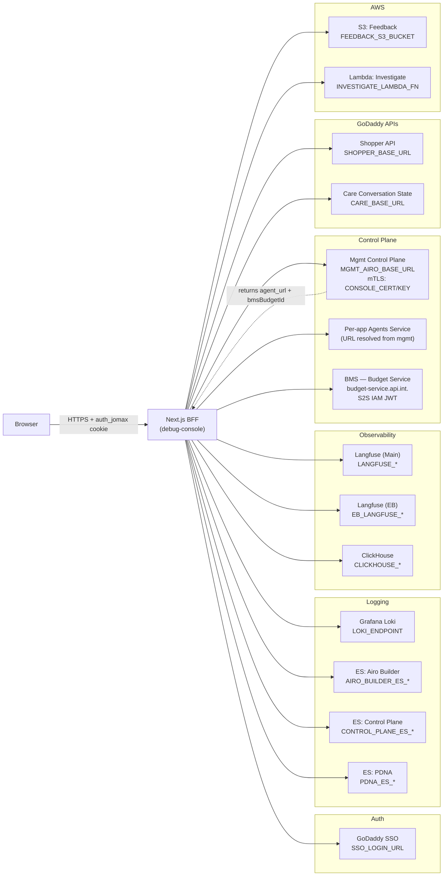
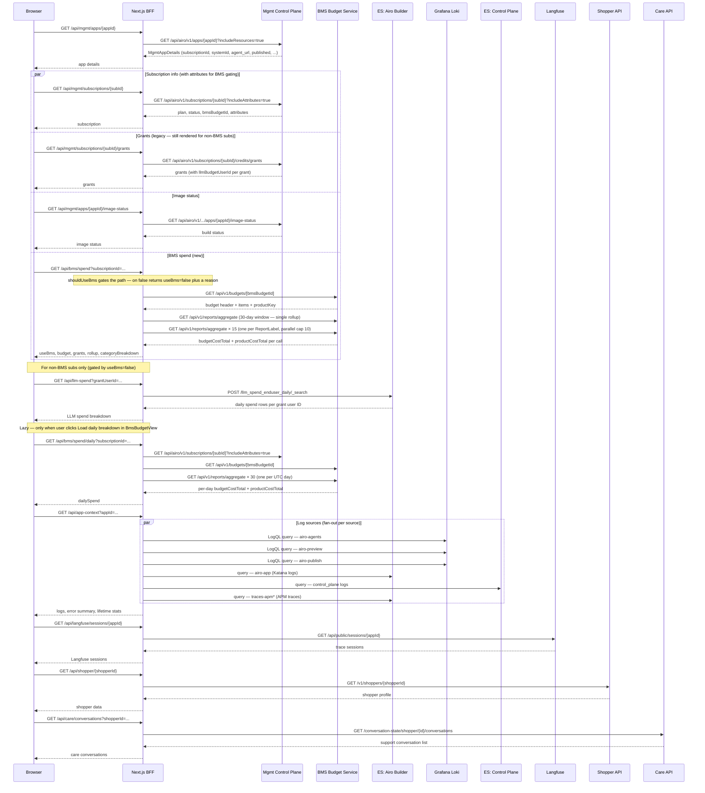
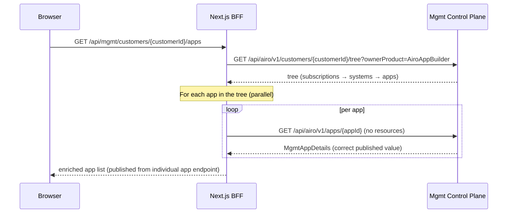
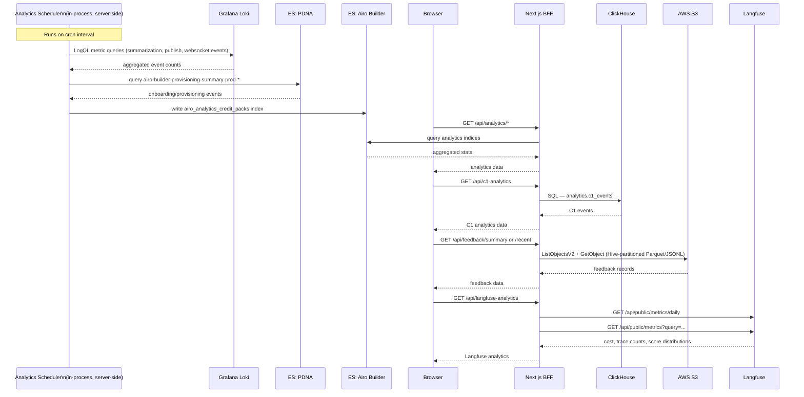
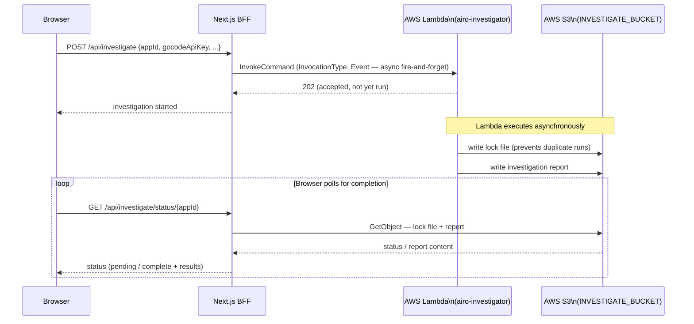
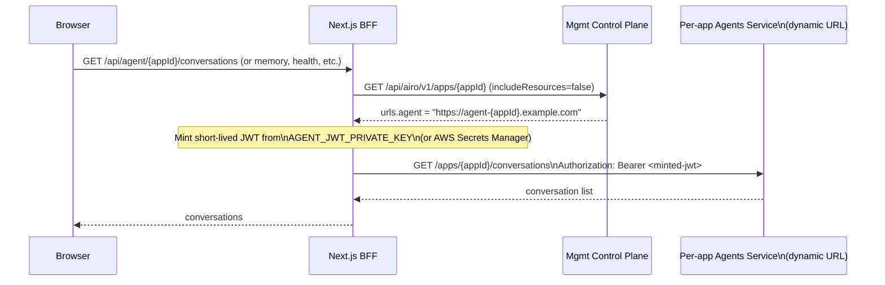
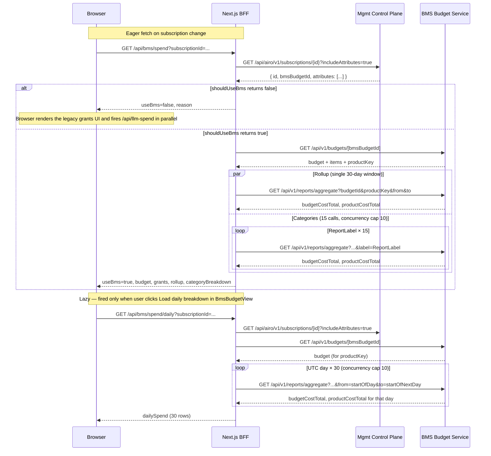

# debug-console — Architecture & External Interfaces

## Overview

An internal Next.js + Express dashboard for the Airo Builder dev team (~10–20 engineers). It is **not customer-facing**. It aggregates data from many backend systems into a single place for debugging, analytics, and support. The app runs behind GoDaddy SSO and is deployed as a Katana service.

**Tech Stack:** Next.js 14 App Router, TypeScript, React, Recharts (charts), Tailwind CSS, `@elastic/elasticsearch` client, AWS SDK (S3, Lambda), `gd-auth-client` (GoDaddy certificate auth), `@airo/ai-lib/budget` `BudgetServiceClient` (S2S IAM JWT auth to BMS).

---

## Directory Structure

```
debug-console/
├── src/app/              # Next.js App Router pages + API routes
│   ├── api/              # ~30 BFF API routes (proxies to external services)
│   ├── analytics/        # Analytics dashboard page
│   ├── apps/             # App-level management pages (credit packs)
│   ├── image-search/     # Image search test page
│   ├── investigate/      # AI investigation trigger page
│   └── status/           # Service status page
├── src/components/       # React panel components (logs, Langfuse, care, etc.)
├── src/lib/              # Server-side clients and helpers
│   ├── analytics/        # Loki metrics + Katana ES events + PDNA ES client
│   ├── investigate/      # AWS Lambda + S3 state for the investigate feature
│   └── *.ts              # Individual service clients (Langfuse, ClickHouse, etc.)
└── server.ts             # Custom Express HTTPS server (SSO requires TLS)
```

---

## External Interfaces & Data Fetched

### 1. Grafana Loki (`LOKI_ENDPOINT` + `LOKI_API_KEY`)
- **Endpoint:** `{LOKI_ENDPOINT}/loki/api/v1/query_range`
- **Auth:** `Authorization: Bearer <LOKI_API_KEY>`
- **Data fetched:**
  - Live log streams from `airo-agents`, `airo-preview`, `airo-publish` (filtered by `job`, `env` labels, and `app_id` in log line)
  - Analytics metric queries: count of summarization events, publish events (`route.publish.*`), WebSocket errors — aggregated by day/hour using LogQL metric queries
- **Used by:** `LogsPanel`, analytics pipeline, `/api/es-logs` route (when `backendType=loki`)

### 2. Elasticsearch — Airo Builder cluster (`AIRO_BUILDER_ES_ENDPOINT` + `AIRO_BUILDER_ES_API_KEY`)
- **Endpoint:** REST API (`https://airobuilde-*.es.us-west-2.aws.found.io:9243`)
- **Auth:** `ApiKey` header
- **Data fetched:**
  - `airo-app` logs (UI/BFF service logs; Katana client errors)
  - `traces-apm*` APM traces
  - Analytics write target: `airo_analytics_credit_packs` index (credit pack add history)
- **Used by:** `/api/es-logs` (for `airo-app`, `apm` sources), `es-client.ts` write path

### 3. Elasticsearch — Control Plane cluster (`CONTROL_PLANE_ES_ENDPOINT`)
- **Data fetched:** `control_plane` service logs
- **Used by:** `/api/es-logs` (when `source=control_plane`)

### 4. Elasticsearch — PDNA cluster (`PDNA_ES_ENDPOINT`)
- **Index:** `airo-builder-provisioning-summary-prod-*`
- **Data fetched:** Provisioning/onboarding summary events
- **Used by:** analytics pipeline (`pdna-client.ts`)

### 5. Langfuse — Airo instance (`LANGFUSE_BASE_URL`, `LANGFUSE_PUBLIC_KEY`, `LANGFUSE_SECRET_KEY`)
- **Endpoint:** `{LANGFUSE_BASE_URL}/api/public/*`
- **Auth:** HTTP Basic (`public:secret`)
- **Data fetched:**
  - `/api/public/sessions/{userId}` — agent trace sessions by user
  - `/api/public/traces` — trace list with filters
  - `/api/public/scores` — evaluation scores (`tool-error-eval`)
  - `/api/public/metrics/daily` — daily cost/trace counts by model
  - `/api/public/metrics?query=...` — categorical score metrics (sentiment, emotion, action intent, verticals, latency percentiles)
- **Used by:** `LangfusePanel`, `LangfuseInsightsPanel`, `/api/langfuse/*`, `/api/langfuse-analytics`

### 6. Langfuse — EB (Engineering Bridge) instance (`EB_LANGFUSE_BASE_URL`, `EB_LANGFUSE_*_KEY`)
- Same API surface as above, separate deployment
- **Used by:** `LangfuseEbPanel`, `/api/eb-langfuse/sessions/[appId]`

### 7. ClickHouse / C1 Analytics (`CLICKHOUSE_HOST`, `CLICKHOUSE_USER`, `CLICKHOUSE_PASSWORD`)
- **Endpoint:** `{CLICKHOUSE_HOST}/?default_format=JSON`
- **Auth:** HTTP Basic
- **Data fetched:** `analytics.c1_events` table — C1 (customer experience) analytics events
- **Used by:** `C1AnalyticsPanel`, `/api/c1-analytics`

### 8. AWS S3 — Customer Feedback (`FEEDBACK_S3_BUCKET`)
- **SDK:** `@aws-sdk/client-s3`
- **Bucket layout:** Hive-partitioned `airo_builder_feedback_cln/year=/month=/day=/`
- **File formats:** `.json`, `.jsonl`, `.ndjson`, `.parquet`
- **Data fetched:** Customer feedback records with `feedback_text`, `rating`, `feedback_utc_ts`
- **Used by:** `FeedbackAnalyticsPanel`, `/api/feedback/summary`, `/api/feedback/recent`

### 9. AWS Lambda — Investigate (`INVESTIGATE_LAMBDA_FN`, `INVESTIGATE_BUCKET`)
- **SDK:** `@aws-sdk/client-lambda` (async invoke, `InvocationType: Event`)
- **Function:** `airo-investigator-dev/prod` — runs the investigate-feedback Claude CLI skill
- **State in S3:** `INVESTIGATE_BUCKET` stores investigation reports and lock files
- **Used by:** `/investigate` page, `/api/investigate` routes

### 10. Mgmt Airo Control Plane (`MGMT_AIRO_BASE_URL`, `CONSOLE_CERT`, `CONSOLE_KEY`)
- **Hosts:** `https://mgmt.nstk.net` (test) / `https://mgmt.woosaas.godaddy.com` (prod)
- **Auth:** mTLS certificate → GoDaddy SSO JWT (`sso-jwt <token>`) via `gd-auth-client`

| Endpoint | Data |
|----------|------|
| `GET /api/airo/v1/apps/{appId}` | App details, URLs (including `agent_url`), resources |
| `GET /api/airo/v1/customers/{customerId}/tree` | All apps for a customer (subscriptions → systems → apps) |
| `GET /api/airo/v1/subscriptions/{id}` | Subscription details |
| `GET /api/airo/v1/subscriptions/{id}?includeAttributes=true` | Subscription details + `attributes[]` (incl. `bms-migration` attribute) and `bmsBudgetId` — used by `/api/bms/spend` to gate BMS vs legacy |
| `GET /api/airo/v1/subscriptions/{id}/credits/grants` | Legacy credit grants — used as the fallback for non-BMS subs |
| `POST /api/airo/v1/subscriptions/{id}/credits/grants` | Add a credit grant |
| `GET /api/airo/v1/.../apps/{appId}/image-status` | Container image build status |
| `POST /api/airo/v1/.../apps/{appId}/reload` | Trigger app reload |
| `GET /api/airo/v1/.../apps/{appId}/domain-error` | Domain configuration errors |

### 11. BMS — Budget Management Service (`BUDGET_SERVICE_URL` override or derived from request hostname)
- **URL pattern:** `https://budget-service.api.int.{rootDomain}` (e.g. `…test-godaddy.com`). `BUDGET_SERVICE_URL` env var overrides for local dev.
- **Auth:** `Authorization: Bearer <S2S IAM JWT>` minted via `@airo/ai-lib`'s `getS2SToken` (gd-auth-client `IamTokenClient`). The minted role must be in BMS's `AUTH_ALLOWED_ROLES` allowlist; deployed debug-console runs under its Katana ECS task role, locally `AWS_PROFILE=airobuild-dev-private-sso` is allowlisted by the test BMS instance.
- **Client:** `BudgetServiceClient` from `@airo/ai-lib/budget` (used directly — no port). Token + read timeouts bumped on the local client (`tokenTimeoutMs: 10s`, `getBudgetTimeoutMs: 8s`) to absorb cold-start AWS SSO mints.
- **Endpoints used (read-only):**

| Endpoint | Data |
|----------|------|
| `GET /api/v1/budgets/{budgetId}` | Budget header (`creditsTotal` / `creditsUsed` / `creditsPending`), `productKey`, `items[]` for the per-grant rows |
| `GET /api/v1/reports/aggregate?budgetId&productKey&label?&from&to` | Sum of `budgetCost` and `productCost` for one half-open `[from, to)` window. Used for both the 30-day rollup and the 15 per-`ReportLabel` category rollups. Daily drill-down fans out 30 of these on user request. |

- **Used by:** `/api/bms/spend` (default panel data) and `/api/bms/spend/daily` (lazy, triggered by the "Load daily breakdown" button in `BmsBudgetView`).
- **Gating helper:** `lib/bms-migration.ts` — `shouldUseBms(subscription)` returns `useBms: false` when there's no `bmsBudgetId` or when the `bms-migration` attribute exists with `migrationDate: null`. Internal admin view, no flag-gating; non-BMS subs fall back to the legacy grants UI.

### 12. Per-app Agents Service (dynamic URL from mgmt)
- **Auth:** Short-lived JWT minted from `AGENT_JWT_PRIVATE_KEY` (or AWS Secrets Manager `JWT_SECRETS_NAME`), or forwarded JOMAX cookie
- **URL resolution:** Control plane `GET /api/airo/v1/apps/{appId}` → `urls.agent`

| Endpoint | Data |
|----------|------|
| `GET /apps/{id}/conversations` | Conversation list for an app |
| `GET /apps/{id}/conversations/{convId}` | Full conversation detail (messages, tool calls) |
| `GET /diagnostics/conversations/export` | Conversation export stream (zip) |
| `GET /diagnostics/memory/{appId}` | Agent memory dump |
| `GET /apps/{id}/zip` | App workspace zip download |
| `GET /health` | Agent health check |

### 13. GoDaddy Shopper API (`SHOPPER_BASE_URL` = `https://shopper.api.int.godaddy.com`)
- **Auth:** Forwarded `auth_jomax` SSO cookie → `sso-jwt` header
- **Endpoint:** `GET /v1/shoppers/{shopperId}?auditClientIp=...`
- **Data fetched:** Shopper/account profile information
- **Used by:** `/api/shopper/[shopperId]`, `AppDetailsPanel`

### 14. GoDaddy Care / Conversation State Service (`CARE_BASE_URL` = `https://conversation-state-service.care.godaddy.com`)
- **Auth:** Forwarded `auth_jomax` cookie (Care rejects SSO JWT headers)

| Endpoint | Data |
|----------|------|
| `GET /conversation-state/shopper/{id}/conversations?lastMinutes=N` | Recent support conversations for a shopper |
| `GET /conversation-state/contacts/{contactId}/transcript` | Full conversation transcript |

- **Used by:** `CarePanel`, `/api/care/*`

### 15. GoDaddy SSO (`SSO_LOGIN_URL`)
- Handles user login/token refresh for the debug console's own auth
- Operator JOMAX tokens are also forwarded through to downstream services (Shopper, Care)

---

## Key Architectural Patterns

- **All API routes are server-side only** — secrets never reach the browser; `NEXT_PUBLIC_*` vars are limited to non-sensitive UI config (Langfuse base URL, SSO login URL).
- **`withAuth` middleware** wraps all routes, validating the operator's GoDaddy SSO session.
- **The mgmt control plane is the routing layer** for all per-app agent requests — the debug console first looks up `agent_url` for an `appId`, then hits that URL directly with a minted JWT.
- **Dual Langfuse instances** — one for the main Airo Langfuse tracing, one for the EB (Engineering Bridge) observability platform.
- **Log sources are backend-agnostic** — `src/lib/log-sources.ts` defines a registry; routes dispatch to Loki or Elasticsearch depending on `backendType` in the source config.
- **Subscription credit-source split** — BMS is the source of truth for credits / per-grant absorption / per-category attribution on migrated subscriptions; the legacy mgmt-CP grants + ES `llm_spend_enduser_daily` flow remains as the fallback for non-migrated subs and is gated client-side via `bmsSpend.useBms`. Once full migration completes, the legacy fallback is mechanically removable.
- **BMS read-call budget** — the default panel render does **17 BMS calls** (1 budget + 1 30-day rollup + 15 categories). The 30-day daily series is **lazy-loaded** by a button in `BmsBudgetView` that hits `/api/bms/spend/daily`; that route fires 30 additional aggregate calls and is only invoked on user request.

## Request Flow Examples

## 1. External Service Overview

All requests originate from the browser and go through the Next.js BFF. Secrets never reach the browser.



---

## 2. App Detail Page

The app detail page is the most request-intensive surface. It fans out to the control plane, log backends, Langfuse, Shopper, and Care.



---

## 3. Customer App List (Shopper ID Search)

Searching by Shopper ID triggers a customer tree fetch followed by parallel per-app detail enrichment.



---

## 4. Analytics Dashboard

Analytics data is pulled from multiple independent backends. An in-process scheduler also writes aggregated event counts into the Airo Builder ES cluster on a recurring schedule.



---

## 5. Investigate Feature

The investigate feature asynchronously invokes a Lambda, which runs independently and writes results to S3.



---

## 6. Agent URL Resolution

Requests to the per-app agents service require a two-step lookup: first resolve the `agent_url` from the control plane, then call the agents service directly with a minted JWT.



---

## 7. BMS Spend Flow (Subscription Details panel)

The Subscription Details section of the App Detail page renders BMS data for migrated subscriptions and falls back to the legacy grants UI for non-migrated ones. A 30-day rollup and per-category breakdown load eagerly; the per-day chart is opt-in via a button.



**Call budget per panel render:**

| Action | Mgmt CP | BMS | Total |
|---|---|---|---|
| Open panel (BMS-migrated) | 1 (subscription) | 17 (1 budget + 1 rollup + 15 categories) | 18 |
| Open panel (non-migrated) | 1 (subscription) + 1 (legacy grants) | 0 | 2 + 1 ES call (`/api/llm-spend`) |
| Click "Load daily breakdown" | 1 (subscription) | 31 (1 budget + 30 daily) | 32 |

**Soft-failure shape.** Both BMS routes return HTTP 200 with an `error` field when a partial failure exceeds 20% of aggregate calls. Individual failed cells are filled with zeros so the chart and tables still render. The client surfaces the error inline above the budget header without falling back to the legacy UI — `useBms: true` always means "BMS is the source of truth"; only `useBms: false` swaps to legacy.
