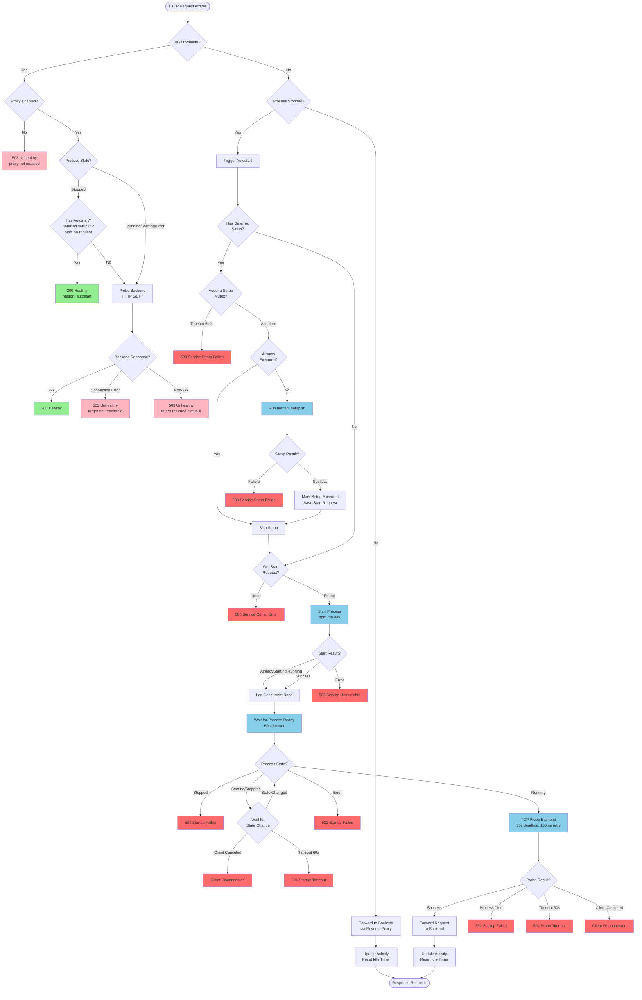

# HTTP Request Flow with Idle and Deferred Setup

This diagram shows all possible flows when an HTTP request is received by the dev-supervisor HTTP proxy with both idle mode and deferred setup enabled.



## Key Flows

### Health Check Path

**When process is stopped with autostart:**

- Returns `200 OK` with `"reason": "autostart"` immediately
- Does NOT check the backend
- Indicates the system is ready to serve requests on-demand

**When process is running or in other states:**

- Probes the backend with `HTTP GET /`
- Returns `200 OK` only if backend responds with 2xx
- Returns `503` if backend is unreachable or returns non-2xx

### Regular Request Path (Autostart)

**When process is stopped:**

1. **Deferred Setup (if configured)**

   - Acquires mutex (prevents concurrent setup)
   - Checks if already executed (idempotent)
   - Runs `nomad_setup.sh` (restores workspace if corrupted)
   - Marks as executed

2. **Process Start**

   - Starts the backend process (`npm run dev`)
   - Handles race conditions (already starting/running)

3. **Wait for Ready**

   - Waits up to 60 seconds for process to reach `Running` state
   - Uses state change notifications (not polling)
   - Handles client cancellation

4. **TCP Readiness Probe**

   - After process reports `Running`, probes the backend TCP port
   - Retries every 100ms for up to 30 seconds
   - Each connection attempt has 500ms timeout
   - Ensures backend server is actually accepting connections
   - Avoids "connection refused" errors on first requests

5. **Forward Request**
   - Reverse proxies the original request to backend
   - Updates activity timestamp (resets idle timer)

**When process is running:**

- Immediately forwards request to backend
- Updates activity timestamp

### Error Cases

| Error                       | HTTP Status | Reason                                        |
| --------------------------- | ----------- | --------------------------------------------- |
| Setup mutex timeout         | 500         | Another request stuck in setup for 5+ minutes |
| Setup script failure        | 500         | nomad_setup.sh exited with error              |
| No start request config     | 500         | Missing process start configuration           |
| Process start error         | 503         | Failed to start the process                   |
| Startup failed (stopped)    | 502         | Process started but immediately stopped       |
| Startup failed (error)      | 502         | Process entered error state                   |
| Startup timeout             | 504         | Process didn't become ready within 60s        |
| TCP probe process died      | 502         | Process died while probing backend port       |
| TCP probe timeout           | 504         | Backend port not ready within 30s             |
| Client disconnect           | -           | Client canceled while waiting                 |

### Activity Tracking

Every successfully forwarded request updates the activity timestamp, resetting the idle timeout:

- **Local dev:** 5 minutes (via `docker-compose-generator.ts`)
- **Preview (Nomad):** 30 minutes (via Nomad job template)

After the idle timeout expires with no activity, the process is automatically stopped to save resources.

## Configuration

**Deferred Setup:**

```bash
DEV_SUPERVISOR_SETUP_SCRIPT=/management-scripts/nomad_setup.sh
DEV_SUPERVISOR_DEFER_RESTART_SETUP=true  # Opt-in (defaults to false)
```

**Start-on-Request (Idle Mode):**

```bash
DEV_SUPERVISOR_ENABLE_START_ON_REQUEST=true
DEV_SUPERVISOR_IDLE_TIMEOUT=30m
DEV_SUPERVISOR_IDLE_CHECK_INTERVAL=30s
NOMAD_TASK_NAME=preview  # Safety: only enabled for preview variant
```

## Implementation Details

- **Health check:** `dev-supervisor/internal/proxy/http/health.go`
- **Autostart:** `dev-supervisor/internal/proxy/http/autostart.go`
- **Deferred setup:** `dev-supervisor/internal/processmanager/manager.go` (`ExecuteDeferredSetup()`)
- **Idle detection:** `dev-supervisor/internal/proxy/http/activity.go`
- **Setup script:** `container-scripts/preview/nomad_setup.sh`
