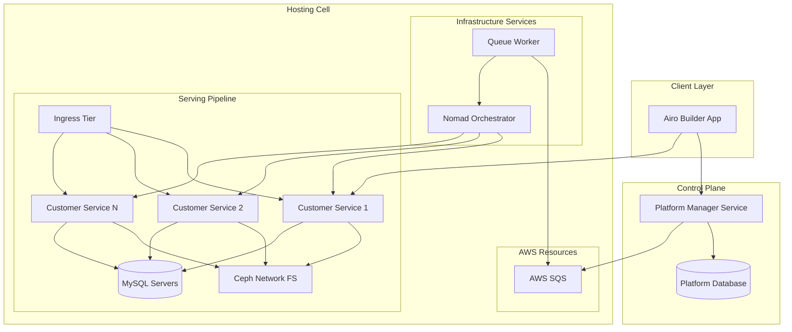
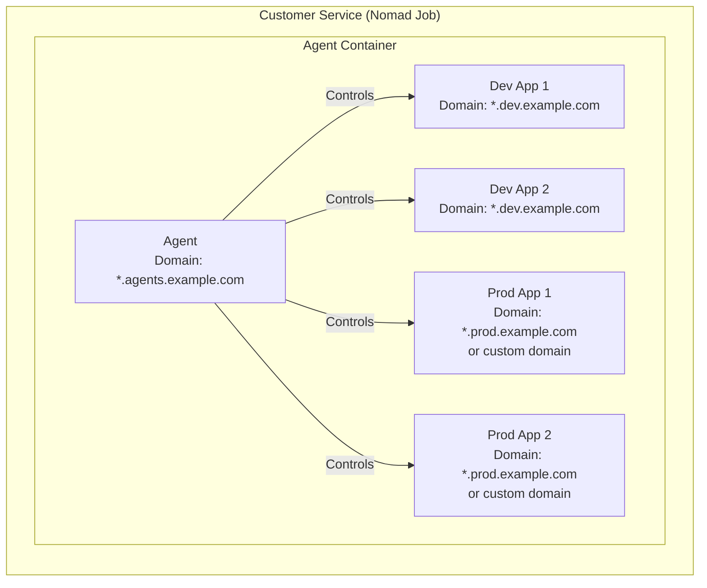
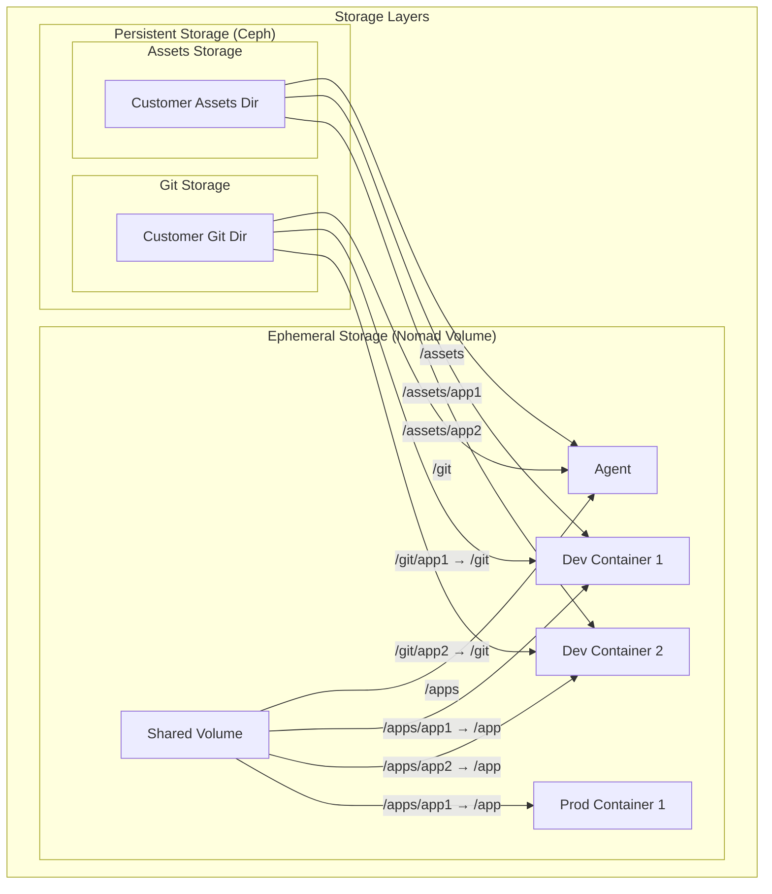
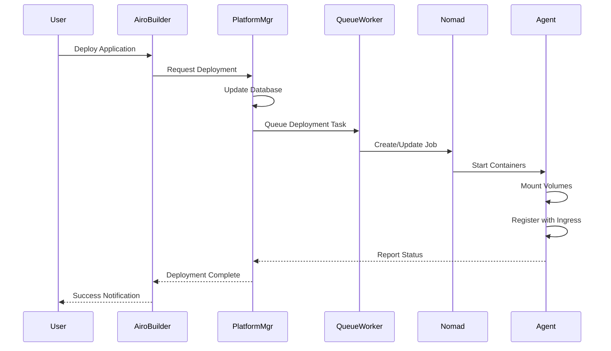
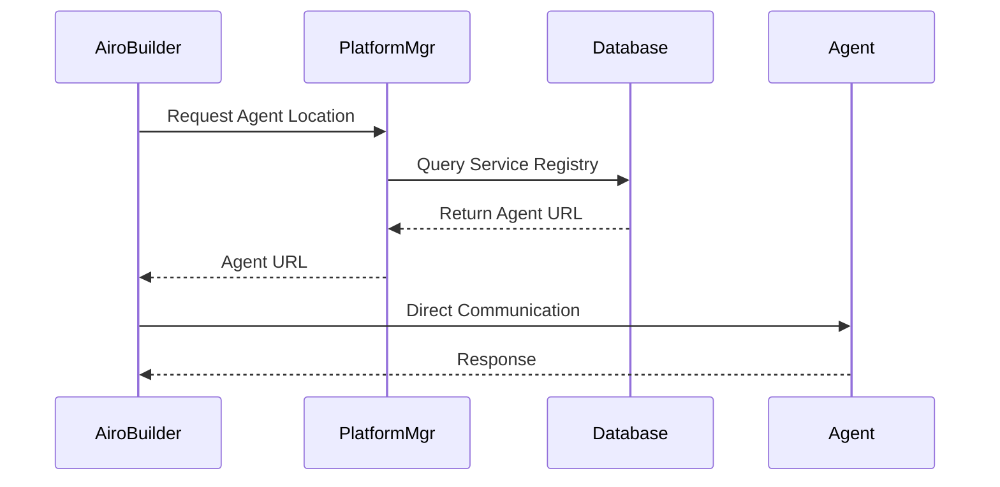

# AI Hosting Platform Documentation

## Overview

The AI Hosting Platform is a comprehensive infrastructure solution designed to host and manage AI-powered applications. It provides a scalable, multi-tenant environment where customers can develop, deploy, and manage their AI applications through the Airo Builder App interface.

## Architecture Overview

## Component Details

### 1. Airo Builder App

The Airo Builder App serves as the primary interface for users to interact with the platform. It provides:

- **Communication with Platform Manager**: Manages app state and deployment configurations
- **Direct Agent Communication**: Interfaces with customer service agents for app management
- **Service Discovery**: Utilizes the Platform Manager's location service to resolve agent URLs

### 2. Platform Manager Service

The Platform Manager acts as the central control plane for the entire platform:

- **State Management**: Maintains a database storing:
  - Application configurations
  - Deployment locations
  - Service metadata
- **Location Service**: Provides URL resolution for the Builder App to locate specific agents
- **Orchestration Coordination**: Interfaces with the hosting cell's Nomad orchestrator

### 3. Hosting Cell

The Hosting Cell is a self-contained infrastructure unit that hosts customer services.

#### Infrastructure Components

| Component | Function |
|-----------|----------|
| **Ingress Tier** | Routes external traffic to appropriate customer services |
| **Nomad** | Orchestrates container deployment and lifecycle management |
| **Queue Worker** | Processes create/update/delete operations from SQS |
| **Ceph Network FS** | Provides persistent storage across containers |
| **MySQL Servers** | Database infrastructure for customer applications |

## Customer Service Architecture

Each customer service runs as a Nomad job consisting of multiple Docker containers:

### Container Types

#### 1. Agent Container
- **Purpose**: Central management interface for the customer service
- **Capabilities**:
  - Restart other containers
  - Execute tasks on dev/prod containers
  - Service registration with ingress
- **Domain**: Random subdomain (structure TBD)
- **Mount Points**:
  - `/apps` - Shared ephemeral volume
  - `/git` - Customer's Ceph directory
  - `/assets` - Customer's assets directory

#### 2. Development Containers
- **Purpose**: Run customer applications in development mode
- **Quantity**: One per application
- **Domain**: Random subdomain on dedicated development domain
- **Mount Points**:
  - `/app` - Maps to `/apps/{identifier}` from shared volume
  - `/git` - Maps to `/git/{identifier}` from Ceph
  - `/assets/{identifier}` - Customer's app-specific assets

#### 3. Production Containers
- **Purpose**: Run customer applications in production mode
- **Quantity**: One per deployed application
- **Domain**: 
  - Default: Random subdomain on production domain
  - Optional: Customer-specified custom domain
- **Mount Points**:
  - `/app` - Maps to `/apps/{identifier}` from shared volume
  - `/git` - Maps to `/git/{identifier}` from Ceph
  - `/assets/{identifier}` - Customer's app-specific assets

## Storage Architecture

### Storage Types

#### Ephemeral Storage
- **Technology**: Nomad volumes
- **Purpose**: Temporary runtime data and application code
- **Lifecycle**: Persists for the duration of the Nomad job

#### Persistent Storage
- **Technology**: Ceph network filesystem
- **Purpose**: Long-term storage of:
  - Git repositories
  - Customer assets
  - Application data
- **Lifecycle**: Persists beyond container restarts and redeployments

## Workflow Operations

### Application Deployment Flow

### Service Discovery Flow

## Domain Structure

| Container Type | Domain Pattern | Example |
|---------------|---------------|---------|
| Agent | `{random}.agents.platform.com` | `abc123.agents.platform.com` |
| Development | `{random}.dev.platform.com` | `xyz789.dev.platform.com` |
| Production (Default) | `{random}.prod.platform.com` | `def456.prod.platform.com` |
| Production (Custom) | Customer-specified | `app.customer.com` |

*Note: Exact domain structures are to be defined*

## Security Considerations

### Network Isolation
- Each customer service runs in isolated Nomad jobs
- Container-to-container communication restricted within customer boundaries
- Ingress tier provides traffic filtering and routing

### Access Control
- Agent containers have elevated permissions within their service boundary
- Dev/Prod containers have restricted permissions
- File system access controlled through mount point isolation

### Data Isolation
- Customer data segregated in Ceph using unique directories
- Database isolation per customer app, by provisioning a user and database per app
- Ephemeral volumes restricted to single customer service

---

*Document Version: 1.0*  
*Last Updated: 2025-08-22
*Status: Initial Draft*
