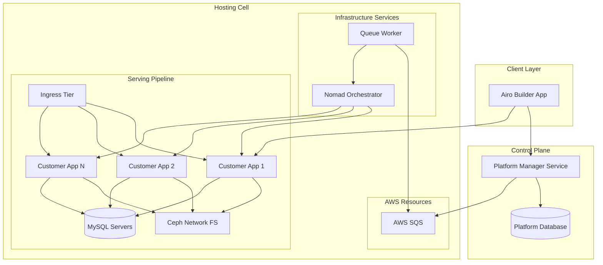
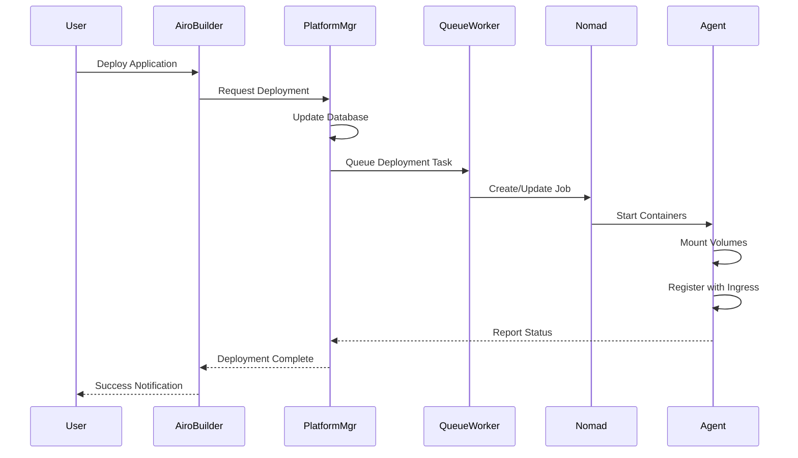
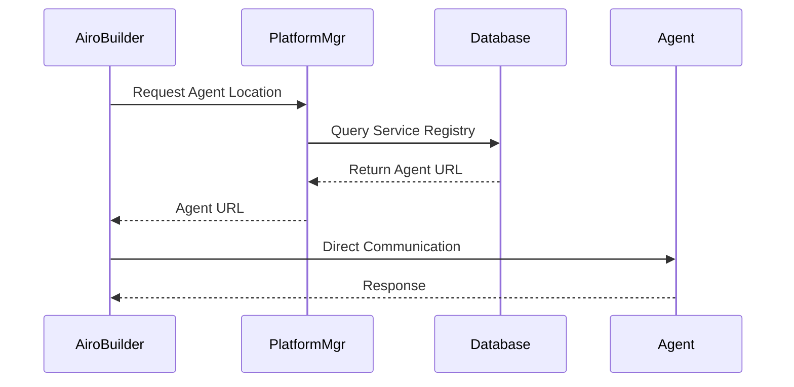

# AI Hosting Platform Documentation

## Overview

The AI Hosting Platform is a comprehensive infrastructure solution designed to host and manage AI-powered applications. It provides a scalable, multi-tenant environment where customers can develop, deploy, and manage their AI applications through the Airo Builder App interface.

## Architecture Overview

## Component Details

### 1. Airo Builder App

The Airo Builder App serves as the primary interface for users to interact with the platform. It provides:

- **Communication with Platform Manager**: Manages app state and deployment configurations
- **Direct Agent Communication**: Interfaces with customer app agents for app management
- **Service Discovery**: Utilizes the Platform Manager's location service to resolve agent URLs

### 2. Platform Manager Service

The Platform Manager acts as the central control plane for the entire platform:

- **State Management**: Maintains a database storing:
  - Application configurations
  - Deployment locations
  - Service metadata
- **Location Service**: Provides URL resolution for the Builder App to locate specific agents
- **Orchestration Coordination**: Interfaces with the hosting cell's Nomad orchestrator

### 3. Hosting Cell

The hosting cell architecture can be found at [On-Prem Hosting Architecture](onprem-hosting-architecture.md).

## Storage Architecture

The storage architecture can be found at [Persistent Storage Architecture](persistent-storage-architecture.md).

## Workflow Operations

### Application Deployment Flow

### Service Discovery Flow

## Domain Structure

| Container Type | Domain Pattern | Example |
|---------------|---------------|---------|
| Agent | `{random}.agents.platform.com` | `abc123.agents.platform.com` |
| Development | `{random}.dev.platform.com` | `xyz789.dev.platform.com` |
| Production (Default) | `{random}.prod.platform.com` | `def456.prod.platform.com` |
| Production (Custom) | Customer-specified | `app.customer.com` |

*Note: Exact domain structures are to be defined*

## Security Considerations

### Network Isolation
- Each application runs in isolated Nomad jobs
- Container-to-container communication restricted within application boundaries
- Ingress tier provides traffic filtering and routing

### Access Control
- Agent containers have elevated permissions within their service boundary
- Dev/Prod containers have restricted permissions
- File system access controlled through mount point isolation

### Data Isolation
- Application data segregated in Ceph using unique directories
- Database isolation per customer app, by provisioning a user and database per app
- Ephemeral volumes restricted to single customer service

---

*Document Version: 1.0*
*Last Updated: 2025-08-22
*Status: Initial Draft*
