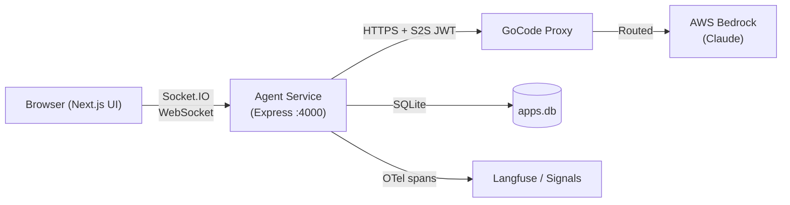
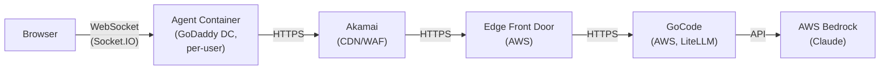
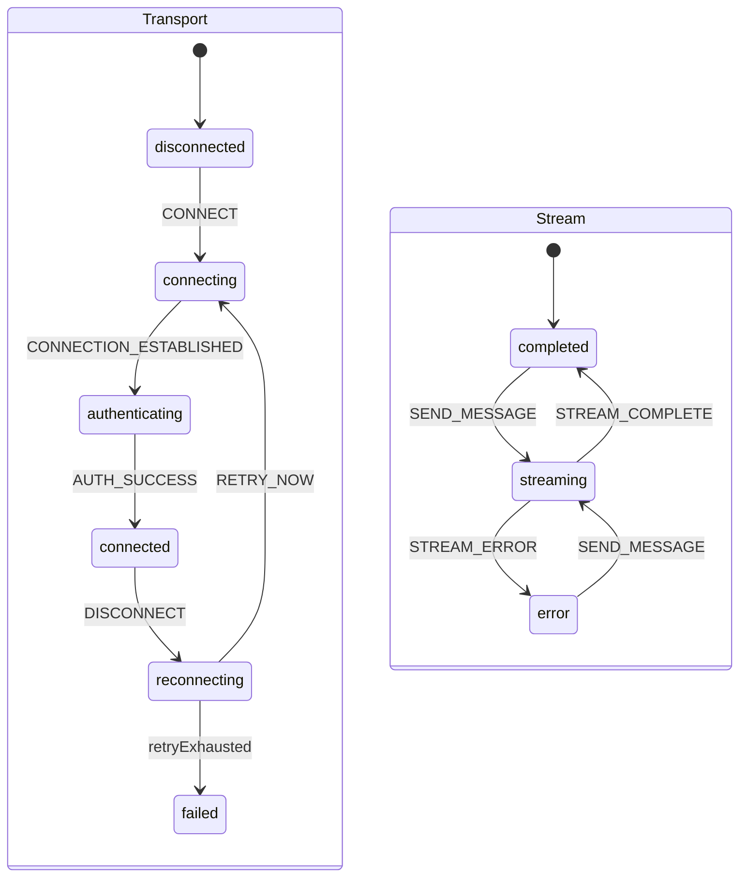
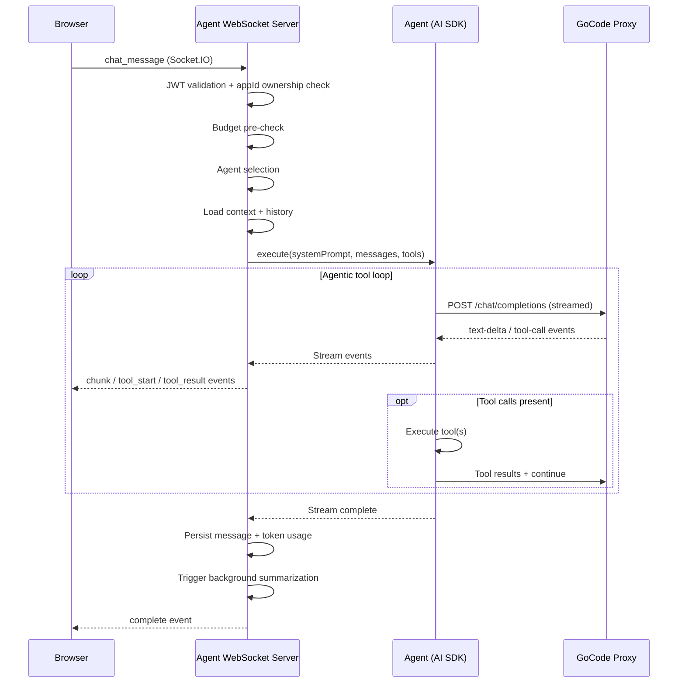
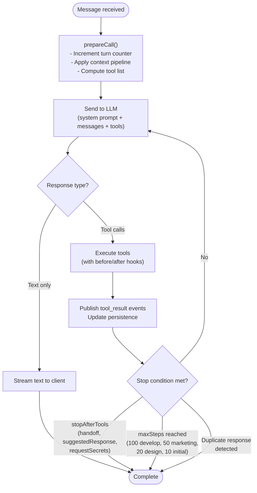
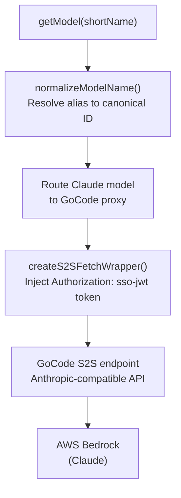
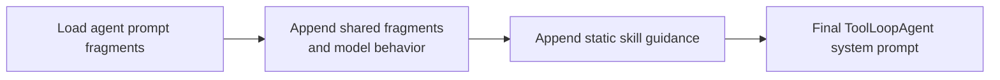
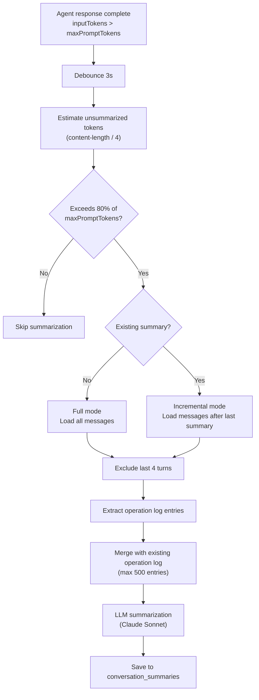
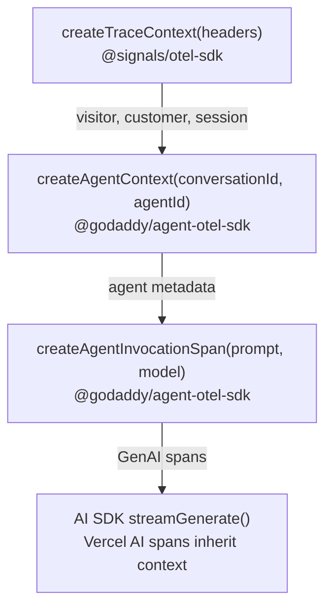

# AI System Architecture

How Airo Builder interacts with LLMs in production. Covers the full pipeline from user message through agent execution to streaming response, including provider routing, prompt caching, context management, and observability.

> For operational pain points, real-traffic metrics, and open problems we're looking for external input on, see [ai-operational-metrics.md](ai-operational-metrics.md).

LLM traffic is multi-provider via the GoCode/LiteLLM gateway, which internally load-balances ~50/50 per-customer between AWS Bedrock and Azure OpenAI passthrough for Sonnet 4.6. The agent service itself targets a single GoCode endpoint (Bedrock-specific code was removed from the provider layer on 2026-03-30); the architecture described below is provider-neutral and deliberately does not rely on backend-specific features.

## Table of Contents

1. [System Overview](#system-overview)
2. [User Experience Loop](#user-experience-loop)
3. [Agent Execution Loop](#agent-execution-loop)
4. [LLM Provider Integration](#llm-provider-integration)
5. [Model Configuration](#model-configuration)
6. [System Prompt Design](#system-prompt-design)
7. [Prompt Caching](#prompt-caching)
8. [Context Pruning](#context-pruning)
9. [Context Summarization](#context-summarization)
10. [Observability](#observability)

---

## System Overview

Each production app runs as a Nomad job containing agent, preview, and publish containers. The agent container (Express on port 4000) hosts all AI logic: agent orchestration, tool execution, prompt assembly, conversation persistence, and LLM communication.



### Request Network Path

Full network path for an LLM request from user to model:



**Key components:**

| Component     | Package              | Responsibility                                             |
| ------------- | -------------------- | ---------------------------------------------------------- |
| Agent service | `@airo/agents`       | WebSocket server, agent orchestration, tools, persistence  |
| ai-lib        | `@airo/ai-lib`       | AI SDK wrapper, provider abstraction, prompt caching       |
| ai-transport  | `@airo/ai-transport` | Base WebSocket server, stream processing, event publishing |
| ai-common     | `@airo/ai-common`    | LiteLLM metadata, budget patterns, shared utilities        |
| ai-grants     | `@airo/ai-grants`    | Grant session management, budget attribution               |
| shared        | `@airo/shared`       | Domain types (grants, context-attachment, websocket)       |

---

## User Experience Loop

The browser maintains a persistent Socket.IO connection to the agent service. An XState state machine on the client governs the full connection and streaming lifecycle.

### Client State Machine

Two parallel regions run independently:



**Client components** (all in `app/src/services/websocket/`):

- `useStreamingWebSocket.ts` - React hook exposing `sendMessage` and lifecycle state
- `StreamingWebSocketController.ts` - Coordinates services, builds outbound messages
- `TransportSupervisor.ts` - Socket creation, ConnectionManager, retry/escalation
- `webSocketMachine.ts` - XState chart (transport + stream regions)
- `StoreSyncAdapter.ts` - Translates machine snapshots to Zustand store actions
- `handlers/*` - Tier 2 message processors that mutate transcript/tool state directly

> **Note (AIROBUILD-2629):** The client WebSocket transport described above was removed — the client now uses the SSE transport (`app/src/hooks/useSSEChat.ts`; see `app/CLAUDE.md` → "Chat Transport (SSE)"). The component list/diagram above describes the retired stack and is pending a broader docs refresh under AIROBUILD-2633.

### Request-Response Flow



**Security validation** is three-layer: JWT token in handshake, per-message appId validation, conversation ownership verification via ConversationRepository.

**Event types** streamed to client: `chunk`, `tool_start`, `tool_input_delta`, `tool_result`, `step_complete`, `complete`, `error`.

---

## Agent Execution Loop

### Agent Selection

When a message arrives, the agent is selected by priority:

1. **Session state** - existing active agent for this socket/app
2. **App context** - no conversations yet -> `InitialAgent`, otherwise -> `DevelopAgent`
3. **Client-specified** - `data.agentId` or `data.agentName`
4. **Default** -> `DevelopAgent`

| Agent          | Purpose                           | Handoff targets |
| -------------- | --------------------------------- | --------------- |
| InitialAgent   | First-time app scaffolding        | develop         |
| DevelopAgent   | Feature development, code changes | marketing       |
| MarketingAgent | SEO/marketing content             | develop         |
| DeepBuildAgent | Orchestrated interview→plan→build | (sub-agents)    |

Factory: `agents/src/agents/ai-lib-agents/index.ts` (`createUnifiedAgentFactory()`).

### Tool Calling Loop

The core execution uses Vercel AI SDK 6's `ToolLoopAgent` wrapped by `AgentWrapper`:



**Stop-after tools** pause execution for user confirmation:

- `develop`: stops after `handoff`, `suggestedResponse`, `requestSecrets`
- `marketing`: stops after `handoff`

Only triggers when the tool succeeds (has a matching `tool-result`, not `tool-error`).

### Tool System

44 tools registered in `agents/src/tools/ai-lib-tools/index.ts`. Each agent declares which tools it uses in its config. Tool execution is wrapped with `beforeToolExecutionHook` and `afterToolExecutionHook` for observability and custom logic.

**Skills** extend the tool set dynamically. Skills include ai-agent, authentication, blog, blog-writing, commerce, commerce/ui, database, email, google-maps, i18n, media, online-appointments, seo, social-platform, social-posts, social-publish, and payment providers such as payment/godaddy-payments and payment/stripe. Skill tools are prefixed `skill__{skillName}` and managed by `SkillToolManager` with inactivity-based cleanup (deactivated after 30 steps of non-use, configurable via `SKILL_INACTIVITY_THRESHOLD_STEPS`). No limit on concurrently active skills.

---

## LLM Provider Integration

All LLM calls route through `packages/ai-lib/src/providers/unified-provider.ts` to GoCode, a GoDaddy-internal LLM proxy that routes requests to AWS Bedrock. Production uses S2S (service-to-service) JWT authentication.

### Provider Routing



### GoCode Proxy

GoCode exposes an Anthropic-compatible API. The agent service connects using S2S JWT authentication (`GOCODE_USE_S2S_AUTH=true`).

**Endpoints** (environment-specific, via `getDefaultGoCodeEndpoint()` in `s2s-auth.ts`):

| Environment | Endpoint                                    |
| ----------- | ------------------------------------------- |
| Prod        | `https://api.gocode.caas.gdcorp.tools`      |
| Test        | `https://api.gocode.caas.test-gdcorp.tools` |
| Dev         | `https://api.gocode.caas.dev-gdcorp.tools`  |

### S2S Authentication

A custom fetch wrapper (`createS2SFetchWrapper()`) injects `Authorization: sso-jwt {token}` on every LLM request. GoCode requires this scheme (authz-gdjwt-all standard); `Bearer` is rejected by the API gateway. The JWT is obtained from `gd-auth-client`'s `IamTokenClient` and cached with a 60-second refresh buffer before expiry. On 401/403, the token is refreshed and the request retried once.

Key files: `packages/ai-lib/src/utils/s2s-auth.ts` (`getS2SToken()`, `refreshS2SToken()`, `isS2SAuthEnabled()`).

### LiteLLM Metadata

Every LLM request carries cost attribution metadata in two places:

**Request body** (`litellm_metadata` field, injected by fetch wrapper):

```typescript
{
  user: string       // subscriptionId (or llmBudgetUserId from grant)
  tags: string[]     // [customerId, appId]
}
```

**HTTP headers** (BMS cost reporting):

```
x-gocode-budget-service-name: airo-bms
x-gocode-budget-id: {budgetId}:{budgetSessionId}
```

This metadata is stored in `AsyncLocalStorage` (`llmMetadataContext`) for per-request isolation.

### Grant-Based Budget Management

Grants control LLM spending per subscription. The flow:

1. Frontend sends `grant_context` event with `CreditGrant[]` via WebSocket
2. `grantSessionManager.setGrants()` registers grants per subscription
3. During LLM calls, `buildLitellmMetadataFromContext()` resolves the current grant's `llmBudgetUserId`
4. On HTTP 400 with budget-exceeded pattern:
   - `advanceToNextGrant()` moves to next usable grant
   - If no local grants remain, `requestGrantRefreshAndWait(5000ms)` asks the frontend for new grants
   - Single retry with new userId (no infinite loop)

**User resolution fallback hierarchy:**

1. Grant's `llmBudgetUserId` (preferred)
2. `subscriptionId` (when no grants indexed)
3. `customerId` (last resort - avoid, as this has infinite budget)

---

## Model Configuration

### Default Model

Both `full` and `fast` tiers default to Claude Sonnet (`claude-sonnet-4-6`), configured in `agents/src/utils/model-selection.ts`.

### Model Name Resolution

Short names map to canonical model IDs via `packages/ai-lib/src/utils/model-normalization.ts`:

| Short name          | Full Provider Model ID       |
| ------------------- | ---------------------------- |
| `sonnet`            | `claude-sonnet-4-6`          |
| `haiku`             | `claude-haiku-4-5-20251001`  |
| `claude-sonnet-4-5` | `claude-sonnet-4-5-20250929` |
| `claude-opus-4-8`   | `claude-opus-4-8`            |
| `claude-opus-4-7`   | `claude-opus-4-7`            |
| `claude-opus-4-6`   | `claude-opus-4-6`            |

### Override Mechanisms

**Global (Switchboard):** Ops/SRE sets `appbuilder-model-override` in Switchboard. The BFF embeds this as a signed `modelOverride` claim in the agent JWT. The agents service reads the claim and applies it to all AI operations (agent, summarizer, tools). No downtime; takes effect on next page reload or WebSocket reconnect.

**Per-project:** When `appbuilder-model-selector` is enabled in Switchboard, a Settings panel model dropdown appears. Per-project selection takes priority over the global override.

**Environment variable:** `AI_MODEL_OVERRIDE` forces a specific model (dev/testing only).

**Server-side allowlist** (`agents/src/server/constants.ts`, `ALLOWED_OVERRIDE_MODELS`): `claude-opus-4-8`, `claude-opus-4-7`, `claude-opus-4-6`, `claude-sonnet-4-6`, `azure/claude-sonnet-4-6`, `claude-sonnet-4-5`, `claude-sonnet-4-5-20250929`, `claude-haiku-4-5`, `azure/Kimi-K2.6`, `azure/Kimi-K2.6-thinking`, `sonnet`, `haiku`. The `azure/Kimi-K2.6` variants are dev/test-only right now. Invalid values fall back to default.

See [model-override.md](model-override.md) for the ops runbook.

---

## System Prompt Design

### Prompt Composition

Prompts are assembled from modular markdown fragments via `createPromptBuilder()`:

```
agents/src/prompts/
  {agent-name}/          Agent-specific base prompts (core.md, handoff.md, etc.)
  shared/                Reusable fragments (communication.md, filesystem.md, security.md)
  template-descriptions/ Per-template context (v8.md)
  fragments/             Composable fragments
```

**System prompt flow** in ai-lib agents, for example `agents/src/agents/develop-agent.ts`:



Template descriptions are intentionally injected separately as `before_history` context by `AILibContextManager`, not embedded in the ToolLoopAgent system prompt.

### Dynamic Context Injection

Context messages are injected at two points relative to conversation history:

| Insertion Point        | Content                                                        | Role   |
| ---------------------- | -------------------------------------------------------------- | ------ |
| `before_history`       | Template description                                           | system |
| `before_history`       | Memory summary (conversation compaction)                       | user   |
| _conversation history_ |                                                                |        |
| `after_history`        | App context (package info, color scheme, secrets, media slots) | user   |
| `after_history`        | KnowB search results                                           | user   |
| `after_history`        | Todo list context                                              | user   |
| `after_history`        | Dynamic data (date, timezone, project title, preview URL)      | user   |

**Why `after_history`?** App context, KnowB results, and dynamic data change between requests. Placing them after the cache boundary prevents cache invalidation when they change. See [Prompt Caching](#prompt-caching).

**Why memory summary is `user` role?** Summaries are derived from user conversations. Placing user-derived content in system prompts creates a prompt injection vulnerability where crafted messages could survive summarization and appear as trusted system instructions.

---

## Prompt Caching

Anthropic caches message prefixes - the contiguous token sequence from the start of a request. A cached prefix is reused if identical on subsequent requests (5-minute TTL). Maximum 4 cache breakpoints per request.

### Message Assembly Order

```
+------------------------------------------------------------------+
| Segment 1: System Prompt (system role)            CACHE POINT 1  |
|   Base agent instructions + stable prompt fragments              |
+------------------------------------------------------------------+
| Segment 2: Template Description (system role)                    |
|   Per-template context, insertionOrder: before_history           |
+------------------------------------------------------------------+
| Segment 3: Memory Summary (user role)             CACHE POINT 2  |
|   Summarized conversation history                                |
+------------------------------------------------------------------+
| Segment 4: Conversation History                                  |
|   Previous user/assistant/tool exchanges                         |
|   - Intermediate stepping stone              CACHE POINT 3       |
|   - Last history message                     CACHE POINT 4       |
|                                                                  |
| ================ CACHE BOUNDARY ================================ |
+------------------------------------------------------------------+
| Segment 5: App Context (user role)                               |
|   Package info, color scheme, secrets, media slots               |
+------------------------------------------------------------------+
| Segment 6: KnowB Results (user role)                             |
+------------------------------------------------------------------+
| Segment 7: Todo Context (user role)                              |
+------------------------------------------------------------------+
| Segment 8: Dynamic Data (user role)                              |
+------------------------------------------------------------------+
| Segment 9: Current User Message                                  |
+------------------------------------------------------------------+
```

Everything above the cache boundary forms the stable prefix. Template description participates in that prefix but does not consume a separate cache breakpoint. Everything below can change freely without invalidating the cache.

### Breakpoint Strategy

| Slot | Target                        | Condition                          | Purpose                  |
| ---- | ----------------------------- | ---------------------------------- | ------------------------ |
| 1    | System prompt                 | Always                             | Cache agent instructions |
| 2    | Memory summary                | When summary exists                | Cache compacted history  |
| 3    | Intermediate (within history) | When anchor-to-end gap > 20 blocks | Bridge lookback windows  |
| 4    | Last history message          | Always (when history exists)       | Cache full prefix        |

**20-block lookback:** Anthropic's cache walks at most 20 content blocks backward from each breakpoint. Tool calls expand into 2-3 blocks each, so a conversation with 30 tool calls produces ~60-90 blocks. The intermediate breakpoint creates a "stepping stone" chain so the lookback can traverse the full history.

### Cache Hit Rates

| Scenario                        | Hit rate           | Notes                                               |
| ------------------------------- | ------------------ | --------------------------------------------------- |
| Subsequent request in same turn | ~99%               | Prefix identical                                    |
| First request of new turn       | ~42-52%            | New message extends prefix                          |
| After summarization             | 0% (one-time miss) | Summary content changed                             |
| After 5-min idle                | 0%                 | TTL expired                                         |
| Long conversation (200+ blocks) | Degraded           | Gap between intermediate and last exceeds 20 blocks |

**Cost model (Claude Sonnet 4.5):**

| Token type         | Price per MTok      |
| ------------------ | ------------------- |
| Input (uncached)   | $3.00               |
| Cache read (hit)   | $0.30 (90% savings) |
| Cache write (miss) | $3.75 (25% premium) |

See [prompt-caching-architecture.md](prompt-caching-architecture.md) for full implementation detail including content block counting, summary pinning, and edge cases.

---

## Context Pruning

Conversation history is compressed and token-limited on every load to fit within the context window while preserving cache consistency.

### Token Limiting

`ConversationHistoryLoader.loadMessagesWithTokenLimitByConversationId()` enforces a default 40,000-token budget:

1. Separate summary messages from regular messages
2. Always include all summaries (highly compressed, always valuable)
3. Add recent messages backward from newest until budget exceeded
4. Result: `[summaries, ...recent_messages]` sorted chronologically

Token counting uses the active model name (passed through from the agent). Falls back to `claude-sonnet-4-6` (`DEFAULT_TOKEN_COUNTING_MODEL`) when no model name is provided.

### Compression Strategies

`MessageCompressor` orchestrates multiple strategies applied in order:

| Strategy                             | Type        | Mutates? | Purpose                                         |
| ------------------------------------ | ----------- | -------- | ----------------------------------------------- |
| `DuplicateFileReadStrategy`          | compression | Yes      | Removes duplicate file reads (keeps latest)     |
| `AppContextRemovalStrategy`          | removal     | No       | Removes stale app context messages from history |
| `TodoListRemovalStrategy`            | removal     | No       | Removes outdated todo list snapshots            |
| `SecretOperationCompressionStrategy` | removal     | No       | Removes user messages about secret operations   |
| `MediaSearchSummaryStrategy`         | removal     | Yes      | Summarizes deprecated media search results      |
| `ToolResultCompressionStrategy`      | removal     | Yes      | Truncates large tool outputs                    |

**Strategy classification:**

- `removal` - Removes entire messages or tool results. Safe for stale/redundant data.
- `compression` - Modifies content in-place while keeping the message.

All strategies run on every load (no type-based filtering in the current invocation). The `strategyType` classification exists in the API but `ConversationHistoryLoader` passes `undefined` as the filter, running all strategies unconditionally.

### Stable Region Protection

Compression must not alter the cached prefix, or the cache is invalidated.

```
Turn N:   load -> compress(stableRegionEnd=undefined) -> limit -> 45 messages
          Store previousTurnMessageCount[appId] = 45

Turn N+1: load -> compress(stableRegionEnd=45) -> limit -> 48 messages
          Messages 0-44: untouched (cached prefix preserved)
          Messages 45-47: new (appended after cache boundary)
          Store previousTurnMessageCount[appId] = 48
```

Mutation strategies (`mutatesContent: true`) are skipped for messages within the stable region. Removal strategies still run because they are idempotent - removing a message that was already absent is a no-op.

---

## Context Summarization

When conversation history grows beyond the token threshold, background summarization compresses older turns into a structured summary.

### Background Summarizer

`BackgroundSummarizer` (`agents/src/services/summarization/BackgroundSummarizer.ts`) triggers after each agent response:

| Parameter                 | Value  | Purpose                                     |
| ------------------------- | ------ | ------------------------------------------- |
| `maxPromptTokens`         | 10,000 | Token threshold for unsummarized messages   |
| `debounceMs`              | 3,000  | Short delay for GC, not batching            |
| `keepRecentTurns`         | 4      | Recent messages excluded from summarization |
| `disableFullRegeneration` | true   | Prefer incremental updates                  |

### Summarization Flow



### Incremental vs Full Summarization

**Incremental** (default): Loads only messages added since the last summary's `messageRangeEnd`. Passes existing summary text as context. Cheaper and faster.

**Full**: Loads entire message history. Used when:

- No existing summary (first summarization)
- Reference message for incremental not found (deleted)
- Rebuilding legacy operation logs

Full regeneration on a periodic schedule is disabled by default (`disableFullRegeneration: true`) because the operation log already provides durable structured context that survives incremental updates.

### Operation Log

The operation log is a structured record of tool executions extracted from message history. It provides the summarizer and future conversation turns with a compact view of what the agent has done.

**Extraction** (`OperationLogExtractor`): Parses assistant messages with tool calls into entries:

```typescript
{ tool: "file_edit", files: ["src/App.tsx"], mode: "edit", description: "edit: src/App.tsx" }
```

**Pruning** (`OperationLogPruner`): Caps at 500 entries with priority allocation: 75% file operations (`file_edit` + `read_file`), 25% other operations. Most recent entries kept in each category.

**Lifecycle:** Extracted from new messages, merged with existing log during incremental summarization, serialized to JSON in the `conversation_summaries` table.

### Summary Pinning

When `BackgroundSummarizer` creates a new summary between turns, both the context manager (memory summary segment) and the history loader (cache boundary) must use the same summary version. If they disagree, the memory summary content changes, invalidating the cache.

`ConversationHistoryLoader` pins a summary per app for up to `MAX_PINNED_TURNS` (5) turns. The pin ensures all components reference the same summary within an epoch, avoiding cache-invalidating divergence. After 5 turns the pin refreshes, accepting a one-time cache miss.

---

## Observability

### Trace Context Hierarchy

Three layers of context, each enriching spans:



### Span Processors

| Processor                    | Trigger                                           | Destination                      |
| ---------------------------- | ------------------------------------------------- | -------------------------------- |
| GoDaddy Agent Span Processor | `ENABLE_OBSERVABILITY_EVENTS=true`                | GoDaddy observability (EventBus) |
| Langfuse Span Processor      | `LANGFUSE_PUBLIC_KEY` + `LANGFUSE_SECRET_KEY` set | Langfuse                         |

**Explicit events:** `emitConversationStart`, `emitHandoff`, `emitError` - emitted by conversation persistence. The span processor handles LLM/tool events automatically from AI SDK instrumentation.

Configuration: `agents/src/server/instrumentation.ts`.

### Token Usage Tracking

On every LLM response, the `onTokenUsage` callback:

1. Calculates cost via `calculateCostEstimate()` (cache-aware pricing)
2. Creates a dedicated APM transaction via `trackTokenUsageInAPM()`
3. Logs structured event with cache metrics and context window utilization
4. Checks if `inputTokens > maxPromptTokens` to trigger background summarization

**APM transaction labels:** `token_usage_type`, `agent_name`, `model_name`, `conversation_id`
**APM metrics:** input/output/cache tokens, cost_total_usd, cache_hit_rate

### Cost Calculation

```
costWithCaching =
    (uncachedTokens / 1M) * inputPrice
  + (cacheReadTokens / 1M) * cacheReadPrice
  + (cacheWriteTokens / 1M) * cacheWritePrice

savings = costWithoutCaching - costWithCaching
```

Cache read tokens are sourced from `usage.inputTokenDetails.cacheReadTokens` in the AI SDK v6 response.

### Error Handling

Three terminal paths for agent execution:

| Path              | Trigger                  | Actions                                                                            |
| ----------------- | ------------------------ | ---------------------------------------------------------------------------------- |
| **Complete**      | Stream finishes normally | Persist message, track tokens, git auto-commit, emit funnel events                 |
| **Error**         | LLM/tool/budget failure  | Persist error state, squash-merge branch to main, emit error event                 |
| **Disconnection** | Socket drops mid-stream  | Clear in-progress flag (prevents stuck UI), squash-merge to main, cleanup tracking |

Budget-exceeded errors emit a `budget_exceeded` event to the client with remaining balance information.

---

## Implementation Files

| Area                | File                                                                                         | Key functions                                                    |
| ------------------- | -------------------------------------------------------------------------------------------- | ---------------------------------------------------------------- |
| WebSocket server    | `agents/src/server/ai-lib-websocket-server.ts`                                               | `setupAILibWebSocketServer()`, `contextProvider`, `onTokenUsage` |
| Base WebSocket      | `packages/ai-transport/src/experimental-websocket-server.ts`                                 | `handleChatMessage()`, `processStreamWithToolEvents()`           |
| Agent factory       | `agents/src/agents/ai-lib-agents/index.ts`                                                   | `createUnifiedAgentFactory()`                                    |
| Context manager     | `agents/src/agents/ai-lib-agents/context-manager.ts`                                         | `buildContextMessages()`                                         |
| History loader      | `agents/src/services/ConversationHistoryLoader.ts`                                           | `loadMessagesWithTokenLimitByConversationId()`                   |
| Provider + S2S auth | `packages/ai-lib/src/providers/unified-provider.ts`, `packages/ai-lib/src/utils/s2s-auth.ts` | `getModel()`, `getS2SToken()`, `createS2SFetchWrapper()`         |
| Model normalization | `packages/ai-lib/src/utils/model-normalization.ts`                                           | `normalizeModelName()`                                           |
| Model selection     | `agents/src/utils/model-selection.ts`                                                        | `getAgentModel()`, `getAgentModelWithName()`                     |
| Prompt caching      | `packages/ai-lib/src/utils/prompt-caching.ts`                                                | `addCacheControlToMessages()`                                    |
| Compression         | `agents/src/services/compression/MessageCompressor.ts`                                       | `compressMessages()`                                             |
| Summarization       | `agents/src/services/summarization/BackgroundSummarizer.ts`                                  | `checkAndSummarize()`                                            |
| Operation log       | `agents/src/services/summarization/OperationLogExtractor.ts`                                 | `extract()`, `mergeAndPrune()`                                   |
| Grants              | `packages/ai-grants/src/grant-session-manager.ts`                                            | `setGrants()`, `advanceToNextGrant()`                            |
| Instrumentation     | `agents/src/server/instrumentation.ts`                                                       | Span processor setup                                             |
| Persistence         | `agents/src/server/conversation-persistence.ts`                                              | `updateAgentTurn()`, `trackTokenUsageInAPM()`                    |

## Related Documentation

- [ai-operational-metrics.md](ai-operational-metrics.md) - Production metrics, pain points, and open questions for advisors
- [prompt-caching-architecture.md](prompt-caching-architecture.md) - Detailed cache breakpoint mechanics, block counting, summary pinning edge cases
- [model-override.md](model-override.md) - Ops runbook for emergency model switching via Switchboard
- [stop-and-queue-architecture.md](stop-and-queue-architecture.md) - User-controlled agent stream stopping
- [agent-tool-inventory.md](agent-tool-inventory.md) - Complete tool and service inventory
