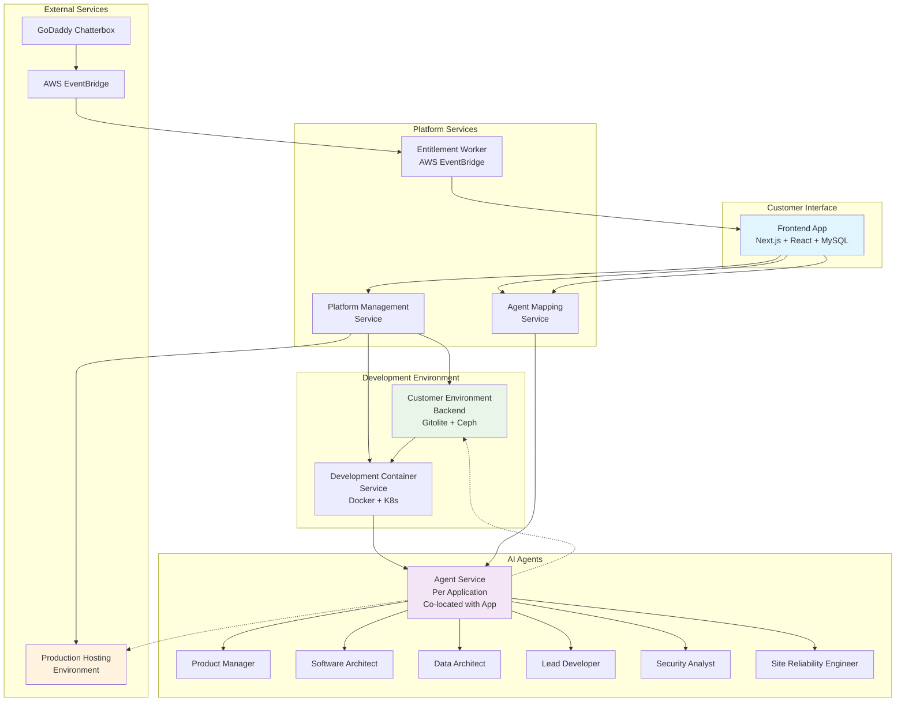
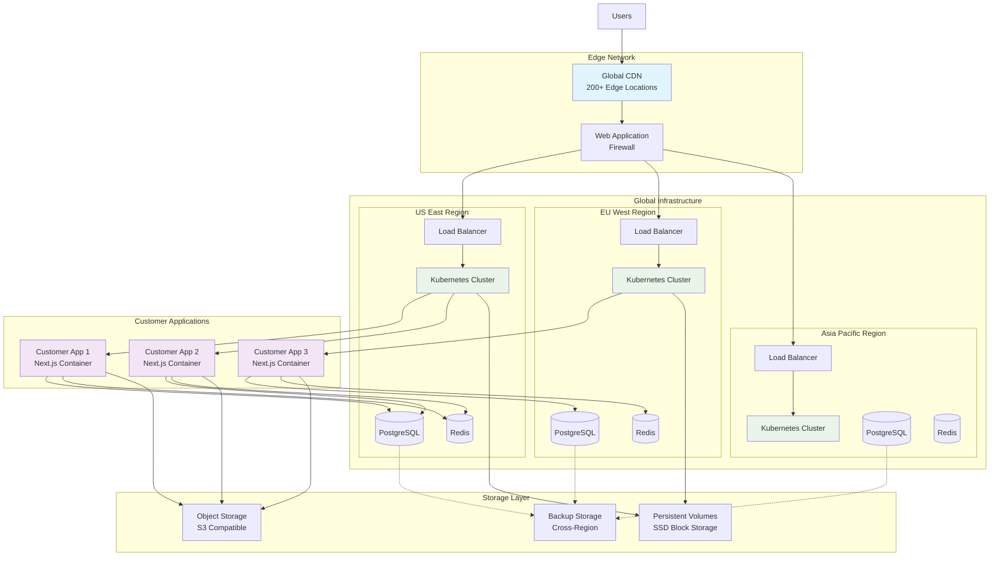
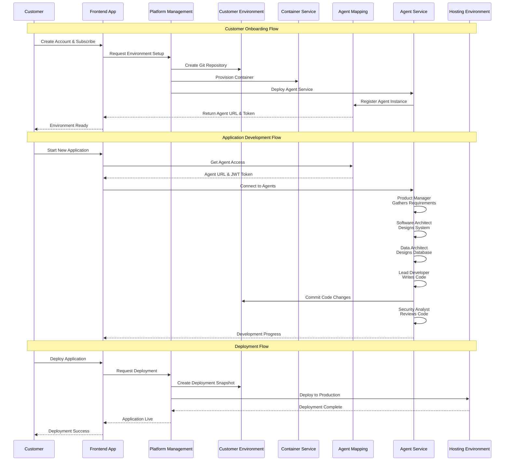

# AIRO Architecture Diagrams

This document contains visual diagrams that illustrate the architecture of the AIRO AI Builder platform and its hosting environment.

## 🏗️ Platform Architecture Overview

This diagram shows the high-level architecture of the AIRO AI Builder platform, including all core services and their relationships.

## 🌐 Production Hosting Architecture

This diagram illustrates the production hosting environment where customer applications are deployed and served globally.

## 🔄 System Flow Diagram

This sequence diagram shows the typical flow of interactions from customer onboarding through application development to deployment.

## 📊 Component Relationships

### Service Dependencies

#### Frontend Application
- **Depends on**: Platform Management Service, Agent Mapping Service
- **Provides**: Customer interface, dashboard, agent communication
- **Data Store**: MySQL for customer data and application metadata

#### Platform Management Service
- **Depends on**: Customer Environment Backend, Development Container Service
- **Provides**: Infrastructure provisioning, configuration management
- **Integration**: Cloud providers, hosting infrastructure

#### Agent Service
- **Depends on**: Customer Environment Backend (file system access)
- **Provides**: AI agent functionality, code generation, development assistance
- **Co-located**: Runs alongside customer applications

#### Customer Environment Backend
- **Depends on**: Ceph distributed storage
- **Provides**: Git repository management, snapshot capabilities
- **Technology**: Gitolite for git hosting, Ceph for distributed storage

### Data Flow Patterns

#### Event-Driven Architecture
- **Entitlement Events**: GoDaddy Chatterbox → AWS EventBridge → Entitlement Worker
- **Agent Communication**: Real-time WebSocket connections for agent interactions
- **Deployment Events**: Git commits trigger deployment pipelines

#### Request-Response Patterns
- **Agent Mapping**: Service discovery and authentication token generation
- **Platform Management**: Synchronous API calls for infrastructure operations
- **Frontend APIs**: REST APIs for customer dashboard functionality

### Security Boundaries

#### Authentication Layers
1. **Customer Authentication**: NextAuth.js in frontend application
2. **Service Authentication**: JWT tokens for service-to-service communication
3. **Agent Authentication**: Time-limited tokens from Agent Mapping Service

#### Network Segmentation
- **Public Subnet**: Load balancers and CDN endpoints
- **Private Subnet**: Application containers and services
- **Database Subnet**: Isolated database infrastructure
- **Management Subnet**: Platform management and monitoring services

## 🔐 Security Architecture

### Defense in Depth

#### Network Security
- **WAF**: Web Application Firewall for OWASP protection
- **DDoS Protection**: Multi-layer DDoS mitigation
- **VPC**: Virtual Private Cloud isolation
- **Security Groups**: Fine-grained firewall rules

#### Application Security
- **Container Security**: Image scanning and runtime protection
- **Secret Management**: Centralized secret storage and rotation
- **Encryption**: TLS in transit, encryption at rest
- **Access Control**: Role-based access control (RBAC)

#### Data Security
- **Database Encryption**: Encrypted database connections and storage
- **Backup Encryption**: Encrypted backups with cross-region replication
- **Key Management**: Secure key storage and rotation
- **Audit Logging**: Comprehensive audit trails

These diagrams provide a visual representation of the AIRO AI Builder platform architecture, showing how the various components work together to provide a comprehensive application development and hosting solution.
