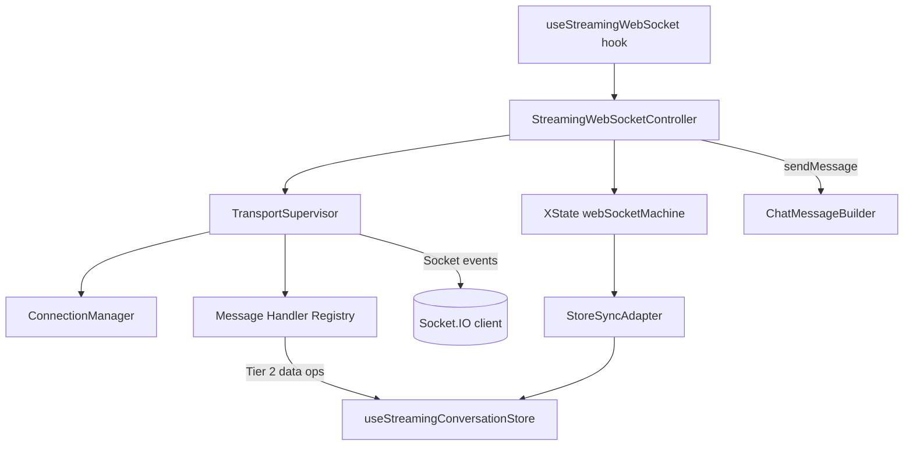
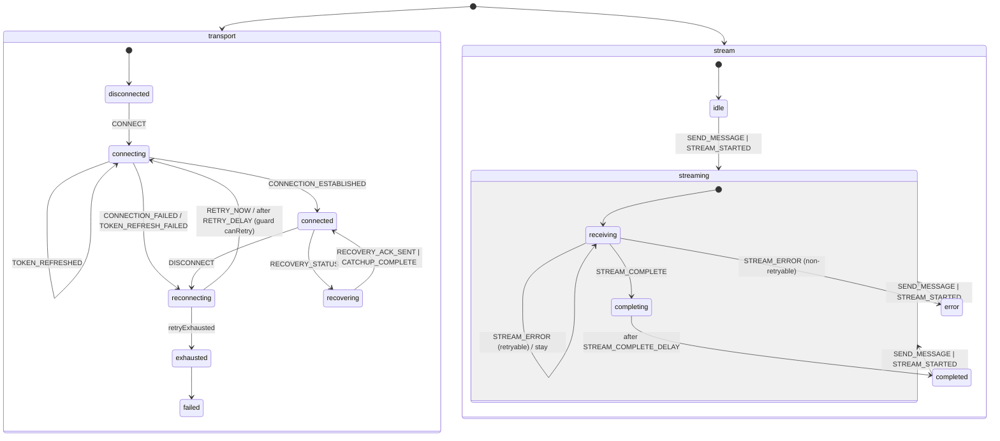
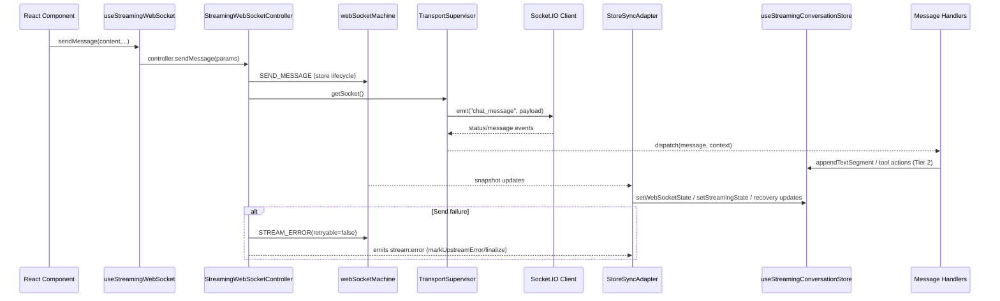
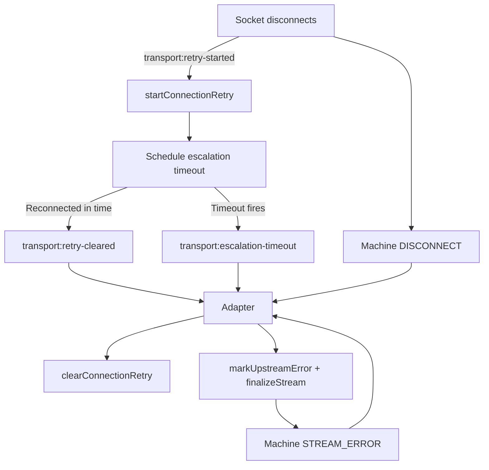

# Client WebSocket Architecture

This document captures how the Airo Builder client coordinates persistent chat streams with the agent platform. It focuses on the browser-side code in `app/src/services/websocket` and the React hook that exposes the API to UI components.

## Goals & Constraints

- **Single source of truth for lifecycle** – the XState machine (`webSocketMachine.ts`) owns connection + streaming state so UI code never mutates transport state directly.
- **Separation of concerns** – networking sits inside `TransportSupervisor`, orchestration inside `StreamingWebSocketController`, state syncing in `StoreSyncAdapter`, and transcript mutations inside message handlers.
- **Deterministic recovery** – replay, catch-up, and retry flows must be observable for logging (`logger.info/warn/error(...)`) and testable in isolation.
- **React-friendly** – the `useStreamingWebSocket` hook hides implementation details while keeping services headless so they can be tested without React.

## Component Map

**Key responsibilities**

- `useStreamingWebSocket.ts` – wires store selectors/actions into the controller, manages lifecycle in React, and exposes `sendMessage`.
- `StreamingWebSocketController.ts` – coordinates services, forwards supervisor events, builds outbound messages, and emits domain events (e.g., `stream:error`).
- `TransportSupervisor.ts` – owns socket creation, ConnectionManager callbacks, handler wiring, retry/escalation timers, and emits transport-level events.
- `webSocketMachine.ts` – parallel XState chart describing transport + stream lifecycles, recovery, retries, and logging side-effects.
- `StoreSyncAdapter.ts` – listens to machine snapshots and controller events to translate lifecycle changes into Zustand actions.
- `handlers/*` – Tier 2 message processors that mutate transcript/tool state directly for performance, optionally sending machine events.

## State Machine Overview

The machine has two parallel regions: `transport` (connection lifecycle) and `stream` (message streaming). Each region is orthogonal—the UI can keep streaming while a reconnect attempt runs, and vice versa.

Guards/actions defined in the machine (e.g., `canRetry`, `startRecovery`, `logStreamError`) keep side-effects centralized and feed the adapter with rich context.

## Message Flow

**Highlights**

- Tier 1 lifecycle runs through machine → adapter → store; Tier 2 transcript changes bypass the machine for performance.
- Controller never mutates Zustand directly; it emits events consumed by the adapter.
- Supervisor encapsulates socket wiring, so React code never touches Socket.IO APIs.

## Disconnect, Retry & Escalation Flow

- Supervisor emits transport events (`transport:retry-started`, `transport:escalation-timeout`, `transport:retry-cleared`) that flow through the controller. Adapter subscribes to these forwarded events and invokes corresponding store actions (`startConnectionRetry`, `clearConnectionRetry`) to track retry state, plus handles escalation timeout fallout by finalizing the stream.
- When retries exhaust (machine enters `transport.reconnecting.exhausted`), the adapter finalizes the stream and sends `STREAM_ERROR` to the machine so parallel stream state transitions to `error`.

## Testing Strategy

**Test Coverage**: 175 WebSocket tests across 6 test files

- 28 machine state transition tests
- 22 adapter mapping tests
- 49 supervisor lifecycle tests
- 33 controller orchestration tests
- 31 message builder tests
- 12 connection manager tests

| Layer                                       | Primary tests                                     | Coverage highlights                                                                |
| ------------------------------------------- | ------------------------------------------------- | ---------------------------------------------------------------------------------- |
| Machine (`webSocketMachine`)                | `StateMachineTestHarness` unit tests (28 tests)   | Guards, retries, recovery ack, stream transitions                                  |
| Adapter (`StoreSyncAdapter`)                | `StoreSyncAdapter.test.ts` via harness (22 tests) | Transport/stream mappings, controller-event handling                               |
| Controller (`StreamingWebSocketController`) | `StreamingWebSocketController.test.ts` (33 tests) | Delegation, `sendMessage` success/error paths, event emission                      |
| Supervisor (`TransportSupervisor`)          | `TransportSupervisor.test.ts` (49 tests)          | Connection callbacks, retry + escalation events, handler wiring, recovery protocol |
| Message Builder (`ChatMessageBuilder`)      | `ChatMessageBuilder.test.ts` (31 tests)           | Message construction, context handling, payload formatting                         |
| Connection Manager (`ConnectionManager`)    | `ConnectionManager.test.ts` (12 tests)            | Socket lifecycle, connection state management                                      |

## Recent Updates (Jan 2026)

- **Phase 3 Refactor**: Extracted TransportSupervisor from controller (49% LOC reduction: 610 → 312 lines)
- **Event-driven architecture**: Controller emits events → Adapter subscribes (eliminates dual state authority)
- **Table-driven adapter**: Declarative state mappings replace imperative checks (TRANSPORT_STATE_MAP)
- **Comprehensive supervisor tests**: 37 unit tests added covering critical lifecycle logic
- **Type safety improvements**: Full XState v5 type safety with proper event narrowing

## Future Enhancements

1. **Telemetry surface** – expose controller events through a debug panel so QA can observe machine states without diving into logs.
2. **Tracing propagation** – attach request/trace IDs to `chat_message` payloads in `ChatMessageBuilder` and echo them in structured logs (both machine + supervisor) for easier correlation.
3. **Performance monitoring** – add metrics for message round-trip time, recovery duration, and retry success rates.

This architecture keeps transport concerns isolated, makes lifecycle observable, and allows each layer to be tested independently while still delivering a cohesive experience through the React hook.
