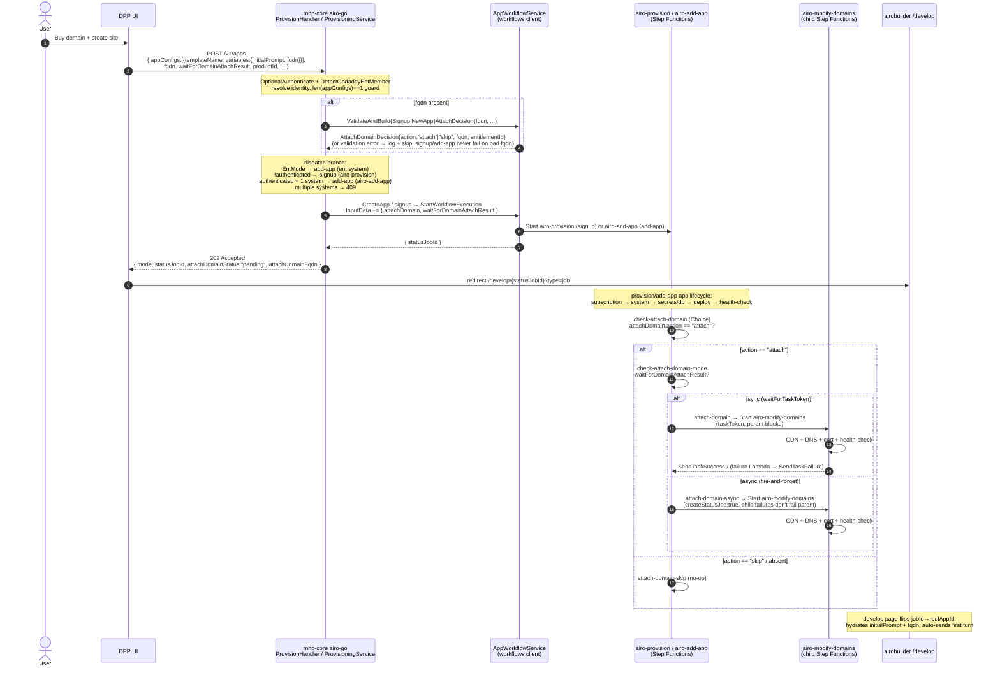

# DPP app-create + domain-attach flow: aab → mhp-core → workflow

High-level map of how a Domain-Purchase-Path (DPP) app creation flows from the
GoDaddy domain-purchase UI through **mhp-core `airo-go`** (the Go control-plane
backend in [`mhp-core`](https://github.com/gdcorp-partners/mhp-core)) and into the
Step Functions state machines in
[`pioneer-infra`](https://github.com/gdcorp-commerce/pioneer-infra), including
how a purchased domain gets attached via the `airo-modify-domains` workflow.

Companion docs:

- [`docs/dpp-develop-handoff.md`](dpp-develop-handoff.md) — the client/BFF side
  of the redirect into `/develop/{jobId}` and the initial-prompt + `fqdn`
  hydration. (aab PR [#4111](https://github.com/gdcorp-partners/airo-app-builder/pull/4111).)
- This doc — the create + domain-attach side: `POST /v1/apps` →
  provision/add-app SFN → `airo-modify-domains`.

## TL;DR

1. DPP calls airo-go's control-plane **`POST /v1/apps`** directly (not the aab
   BFF), with the purchased domain in two places: top-level `fqdn` (drives the
   domain attach) and `appConfigs[0].variables` (`initialPrompt`, `fqdn` —
   drives the develop-page hydration on redirect).
2. `ProvisionHandler` → `ProvisioningService.ProvisionApp` picks a branch:
   **signup** (anonymous → `airo-provision`) or **add-app** (authenticated with
   exactly one system, or a detected enterprise member → `airo-add-app`).
3. When `fqdn` is present, the service validates it and builds an
   **`attachDomain`** decision blob (`{action, fqdn, entitlementId}`), forwarded
   into the workflow input alongside `waitForDomainAttachResult`.
4. The `airo-provision-go` / `airo-add-app-go` state machine provisions the app,
   then at its `check-attach-domain` choice fires the **`airo-modify-domains`**
   workflow as a child — **synchronously** (`waitForTaskToken`) when
   `waitForDomainAttachResult=true`, otherwise **fire-and-forget** (async).
5. `airo-modify-domains` does the CDN + DNS + cert work to bind the custom
   domain to the app.

## Actors

| Layer | Component | Source |
| --- | --- | --- |
| **DPP UI** | GoDaddy domain-purchase path | (external) |
| **aab BFF / develop UI** | redirect target `/develop/{jobId}?type=job`, prompt + fqdn hydration | `app/` (this repo) |
| **mhp-core / airo-go** | `POST /v1/apps` handler + orchestrator + workflow client | `mhp-core/backends/airo-go` |
| **Step Functions** | `airo-provision`, `airo-add-app`, `airo-modify-domains` | `pioneer-infra/manage/lib/state-machines` |

> Note: DPP creates the app by calling airo-go **directly**. The aab BFF
> (`v2-control-plane-adapter.ts`) is a *parallel* caller of the same
> control-plane API for home-page traffic; it is not in the DPP create path.
> The aab side of DPP is the **redirect destination** (`/develop`), covered in
> `dpp-develop-handoff.md`.

## Sequence: create + domain attach



## The request body

`POST /v1/apps` (`ProvisionAppRequest`,
`mhp-core/.../schemas/provision_schemas.go`). Mounted under
`OptionalAuthenticate` + `DetectGodaddyEntMember`
(`.../handlers/router.go`).

```jsonc
{
  "appConfigs": [
    {
      "templateName": "default",
      "variables": { "initialPrompt": "...", "fqdn": "example.com" }
    }
  ],
  "fqdn": "example.com",              // top-level → drives domain attach
  "waitForDomainAttachResult": false, // sync vs fire-and-forget attach
  "productId": "...",
  // admin-only: customerId / shopperId override
}
```

Two carriers for the domain, by design:

- **top-level `fqdn`** → consumed by the handler/service to build the
  `attachDomain` decision and trigger `airo-modify-domains`.
- **`variables.fqdn` + `variables.initialPrompt`** → written onto the app record;
  surfaced back through the BFF as `site.fqdn` / `site.initial_prompt` so the
  develop page can hydrate the chat and auto-send (see `dpp-develop-handoff.md`).

## airo-go: dispatch + decision

`ProvisionHandler.Create` → `ProvisioningService.ProvisionApp`
(`.../application/services/provisioning_service.go`):

| Condition | Branch | Workflow |
| --- | --- | --- |
| `EntMode` (detected aab-ent-v1 member) | add-app on member system | `airo-add-app` |
| not authenticated | signup (mints subscription) | `airo-provision` |
| authenticated, exactly one system | add-app | `airo-add-app` |
| authenticated, multiple systems | refuse | `409` |

(Workflow names are product-scoped via `GetAddAppWorkflowForProduct` /
`getProvisionWorkflowForProduct`; PaaS products map to `paas-*` variants.)

When `fqdn` is present the service builds an **`AttachDomainDecision`**
(`app_workflow_service.go`):

```go
type AttachDomainDecision struct {
    Action        string  `json:"action"`        // "attach" | "skip"
    FQDN          string  `json:"fqdn"`          // normalized
    SkipReason    string  `json:"skipReason,omitempty"`    // "already_attached"
    EntitlementID *string `json:"entitlementId,omitempty"` // nil-safe; resolved in-workflow for signup
}
```

Builder per branch:

- **signup** → `ValidateAndBuildSignupAttachDecision` — format/deny-list/uniqueness/
  cross-account-ownership checks; **does not** require `entitlementId` (the
  provision SFN creates the subscription entitlement and fills it in downstream).
- **add-app** → `ValidateAndBuildNewAppAttachDecision` — same checks **plus**
  requires an `entitlementId` on the subscription.
- (publish path uses `ValidateAndBuildPublishAttachDecision` — adds custom-domain
  slot + active-job-conflict checks; not part of DPP create.)

**Validation failures never fail create** on the signup/add-app branches: the
handler logs and proceeds without `attachDomain`, and the response carries
`attachDomainStatus="skipped_validation_failed"`. A valid decision yields
`attachDomainStatus="pending"`. The blob is forwarded verbatim into the workflow
input (`workflowData["attachDomain"]`, `workflowData["waitForDomainAttachResult"]`).

Response is `202 Accepted` with `{ mode, statusJobId, subscriptionId, systemId,
attachDomainStatus, attachDomainFqdn }`. DPP redirects to
`/develop/{statusJobId}?type=job`.

## Workflow: how the attach is triggered

Both `airo-provision-go` and `airo-add-app-go` run the standard app lifecycle
(subscription → system → secrets/db → OAuth → deploy → health-check), then reach
the domain-attach tail (state names from
`pioneer-infra/manage/lib/state-machines/airo-{provision,add-app}-go_*.json`).

> State-machine JSON files in pioneer-infra carry a `_v<YYYYMMDDHHMMSS>.json`
> version suffix (e.g. `airo-modify-domains-go_v20260327000000.json`) — pick
> the highest-timestamp file matching the prefix; older versions linger for
> rollback. The `*` glob in this doc means "current latest".

```
... health-check → hosting-update-app-status
        → [add-app only] lookup-app-business-context  (resolves customer/sub/system/app ids)
        → check-attach-domain            (Choice)
              attachDomain present && action=="attach" ? → check-attach-domain-mode
              else                                       → attach-domain-skip (END)
        → check-attach-domain-mode       (Choice)
              waitForDomainAttachResult==true ? → attach-domain        (sync)
              else                              → attach-domain-async  (fire-and-forget)
```

- **`attach-domain`** (sync): `arn:aws:states:::lambda:invoke.waitForTaskToken`
  → starts `airo-modify-domains` and **blocks on the task token** until the child
  completes. No `TimeoutSeconds` (non-GD NS propagation can take ~5–25 min; the
  parent execution timeout is the bound). The `airo-modify-domains-failure` Lambda
  calls `SendTaskFailure` on abort/timeout. On error → `attach-domain-failed`.
- **`attach-domain-async`** (default): `arn:aws:states:::lambda:invoke` →
  starts `airo-modify-domains` with `createStatusJob:true` and returns
  immediately. **Child failures do not fail provisioning** (caught → `attach-domain-skip`).

Child input (built by the SFN) — domain + ids + `createCdn:true`:

```jsonc
{
  "workflowName": "airo-modify-domains",
  "createStatusJob": false,            // true on the async path
  "inputData": {
    "customerId": "...", "shopperId": "...", "subscriptionId": "...",
    "systemId": "...", "appId": "...", "entitlementId": "...",
    "domainsToCreate": [{ "fqdn": "<attachDomain.fqdn>", "primary": true }],
    "fqdnsToCreate": ["<attachDomain.fqdn>"],
    "domainsToDelete": [], "fqdnsToDelete": [],
    "createCdn": true,
    "skipAppReload": "<skipModifyDomainsAppReload>"
  }
}
```

> add-app resolves the ids via a `lookup-app-business-context` task first;
> provision reads them from earlier steps (`airo-create-subscription`,
> `hosting-create-system`).

## airo-modify-domains (child)

High-level path (`airo-modify-domains-go_*.json`):

```
register-modify-domains-job        (idempotent airo_jobs row for the concurrency gate)
  → get-app-cell-details
  → check-has-domains-to-create / prevalidate-domains   (slot-occupied guard → fail)
  → hosting-modify-domains          (ModifyAppDomainsTask)
  → manage-entitlement-domains
  → [deploy app unless skipAppReload] → set subdomains/verification
  → CDN delete/create + DNS:
       check-domain-ownership ↔ wait-ns-propagation (retry loop)
       evaluate-caa → set CA
       cdn-and-dns (Parallel): CDN create (with retry/elapsed budget)
                               + DNS set (SetCdnDns / SetAcmeCname / readiness wait)
  → stop-force-validate → wait-for-deployment → health-check
  → update-domains-create-statuses → update-app-status
  → refresh-domains-secret → update-app-secrets
  → update-airo-job-success
```

This is the workflow that does the real CDN provisioning, DNS record creation
(`SetCdnDns`, `SetAcmeCname`), NS-propagation polling for non-GoDaddy domains,
CAA evaluation, certificate issuance, and the final app reload + status update.

## Source pointers

Links below are pinned to the commits this diagram was drawn against:
mhp-core@[`898eaa80`](https://github.com/gdcorp-partners/mhp-core/tree/898eaa80) and
pioneer-infra@[`7ef8aafe`](https://github.com/gdcorp-commerce/pioneer-infra/tree/7ef8aafe).
Replace the SHA with `main` to follow HEAD.

**mhp-core (`backends/airo-go`):**

- [`internal/presentation/http/handlers/router.go`](https://github.com/gdcorp-partners/mhp-core/blob/898eaa80/backends/airo-go/internal/presentation/http/handlers/router.go) — `POST /v1/apps` mount.
- [`internal/presentation/http/handlers/provision_handler.go`](https://github.com/gdcorp-partners/mhp-core/blob/898eaa80/backends/airo-go/internal/presentation/http/handlers/provision_handler.go) — `Create`: identity
  resolution, admin override, `appConfigs` → workflow shape.
- [`internal/presentation/http/schemas/provision_schemas.go`](https://github.com/gdcorp-partners/mhp-core/blob/898eaa80/backends/airo-go/internal/presentation/http/schemas/provision_schemas.go) — `ProvisionAppRequest`.
- [`internal/application/services/provisioning_service.go`](https://github.com/gdcorp-partners/mhp-core/blob/898eaa80/backends/airo-go/internal/application/services/provisioning_service.go) — `ProvisionApp` dispatch.
- [`internal/application/services/app_workflow_service.go`](https://github.com/gdcorp-partners/mhp-core/blob/898eaa80/backends/airo-go/internal/application/services/app_workflow_service.go) — `AttachDomainDecision`,
  the `ValidateAndBuild*AttachDecision` builders, `CreateApp` (StartWorkflowExecution).
- [`internal/application/services/signup_service.go`](https://github.com/gdcorp-partners/mhp-core/blob/898eaa80/backends/airo-go/internal/application/services/signup_service.go) — signup branch StartWorkflow.

**pioneer-infra state machines (`manage/lib/state-machines`):**

- [`airo-provision-go_v20260327000000.json`](https://github.com/gdcorp-commerce/pioneer-infra/blob/7ef8aafe/manage/lib/state-machines/airo-provision-go_v20260327000000.json) — signup branch; `check-attach-domain` tail.
- [`airo-add-app-go_v20260327000000.json`](https://github.com/gdcorp-commerce/pioneer-infra/blob/7ef8aafe/manage/lib/state-machines/airo-add-app-go_v20260327000000.json) — add-app branch; `lookup-app-business-context` + tail.
- [`airo-modify-domains-go_v20260327000000.json`](https://github.com/gdcorp-commerce/pioneer-infra/blob/7ef8aafe/manage/lib/state-machines/airo-modify-domains-go_v20260327000000.json) — child domain-attach workflow.

**aab (this repo):** `docs/dpp-develop-handoff.md` and PR
[#4111](https://github.com/gdcorp-partners/airo-app-builder/pull/4111) — the
`/develop` redirect, `fqdn` propagation, and initial-prompt auto-send.
</content>
</invoke>
