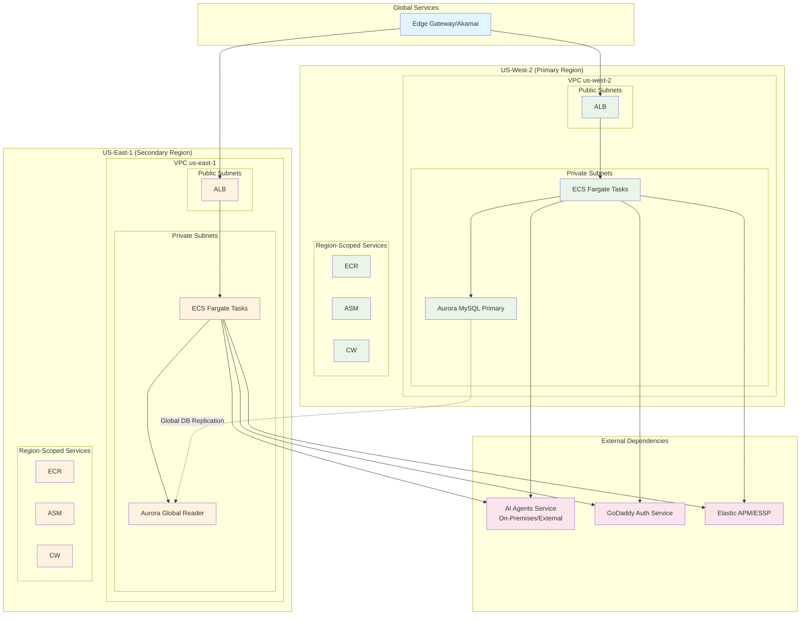
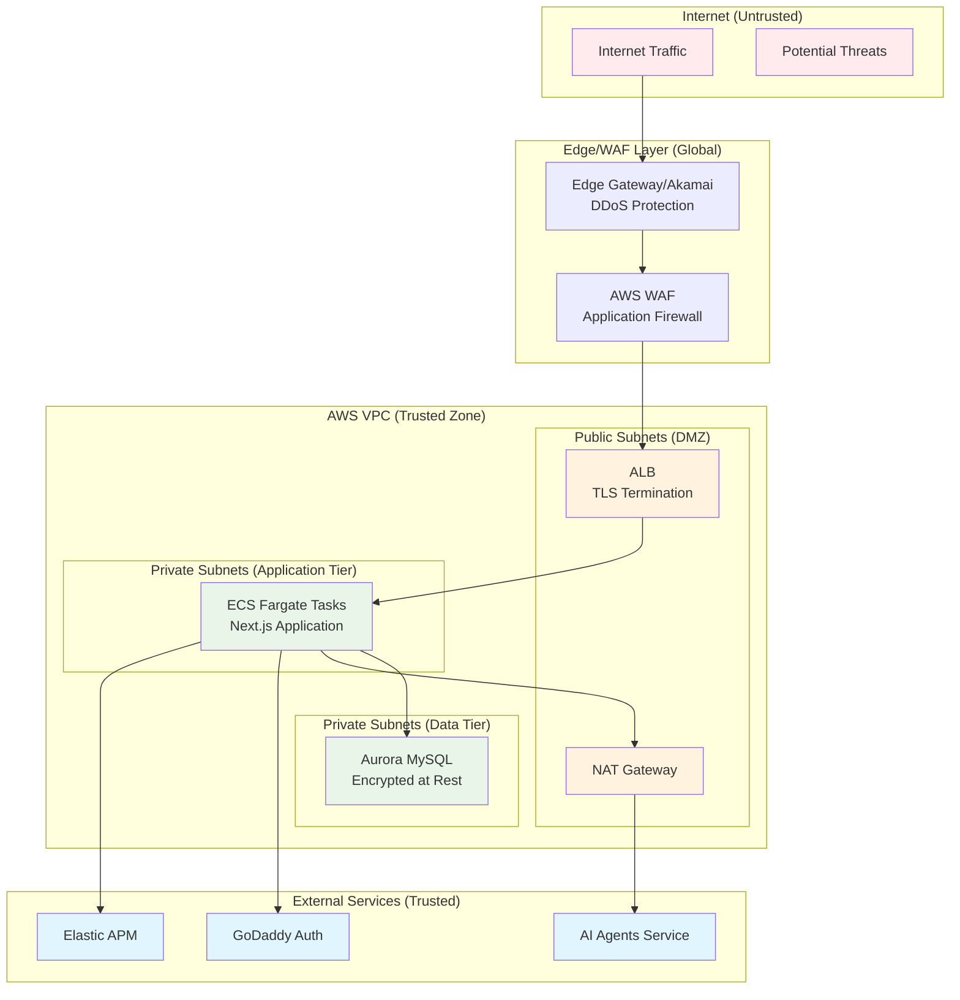
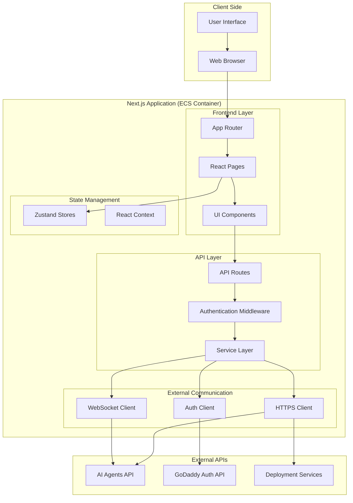
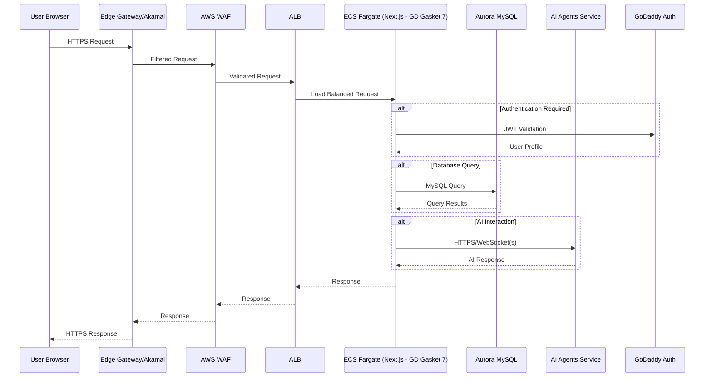
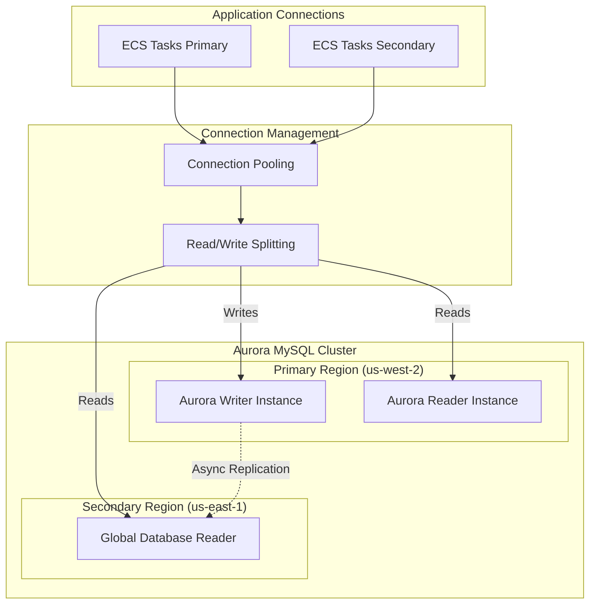
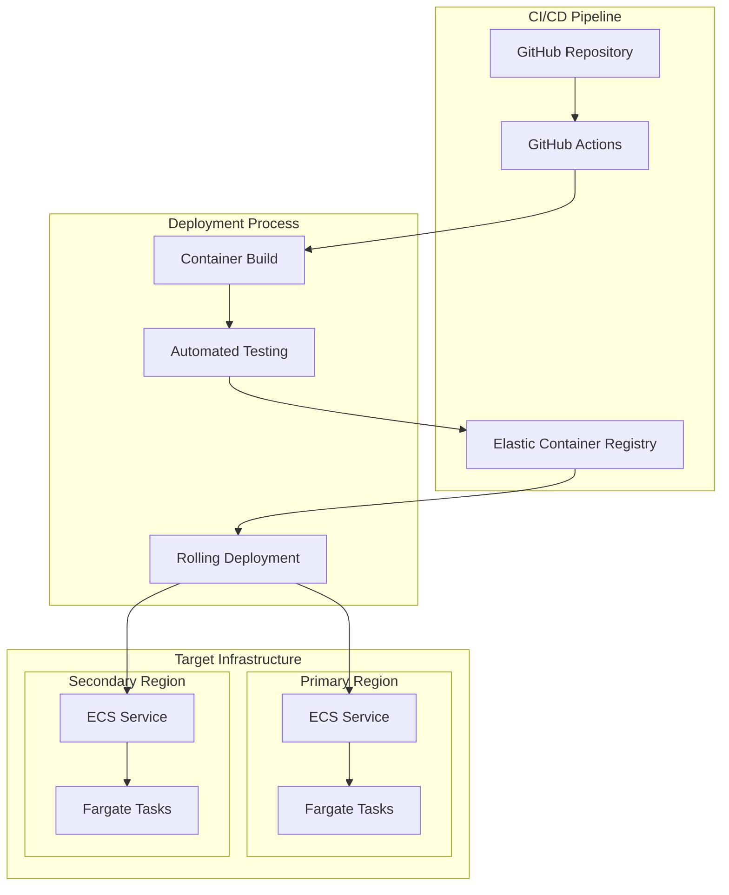

# Airo AI Builder - Frontend Application Architecture

## Executive Summary

This document details the architecture of the Airo AI Builder frontend application (`./app`), a Next.js-based web application deployed on AWS infrastructure. The application provides a user interface for AI-powered application development, featuring real-time AI interactions, code editing, and application management capabilities. This frontend communicates with external AI agents and deployment services while maintaining high availability across multiple AWS regions.

## Table of Contents

1. [Application Overview](#application-overview)
2. [AWS Infrastructure Architecture](#aws-infrastructure-architecture)
3. [Application Components](#application-components)
4. [Traffic Flow & Network Architecture](#traffic-flow--network-architecture)
5. [Security & Authentication](#security--authentication)
6. [Data Architecture](#data-architecture)
7. [Deployment & Operations](#deployment--operations)
8. [Performance & Scaling](#performance--scaling)

## Application Overview

### What is the Airo AI Builder Frontend?

The Airo AI Builder frontend is a modern web application built with Next.js 14+ that serves as the primary user interface for an AI-powered application development platform. Users interact with AI agents to create, develop, and manage applications through a sophisticated web interface featuring real-time chat, code editing, and project management capabilities.

### Key Application Features

- **AI-Powered Development Interface**: Real-time chat with AI agents for application development
- **Code Editor Integration**: Monaco Editor for in-browser code editing
- **Project Management**: Create, view, and manage development projects
- **Real-time Collaboration**: WebSocket-based live updates and AI interactions
- **Responsive Design**: Mobile-friendly interface using Tailwind CSS and Shadcn/ui

## AWS Infrastructure Architecture

### Multi-Region Deployment

**Hosting Locations**: AWS Multi-Region (us-west-2 Primary, us-east-1 Secondary)
**Deployment Pattern**: Hot/Warm (Active-Standby)
**Expected Traffic**: 100s to 1000s of requests per minute



### Infrastructure Components by Scope

#### Globally Scoped Components
- **Edge Gateway/Akamai**: Global content delivery and DDoS protection

#### Region Scoped Components
- **ALB**: Layer 7 load balancing with SSL termination
- **Aurora Serverless V2 Global Datastore (MySQL)**: Managed database with global replication
- **Elastic Container Registry (ECR)**: Container image storage
- **Secrets Manager**: Secure configuration and credential storage
- **CloudWatch**: Logging, metrics, and monitoring

#### VPC Components
- **ECS Fargate**: Serverless container hosting for Next.js application
- **NAT Gateway**: Outbound internet access for private subnets
- **Aurora MySQL Cluster**: Database instances across multiple AZs

### Network Security Zones

**Security Zone**: PRD (Production)
**Network Environment**: AWS VPC with public/private subnet architecture



## Application Components

### Next.js Application Architecture

**Technology Stack**:
- Next.js 14.2+ with App Router
- TypeScript for type safety
- Tailwind CSS + Shadcn/ui components
- Zustand for state management
- Socket.io for real-time communication



### Major Application Resources

#### Web Server Components
- **Next.js Server**: Server-side rendering and API routes
- **Static Asset Server**: Optimized delivery of JS/CSS/images
- **WebSocket Server**: Real-time communication with AI agents

#### Data Processing Components
- **Authentication Handler**: JWT token validation and user session management
- **API Gateway**: Centralized routing to external services
- **State Synchronization**: Real-time updates between UI and backend services

#### Integration Components
- **Agent API Client**: HTTPS/WebSocket client for AI agent communication
- **Database Client**: MySQL connection pool management
- **Monitoring Client**: APM and logging integration

## Traffic Flow & Network Architecture

### User Traffic Flow



### Network Access Patterns

#### Ingress Points
- **Primary**: Edge Gateway/Akamai → AWS WAF → ALB
- **Management**: VPN access for administrative functions
- **Monitoring**: Elastic APM data ingestion

#### Egress Points
- **AI Agents**: HTTPS to on-premises/external AI service
- **Authentication**: HTTPS to GoDaddy Auth services
- **Monitoring**: HTTPS to Elastic APM/ESSP
- **External APIs**: HTTPS to various third-party services

### Interface Protection & Access Control

#### How Interfaces Are Protected
- **TLS Encryption**: All traffic encrypted with TLS 1.2+
- **AWS WAF**: Layer 7 filtering for common attacks (OWASP Top 10)
- **Edge Gateway/Akamai**: DDoS protection and bot mitigation
- **Rate Limiting**: API rate limits per user/IP
- **Authentication**: JWT-based user authentication
- **Authorization**: RBAC with account-level permissions

#### Access Control Matrix

| Interface | Authentication | Authorization | Rate Limiting | WAF Protection |
|-----------|---------------|---------------|---------------|----------------|
| Web UI | SSO JWT User | Account-based RBAC | 1000 req/min | Yes |
| API Routes | SSO JWT User | Account ownership | 100 req/min | Yes |
| WebSocket | SSO JWT User | Session validation | 50 connections | Yes |
| Health Endpoints | None | IP restrictions | 10 req/min | Yes |

## Security & Authentication

### Authentication Methods

#### Production Authentication
- **SSO JWT User**: GoDaddy Single Sign-On with JWT tokens
- **Session Management**: Secure session handling with httpOnly cookies
- **Token Refresh**: Automatic token refresh mechanism

### Authorization Protections

#### Role-Based Access Control (RBAC)
- **Account Ownership**: Users can only access their own sites/applications
- **Plan-Based Limits**: Site creation limits based on user plan
- **Feature Flags**: Conditional feature access based on user permissions

#### Network Security
- **VPC Isolation**: Application runs in isolated VPC
- **Security Groups**: Restrictive inbound/outbound rules
- **WAF Rules**: Custom rules for application-specific threats
- **IP Restrictions**: Administrative functions limited to specific IP ranges

### Security Architecture

```mermaid
graph TB
    subgraph "Security Layers"
        subgraph "Perimeter Security"
            EG[Edge Gateway/Akamai DDoS]
            WAF[AWS WAF Rules]
            ALB[ALB Security Groups]
        end
        
        subgraph "Application Security"
            JWT[JWT Authentication]
            RBAC[Role-Based Authorization]
            Session[Session Management]
        end
        
        subgraph "Data Security"
            Encryption[Data Encryption at Rest]
            TLS[TLS 1.2 in Transit]
            SecretsManager[AWS Secrets Manager]
        end
        
        subgraph "Infrastructure Security"
            VPC[VPC Network Isolation]
            IAM[AWS IAM Roles]
            SecurityGroups[Security Groups]
        end
    end
    
    subgraph "Threat Mitigation"
        DDoS[DDoS Protection]
        SQLInjection[SQL Injection Prevention]
        XSS[XSS Protection]
        CSRF[CSRF Protection]
    end
    
    EG --> DDoS
    WAF --> SQLInjection
    WAF --> XSS
    JWT --> CSRF
    
    ALB --> VPC
    Session --> SecretsManager
    RBAC --> IAM
```



## Data Architecture

### Database Design

#### Database (Aurora MySQL)
**Location**: Private subnets across multiple AZs
**Replication**: Global database replication to us-east-1
**Encryption**: AES-256 encryption at rest

```sql
-- Core data model focused on frontend needs
CREATE TABLE accounts (
    id VARCHAR(255) PRIMARY KEY,
    shopper_id VARCHAR(255) NOT NULL UNIQUE,
    customer_id VARCHAR(255) NOT NULL,
    plan_id VARCHAR(255),
    status ENUM('active', 'suspended', 'closed') DEFAULT 'active',
    created_at TIMESTAMP DEFAULT CURRENT_TIMESTAMP,
    updated_at TIMESTAMP DEFAULT CURRENT_TIMESTAMP ON UPDATE CURRENT_TIMESTAMP
);

CREATE TABLE sites (
    id VARCHAR(255) PRIMARY KEY,
    account_id VARCHAR(255) NOT NULL,
    title VARCHAR(255),
    initial_prompt TEXT,
    domain VARCHAR(255),
    agent_url VARCHAR(255),
    backend_url VARCHAR(255),
    preview_url VARCHAR(255),
    status ENUM('pending', 'queued', 'running', 'failed', 'stopped') DEFAULT 'pending',
    created_at TIMESTAMP DEFAULT CURRENT_TIMESTAMP,
    updated_at TIMESTAMP DEFAULT CURRENT_TIMESTAMP ON UPDATE CURRENT_TIMESTAMP,
    FOREIGN KEY (account_id) REFERENCES accounts(id)
);
```

#### Database Architecture



### Data Flow Patterns

#### Read Operations
- **Site Listings**: Read from nearest Aurora reader
- **User Profiles**: Cached in application memory with 5-minute TTL
- **Configuration Data**: Read from Secrets Manager with application-level caching

#### Write Operations
- **Site Creation**: Write to Aurora writer with immediate consistency
- **User Actions**: Logged asynchronously to monitoring systems
- **Session Data**: Stored in secure httpOnly cookies

## Deployment & Operations

### Deployment Architecture

#### Hot/Warm Pattern
- **Primary (Hot)**: us-west-2 actively serving traffic
- **Secondary (Warm)**: us-east-1 ready for failover
- **Failover**: Automatic via health monitoring
- **RTO**: < 5 minutes (Recovery Time Objective)
- **RPO**: < 1 minute (Recovery Point Objective)

#### Container Deployment


