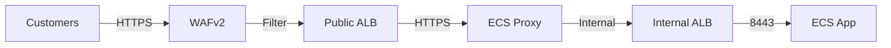
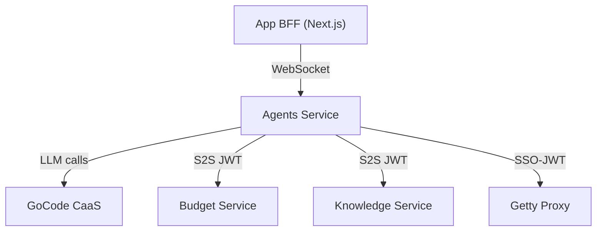
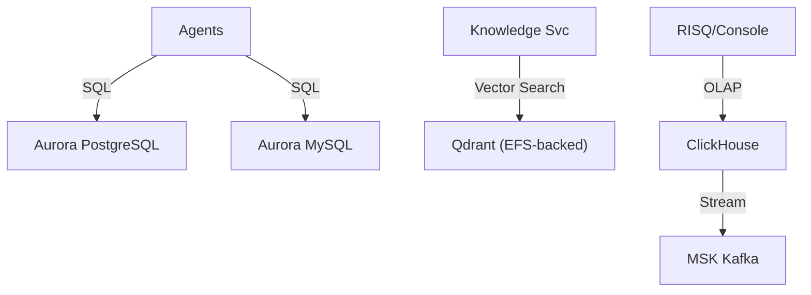
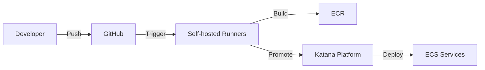
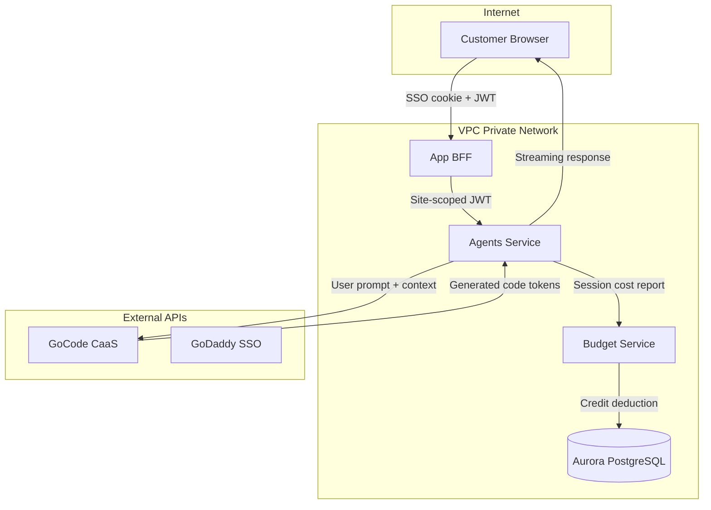

# Generated Architecture Overview

This document provides a comprehensive overview of the architecture and security posture of GoDaddy's Airo App Builder system.
It includes detailed descriptions of the system's components, data flows, security controls, and operational practices.
The information is based on available documentation, code analysis, and architectural diagrams.

It was auto-generated by the security team with a new diagram tool they are developing.
We can update this document iteratively as this tool progresses.

> The _File Inventory_ sections have been removed and the biggest risk of documentation drift.

Contacts: `@agrover`, `@tnelson1`

See the [Generated Architecture Diagram](generated-architecture-diagram.png).

---

## Security Certification — System Description: Airo App Builder

**Certification:** CERT0007898  
**Generated:** 2026-05-21 06:44 UTC  
**Generation Mode:** llm  

---

## Abstract

This document describes the architecture and security posture of GoDaddy's Airo App Builder — an AI-powered vibe coding platform that enables customers to build complete web applications through conversational AI agents. The system spans 4 AWS accounts (Prod, Test, Dev-Private, CICD) using ECS Fargate, Aurora databases, vector search (Qdrant), analytics (ClickHouse), and multiple LLM providers via GoCode CaaS proxy. Key security controls include JWT-based tenant isolation, WAFv2 protection, mTLS for internal GoDaddy services, and comprehensive secrets management.

## Overview

- **Application name:** Airo App Builder
- **Prod URL:** https://airo-builder.godaddy.com
- **Test URL:** https://airo-builder.test-godaddy.com
- **Dev URL:** https://airo-builder.dev-godaddy.com

Airo App Builder is a conversational AI platform where GoDaddy customers describe websites they want to build, and AI agents (Initial, Develop, Marketing, Design) generate full-stack web applications in real-time. The system operates end-to-end as follows:

1. Customer authenticates via GoDaddy SSO and receives a short-lived JWT
2. Browser establishes WebSocket connection to the Agents service (via Proxy ALB)
3. Customer sends a prompt describing their desired website
4. Assessment Agent classifies intent and routes to appropriate agent
5. AI agents call GoCode CaaS (LLM proxy) for code generation
6. Generated code is written to a containerized preview environment (dev-supervisor)
7. Real-time updates stream back via WebSocket/SSE
8. Budget Service tracks credit consumption per session
9. Customer can publish the site, purchase domains, and manage commerce

## In-Scope

- All ECS Fargate services: App (Next.js BFF), Agents (Node.js), Proxy, Budget Service (Go), Knowledge Service (Go), Blog, Debug Console, Stripe Service, Image Search Service, RISQ
- Aurora PostgreSQL and MySQL databases
- Qdrant vector database cluster
- ClickHouse analytics cluster with MSK
- Lambda functions (JWT rotation, GoCode spend sync, Langfuse metrics, Investigator)
- CI/CD pipeline (GitHub Actions with self-hosted runners)
- CDK infrastructure stacks
- External integrations (GoCode CaaS, GoDaddy SSO, Getty Images, Stripe, KnowB)
- WebSocket/SSE real-time communication layer

## Out of Scope

- Client-side browser security (OS, extensions)
- GoDaddy SSO internal implementation
- GoCode CaaS internal LLM routing
- Third-party SaaS internal security (Langfuse, Stripe)
- Customer-generated website content security
- GoDaddy corporate network infrastructure

## Architectural Assumptions

- All client-to-service communication is protected by TLS (HTTPS/WSS)
- JWT tokens have a maximum TTL of 600 seconds for WebSocket connections
- IAM roles follow least privilege (service-specific roles per ECS task)
- Aurora clusters use encryption at rest via KMS
- Internal services communicate over private subnets via internal ALBs
- Secrets are never logged (SENSITIVE_KEYS redaction in logging system)
- Budget Service enforces credit limits before LLM calls proceed
- Cross-tenant data access is prevented at the application layer via siteId validation

## Architectural Diagrams

The full consolidated architecture diagram is available as a companion Mermaid file (.mmd) and PNG image.

### Networking & Ingress

Traffic enters through a public ALB protected by WAFv2 WebACL. The Proxy service (airo-proxy) handles TLS termination, authentication certificate management, and routes to internal ALBs for each backend service. All internal communication uses private subnets.

### Compute & Application

The App service is a Next.js BFF that handles SSO authentication and issues site-scoped JWTs. The Agents service runs AI agents (Develop, Initial, Marketing) that orchestrate LLM calls, tool execution, and real-time streaming. Budget Service (Go) manages credit consumption. Knowledge Service (Go) provides RAG documentation retrieval via Qdrant.

### Data Stores

Aurora PostgreSQL stores budget data and application metadata. Aurora MySQL stores user app databases. Qdrant provides vector similarity search for RAG. ClickHouse handles analytics queries with MSK for event streaming.

### CI/CD Pipeline

GitHub Actions on self-hosted runners (Wadsworth) build Docker images, push to ECR, and promote through environments via GoDaddy's Katana deployment platform. The pipeline includes quality checks, E2E tests (Playwright), load tests, and security scans (CirrusScan).

## Data Flow Diagram

The system processes user prompts (text), generates code (source files), manages credits (financial data), and stores conversation history. Trust boundaries exist between the public internet, the VPC private network, and external API providers.

## Critical Components

### Agents Service (ECS Fargate)
- **Type:** Process
- **Use case:** AI agent orchestration — routes prompts to specialized agents, manages WebSocket connections, executes tools
- **Input:** User messages via WebSocket/SSE, JWT tokens, app context
- **Output:** Streaming code generation, tool call results, budget reports
- Interacts with: GoCode CaaS, Budget Service, Knowledge Service, Aurora databases, Secrets Manager

### Budget Service (ECS Fargate - Go)
- **Type:** API Service
- **Use case:** Credit budget management — creates sessions, tracks LLM costs, files reports
- **Input:** S2S JWT authenticated requests from Agents
- **Output:** Budget status, session costs, report confirmations
- Interacts with: Aurora PostgreSQL, Secrets Manager

### Knowledge Service (ECS Fargate - Go)
- **Type:** API Service
- **Use case:** RAG documentation retrieval — ingests docs, provides semantic search
- **Input:** Search queries with S2S JWT auth
- **Output:** Ranked document chunks
- Interacts with: Qdrant vector DB

### GoCode CaaS Proxy
- **Type:** External Service
- **Use case:** LLM inference routing (OpenAI, Anthropic models)
- **Input:** Chat completion requests with IAM JWT
- **Output:** Streaming token responses with cost metadata

## Authentication / Authorization

- **Level 1 (Customer SSO):** GoDaddy SSO cookie-based authentication at the BFF layer
- **Level 2 (Site JWT):** Short-lived JWTs (max 600s TTL) issued by the App BFF, validated via JWKS endpoint
- **Level 3 (S2S):** IAM-based service-to-service JWT tokens for internal service calls (Budget, Knowledge)
- **Level 4 (mTLS):** Client certificates for GoDaddy internal APIs (SSO token generation, Getty proxy)
- **WebSocket Auth:** Connect-then-auth pattern with 30s timeout; token refresh with siteId consistency check
- **Authorization:** Permission-based (canDownload, canPublish, canPurchaseDomain) from JWT claims; product type enforcement (PaaS denied WebSocket)

## Secrets / Credentials Storage

- AWS Secrets Manager used across all accounts (81 secrets in Prod, 105 in Dev)
- JWT key pairs rotated via Lambda (prod-airo-jwt-rotation)
- mTLS certificates stored as individual secrets (cert + key)
- Database credentials in Secrets Manager with KMS encryption
- Katana platform injects secrets at deploy time via alloc config
- Runtime: secrets fetched via AWS SDK GetSecretValue; never passed through client context

## Infrastructure & Cloud Resources

**Compute:** ECS Fargate (katanaRuntime cluster - Prod), Lambda functions (JWT rotation, spend sync, metrics, investigator)
**Database:** Aurora PostgreSQL 16.11 (serverless), Aurora MySQL 8.0 (serverless), Qdrant (EFS-backed ECS), ClickHouse (EC2-based ECS), DynamoDB (Dev only)
**Networking:** VPC 192.168.0.0/19 per account, public/private subnets across 2 AZs, NAT Gateways, internal/public ALBs, NLB for ClickHouse
**Security:** WAFv2, KMS (9 keys Prod), Secrets Manager, Security Groups, VPC Endpoints
**Storage:** S3 (42 buckets Prod), EFS (Qdrant persistence)
**Messaging:** MSK Kafka (ClickHouse OLAP pipeline)
**Monitoring:** CloudWatch, Elastic APM, Langfuse, Elasticsearch

## CI/CD Pipeline

Built on GitHub Actions with self-hosted runners (Wadsworth) in the CICD account (754151945003). Key workflows:
- `aws-deploy-app.yml`: Builds App container, publishes to Katana, promotes to environment
- `aws-deploy-budget-service.yml`: Go service build with JFrog for private modules
- `deploy-test-e2e.yml`: Post-merge pipeline — deploy to test then run Playwright E2E
- `cdk.yml`: Infrastructure deployment via CDK (diff/deploy)
- `merge-queue.yml`: Required merge gate with parallel quality checks
- `playwright-e2e.yml`: Scheduled E2E tests (every 2h critical path, daily regression)
- `agentic-qa.yml`: AI-powered QA scenarios with Stagehand browser automation

## Deployment Environments

| Environment | Account | Region | Notes |
|---|---|---|---|
| Dev-Private | 694282668781 | us-west-2 | Development + shared test infra |
| Pre-Test | 694282668781 | us-west-2 | Pre-promotion staging |
| Test | 269423819739 | us-west-2 | Integration testing |
| Prod | 644094189644 | us-west-2 + us-east-1 | Production (multi-region networking) |
| CICD | 754151945003 | us-west-2 | Build runners + artifact storage |

## Security Controls

- **Encryption at rest:** KMS-encrypted Aurora, S3, Secrets Manager, EFS
- **Encryption in transit:** TLS everywhere; mTLS for GoDaddy internal APIs
- **Network segmentation:** Private subnets for compute/DB; public subnets only for ALBs/NAT
- **WAF:** WAFv2 WebACL on public-facing ALBs (Prod, Dev, Test)
- **Tenant isolation:** JWT siteId validation on every WebSocket message; conversation ownership checks
- **Vulnerability scanning:** CirrusScan monthly (GoDaddy compliance requirement)
- **Supply chain:** pnpm audit, license compliance checks, JFrog Artifactory for private packages
- **Secrets rotation:** Lambda-based JWT key rotation; ECS service secret rotation via Service Catalog
- **Logging:** Structured logging with sensitive data redaction; ESSP (Elasticsearch) for centralized logs

## Security Observations

**Strengths:**
- Comprehensive tenant isolation at multiple layers (WebSocket middleware, conversation ownership, context extraction)
- Short-lived JWT tokens (600s max) minimize token theft impact
- Budget Service prevents unbounded LLM cost accumulation
- Security scanning integrated into CI/CD (CirrusScan, tools-security-check)
- Sensitive data redaction built into the logging framework

**Concerns:**
- Large number of secrets (81 in Prod) increases rotation management complexity
- Some Lambda functions have high memory (8GB Investigator) suggesting broad permissions
- DynamoDB tables in Dev account may lack encryption configuration visibility
- WebSocket connect-then-auth allows 30s unauthenticated connection window
- Multiple ECR repositories with potentially stale images (1058 in Dev)

## Information Gaps

- CDK stack source code not provided — cannot verify exact resource configurations
- VPC endpoint configurations not visible in provided data
- Exact WAF rule sets and rate limiting thresholds unknown
- IAM policy documents not available for least-privilege verification
- Backup/DR configurations for Aurora and ClickHouse not specified
- Network ACL rules not visible
- CloudFront distribution presence/absence unclear
- ECS task definition resource limits and auto-scaling policies not provided
