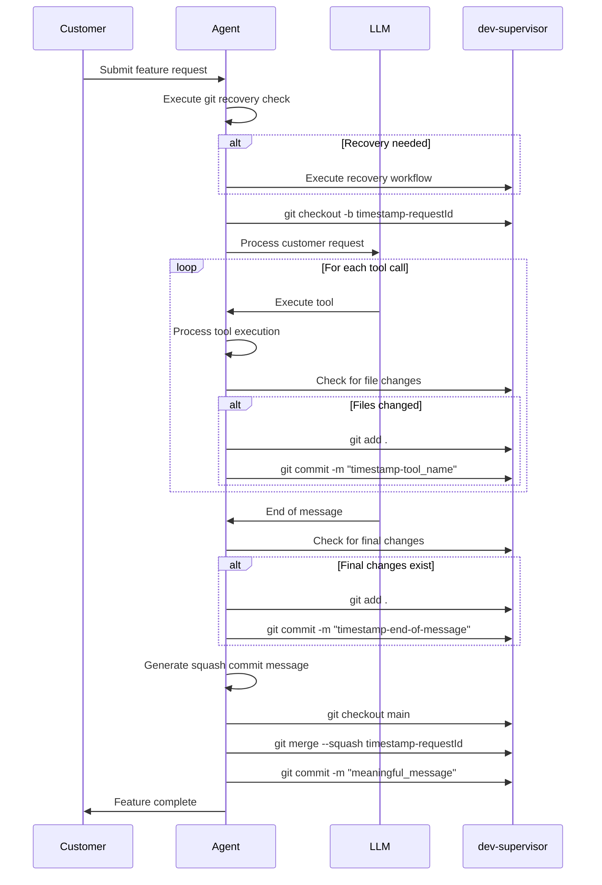
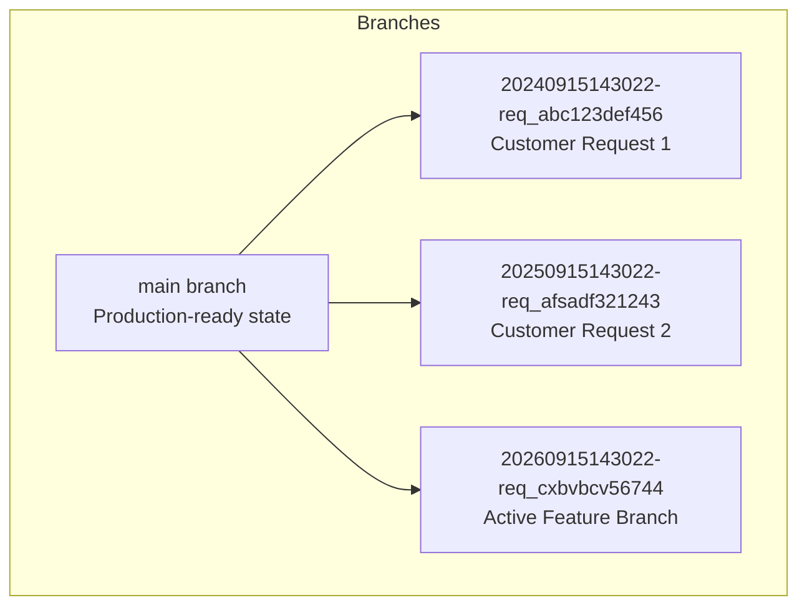
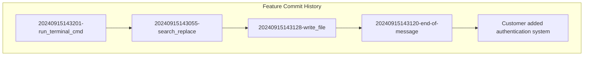
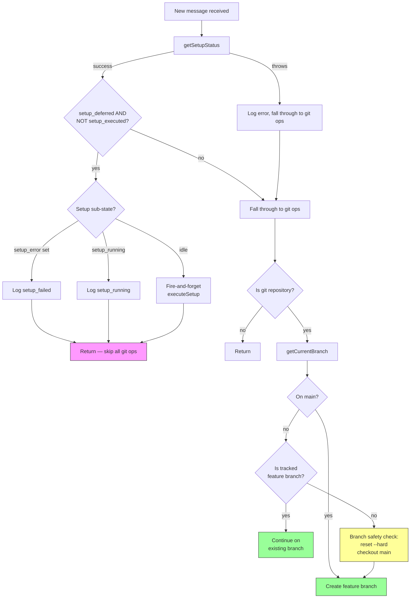
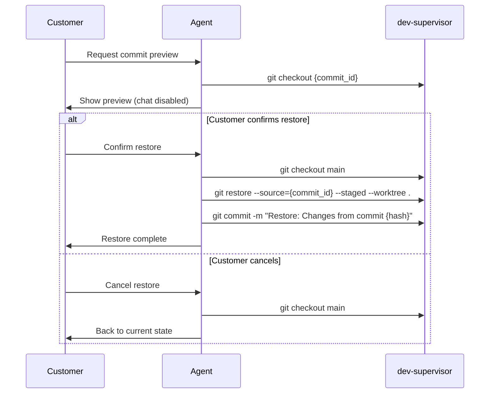
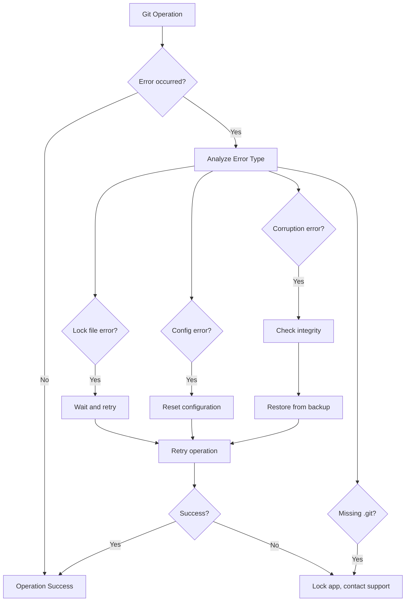

# Git Operations Architecture

## Overview

The Git Operations Architecture provides automated version control for customer applications in the Airo AI platform. All git operations are managed by the agent through the dev-supervisor, ensuring complete isolation of the git repository from the agent container while maintaining comprehensive tracking of LLM interactions and tool executions.

## Core Principles

- **Agent-Driven Workflow**: All git operation logic and decision-making occurs within the agent
- **Repository Isolation**: The `.git` directory is never visible to the agent container
- **Feature Branch Isolation**: Each customer request operates in its own feature branch
- **Comprehensive Tracking**: Every tool call generates a commit for audit and rollback capabilities
- **Automatic Recovery**: Interrupted sessions are automatically detected and recovered
- **No LLM Git Tools**: Git operations are transparent to the LLM, this saves on costs as it reduces tool calls and context

## Feature Request Workflow

### Definition of a Feature

A "feature" represents a complete customer interaction session with the LLM, from initial prompt through all tool executions until the final response.

### Feature Branch Lifecycle



### Branch Naming Convention

Feature branches follow the pattern: `{timestamp}-{requestId}`

**Examples:**

- `20240915143022-req_abc123def456`
- `20241201091500-req_xyz789uvw012`

**Components:**

- `timestamp`: UTC timestamp in `YYYYMMDDHHmmss` format
- `requestId`: Unique identifier for the customer's development session



### Automatic Commit Strategy

#### Tool Call Commits

After each tool execution, the agent checks for file changes and commits them:

```bash
# Pattern: timestamp-tool_name
git commit -m "20240915143055-search_replace"
git commit -m "20240915143128-write_file"
git commit -m "20240915143201-run_terminal_cmd"
```

#### End-of-Message Commits

After LLM completes its response, a final commit captures any remaining changes:

```bash
# Pattern: timestamp-end-of-message
git commit -m "20240915143245-end-of-message"
```

#### Squash Commit Generation

The agent uses an LLM to generate meaningful commit messages for the final merge:

**Input Context:**

- Original customer prompt
- Summary of files changed
- High-level description of modifications

**Generated Message Examples:**

- `Add user authentication with JWT tokens`
- `Implement responsive navigation component`
- `Fix API endpoint validation and error handling`

**Fallback:** If LLM generation fails, use: `{timestamp} - Feature implementation`

Example:

```bash
git checkout main && git merge --squash $previous_branch && git commit -m "$squash_message"
```



## Recovery and Setup Coordination

Recovery after container restart is split between two systems with clear ownership boundaries:

- **`nomad_setup.sh`** — sole owner of filesystem and git recovery (runs in preview container)
- **`GitHookService.handleMessageStart`** — coordinates with setup, manages branch lifecycle (runs in agent)

### Recovery Scenarios

| Scenario                | Trigger                                              | Who recovers                | Agent behavior                                                                |
| ----------------------- | ---------------------------------------------------- | --------------------------- | ----------------------------------------------------------------------------- |
| **Nomad reschedule**    | Ephemeral disk wiped, `.git` survives on bind mount  | `nomad_setup.sh`            | Setup gate returns early, skips git ops until setup complete                  |
| **Process restart**     | Agent crashes, supervisor restarts it (no disk wipe) | Agent (branch safety check) | `reset --hard` → `checkout main` → create feature branch                      |
| **Normal steady state** | No crash                                             | Nobody                      | Setup gate falls through, branch check passes, create/continue feature branch |

### handleMessageStart Flow



### nomad_setup.sh Restart Path

When `.git/config` exists (restart detected), the script runs unconditionally:

1. **Clean stale lock files** — `.git/index.lock`, `.git/refs/heads/*.lock`, `.git/packed-refs.lock`
2. **`git reset --hard`** — restore working tree from HEAD (handles wiped disk, dirty index, interrupted merges)
3. **`git checkout main`** — switch to main if not already there (no `|| true` — failure aborts via `set -e`)
4. **Sync `package.json`** from template
5. **`npm install`** — only if `node_modules` is missing (idempotent — clean restart is a fast no-op)
6. **Sync dev-tools, airo-secrets, .npmrc, template files**

### Setup Coordination

After Nomad reschedule, `nomad_setup.sh` is deferred to the first HTTP request. The agent may receive WebSocket messages before setup runs. The setup coordination gate in `handleMessageStart` prevents the race:

| Message                   | Setup state                            | Agent behavior                                  |
| ------------------------- | -------------------------------------- | ----------------------------------------------- |
| 1st after reschedule      | `deferred && !executed && !running`    | Triggers setup (fire-and-forget), skips git ops |
| 2nd (setup still running) | `deferred && !executed && running`     | Skips git ops                                   |
| Nth (setup done)          | `deferred && executed`                 | Normal git ops resume                           |
| Any (setup failed)        | `deferred && !executed && setup_error` | Logs failure, skips git ops, does not retry     |

### Branch Safety Check

If the agent finds itself on an unexpected branch (not main, not a tracked feature branch), it resets and switches to main. This handles the process-restart scenario where in-memory `appBranches` is lost but the repo is still on a feature branch with a potentially dirty working tree from a crashed tool call. The abandoned feature branch is not squash-merged — `nomad_setup.sh` handles filesystem recovery, so preserving partial work via plumbing is unnecessary complexity.

## Git Restore Operations

### Commit Preview System

Customers can preview commits before restoring:

1. **Temporary Checkout**: Application shows state at selected commit
2. **Chat Disabled**: Interface clearly indicates preview mode
3. **Easy Return**: Customer can return to current state without changes

### Restore Implementation



### Restore Process

1. **Checkout Main**: Ensure we're on main branch
2. **Restore Files**: Copy files from target commit to working directory and staging area
3. **Auto-Commit**: Create commit with restored changes

**Restore Commands:**

```bash
# Checkout main branch
git checkout main

# Restore files from target commit
git restore --source={commit_hash} --staged --worktree .

# Auto-commit the restored state
git commit -m "Restore: Changes from commit {hash}"
```

## Error Handling and Recovery

### Common Git Errors

The agent handles git errors through systematic recovery attempts:

#### Lock File Issues

Stale lock files from crashes are cleaned proactively by `nomad_setup.sh` on restart:

```bash
rm -f .git/index.lock .git/refs/heads/*.lock .git/packed-refs.lock
```

#### Configuration Issues

```bash
# Error: Missing git configuration
# Recovery: Set default configuration
git config user.email "agent@airo.platform"
git config user.name "Airo Agent"
```

#### Repository Corruption

```bash
# Error: Repository integrity issues
# Recovery: Check and repair
git fsck --full
# If unsuccessful, restore from backup
```

#### Missing .git Directory

- **Recovery**: Lock application and escalate to support
- **Prevention**: Monitor file system operations

### Error Recovery Workflow



### Error Handling Strategy

1. **Immediate Retry**: For transient issues (lock files, network)
2. **Configuration Reset**: For config-related errors
3. **Integrity Check**: For corruption detection
4. **Backup Restoration**: For severe corruption
5. **Support Escalation**: For unrecoverable issues

## Benefits and Advantages

### Development Workflow Benefits

- **Comprehensive Audit Trail**: Every tool call tracked in git history
- **Safe Experimentation**: Feature branches protect main development line
- **Automatic Recovery**: Handles interrupted sessions gracefully
- **Granular Rollbacks**: Restore to any point in development history
- **Troubleshooting**: Pinpoint exact operations that caused issues

### Operational Benefits

- **LLM Performance Analysis**: Identify problematic tool calls
- **Customer Support**: Clear history for debugging
- **Platform Improvement**: Data-driven insights for optimization
- **Disaster Recovery**: Comprehensive backup and restore capabilities

### Security Benefits

- **Repository Isolation**: Git operations completely isolated from agent
- **Audit Compliance**: Full traceability of all changes
- **Access Control**: All operations authenticated and authorized
- **Data Protection**: Automated backup and recovery systems

## Implementation Considerations

### Performance Optimization

- **Smart Commit Detection**: Only commit when files actually change
- **Read-Only Tool Filtering**: Skip commits for tools that don't modify files
- **Branch Retention Strategy**: Feature branches retained for debugging and audit
- **Automatic Cleanup**: Old branches cleaned up when count exceeds threshold
- **Repository Maintenance**: Automatic garbage collection after branch cleanup

### Branch Management Strategy

#### Branch Retention and Cleanup

Feature branches are retained after squash merge to provide debugging history and audit trail:

**Retention Policy:**

- Feature branches remain after merge to main
- Maximum branch count threshold: 50 branches
- When threshold exceeded: Delete oldest 25 branches
- Cleanup triggered automatically during merge operations

**Cleanup Workflow:**

1. Squash merge feature branch to main
2. Check total branch count (excluding main)
3. If count > 50: Delete oldest 25 branches (sorted by commit date)
4. Run `git gc --auto` to optimize repository
5. Continue normal operations

**Benefits:**

- **Debugging History**: Recent feature branches available for investigation
- **Audit Trail**: Historical branches preserved temporarily
- **Automatic Management**: No manual intervention required
- **Storage Optimization**: Git garbage collection after bulk deletions

**Commands:**

```bash
# After successful merge
git checkout main
git merge --squash {feature_branch}
git commit -m "{user_prompt}"

# Automatic cleanup if branch count > 50
git for-each-ref --sort=committerdate --format='%(refname:short)' refs/heads/
# Delete oldest 25 branches
git branch -D {old_branch_1} {old_branch_2} ... {old_branch_25}
git gc --auto  # Optimize repository
```

### Monitoring and Observability

- **Git Operation Metrics**: Track commit frequency, merge success, errors
- **Health Monitoring**: Repository integrity, branch state, lock file status
- **Error Analytics**: Pattern analysis for improving error handling
- **Performance Metrics**: Operation timing and repository size tracking

### Backup and Recovery

- **Automated Backups**: Repository snapshots after significant operations
- **Point-in-Time Recovery**: Restore to any previous state
- **Integrity Validation**: Automatic verification after recovery
- **Disaster Recovery**: Comprehensive procedures for catastrophic failures

---

_Document Version: 1.0_  
_Created: September 25, 2025_  
_Classification: Internal_  
_Audience: Platform Engineering & Development Teams_
