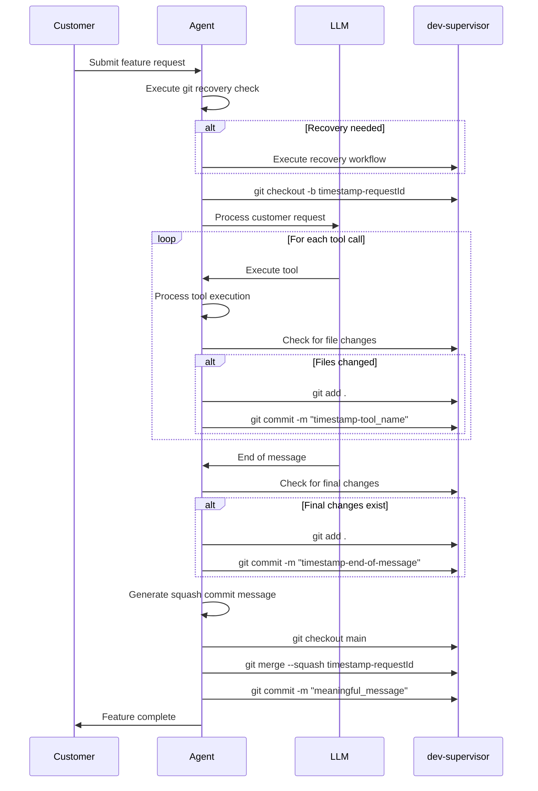
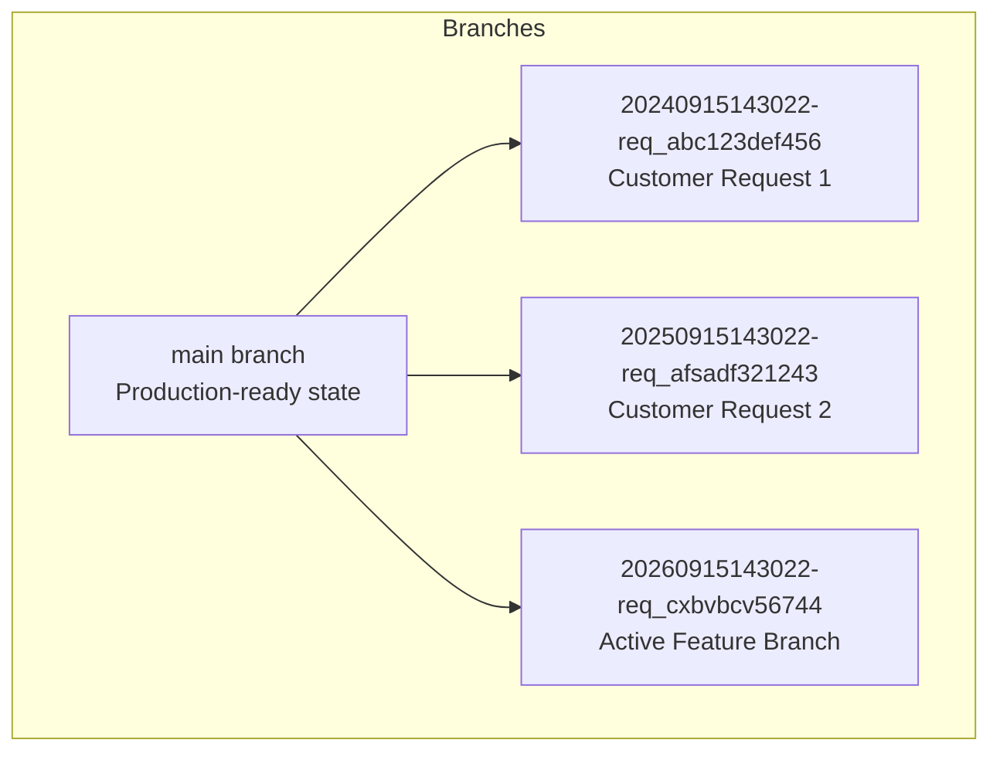
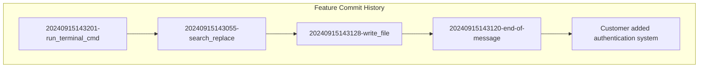
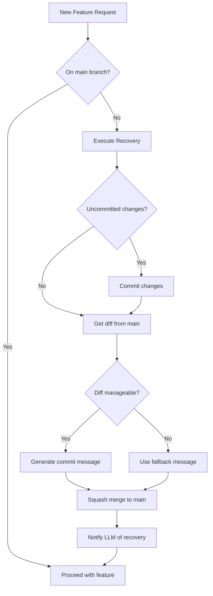
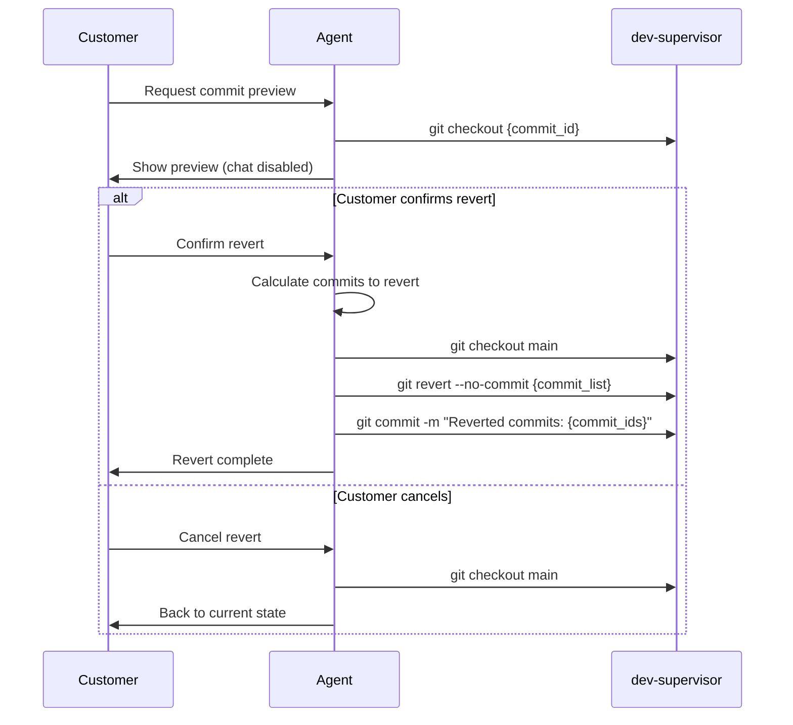
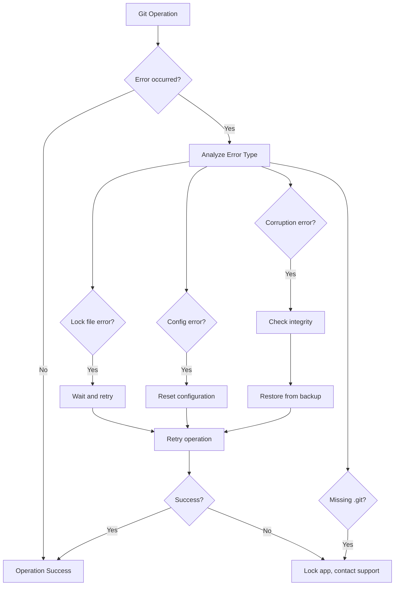

# Git Operations Architecture

## Overview

The Git Operations Architecture provides automated version control for customer applications in the Airo AI platform. All git operations are managed by the agent through the dev-supervisor, ensuring complete isolation of the git repository from the agent container while maintaining comprehensive tracking of LLM interactions and tool executions.

## Core Principles

- **Agent-Driven Workflow**: All git operation logic and decision-making occurs within the agent
- **Repository Isolation**: The `.git` directory is never visible to the agent container
- **Feature Branch Isolation**: Each customer request operates in its own feature branch
- **Comprehensive Tracking**: Every tool call generates a commit for audit and rollback capabilities
- **Automatic Recovery**: Interrupted sessions are automatically detected and recovered
- **No LLM Git Tools**: Git operations are transparent to the LLM, this saves on costs as it reduces tool calls and context

## Feature Request Workflow

### Definition of a Feature

A "feature" represents a complete customer interaction session with the LLM, from initial prompt through all tool executions until the final response.

### Feature Branch Lifecycle



### Branch Naming Convention

Feature branches follow the pattern: `{timestamp}-{requestId}`

**Examples:**

- `20240915143022-req_abc123def456`
- `20241201091500-req_xyz789uvw012`

**Components:**

- `timestamp`: UTC timestamp in `YYYYMMDDHHmmss` format
- `requestId`: Unique identifier for the customer's development session



### Automatic Commit Strategy

#### Tool Call Commits

After each tool execution, the agent checks for file changes and commits them:

```bash
# Pattern: timestamp-tool_name
git commit -m "20240915143055-search_replace"
git commit -m "20240915143128-write_file"
git commit -m "20240915143201-run_terminal_cmd"
```

#### End-of-Message Commits

After LLM completes its response, a final commit captures any remaining changes:

```bash
# Pattern: timestamp-end-of-message
git commit -m "20240915143245-end-of-message"
```

#### Squash Commit Generation

The agent uses an LLM to generate meaningful commit messages for the final merge:

**Input Context:**

- Original customer prompt
- Summary of files changed
- High-level description of modifications

**Generated Message Examples:**

- `Add user authentication with JWT tokens`
- `Implement responsive navigation component`
- `Fix API endpoint validation and error handling`

**Fallback:** If LLM generation fails, use: `{timestamp} - Feature implementation`

Example:

```bash
git checkout main && git merge --squash $previous_branch && git commit -m "$squash_message"
```



## Git Recovery Workflow

### Recovery Trigger

Before each new feature request, the agent checks if recovery is needed:



### Recovery Process

1. **Branch Detection**: Check if current branch is not `main`
2. **Uncommitted Changes**: Commit any pending changes with recovery marker
3. **Diff Analysis**: Get changes between current branch and main
4. **Commit Message Generation**:
   - If diff is manageable: Use LLM to generate meaningful message
   - If diff is too large: Use fallback: `{timestamp} - Git recovery from unknown error`
5. **Squash Merge**: Merge feature branch to main with generated message
6. **LLM Notification**: Inform LLM about recovery and current state

### Recovery Commands

```bash
# Detect current branch
git branch --show-current

# Commit uncommitted changes if any
git add .
git commit -m "{timestamp}-recovery-uncommitted"

# Get diff for analysis
git diff main

# Squash merge to main
git checkout main
git merge --squash {previous_branch}
git commit -m "{generated_message}"
```

## Git Revert Operations

### Commit Preview System

Customers can preview commits before reverting:

1. **Temporary Checkout**: Application shows state at selected commit
2. **Chat Disabled**: Interface clearly indicates preview mode
3. **Easy Return**: Customer can return to current state without changes

### Revert Implementation



### Revert Process

1. **Commit Range Calculation**: Identify commits from newest to target (excluding target)
2. **Revert Execution**: Execute revert without auto-commit
3. **Custom Commit Message**: Create descriptive revert commit

**Revert Commands:**

```bash
# Calculate commits to revert (newest to target, excluding target)
git log --oneline main

# Execute revert without committing
git revert --no-commit commit_id_1 commit_id_2 commit_id_3

# Create descriptive commit
git commit -m "Reverted commits: commit_id_1 commit_id_2 commit_id_3"
```

## Error Handling and Recovery

### Common Git Errors

The agent handles git errors through systematic recovery attempts:

#### Lock File Issues

```bash
# Error: .git/index.lock exists
# Recovery: Wait 5 seconds, then remove if persistent
rm .git/index.lock
```

#### Configuration Issues

```bash
# Error: Missing git configuration
# Recovery: Set default configuration
git config user.email "agent@airo.platform"
git config user.name "Airo Agent"
```

#### Repository Corruption

```bash
# Error: Repository integrity issues
# Recovery: Check and repair
git fsck --full
# If unsuccessful, restore from backup
```

#### Missing .git Directory

- **Recovery**: Lock application and escalate to support
- **Prevention**: Monitor file system operations

### Error Recovery Workflow



### Error Handling Strategy

1. **Immediate Retry**: For transient issues (lock files, network)
2. **Configuration Reset**: For config-related errors
3. **Integrity Check**: For corruption detection
4. **Backup Restoration**: For severe corruption
5. **Support Escalation**: For unrecoverable issues

## Benefits and Advantages

### Development Workflow Benefits

- **Comprehensive Audit Trail**: Every tool call tracked in git history
- **Safe Experimentation**: Feature branches protect main development line
- **Automatic Recovery**: Handles interrupted sessions gracefully
- **Granular Rollbacks**: Revert to any point in development history
- **Troubleshooting**: Pinpoint exact operations that caused issues

### Operational Benefits

- **LLM Performance Analysis**: Identify problematic tool calls
- **Customer Support**: Clear history for debugging
- **Platform Improvement**: Data-driven insights for optimization
- **Disaster Recovery**: Comprehensive backup and restore capabilities

### Security Benefits

- **Repository Isolation**: Git operations completely isolated from agent
- **Audit Compliance**: Full traceability of all changes
- **Access Control**: All operations authenticated and authorized
- **Data Protection**: Automated backup and recovery systems

## Implementation Considerations

### Performance Optimization

- **Smart Commit Detection**: Only commit when files actually change
- **Read-Only Tool Filtering**: Skip commits for tools that don't modify files
- **Repository Maintenance**: Periodic garbage collection and optimization
- **Branch Retention**: Feature branches preserved for debugging and troubleshooting
- **Periodic Cleanup**: Automatic removal of oldest feature branches to manage disk space

### Branch Management Strategy

#### Feature Branch Retention

Feature branches are preserved after merging to main for debugging and troubleshooting purposes:

- **Debugging Benefits**: Ability to examine exact state during specific development sessions
- **Troubleshooting**: Investigate tool call sequences that caused issues
- **Performance Analysis**: Analyze LLM behavior and tool execution patterns
- **Customer Support**: Reference exact changes for support investigations

#### Automated Branch Cleanup

To manage repository size and performance, the system implements automated cleanup:

**Cleanup Triggers:**
- Daily scheduled maintenance
- Repository size thresholds
- Branch count limits

**Cleanup Strategy:**
- Preserve branches from last 30 days (configurable)
- Keep minimum of 50 most recent branches (configurable)
- Prioritize retention of branches with significant changes
- Never delete branches referenced in support tickets

**Cleanup Commands:**
```bash
# List branches older than 30 days
git for-each-ref --format='%(refname:short) %(committerdate)' refs/heads/ | 
  awk '$2 < "'$(date -d '30 days ago' -I)'"'

# Delete old feature branches (preserve main and recent branches)
git branch -D old_feature_branch_name
```

### Monitoring and Observability

- **Git Operation Metrics**: Track commit frequency, merge success, errors
- **Health Monitoring**: Repository integrity, branch state, lock file status
- **Error Analytics**: Pattern analysis for improving error handling
- **Performance Metrics**: Operation timing and repository size tracking

### Backup and Recovery

- **Automated Backups**: Repository snapshots after significant operations
- **Point-in-Time Recovery**: Restore to any previous state
- **Integrity Validation**: Automatic verification after recovery
- **Disaster Recovery**: Comprehensive procedures for catastrophic failures

---

*Document Version: 1.0*  
*Created: September 25, 2025*  
*Classification: Internal*  
*Audience: Platform Engineering & Development Teams*
