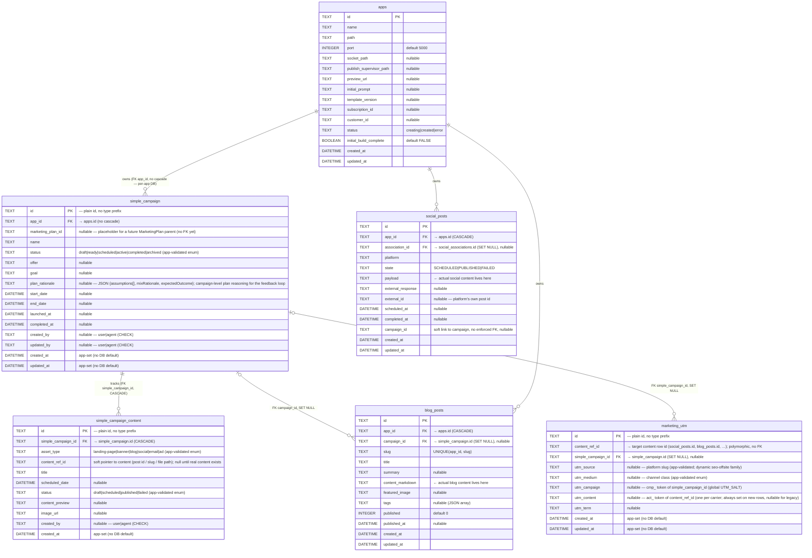

# Marketing Campaigns — Data Model

Status: **proposed / in review** (PR [#4544](https://github.com/gdcorp-partners/airo-app-builder/pull/4544), TACOROYALE-2624)

This documents the per-app SQLite data model for marketing campaigns in the agents
service. It is the foundation the orchestrator skill, plan-approval tool, content
generation, and the campaign artifact card build on.

## Concept: "SimpleCampaign"

A `simple_campaign` intentionally **collapses the campaign + activation/flight into a
single object**. In a full attribution model (e.g. Kevel/Google Ads) the hierarchy is
`campaign → activation/flight → creative`; here we flatten the first two because an AAB
campaign is launched once, not re-flighted. The "simple" prefix leaves room for a future
richer structure that rolls multiple campaigns up under a parent `MarketingPlan` without
renaming this model.

One campaign **fans out to N content items** (one row per channel piece) — e.g. a "Summer
Sale" campaign with 1 landing page + 2 blog posts + 2 social posts → **1 `simple_campaign`
row + 5 `simple_campaign_content` rows**, plus the real content in `blog_posts` /
`social_posts`. Storage is **one isolated SQLite database per customer** (production deploys
one agent per app, no shared DB); `app_id` scopes rows within it.

## Lifecycle / where each table is written

```
Customer Goals → Campaign Plan (goal type, initial prompt, target audience, dates)
   │
   ├─ Approve Campaign Plan ──▶ creates simple_campaign + simple_campaign_content
   │                            (+ the real content rows in blog_posts / social_posts)
   │
   └─ Launch Campaign ────────▶ writes marketing_utm (one row per published target × platform)
```

`Customer Goals`, `Campaign Plan`, and the approve/launch steps are flow stages, not
tables. The three tables this model introduces are **`simple_campaign`**,
**`simple_campaign_content`**, and **`marketing_utm`**.

## ER diagram



> `apps`, `blog_posts`, and `social_posts` are pre-existing tables shown in full for
> fidelity. `social_posts.association_id` FKs to `social_associations` (social-connection
> subsystem, out of scope here). `marketing_utm.content_ref_id` is a **polymorphic** reference
> (it can point at a `social_posts`, `blog_posts`, or future ad/email row) so it is not a
> hard FK.
>
> **`blog_posts.campaign_id` / `social_posts.campaign_id` keep their column names** (pre-existing,
> cross-team) — only the new tables (`simple_campaign_content`, `marketing_utm`) use
> `simple_campaign_id`, to disambiguate from a future higher-level campaign type.

### Enum validation (app layer, no DB constraint)

The enum columns (`status`, `asset_type`, `utm_medium`, and content `status`) are plain
`TEXT` with **no DB CHECK or lookup table**. The TS enums (`SimpleCampaignStatus`,
`SimpleCampaignContentType`, `SimpleCampaignContentStatus`, `UtmMedium`) are the single
source of truth, and values are validated against them in the repository layer
(`assertEnumValue`) before persisting. Rationale: SQLite cannot ALTER a CHECK in place, and
a lookup table would force a DB migration/seed to add a value — but new skill versions will
add `utm_medium`/`asset_type` values over time, so we keep validation in code where adding a
value is a one-line enum edit with no DB change. `created_by`/`updated_by` keep a plain CHECK
(a fixed `user|agent` binary that won't evolve). `utm_source` is validated only loosely (its
`seo-offsite-<placement>` family is dynamic, resolved at the channel-adapter layer).

## Tables

### `simple_campaign`
Top-level campaign record: identity, lifecycle status, the offer/goal, and the date
window. FK `app_id → apps(id) ON DELETE CASCADE`. Status transitions are enforced in the
repository (`SimpleCampaignRepository`):

```
draft → ready → scheduled → active → completed
  └──────────────── any → archived ──────────────┘
```

### `simple_campaign_content`
A **reference/tracking layer — it does NOT store content.** One row per channel piece, a
thin projection surfacing just what the campaign card needs (title, content_preview, image,
status, scheduled_date). `content_ref_id` is a *soft* pointer (not a DB FK) to where the
content actually lives, by `asset_type`:

| `asset_type`            | content lives in                       |
| ----------------------- | -------------------------------------- |
| `blog`                  | `blog_posts.content_markdown`          |
| `social`                | `social_posts.payload`                 |
| `landing-page` `banner` | app source files (committed via git)   |
| `email` `ad`            | future — external service TBD          |

`content_ref_id` holds a **content identifier only** — never a date or a "planned"
placeholder. It is left `null` until the real content exists; a future content resolver
(see Open items) maps `(asset_type, content_ref_id)` to the live content row. FK
`simple_campaign_id → simple_campaign(id) ON DELETE CASCADE`.

### `marketing_utm`
UTM attribution for a single published **target** (a blog post, a per-platform social post,
a future ad/email). Deliberately **independent of campaigns** — UTM applies to any
marketing content. `utm_source`/`utm_medium` are always set; `simple_campaign_id` and
`utm_campaign` are populated **only when the target belongs to a campaign** (content
created outside any campaign — e.g. a one-off blog post — still gets source/medium but no
campaign linkage). A social post to Instagram + Facebook produces **two** rows (one per
platform / `social_posts` row). `utm_medium` is an app-validated enum (closed channel-class
vocabulary); `utm_source` is looser (the `seo-offsite-<placement>` family is dynamic). FK
`simple_campaign_id → simple_campaign(id) ON DELETE SET NULL`.

#### Prefixed tokens (`utm_campaign` / `utm_content`) — RUBICON-500
The raw `simple_campaign_id` / content id are internal primary keys and must not leak into
outbound URLs. The public values are **prefixed salted-hash tokens**, computed by
`utils/campaign-utm-signer.ts` — reusing the same **HMAC-SHA256 + `getEncryptionKey()`**
primitive already used by `file-url-signer.ts` (the key is `GODADDY_OAUTH_ENCRYPTION_KEY`):

```
hash         = HMAC_SHA256(key = getEncryptionKey(), message = `${id}:${UTM_SALT}`)  // base64url
utm_campaign = `cmp_${hash(simple_campaign_id)}`   // buildCampaignToken — one per campaign
utm_content  = `act_${hash(content_ref_id)}`       // buildContentToken  — one per carrier
```

The prefix namespaces the dimension (`cmp_` campaign vs. `act_` content/activation) so a
`(utm_source, utm_medium, utm_campaign)` row is unambiguous. **M1 is one creative per
activation**, so `utm_content` carries the `act_` token only — the `cr_` creative dimension
is deferred to a future milestone.

`UTM_SALT` is a **single global static salt** (offline-generated, hardcoded). The HMAC key
provides the cryptographic strength; the salt only domain-separates this use and is not
secret. Because the hash is deterministic, every row of a campaign resolves to **one stable
`utm_campaign`** (and each carrier to one stable `utm_content`) with no per-row salt to store
— the value the attribution warehouse aggregates on (composite key
`(utm_source, utm_medium, utm_campaign)`) and that the **Customer Stats API** call reproduces
to retrieve metrics. Reverse lookup never inverts the HMAC: we query `marketing_utm` via
`findByComposite`/`findByUtmCampaign`, and the analytics system reproduces the hash with the
same shared salt. (Earlier drafts stored a per-campaign `salt_id`; it was dropped — a
plaintext per-row salt added no secrecy over a global one, and the global salt lets analytics
reverse-look-up without reading our per-app DBs.)

**No migration/backfill.** The tokens are minted at row creation (`MarketingUtmRepository.create`),
so every new row carries the `cmp_`/`act_` values. No data-preserving migration of pre-existing
rows is performed: `marketing_utm` is not yet populated (the carrier-persistence wiring lands
with RUBICON-499/501), and the schema predates GA, so per the clean-start convention the columns
live only in the `CREATE TABLE` definition — no `ALTER TABLE`/backfill scripts to carry forward.

### Related (owned elsewhere)
- **`blog_posts`** — `campaign_id` FKs back to `simple_campaign` with `ON DELETE SET NULL`.
- **`social_posts`** — `campaign_id` is a soft `TEXT` link (pre-existing from the Prisma→SQLite migration, no enforced FK).

## Key design decisions

- **Content rows are reference-only.** Real content stays in its system of record
  (`blog_posts`, `social_posts`, app source); `simple_campaign_content` just points to it.
- **No `campaign_type`** — dropped (redundant with `asset_type`; every campaign includes a
  landing page).
- **UTM lives on its own `marketing_utm` table**, keyed by the target content row — not on
  the campaign and not on the content row — because UTM applies to any content (campaign or
  not) and fans out per platform.
- **`campaign_id` on the content tables** (`blog_posts`, `social_posts`) is intentional and
  may be set even outside a formal campaign (loose tracking). These pre-existing columns keep
  their name; the **new** tables use `simple_campaign_id` to disambiguate from a future
  higher-level campaign type.
- **`marketing_plan_id` placeholder** on `simple_campaign` (nullable, no FK yet) so simple
  campaigns can later become children of a `MarketingPlan` without a schema rename.
- **Enums are validated in the app layer, not the DB** — plain `TEXT` columns checked
  against the TS enums (`assertEnumValue`) before persisting. SQLite can't alter a CHECK in
  place and a lookup table would force a DB migration to add a value; since new skill
  versions add `utm_medium`/`asset_type` values over time, code-only validation is the
  lighter path. `created_by`/`updated_by` keep a CHECK (fixed binary). See "Enum validation".
- **No app→campaign cascade.** The SQLite DB is one-per-app, so deleting the app drops the
  whole file — a cascade from `apps` is unnecessary. The `app_id` FK is plain (no ON DELETE
  action). The `simple_campaign → simple_campaign_content` cascade is kept so deleting a
  single campaign still removes its content rows.
- **DB is raw persistence; the app layer owns write logic.** Repositories construct the row
  in memory, assign id/status/timestamps in code (no DB defaults), persist, and use the
  driver's `run().changes` as the authoritative success check — returning the constructed
  object with no read-back. Lifecycle moves (`transition`, `launch`) are guarded UPDATEs
  (`… WHERE id = ? AND status IN (<valid prev>)`) that enforce the FSM without a
  read-before-write.
- **`utm_campaign`/`utm_content` are prefixed salted-hash tokens** (`cmp_<hash>` / `act_<hash>`,
  single global static salt) — keeps the raw id out of URLs, stays deterministic (one stable
  value per campaign / per carrier, no per-row `salt_id`), and lets the analytics system and
  Customer Stats API reverse-look-up by reproducing the hash with the same shared salt.
- **`created_by` / `updated_by`** on `simple_campaign` (and `created_by` on
  `simple_campaign_content`) record whether an artifact came from the customer (`user`) or
  the agent (`agent`) — campaign content can originate either way. Nullable (a new
  convention — no other agent-DB table tracks actor columns today). `marketing_utm` is
  excluded: its rows are system-generated at launch.

## Open items / not yet wired

- **Content resolver.** A function mapping `(asset_type, content_ref_id)` → the live content
  row (`blog_posts` / `social_posts` / app source / future ad/email) is the natural next
  piece. It belongs at the launch/orchestration layer and is not built here.
- **Global ID uniqueness.** `simple_campaign.id` is a plain `nanoid(12)` (internal PK,
  unique within a customer's DB) — no type prefix. The published key is the salted-hash token,
  not the raw id, so the warehouse key is opaque and global without changing the PK. (Type
  prefixes like `camp_`/`cont_`/`mutm_` were dropped — they were never a requirement, and no
  code disambiguates ids by prefix.)
- **`utm_content`** is now minted as the `act_<hash>` token of the content id (RUBICON-500).
  `utm_term` (keyword/segment/topic) population mapping per channel lands with RUBICON-499/501.
- **Population wiring.** Writing decorated URLs into generated content (and the full
  generator) lands with RUBICON-499 (URL generator) and RUBICON-501 (apply CTAs at generate);
  the table + repository + token builders exist here.
