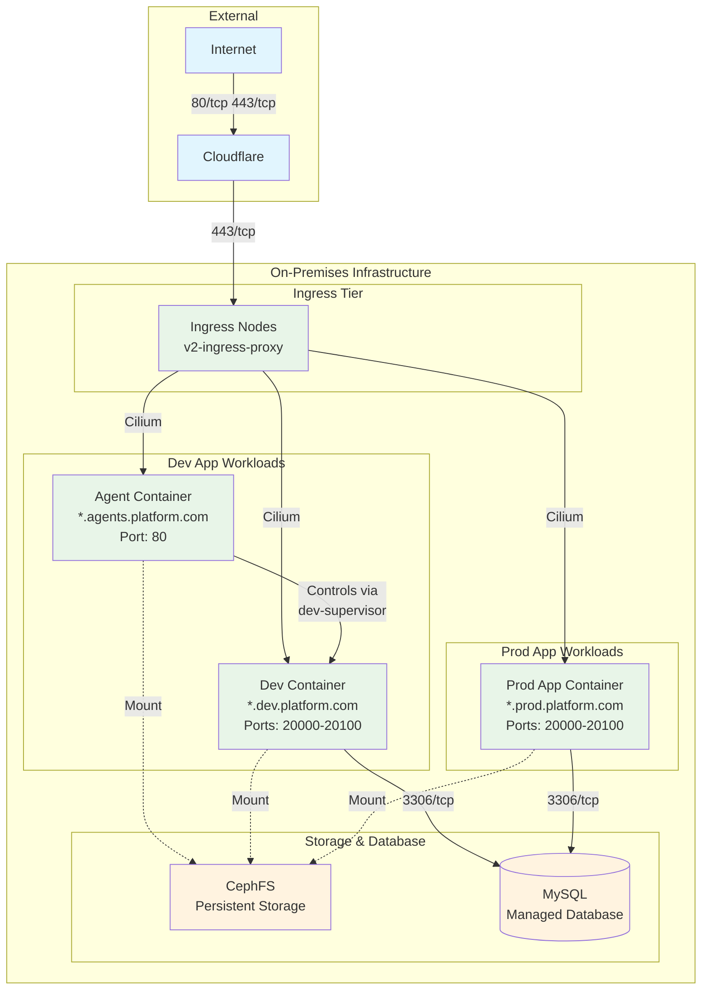
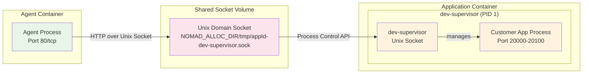

# Airo Builder Hosting Platform - On-Premises Architecture

## Executive Summary

This document describes the on-premises hosting platform architecture for the Airo AI application hosting service. The platform leverages the existing v2 Managed WordPress platform infrastructure components with modifications to support Airo Builder workloads. This document is intended for security teams to understand the architecture, network flows, and security controls.

## Architecture Overview

This document is meant to highlight and explain the new changes to the v2 platform to support Airo Builder. Any reused existing components and networking have already been through a threat model and security certification. The architecture and security review documents for that can be found at <https://godaddy-corp.atlassian.net/wiki/spaces/PARCH/pages/3505685011/Managed+WordPress+MWP+MWCS+V2+Design+Summary>, <https://godaddy-corp.atlassian.net/wiki/spaces/PARCH/pages/3218325911/Threat+Model>, and <https://godaddy-corp.atlassian.net/wiki/spaces/PARCH/pages/3298051616/WordPress+PaaS+V2+Threat+Models>.

The Airo Builder hosting platform consists of multiple server groups orchestrated by Nomad, with Cilium providing network security and SELinux enforcing container-level security policies.



## Server Groups and Roles

### Nomad Servers (nomad)

- **Purpose**: Control plane for Nomad orchestration
- **Minimum Instances**: 3 (requires majority for quorum)
- **Recommended Instances**: 5 (allows for multiple server failures)
- **Criticality**: High - required for all deployments and periodic tasks
- **Network Access**: Cluster-internal only

### Platform Nodes (platform)

- **Purpose**: Operational and coordination services
- **Minimum Instances**: 3 (requires majority for quorum)
- **Recommended Instances**: 5 (allows for multiple server failures)
- **Services**:
  - Prometheus, Grafana, Hubble Relay (observability)
  - Queue worker for Nomad job provisioning
  - etcd cluster (used by Cilium and netreap)
  - Raft snapshot jobs
- **Network Access**: Cluster-internal with external monitoring endpoints

### Ingress Nodes (ingress)

- **Purpose**: Customer application traffic ingress
- **Services**: v2-ingress-proxy <https://github.com/gdcorp-partners/v2-ingress-proxy>
- **Network Access**:
  - Internet-facing via Cloudflare IPs and VPN: [Secured via Network Securtiy Policy (SPR)](https://github.com/gdcorp-engineering/network-security-policy/blob/main/global-policy/global-shared/gcn_mah/includes/mwp-nomad-client-ingress-inbound.yaml)
  - Routes to Cilium overlay network
- **Ports**: 443/tcp

### OneGroup Nodes (Customer Workloads)

- **Purpose**: Customer application workloads
- **Services**: Dev apps (Agent & Dev container) and Prod apps
- **Network Access**: Cilium overlay network only
- **Storage**: CephFS mounts for persistent data

## Nomad Job Architecture

### Dev Application Job

#### Agent Container

- **Purpose**: Management interface for customer applications
- **Domain**: `*.agents.platform.com`
- **Capabilities**:
  - Restart application containers
  - Execute tasks on dev containers via dev-supervisor socket (more details later in this document)
  - Editing application files in the shared alloc directory
  - Service registration with ingress
- **Ports**: 80/tcp
- **Storage Mounts**:
  - `${NOMAD_ALLOC_DIR}/customer-app/${appId}` → Working directory (ephemeral)
  - `/mnt/ceph/${cephMountId}/${cephDirNumber}/${appId}` → `/ceph-storage` (persistent customer data)
  - Mount: `/data/.aws/` → `/data/.aws/` (AWS credentials, read-only)

#### Dev Application Container

- **Purpose**: Customer applications in development mode
- **Domain**: `*.dev.platform.com`
- **Ports**: 20000-20100/tcp (application services)
- **Storage Mounts**:
  - `${NOMAD_ALLOC_DIR}/customer-app/${appId}` → `/app` (ephemeral application runtime)
  - `/mnt/ceph/${cephMountId}/${cephDirNumber}/${appId}/git-repo` → `/app/.git` (persistent git repository)
  - `/mnt/ceph/${cephMountId}/${cephDirNumber}/${appId}/assets` → `/app/assets` (persistent large file assets)
  - `/mnt/ceph/${cephMountId}/${cephDirNumber}/${appId}/config` → `/config` (persistent config, read-only)

### Production Application Job

- **Purpose**: Customer applications in production mode
- **Domain**: `*.prod.platform.com` or customer custom domains
- **Ports**: 20000-20100/tcp (application services)
- **Storage Mounts**:
  - `${NOMAD_ALLOC_DIR}/customer-app/${appId}` → `/app` (ephemeral application runtime)
  - `/mnt/ceph/${cephMountId}/${cephDirNumber}/${appId}/prod/${version}` → `/prod` (persistent production build artifacts)
  - `/mnt/ceph/${cephMountId}/${cephDirNumber}/${appId}/assets` → `/app/assets` (persistent large file assets)
  - `/mnt/ceph/${cephMountId}/${cephDirNumber}/${appId}/config` → `/config` (persistent config, read-only)

## Secure Agent-to-Application Communication

### dev-supervisor Socket Interface

The Agent containers communicate securely with development and production application containers through a specialized Go-based supervisor service called `dev-supervisor`. This provides a secure, controlled interface for application lifecycle management without requiring elevated privileges or network-based communication.

#### dev-supervisor Architecture Overview



#### Security Model

**Unix Domain Socket Communication**

- **Transport**: HTTP API served over Unix domain sockets (not TCP)
- **Socket Path**: `${NOMAD_ALLOC_DIR}/tmp/${appId}-dev-supervisor.sock` (app-specific)
- **Permissions**: Socket permissions restrict access to container users
- **Isolation**: No network traffic - communication stays within the host kernel
- **Authentication**: File system permissions provide access control

**Process Isolation**

- **PID 1 Role**: dev-supervisor runs as the primary process in application containers
- **Process Management**: Controls customer application lifecycle without exposing system-level access
- **Signal Handling**: Proper init process behavior with zombie reaping and signal forwarding
- **Resource Isolation**: Application processes run under dev-supervisor's controlled environment

#### API Capabilities

The dev-supervisor exposes a RESTful HTTP API over the Unix socket with the following capabilities:

**Process Lifecycle Management**

```bash
# Start application process
POST /process/start
{
  "command": "npm run dev",
  "working_dir": "/app"
}

# Stop current process
POST /process/stop

# Restart process
POST /process/restart

# Get process status
GET /process/status
```

**Command Execution**

The agent can execute commands directly on the app container if there are specified in an allowlist.

```bash
# Execute commands with output capture
POST /exec
{
  "command": "ls -la /app",
  "timeout": 30
}
```

**Health Monitoring**

```bash
# Configure health checks and restart policies
PUT /health-config
{
  "health_check": {
    "type": "http",
    "url": "http://localhost:3000/health",
    "interval": "30s",
    "timeout": "10s",
    "retries": 3
  },
  "restart_policy": {
    "enabled": true,
    "max_restarts": 5,
    "restart_window": "5m"
  }
}

# Get health status
GET /health-config/status
```

**Environment Management**

```bash
# Get environment variables
GET /environment

# Set environment variables
PUT /environment

# Reset environment
DELETE /environment
```

**Log Management**

```bash
# Get historical logs with filtering
GET /logs

# Real-time log streaming via WebSocket
WS /logs/stream
```

#### Volume Mount Configuration

**Shared Socket Volume**

```yaml
# Nomad job configuration - uses allocation directory
# Socket path: ${NOMAD_ALLOC_DIR}/tmp/${appId}-dev-supervisor.sock

# Application container environment variable
Env: {
  DEV_SUPERVISOR_SOCKET_PATH: "${NOMAD_ALLOC_DIR}/tmp/${appId}-dev-supervisor.sock"
}

# Both containers share the same allocation directory
# Agent accesses socket via: ${NOMAD_ALLOC_DIR}/tmp/${appId}-dev-supervisor.sock
# App container creates socket via dev-supervisor at the same path
```

#### Security Benefits

1. **No Network Exposure**: Communication occurs entirely through Unix domain sockets
2. **File System Permissions**: Access controlled through standard Unix file permissions
3. **Process Isolation**: dev-supervisor acts as a controlled gateway to application processes
4. **Audit Trail**: All communication is logged and traceable
5. **Resource Controls**: dev-supervisor enforces resource limits and policies
6. **Crash Recovery**: Automatic process restart with configurable backoff policies

## Network Security Architecture

### Physical Network Security

- **Firewall**: Managed via Network Security Policy repository
- **Repository**: <https://github.com/gdcorp-engineering/network-security-policy/tree/main/global-policy/applications/wordpress-platform-c4>
- **Security Groups**: OpenStack security groups based on policy definitions

### Overlay Network Security (Cilium)

- **Repository**: <https://github.com/gdcorp-commerce/pioneer-infra/blob/main/ansible/roles/network-policy/templates/airo-networkpolicy.yaml.j2>
- **Default Policy**: Default deny - all traffic must be explicitly allowed
- **Network Policies**: Applied per customer application
- **Segmentation**: Customer workloads isolated from each other

#### Cilium Network Policy Rules

```yaml
# Core DNS Access (All endpoints)
- Egress to 169.254.172.53:53/udp,tcp (CoreDNS)

# Ingress Traffic (Airo agent/app containers)
- Ingress from network_policy_cidrs_ingress:80/tcp
- Ingress from network_policy_cidrs_ingress:20000-20100/tcp

# Egress Traffic (Airo agent/app containers)
- Egress to 0.0.0.0/0 except private IP ranges
- Egress to database_cidrs:3306/tcp (MySQL)
```

### Container Security (SELinux)

#### Ingress Container Policy

- **Repository**: <https://github.com/gdcorp-commerce/pioneer-infra/blob/main/ansible/roles/selinux/templates/containers-udica-policies/nomad-client-ingress/v2-ingress-proxy/ingress_container.cil>
- **Network**: Bind/connect to 80/443 (HTTP), 9445 (metrics), 20000-20100 (apps)
- **File System**: Read certificates from default_t
- **IPC**: Connect to Nomad Task API via Unix socket

#### Agent Container Policy

- **Repository**: <https://github.com/gdcorp-commerce/pioneer-infra/blob/main/ansible/roles/selinux/templates/containers-udica-policies/nomad-client-onegroup/airo_agent/airo_agent_container.cil>
- **Network**: Bind/connect to 80/443 (HTTP)
- **File System**: Ceph access for customer data
- **IPC**: Connect to application container Unix sockets
- **Credentials**: Execute AWS authentication scripts

#### Application Container Policy

- **Repository**: <https://github.com/gdcorp-commerce/pioneer-infra/blob/main/ansible/roles/selinux/templates/containers-udica-policies/nomad-client-onegroup/airo_app/airo_app_container.cil>
- **Network**: Connect to 80/443 (HTTP), bind to 20000-20100, connect to 3306 (MySQL), 25 (SMTP)
- **File System**: Ceph access for customer data
- **Database**: Connect to MySQL servers

## Network Flow Diagrams

### Customer Traffic Flow

```
Internet → Cloudflare → Ingress Nodes (v2-ingress-proxy) → Cilium Network → Agent/App Containers
```

### Management Traffic Flow

```
Control Plane → Queue Worker → Nomad Server → OneGroup Nodes → Containers
```

### Storage Access Flow

```
Containers → Host NFS Mounts → CephFS Network → Persistent Storage
```

## Port Matrix

| Component | Direction | Ports | Protocol | Source/Destination |
|-----------|-----------|-------|----------|-------------------|
| **Internet Ingress** |
| Ingress Nodes | Inbound | 80, 443 | TCP | Internet |
| **Cluster Internal** |
| Nomad Server | Inbound | 4647 | TCP | All Nomad Clients |
| Cilium Health | Bidirectional | 4240 | TCP | All Cilium Clients |
| Cilium Networking | Bidirectional | 4245, 6081, 51871 | TCP/UDP | All Cilium Clients |
| **Application Services** |
| Agent Containers | Inbound | 80 | TCP | Ingress Nodes |
| App Containers | Inbound | 20000-20100 | TCP | Ingress Nodes |
| **External Dependencies** |
| All Containers | Outbound | 53 | UDP/TCP | CoreDNS |
| App Containers | Outbound | 3306 | TCP | MySQL Servers |
| App Containers | Outbound | 25 | TCP | SMTP Servers |
| App Containers | Outbound | 80, 443 | TCP | Internet |

## Security Controls Summary

### Network Level

1. **External Firewall**: Network Security Policy repository controls
2. **Network Segmentation**: Cilium policies with default deny
3. **Traffic Isolation**: Customer workloads cannot communicate cross-tenant

### Container Level

1. **Mandatory Access Control**: SELinux policies per container type
2. **Resource Isolation**: Nomad job boundaries
3. **File System Access**: Mount point restrictions and Ceph permissions

### Application Level

1. **Domain Isolation**: Separate domains per environment (dev/prod/agents)
2. **Storage Isolation**: Customer-specific directories on CephFS
3. **Database Isolation**: Per-application database users and schemas

---

*Document Version: 1.0*
*Created: 2025-09-18*
*Classification: Internal*
*Audience: Security & Platform Engineering Teams*
