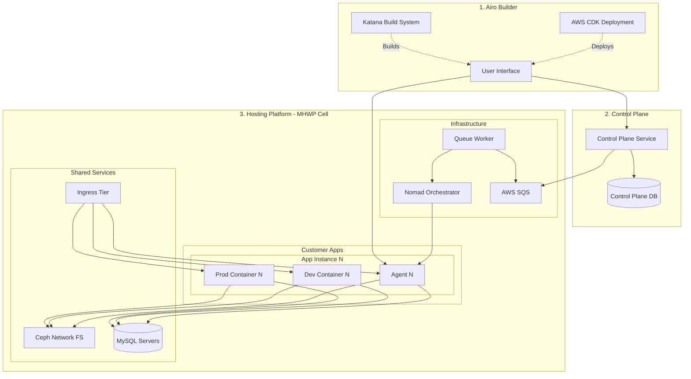

# Airo Platform Overview

## Introduction

Airo is a vibe coding platform that enables users to build and deploy AI-powered applications through an intuitive interface. The platform combines code generation, AI agents, and managed hosting infrastructure to provide a complete application development and deployment experience.

## Architecture Overview

The platform is composed of four primary systems that work together to deliver the complete Airo experience:



## System Components

### 1. Airo Builder (`/app`)

The user-facing application that provides the complete development experience:

- **Interactive UI**: Web-based interface for building and managing applications
- **Vibe Coding Interface**: AI-assisted code generation and editing
- **Direct Agent Communication**: Real-time interaction with deployed agents
- **Deployment Management**: Controls and monitors application deployments

**Infrastructure:**

- **Location**: `/app` in codebase
- **Deployment**: AWS Airobuilde - [PCP](https://pcp.int.gdcorp.tools/projects/8606/summary)
  - Katana build system
  - CDK (`/cdk` in codebase)

### 2. Agent System (`/agents`)

A collection of AI agents that manage application lifecycle and development:

- **Code Generation**: Transforms user intent into working code
- **Development Tools**: Provides debugging, testing, and iteration capabilities
- **File Management**: Handles application file structure and updates
- **Integration with other GoDaddy services**: Assets API for images, backups etc
- **Lifecycle management**: Initiates app deployments for production builds

**Infrastructure:**

- **Location**: `/agents` in codebase
- **Deployment**: Github action to create docker image, registered in the control plane
- **Scaling**: One agent deployment per customer application
- **Communication**: Direct HTTP/WebSocket with Airo Builder

### 3. Control Plane

The central management service coordinating the entire platform:

- **Entitlements Management**: User permissions and feature access
- **Hosting Configuration**: Application deployment settings and parameters
- **Nomad Job Generation**: Creates orchestrator configurations for deployments
- **Service Registry**: Maintains location and status of all services
- **State Management**: Tracks application configurations and deployments

**Infrastructure:**

- **Location**: Separate GitHub repositories
  - [mhp-core](https://github.com/gdcorp-partners/mhp-core) - Nomad management and orchestration
  - [mhp-airo](https://github.com/gdcorp-partners/mhp-airo) - Airo-specific configuration and entitlement handling
- **Database**: Persistent storage for platform state
- **API**: RESTful interface for platform operations

### 4. Hosting Platform (MHWP Cell)

Multi-tenant hosting infrastructure based on MHWP (Multi-Hosted Web Platform) architecture:

**Core Infrastructure:**

- **Nomad Orchestrator**: Container scheduling and lifecycle management
- **Queue Worker**: Processes deployment and management tasks via AWS SQS
- **Ingress Tier**: Traffic routing and load balancing
- **Ceph Network FS**: Distributed file system for persistent storage
- **MySQL Servers**: Database tier for application data

**Container Types per Application:**

- **Agent Container**: AI agent for development and management
- **Dev Container**: Development environment instance
- **Prod Container**: Production application instance

For detailed hosting architecture, see [AI Hosting Platform Documentation](ai-hosting-platform-docs.md).

## Data Flow

### Storage Architecture

- **Application Code**: Stored in Ceph, shared between agent and app containers
- **User Data**: Persisted in MySQL databases (isolated per application)
- **Platform State**: Maintained in Control Plane database
- **Build Artifacts**: Cached in Ceph for faster deployments

### Communication Patterns

- **App ↔ Agent**: Direct HTTP/WebSocket connections via ingress tier
- **App ↔ Control Plane**: RESTful API for management operations
- **Control Plane ↔ Hosting**: Asynchronous via SQS queue
- **Agent ↔ Containers**: Shared file system via Ceph

## Domain Structure

| Service Type      | Domain Pattern                    | Example                             |
| ----------------- | --------------------------------- | ----------------------------------- |
| Airo App Builder  | `app.airo.com`                    | Main application                    |
| Agent             | `{appId}.agent.{cell}.{domain}`   | `abc123.agent.c4.test-airoapp.ai`   |
| Preview           | `{appId}.preview.{cell}.{domain}` | `xyz789.preview.c4.test-airoapp.ai` |
| Publish (Default) | `{appId}.{cell}.{domain}`         | `def456.c4.test-airoapp.ai`         |
| Publish (Custom)  | Customer-specified                | `app.customer.com`                  |

## Technology Stack

### Airo Builder

- **Framework**: Next.js
- **Deployment**: AWS (via Katana/CDK)
- **Build System**: Github actions

### Agent System

- **Runtime**: Node.js
- **Orchestration**: Nomad
- **Communication**: HTTP/WebSocket

### Control Plane

- **Architecture**: Microservices
- **Database**: MySQL
- **Queue**: AWS SQS

### Hosting Platform

- **Orchestration**: Nomad
- **Storage**: Ceph
- **Database**: MySQL
- **Load Balancing**: Custom ingress tier
- **WAF/CDN**: Cloudflare

## Repository Structure

```
airo-ai-builder/
├── app/                    # Airo Builder application
├── agents/                 # Agent system implementation
├── cdk/                    # AWS CDK deployment configs
├── docs/                   # Platform documentation
└── [other packages]

mhp-core/                   # Separate repository (Control Plane)
└── [nomad management]

mhp-airo/                   # Separate repository (Control Plane)
└── [airo configuration & entitlements]
```

## Related Documentation

- [AI Hosting Platform Documentation](ai-hosting-platform-docs.md) - Detailed hosting architecture
- [On-Prem Hosting Architecture](onprem-hosting-architecture.md) - MHWP cell details
- [Persistent Storage Architecture](persistent-storage-architecture.md) - Storage layer design

---

_Document Version: 1.0_  
_Last Updated: 2025-10-27_  
_Status: Initial Release_
