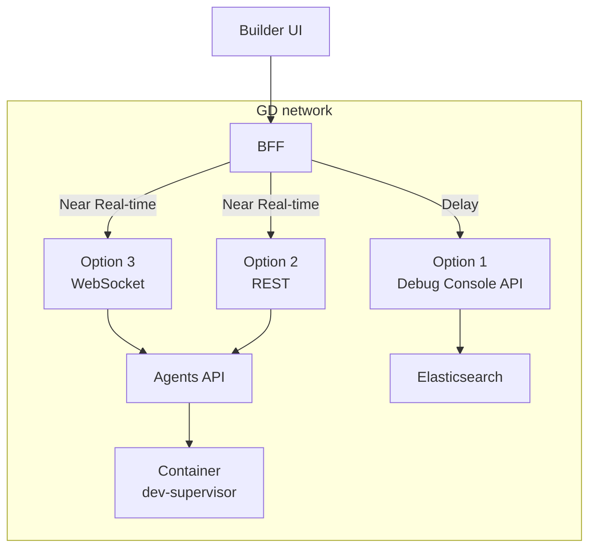

# Feature: PaaS - Customer App Deployment Logs

**Date:** 2025-01-20
**Status:** Draft

---

## Objective

Provide end customers with real-time visibility into their application's deployment progress during preview and publish operations.

---

## Scope

### Scope

| In Scope                | Out of Scope               |
| ----------------------- | -------------------------- |
| Preview deployment logs | Agent/AI conversation logs |
| Publish deployment logs | Development server logs    |
| Build output logs       | Internal system logs       |
| Container startup logs  | Chat/tool execution logs   |

---

## Target Environment

| Attribute    | Value                                   |
| ------------ | --------------------------------------- |
| **Products** | PaaS and/or Airo App Builder            |
| **Control**  | Feature flag driven                     |
| **Audience** | End customers (not internal developers) |

---

## Key Requirements

1. **Reliability** - Solution must be highly reliable; this is a customer-facing feature
2. **Real-time** - Stream logs as deployment progresses
3. **Filtered** - Only show relevant, customer-appropriate messages (no internal errors, secrets, or debug info)
4. **Scoped** - Strictly limited to preview/publish lifecycle events
5. **Isolated** - Customers can only see their own app logs
6. **Retention** - Logs retained for N days (configurable)

---

## Typical Log Events to Surface

```
Build started
Dependencies installing...
Build completed successfully
Container starting...
Application health check passed
Preview URL ready: https://...
```

---

## Existing Infrastructure

### DevSupervisor Container Access

Agents can access **both preview and publish containers** via `DevSupervisorClient`. Each app stores two supervisor connection paths:

| Container | Field                       | Environment Variable                  |
| --------- | --------------------------- | ------------------------------------- |
| Preview   | `app.socketPath`            | `AIRO_SUPERVISOR_PREVIEW_SOCKET_PATH` |
| Publish   | `app.publishSupervisorPath` | `AIRO_SUPERVISOR_PUBLISH_SOCKET_PATH` |

**Source:** `agents/src/database/repositories/AppRepository.ts:21-22`

```typescript
socketPath?: string; // Preview supervisor connection path
publishSupervisorPath?: string; // Publish supervisor connection path
```

### Existing Usage Example

The publish route already connects to the publish supervisor:

**Source:** `agents/src/server/routes/publish.ts:284-304`

```typescript
let publishSupervisor: DevSupervisorClient | null = null;

if (publishSocketPath) {
  // Production: use provided socket path
  publishSupervisor = DevSupervisorClientFactory.createForSocketPath(
    publishSocketPath,
    id,
  );
} else {
  // Local dev: look up from database
  const app = appRepository.findById(id);
  if (app?.publishSupervisorPath) {
    publishSupervisor = DevSupervisorClientFactory.createForSocketPath(
      app.publishSupervisorPath,
      id,
    );
  }
}

// Can call: publishSupervisor.getLogs(), .exec(), .publish()
```

### DevSupervisorClient Capabilities

Both preview and publish supervisors support:

| Method                             | Description                               |
| ---------------------------------- | ----------------------------------------- |
| `getLogs(options)`                 | Get container logs (source, lines, since) |
| `exec(options)`                    | Execute commands in container             |
| `getProcessStatus()`               | Check process state                       |
| `startProcess()` / `stopProcess()` | Process lifecycle                         |
| `publish(request)`                 | Trigger version switch (publish only)     |

**Source:** `agents/src/services/DevSupervisorClient.ts`

---

## Design Options

### Option 1: Elasticsearch via Debug Console API

**How it works:**

- Logs shipped from containers → Elasticsearch
- Customer queries via existing `/api/es-logs` endpoint (already available in prod)
- Filter by `appId`

```
Customer → Builder UI → Debug Console API → Elasticsearch
                        GET /api/es-logs?appId={appId}
```

**Pros:**

- Easy to implement - similar approach already exists in debug_console solution used by internal employees/support teams
- Data persisted in Elasticsearch, allowing access to historical logs
- N-day retention built-in (ILM policy, configurable)

**Cons:**

- Not a Tier-1 solution, as it relies on the ELK stack to serve end customers
- Load considerations required (not a major concern initially, but matters at scale)
- Requires strict query-filtering rules to ensure proper customer log isolation
- Involves multiple API calls to poll data
- 1-5 second delay (ES indexing latency)
- Requires log shipper setup for PaaS containers (Filebeat/Fluentd)

---

### Option 2: Agent API with REST Polling

**How it works:**

- New Agent API endpoint calls DevSupervisorClient
- DevSupervisorClient queries container's `/logs` endpoint
- Client polls periodically for new logs

```
Customer → Builder UI → Agents API → DevSupervisorClient → Container
                        GET /apps/:appId/logs
                              ↑
                        (poll every 1-2s)
```

**Pros:**

- Load is naturally distributed when fetching data
- Query and data isolation come inherently, reducing isolation concerns
- Simple implementation using existing DevSupervisorClient (proven in ProjectImportService)
- No extra infrastructure
- Stateless - easy to scale

**Cons:**

- Data is lost when the task/container restarts
- No ability to serve historical logs or logs from previous deployments
- Involves multiple API calls to poll data
- In-memory only (10K entries ring buffer in dev-supervisor)
- Not true real-time (delay = poll interval)

---

### Option 3: Agent API with WebSocket Streaming

**How it works:**

- Client subscribes to log stream via WebSocket
- Server polls dev-supervisor and pushes new logs to client
- True real-time log tailing

```
Customer → Builder UI ←──WebSocket──→ Agents API → DevSupervisorClient → Container
                        logs:subscribe
                        logs:data (push)
```

> **Note:** Largely similar to Option 2 in terms of data source and isolation characteristics.

**Key Advantage:**

- Eliminates the need for multiple API calls for polling - all data is served over WebSockets

**Pros:**

- True real-time (<100ms latency)
- No polling overhead on client
- Better UX for live tailing during deployment
- Efficient - only sends when new logs exist
- Inherits Option 2's benefits: natural load distribution, inherent query/data isolation

**Cons:**

- More complex than REST polling
- Requires WebSocket connection management
- State to manage (subscriptions)
- Inherits Option 2's limitations: data lost on container restart, no historical logs
- Still limited by dev-supervisor buffer (10K entries)

---

## Comparison Matrix

| Factor                | Option 1 (ES)                          | Option 2 (REST Polling)                   | Option 3 (WebSocket)                      |
| --------------------- | -------------------------------------- | ----------------------------------------- | ----------------------------------------- |
| **Tier-1 Ready**      | No (relies on ELK stack)               | Yes                                       | Yes                                       |
| **Reliability**       | High (ES cluster)                      | Medium (container-bound)                  | Medium (container-bound)                  |
| **Load Distribution** | Requires consideration at scale        | Naturally distributed                     | Naturally distributed                     |
| **Isolation**         | Requires strict query filtering        | Inherent (container-level)                | Inherent (container-level)                |
| **Log Retention**     | N days (configurable)                  | short lived </br>(till container is live) | short lived </br>(till container is live) |
| **Latency**           | 1-5 seconds                            | faster than option-1                      | <100ms                                    |
| **API Calls**         | Multiple (polling)                     | Multiple (polling)                        | Single (WebSocket stream)                 |
| **Implementation**    | Low (debug_console exists)             | Low                                       | Medium                                    |
| **Infrastructure**    | Needs log shipper </br>(already there) | None                                      | None                                      |
| **Historical Logs**   | Yes                                    | No                                        | No                                        |

---

## Trade-off Analysis

### Tier-1 Readiness

- **Option 1**: Not a Tier-1 solution as it relies on the ELK stack to serve end customers. ELK availability directly impacts customer experience.
- **Options 2 & 3**: Tier-1 ready. Logs served directly from the customer's own container without dependency on shared infrastructure.

### Reliability

- **Option 1**: ES cluster is production-grade with replication. If ES goes down, logs unavailable but no data loss (buffered in shipper).
- **Options 2 & 3**: Depend on container being up. If container dies, recent logs lost. Dev-supervisor has 10K entry ring buffer.

### Load Distribution

- **Option 1**: Log queries go to ES cluster, not agents service. However, load considerations are required at scale.
- **Options 2 & 3**: Load is naturally distributed when fetching data - each request goes to the specific customer's container.

### Isolation

- **Option 1**: ES queries filtered by `appId` field. Requires strict query-filtering rules to ensure proper customer log isolation and prevent cross-tenant access.
- **Options 2 & 3**: Query and data isolation come inherently. DevSupervisorClient connects to specific container only - physical isolation means customers can only see their own container's logs.

### Log Retention

- **Option 1**: Configurable via ES ILM policy (N days). Can search historical logs from previous deployments.
- **Options 2 & 3**: Limited to dev-supervisor's in-memory buffer (~10K entries). No ability to serve historical logs or logs from previous deployments.

### API Efficiency

- **Options 1 & 2**: Involve multiple API calls to poll data, adding overhead on both client and server.
- **Option 3**: Eliminates multiple API calls - all data served over a single WebSocket connection.

---

## Recommended Approach: Hybrid

Combine options based on use case:

| Use Case                | Recommended Option                         |
| ----------------------- | ------------------------------------------ |
| Live deployment logs    | Option 3 (WebSocket) or Option 2 (Polling) |
| Debugging recent issues | Option 2 (REST Polling)                    |
| Historical log search   | Option 1 (Elasticsearch)                   |



**Phased Rollout:**

1. **Phase 1**: Implement Option 2 (REST Polling) - quick win, covers deployment logs
2. **Phase 2**: Add Option 3 (WebSocket) - better UX for live tailing
3. **Phase 3**: Configure log shipping for Option 1 - historical search capability

---

## API Design

### Option 2: REST Endpoint

```
GET /api/apps/:appId/logs
```

**Query Parameters:**
| Param | Type | Default | Description |
|-------|------|---------|-------------|
| `lines` | number | 100 | Number of lines (max 500) |
| `source` | string | all | `stdout`, `stderr`, or `all` |
| `since` | string | - | ISO 8601 timestamp |

**Response:**

```json
{
  "logs": [
    {
      "timestamp": "2025-01-20T10:30:00Z",
      "source": "stdout",
      "message": "Build completed successfully",
      "level": "info"
    }
  ],
  "total": 1
}
```

### Option 3: WebSocket Events

**Subscribe:**

```json
{ "event": "logs:subscribe", "data": { "appId": "xxx" } }
```

**Log Data (server → client):**

```json
{ "event": "logs:data", "data": { "appId": "xxx", "logs": [...] } }
```

**Unsubscribe:**

```json
{ "event": "logs:unsubscribe" }
```

### Option 1: Existing ES Endpoint

```
GET /api/es-logs?appId={appId}&source=paas_containers&size=100
```

Already available in debug-console. Requires adding `paas_containers` log source configuration.

---

## Technical Considerations

### Log Sanitization

Logs must be sanitized before exposing to customers:

- Filter log levels: INFO and above only (no DEBUG)
- Redact sensitive patterns (API keys, tokens, internal URLs)
- Remove internal error stack traces
- Strip internal system prefixes

### Log Level Filtering

| Level | Customer Visible | Description           |
| ----- | ---------------- | --------------------- |
| DEBUG | No               | Internal debugging    |
| INFO  | Yes              | Progress updates      |
| WARN  | Yes              | Non-fatal issues      |
| ERROR | Yes (sanitized)  | Build/deploy failures |

### Fallback Mechanism

For reliability, implement fallback:

1. Primary: WebSocket streaming (Option 3)
2. Fallback: REST polling (Option 2) if WebSocket disconnects
3. Historical: ES query (Option 1) for logs older than buffer

---

## Security Considerations

1. **Access Control**: Validate customer owns the appId before returning logs
2. **Rate Limiting**: 100 requests/minute per customer for REST endpoint
3. **Data Isolation**:
   - Options 2 & 3: DevSupervisorClient connects only to specific container
   - Option 1: ES queries must include `appId` filter
4. **Log Redaction**: Strip secrets, internal errors, debug info before sending to customer

---

## Open Questions

1. What is the expected log volume per customer per day? (for ES sizing)
2. Exact value for N-day retention in ES?
3. Should we support log download/export?

---

## Testing Guide (PROD)

### API Endpoint

```
GET /apps/:appId/customer-logs
```

### Required Parameters

| Parameter | Type  | Required | Description                                   |
| --------- | ----- | -------- | --------------------------------------------- |
| `appId`   | path  | Yes      | Application ID                                |
| `target`  | query | Yes      | `preview` or `publish`                        |
| `source`  | query | Yes      | `stdout`, `stderr`, `all`, or comma-separated |
| `since`   | query | Yes      | ISO 8601 timestamp                            |
| `lines`   | query | No       | Number of lines (default: 100, max: 500)      |

### Happy Path Test

**Prerequisites:**

1. Valid `appId` with an active preview or publish container
2. Valid JWT token for authentication

**Test Command:**

```bash
# Set variables
APP_ID="<your-app-id>"
TOKEN="<your-jwt-token>"
SINCE="2025-01-01T00:00:00Z"

# Fetch preview logs
curl -s -H "Authorization: Bearer $TOKEN" \
  "https://<agents-host>/apps/$APP_ID/customer-logs?target=preview&source=all&since=$SINCE&lines=50" | jq .
```

**Expected Response (200 OK):**

```json
{
  "logs": [
    {
      "timestamp": "2025-01-22T10:30:00Z",
      "source": "stdout",
      "message": "Build completed successfully",
      "level": "info"
    }
  ],
  "total": 1
}
```

### Verification Checklist

- [ ] Response status is `200 OK`
- [ ] Response contains `logs` array and `total` count
- [ ] Each log entry has: `timestamp`, `source`, `message`, `level`
- [ ] No sensitive data exposed (API keys, internal paths, etc.)
- [ ] `http.request` noise logs are filtered out
- [ ] Infrastructure fields (client_ip, src_ip, ray_id) are not visible

### Error Responses

| Scenario                  | Status | Code                        |
| ------------------------- | ------ | --------------------------- |
| Missing `target`          | 400    | `MISSING_TARGET`            |
| Missing `source`          | 400    | `MISSING_SOURCE`            |
| Missing `since`           | 400    | `MISSING_TIMESTAMP`         |
| Invalid `target` value    | 400    | `INVALID_TARGET`            |
| `lines` exceeds max (500) | 400    | `INVALID_LINES`             |
| App not found             | 404    | `APP_NOT_FOUND`             |
| Supervisor not configured | 503    | `SUPERVISOR_NOT_CONFIGURED` |
| Supervisor unavailable    | 503    | `SUPERVISOR_UNAVAILABLE`    |
