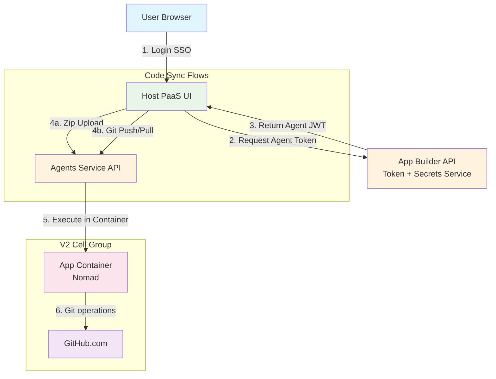
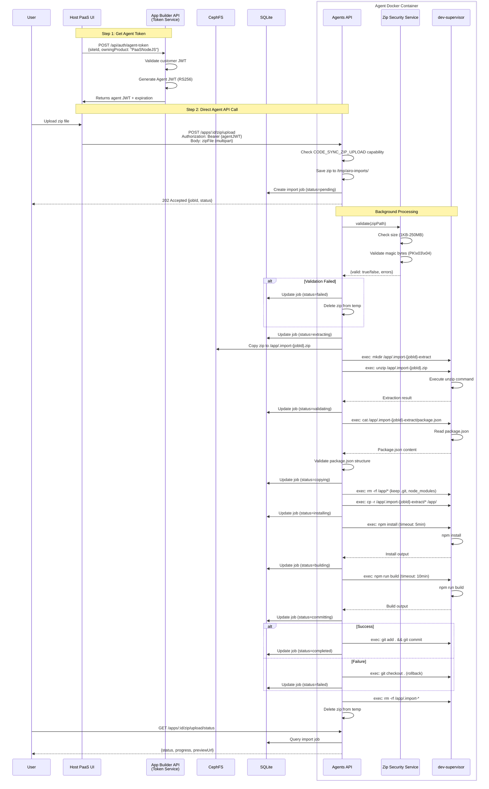
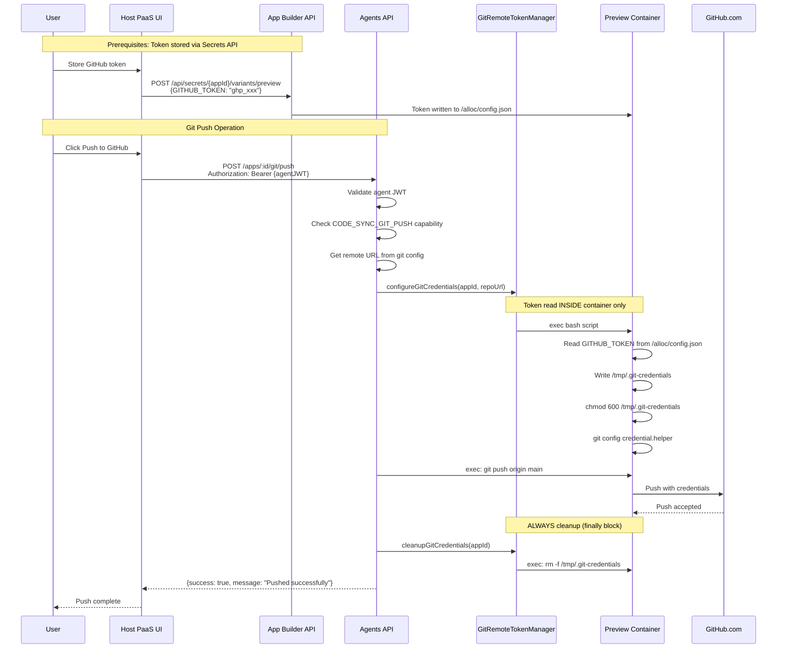
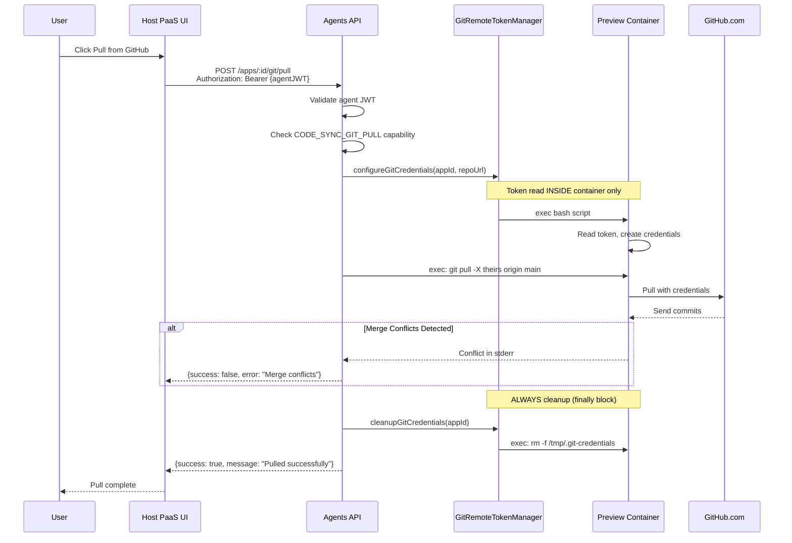
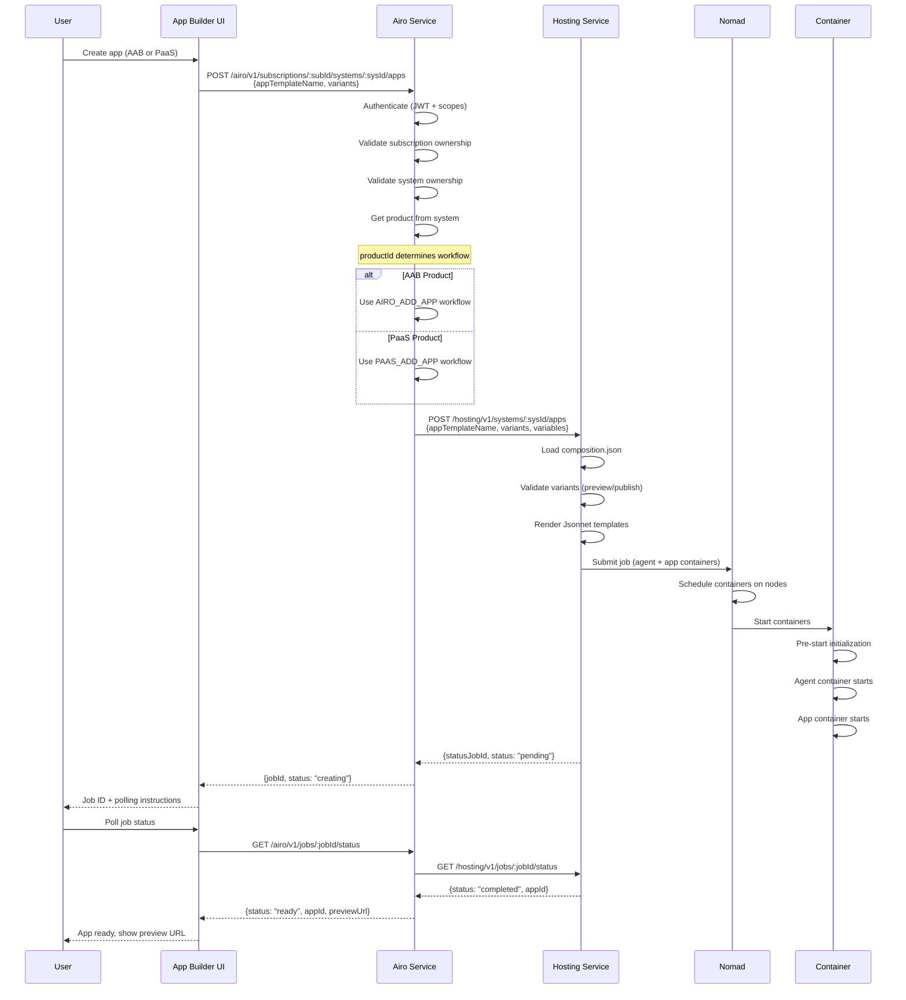

# Hosting PaaS (Platform as a Service) - Threat Model & Security Architecture

---

## Table of Contents

1. [Executive Summary](#1-executive-summary)
2. [System Overview](#2-system-overview)
3. [Architecture Components](#3-architecture-components)
4. [Data Flow Diagrams](#4-data-flow-diagrams)
5. [Security Controls](#5-security-controls)
6. [Security Considerations](#6-security-considerations)
7. [Access Control & Authorization](#7-access-control--authorization)
8. [Related Documentation](#8-related-documentation)
9. [Related Pull Requests](#9-related-pull-requests)
10. [Conclusion](#10-conclusion)

---

## 1. Executive Summary

### 1.1 Purpose

The Hosting PaaS (Platform as a Service) feature extends the Airo App Builder platform to support hosting and deployment of customer Node.js applications. It provides three code synchronization mechanisms:

1. **Zip Upload** - Upload and replace app codebase from zip files
2. **Git Pull** - Pull code from remote GitHub repository into container
3. **Git Push** - Push local container code to remote GitHub repository

These features combine with multi-product support, container orchestration, and secure on-premises hosting to provide a complete application hosting solution.

### 1.2 Core Security Features

**PaaS Security Responsibilities:**

1. ✅ **Product-based authorization** - Users can only access their product's apps
2. ✅ **Zip security validation** - Format verification and size limits (1KB - 250MB)
3. ✅ **Container isolation** - Docker + SELinux policies per container type
4. ✅ **Agent token authentication** - RSA-signed JWT tokens with site scope
5. ✅ **Container-inside processing** - Heavy operations isolated in containers
6. ✅ **Network segmentation** - Cilium network policies with default deny
7. ✅ **GitHub token security** - Tokens stored in secrets API, never in agents service memory
8. ✅ **Ephemeral credential management** - Git credentials deleted after each operation
9. ✅ **Capability-based access control** - Per-operation capability checks

---

## 2. System Overview

### 2.1 Feature Components

The PaaS feature consists of five integrated components:

1. **Zip Import Feature** - Upload and replace app codebase from zip files
2. **GitHub Sync Feature** - Bidirectional sync with GitHub (push/pull operations)
3. **Multi-Product Support** - Enhanced existing product support for AAB v1 to PaaS Node.js v1 product by mhp platform
4. **Container Orchestration** - Nomad-based deployment with preview/publish variants
5. **On-Premises Hosting** - Leverages existing v2 MWP infrastructure

### 2.2 Code Sync Flows Overview

| Flow           | Direction            | Endpoint                    | Capability Required    |
| -------------- | -------------------- | --------------------------- | ---------------------- |
| **Zip Upload** | External → Container | `POST /apps/:id/zip/upload` | `CODE_SYNC_ZIP_UPLOAD` |
| **Git Pull**   | GitHub → Container   | `POST /apps/:id/git/pull`   | `CODE_SYNC_GIT_PULL`   |
| **Git Push**   | Container → GitHub   | `POST /apps/:id/git/push`   | `CODE_SYNC_GIT_PUSH`   |

### 2.3 Related Documentation

This threat model focuses on PaaS-specific security. For additional architectural details, see:

- **Architecture Overview**: `/docs/onprem-hosting-architecture.md` - Infrastructure and network architecture
- **Zip Import Design**: `/docs/paas/zip-import-architecture.md` - Detailed zip import design
- **Zip Import Plan**: `/docs/paas/zip-import-plan.md` - Implementation details and authentication
- **GitHub Sync Design**: `/docs/paas/github-sync-design.md` - Complete GitHub sync architecture
- **GitHub Sync Class Diagram**: `/docs/paas/github-sync-class-diagram.md` - Component relationships
- **Agent Authentication**: `/docs/ui-agents-authentication-architecture.md` - JWT authentication flow
- **On-Premises Security**: Existing v2 MWP threat models (see links in onprem-hosting-architecture.md)

---

## 3. Architecture Components

### 3.1 High-Level Architecture



#### **Components:**

- **Host PaaS UI**: Separate UI app for PaaS
- **App Builder**: Token generation + secrets management for PaaS product
- **Agents Service**: Zip import API, GitHub sync API, container orchestration
- **Containers**: Nomad-managed, isolated per app
- **GitHub**: External git repository for code sync

### 3.2 Component Responsibilities

#### 3.2.1 Host PaaS UI (Separate Application)

- **Purpose**: Dedicated UI for PaaS Node.js product management
- **Technology**: [To be determined - separate from App Builder]
- **Authentication**: Customer authentication via SSO
- **Integration Pattern**:
  1. Calls App Builder API to get Agent JWT token
  2. Calls App Builder API to store GitHub token in secrets
  3. Calls Agent API directly with Agent JWT for code sync operations
- **Security**: CSP headers, HTTPS only, CORS configuration, JWT storage

**Security Considerations for Host PaaS UI:**

- ✅ Separate application = isolated security boundary
- ⚠️ Must securely store Agent JWT (memory only, not localStorage)
- ⚠️ CORS configuration must restrict to known origins
- ⚠️ Token refresh flow needed for long sessions
- ⚠️ Direct Agent API calls bypass App Builder security controls

#### 3.2.2 App Builder (Next.js)

- **Purpose**: Agent token generation + secrets management service
- **Port**: 3000
- **Authentication**: AWS SSO (customer tokens)
- **PaaS Role**:
  - **Token provider** - generates Agent JWTs for Host PaaS UI
  - **Secrets manager** - stores GITHUB_TOKEN via `/api/secrets` endpoint
- **Security**: CSP headers, HTTPS only, JWT validation

#### 3.2.3 Airo Service (mhp-airo)

- **Purpose**: Product and subscription management API
- **Port**: 8080
- **Authentication**: JWT tokens (cert-based or AWS IAM)
- **Product Support**: AAB v1, PaaS Node.js v1
- **Key Features**:
  - Product-based filtering (`productId`, `ownerProduct`)
  - Subscription management
  - Workflow orchestration
  - Tree service (hierarchical data)

#### 3.2.4 Agents Service (airo-app-builder/agents)

- **Purpose**: Agent API for app management, zip import, and GitHub sync
- **Port**: 4000
- **Authentication**: Agent JWT tokens (RSA-256)
- **Key Features**:
  - Zip import endpoints
  - GitHub sync endpoints (push/pull/configure)
  - Dev-supervisor integration
  - Container lifecycle management
  - Git operations

**Code Sync API Endpoints:**

| Endpoint                           | Method | Purpose                        | Capability                                   |
| ---------------------------------- | ------ | ------------------------------ | -------------------------------------------- |
| `/apps/:id/zip/upload`             | POST   | Upload zip to replace codebase | `CODE_SYNC_ZIP_UPLOAD`                       |
| `/apps/:id/zip/upload/status`      | GET    | Get zip import job status      | `CODE_SYNC_ZIP_UPLOAD`                       |
| `/apps/:id/git/remote/configure`   | POST   | Configure GitHub remote        | `CODE_SYNC_GIT_PUSH` or `CODE_SYNC_GIT_PULL` |
| `/apps/:id/git/push`               | POST   | Push to GitHub                 | `CODE_SYNC_GIT_PUSH`                         |
| `/apps/:id/git/pull`               | POST   | Pull from GitHub               | `CODE_SYNC_GIT_PULL`                         |
| `/apps/:id/git/remote/status`      | GET    | Get remote sync status         | `CODE_SYNC_GIT_PUSH` or `CODE_SYNC_GIT_PULL` |
| `/apps/:id/git/sync/status/:jobId` | GET    | Get git sync job status        | `CODE_SYNC_GIT_PUSH` or `CODE_SYNC_GIT_PULL` |

#### 3.2.5 Hosting Service (mhp-core)

- **Purpose**: Container composition and deployment
- **Authentication**: Admin JWT tokens
- **Key Features**:
  - Nomad job template rendering
  - Composition management (AAB v3, PaaS Node.js v1)
  - Variant-based deployments (preview/publish)
  - Data-driven variant validation

#### 3.2.6 Container Workloads (Nomad)

- **Agent Container**: Management interface for apps
- **Dev Container**: Development environment with hot reload
- **Prod Container**: Production deployment
- **Isolation**: Docker + SELinux + Cilium network policies

### 3.3 GitHub Sync Architecture

**Token Storage Pattern (Security-Approved):**

```
User → App Builder API → Control Plane → /alloc/config.json (Container)
       (Secrets API)      (mgmt-airo)
```

**Why Secrets API Instead of Database:**

- ✅ **Security-approved pattern** - Same pattern used for e-commerce integration
- ✅ **No CEPH exposure** - Token never stored in agents database
- ✅ **Per-variant isolation** - Token stored in preview secrets only
- ✅ **Container-native** - Token lives in `/alloc/config.json` inside container
- ✅ **Control plane managed** - Encryption handled by mgmt-airo

**GitHub Sync Components:**

```
┌─────────────────────────────────────────────────────────────────┐
│ API Routes (git-remote.ts)                                      │
│ - POST   /apps/:id/git/remote/configure                         │
│ - POST   /apps/:id/git/push                                     │
│ - POST   /apps/:id/git/pull                                     │
│ - GET    /apps/:id/git/remote/status                            │
└─────────────────────────────────────────────────────────────────┘
                            ▼
┌─────────────────────────────────────────────────────────────────┐
│ GitTool (git-tool.ts)                                           │
│ - handlePush() / handlePull() / handleConfigureRemote()         │
└─────────────────────────────────────────────────────────────────┘
                            ▼
┌─────────────────────────────────────────────────────────────────┐
│ GitRemoteTokenManager (NEW)                                     │
│ - configureGitCredentials() - Reads token INSIDE container      │
│ - cleanupGitCredentials() - Deletes /tmp/.git-credentials       │
└─────────────────────────────────────────────────────────────────┘
                            ▼
┌─────────────────────────────────────────────────────────────────┐
│ GitRemoteConfigRepository (NEW - metadata only)                 │
│ - Stores: repo URL, branch, provider, sync status               │
│ - Does NOT store: tokens (those are in secrets API)             │
└─────────────────────────────────────────────────────────────────┘
```

**Detailed Documentation**: See `/docs/paas/github-sync-design.md` and `/docs/paas/github-sync-class-diagram.md`

---

## 4. Data Flow Diagrams

### 4.1 Zip Import Flow (Complete Pipeline)



### 4.2 Git Push Flow (Container → GitHub)



### 4.3 Git Pull Flow (GitHub → Container)



### 4.4 Multi-Product App Creation Flow



### 4.5 Agent Token Authentication Flow

**Overview**: Host PaaS UI requests Agent JWT from App Builder, then uses it for direct Agent API calls.
**Detailed Documentation**: See `/docs/ui-agents-authentication-architecture.md`

---

## 5. Security Controls

### 5.1 Authentication Mechanisms

#### 5.1.1 Customer Authentication (AWS SSO)

- **Token Type**: AWS SSO JWT (IDP tokens)
- **Algorithm**: RS256
- **Lifetime**: Managed by SSO provider
- **Usage**: App Builder UI access
- **Validation**: Signature + expiration + issuer checks

#### 5.1.2 Agent Authentication (Custom JWT)

**Overview**: RSA-signed JWT tokens for Agent API access

**Key Properties:**

- **Algorithm**: RS256 (RSA-256)
- **Lifetime**: Up to 12 hours (configurable, 10-hour refresh cycle)
- **Scope**: Single site (siteId in JWT payload)
- **Key Management**: Private key in App Builder, public key in Agents
- **Usage**: Zip import, git operations, dev-supervisor commands

**Security Assessment:**

- ✅ Strong: RS256 prevents tampering
- ✅ Short-lived tokens with automatic refresh (10-hour cycle)
- ✅ Site-scoped to prevent cross-app access

**Detailed Documentation**: See `/docs/ui-agents-authentication-architecture.md`

#### 5.1.3 Service Authentication (Airo Service)

- **Token Types**: `cert` (certificate-based), `awsiam` (IAM role-based)
- **Algorithm**: RS256
- **Usage**: Service-to-service communication
- **Validation**: Cert CN or IAM ARN matching

### 5.2 Authorization Model

#### 5.2.1 Product-Based Authorization (Airo Service)

**Core Principle**: Products can only access their own data. This is enforced at multiple layers:

1. **Owner Product Validation**:

   - For AAB: `ownerProduct` must be `AiroAppBuilder`
   - For PaaS: `ownerProduct` must be `PaaSNodeJS`

2. **Product Scoping**:
   - Queries automatically filtered by `productId` or `ownerProduct`
   - Products cannot access data belonging to other products

**Authorization Patterns:**

**Pattern 1: Customer-Scoped Access** (App Builder UI)

- **Implementation**: AWS SSO JWT → Customer ID → Subscription ownership
- **Access Logic**: Customer can only access their subscriptions/systems/apps
- **Used By**: All customer-facing endpoints
- **Security**: Customer isolation via subscription ownership

**Pattern 2: Agent Token Access** (Agents API)

- **Implementation**: Agent JWT → Site ID → App ownership
- **Access Logic**: Token can only access the specific site in JWT payload
- **Used By**: Zip import, git operations, dev-supervisor commands
- **Security**: Site-scoped tokens prevent cross-app access

**Pattern 3: Product-Based Access** (Airo Service)

- **Implementation**: JWT → Customer ID + Product filtering
- **Access Logic**: Queries filtered by `productId` or `ownerProduct`
- **Used By**: Customer apps list, subscriptions list, tree endpoints
- **Security**: Product isolation via filtering

### 5.3 Capability-Based Access Control

**Overview**: Per-operation capability checks via `/alloc/config.json`

#### 5.3.1 Code Sync Capabilities

| Capability             | Required For           | Description                     |
| ---------------------- | ---------------------- | ------------------------------- |
| `CODE_SYNC_ZIP_UPLOAD` | `/apps/:id/zip/upload` | Upload zip to replace codebase  |
| `CODE_SYNC_GIT_PUSH`   | `/apps/:id/git/push`   | Push local commits to GitHub    |
| `CODE_SYNC_GIT_PULL`   | `/apps/:id/git/pull`   | Pull remote commits from GitHub |

#### 5.3.2 Config Structure

```json
{
  "CAPABILITIES": {
    "VALUE": [
      "CODE_SYNC_ZIP_UPLOAD",
      "CODE_SYNC_GIT_PUSH",
      "CODE_SYNC_GIT_PULL"
    ],
    "SYSTEM_MANAGED": true
  }
}
```

#### 5.3.3 Access Control Logic

```
┌─────────────────────────────────────────────────────────────────┐
│                    Access Control Evaluation                     │
├─────────────────────────────────────────────────────────────────┤
│                                                                 │
│   1. Check backward compatibility flags (DEPRECATED)            │
│      └── ENABLE_ZIP_IMPORT / ENABLE_GIT_REMOTE_SYNC             │
│      └── If true → ALLOW (bypass capability checks)             │
│      └── If false/unset → Continue to capability checks         │
│                                                                 │
│   2. Check capabilities based on request path:                  │
│      └── /apps/:id/zip/upload → CODE_SYNC_ZIP_UPLOAD            │
│      └── /apps/:id/git/push → CODE_SYNC_GIT_PUSH                │
│      └── /apps/:id/git/pull → CODE_SYNC_GIT_PULL                │
│      └── /apps/:id/git/remote/* → PUSH OR PULL capability       │
│      └── /apps/:id/git/sync/status/* → PUSH OR PULL capability  │
│                                                                 │
│   3. Capability found? → ALLOW                                  │
│      └── Not found? → 403 Forbidden                             │
│                                                                 │
└─────────────────────────────────────────────────────────────────┘
```

#### 5.3.4 Backward Compatibility (DEPRECATED)

| Flag                     | Status     | Replacement                                              |
| ------------------------ | ---------- | -------------------------------------------------------- |
| `ENABLE_ZIP_IMPORT`      | DEPRECATED | `CODE_SYNC_ZIP_UPLOAD` capability                        |
| `ENABLE_GIT_REMOTE_SYNC` | DEPRECATED | `CODE_SYNC_GIT_PUSH` / `CODE_SYNC_GIT_PULL` capabilities |

> **Note**: These flags will be removed once capability config is fully deployed.

### 5.4 Zip Security Validation

**Implementation**: `agents/src/services/ZipSecurityService.ts`

#### 5.4.1 Security Controls (All Implemented)

| Control                      | Limit/Protection                        | Status         |
| ---------------------------- | --------------------------------------- | -------------- |
| **Size Limits**              | 1KB - 250MB compressed                  | ✅ Implemented |
| **Magic Bytes**              | PK\x03\x04 validation                   | ✅ Implemented |
| **Compression Ratio**        | Max 100:1 ratio (zip bomb detection)    | ✅ Implemented |
| **File Count Limits**        | Max 50,000 files                        | ✅ Implemented |
| **Max Extracted Size**       | 1GB maximum extracted size              | ✅ Implemented |
| **Path Traversal Detection** | Blocks `..`, absolute paths, null bytes | ✅ Implemented |
| **Symlink Validation**       | Unix symlink detection via attributes   | ✅ Implemented |
| **Dangerous File Detection** | Blocks .exe, .dll, .so, .dylib, etc.    | ✅ Implemented |
| **Filename Validation**      | Max 260 char path, no control chars     | ✅ Implemented |
| **Cleanable File Detection** | Identifies junk/IDE/security files      | ✅ Implemented |

**Implementation Details:**

- Uses **yauzl** library to inspect zip metadata WITHOUT extraction for security
- Early abort on limit violations (zip bomb, file count, extracted size) for efficiency
- Zip files are validated on the agent side before being passed to containers
- Size validation prevents extremely small or large files
- Magic byte validation ensures only valid ZIP format files are processed
- Container-side extraction provides additional isolation from the agent process
- Cleanable files (`.DS_Store`, `.env`, `.git/`, `.idea/`, `.vscode/`) are identified for cleanup during import

**Configurable Limits** (via environment variables):

| Variable                           | Default                                  | Description                  |
| ---------------------------------- | ---------------------------------------- | ---------------------------- |
| `ZIP_IMPORT_MIN_SIZE`              | 1KB                                      | Minimum zip file size        |
| `ZIP_IMPORT_MAX_SIZE`              | 250MB                                    | Maximum zip file size        |
| `ZIP_IMPORT_MAX_EXTRACTED_SIZE`    | 1GB                                      | Maximum total extracted size |
| `ZIP_IMPORT_MAX_COMPRESSION_RATIO` | 100                                      | Maximum compression ratio    |
| `ZIP_IMPORT_MAX_FILES`             | 50,000                                   | Maximum file count           |
| `ZIP_IMPORT_MAX_PATH_LENGTH`       | 260                                      | Maximum path length          |
| `ZIP_IMPORT_BLOCKED_EXTENSIONS`    | exe,dll,so,dylib,bin,deb,rpm,pkg,app,ps1 | Blocked file extensions      |

**Detailed Documentation**: See `/docs/paas/zip-import-architecture.md`

### 5.5 GitHub Token Security

**Implementation**: `agents/src/services/GitRemoteTokenManager.ts`

#### 5.5.1 Token Storage (Secrets API Pattern)

| Property             | Implementation                                |
| -------------------- | --------------------------------------------- |
| **Storage Location** | `/alloc/config.json` inside preview container |
| **API Endpoint**     | `POST /api/secrets/{appId}/variants/preview`  |
| **Encryption**       | Managed by control plane (mgmt-airo)          |
| **Isolation**        | Per-app, per-variant (preview only)           |
| **Never Stored In**  | Agents database (CEPH), `.git/config`, logs   |

**Why This Is Secure:**

- ✅ Token never in agents database - no exposure if storage compromised
- ✅ Container-isolated - each app has its own secrets
- ✅ Preview-only - publish variant cannot access token
- ✅ Control plane managed - encryption/decryption handled by mgmt-airo
- ✅ Industry standard pattern - same as other sensitive credentials

#### 5.5.2 Token Injection (Ephemeral Credential Helper)

**Method**: All token operations happen INSIDE the container via bash script

```bash
# Step 1: Read token from secrets (inside container)
TOKEN=$(cat /alloc/config.json | jq -r '.GITHUB_TOKEN.VALUE')

# Step 2: Write credential file inside container (ephemeral)
echo "https://${TOKEN}@github.com" > /tmp/.git-credentials
chmod 600 /tmp/.git-credentials

# Step 3: Configure git to use it
git config --local credential.helper "store --file /tmp/.git-credentials"

# Step 4: Execute git command
git push -u origin main

# Step 5: Cleanup (CRITICAL - always in finally block)
rm -f /tmp/.git-credentials
```

#### 5.5.3 Security Properties

| Property                      | Implementation                      | Status |
| ----------------------------- | ----------------------------------- | ------ |
| Token never in agents service | Bash script reads inside container  | ✅     |
| Token never in logs           | Not in command arguments            | ✅     |
| Token never in process list   | Credential file, not CLI args       | ✅     |
| Ephemeral credentials         | Deleted after each operation        | ✅     |
| Preview-only access           | Stored in preview secrets only      | ✅     |
| Encrypted at rest             | Control plane manages encryption    | ✅     |
| File permissions              | `chmod 600` (owner read/write only) | ✅     |

**Detailed Documentation**: See `/docs/paas/github-sync-design.md`

### 5.6 Container Isolation

**Overview**: Multi-layer isolation using Docker, SELinux, Cilium, and dev-supervisor

#### 5.6.1 Security Layers

| Layer                        | Technology     | Protection                                          |
| ---------------------------- | -------------- | --------------------------------------------------- |
| **Container Runtime**        | Docker         | Process isolation, resource limits (2 CPU, 4GB RAM) |
| **Mandatory Access Control** | SELinux        | Kernel-level policy enforcement per container type  |
| **Network Segmentation**     | Cilium         | Default deny, explicit allow rules                  |
| **Process Communication**    | dev-supervisor | Unix socket, command allowlist                      |

#### 5.6.2 Key Security Features

**Docker:**

- Non-root user execution
- Read-only filesystem (except working directories)
- CPU/memory limits per container
- Network namespace isolation

**SELinux:**

- Per-container-type policies (agent, app, ingress)
- Least privilege access
- Prevents lateral movement

**Cilium:**

- Default deny network policy
- Explicit egress/ingress rules
- Customer workload isolation

**dev-supervisor:**

- Unix socket communication (no network)
- Command execution allowlist
- File system permission-based access control

**Detailed Documentation**: See `/docs/onprem-hosting-architecture.md`

### 5.7 Secrets Management

**Architecture**: Two-tier IAM separation (build-time vs runtime)

**Key Features:**

- Build-time: AWS Secrets Manager → S3
- Runtime: S3 read-only (no Secrets Manager access)
- Ephemeral secrets (container filesystem, not env vars)
- CloudTrail audit trail

**Security Assessment:**

- ✅ Least privilege IAM separation between build and runtime
- ✅ Ephemeral secrets loaded at runtime (not baked into images)
- ✅ CloudTrail logging for all secret access operations

---

## 6. Security Considerations

### 6.1 Authentication & Authorization

**Agent JWT Tokens:**

- RS256 signed tokens with maximum 12-hour lifetime
- Site-scoped to prevent cross-app access
- Validated against request appId on every operation
- TLS-only transmission

**Customer Authentication:**

- AWS SSO integration with JWT validation
- Product-based authorization filters data access
- Subscription ownership validated at every layer

**Container Security:**

- Docker isolation with SELinux policies
- Cilium network policies (default deny)
- dev-supervisor command allowlist prevents arbitrary execution

### 6.2 Zip Import Security

**Zip File Handling:**

- Format validation (magic bytes: PK\x03\x04)
- Size limits: 1KB minimum, 250MB maximum
- Container-side extraction for isolation
- Temporary storage with automatic cleanup

**Rollback on Failure:**

- Git commit tracks all changes
- On failure: `git checkout .` restores previous state
- Import job status tracked in database

### 6.3 GitHub Sync Security

**Token Management:**

- GITHUB_TOKEN stored in secrets API (security-approved pattern)
- Token written to `/alloc/config.json` by control plane
- Token NEVER read by agents service (only inside container via bash)
- Ephemeral credentials with automatic cleanup

**Operation Security:**

- All git commands execute inside container via dev-supervisor
- Credential files deleted after each operation (try/finally pattern)
- Push requires explicit user action (no auto-push)
- Pull uses `-X theirs` strategy (remote wins on conflict)

**Risk Mitigations:**

| Risk                    | Mitigation                                                       |
| ----------------------- | ---------------------------------------------------------------- |
| Token leakage in logs   | Token read via bash inside container, not passed as CLI argument |
| Cross-app token access  | Token scoped to preview variant per app                          |
| Accidental data loss    | Git tracks all changes, rollback available                       |
| Token in process list   | Credential file method, not environment variable                 |
| Secret exposure in push | Phase 2: Pre-push secret scanning (planned)                      |

### 6.4 Data Protection

**Secrets Management:**

- Two-tier IAM separation (build-time vs runtime)
- Ephemeral secrets loaded at runtime
- S3 read-only access in production
- CloudTrail audit logging

**Data Isolation:**

- Site-scoped tokens enforce app boundaries
- Product-based filtering in database queries
- Container filesystem isolation
- Sensitive outputs not returned in API responses

### 6.5 Resource Protection

**Container Limits:**

- CPU and memory quotas per container
- Nomad scheduling with resource constraints
- CephFS storage quotas

**Operation Timeouts:**

| Operation        | Timeout    |
| ---------------- | ---------- |
| npm install      | 5 minutes  |
| npm build        | 10 minutes |
| Total zip import | 30 minutes |
| git push         | 2 minutes  |
| git pull         | 2 minutes  |

**Logging & Audit:**

- Structured logging with user identity
- Import job tracking in database
- Git commits for all code changes
- Secrets never logged

---

## 7. Access Control & Authorization

### 7.1 Current Authorization Model

**Hierarchical Ownership:**

```
Customer (AWS SSO)
 └─ owns → Subscription
            └─ owns → System
                      └─ owns → App
                                └─ has → Code (via zip import / git sync)
```

**Authorization Layers:**

1. **Customer Layer**: AWS SSO JWT → Customer ID
2. **Subscription Layer**: Customer must own subscription
3. **System Layer**: Subscription must own system
4. **App Layer**: System must own app
5. **Site Layer**: Agent JWT must match app's siteId
6. **Capability Layer**: Operation must be enabled via capability

**Authorization Flow:**

```typescript
// 1. Validate customer JWT
const customerId = extractCustomerId(customerJWT);

// 2. Check subscription ownership
const subscription =
  await subscriptionService.getSubscriptionById(subscriptionId);
if (!subscription || subscription.customerId !== customerId) {
  return 403; // Forbidden
}

// 3. Check system ownership
const system = await systemService.getSystemById(systemId);
if (!system || system.subscriptionId !== subscriptionId) {
  return 403;
}

// 4. Check app ownership
const app = await appService.getAppById(appId);
if (!app || app.systemId !== systemId) {
  return 403;
}

// 5. For agent operations, validate agent JWT
const agentJWT = extractAgentToken(request);
const { siteId } = verifyAgentJWT(agentJWT);
if (siteId !== appId) {
  return 403;
}

// 6. Check capability for specific operation
if (!isCapabilityEnabled("CODE_SYNC_GIT_PUSH")) {
  return 403;
}

// AUTHORIZED
```

**Strengths:**

- ✅ Prevents cross-customer access
- ✅ Prevents cross-subscription access
- ✅ Prevents cross-system access
- ✅ Prevents cross-app access (agent JWT)
- ✅ Database foreign keys enforce relationships
- ✅ Capability-based feature access control

**Limitations:**

- ❌ No read-only users
- ❌ No delegated access (e.g., CI/CD tokens)
- ❌ All authorized users have full access (create, read, update, delete)
- ❌ No approval workflows for sensitive operations

### 7.2 Product-Based Authorization

**Product Filtering:**

```typescript
// Filter customer apps by product
GET /airo/v1/customers/me/apps?ownerProduct=PaaSNodeJS

// Implementation
const subscriptions = await subscriptionService.getSubscriptionsWithFilters({
  customerId,
  ownerProduct: 'PaaSNodeJS'
});

// SQL query includes product join
SELECT a.* FROM airo_apps a
INNER JOIN airo_systems sys ON a.system_id = sys.id
INNER JOIN airo_subscriptions sub ON sys.subscription_id = sub.id
INNER JOIN airo_products p ON sub.product_id = p.id
WHERE sub.customer_id = ? AND p.owner_product = ?
```

**Product Isolation:**

- ✅ AAB apps and PaaS apps are separate
- ✅ Queries automatically filtered by product
- ✅ Product configuration in database (not hardcoded)
- ✅ Workflows selected based on product

---

## 8. Related Documentation

### 8.1 PaaS-Specific Documentation

| Document                                  | Purpose                                                    |
| ----------------------------------------- | ---------------------------------------------------------- |
| `/docs/paas/zip-import-architecture.md`   | Zip import detailed design, security validation, API specs |
| `/docs/paas/zip-import-plan.md`           | Zip import implementation plan, authentication details     |
| `/docs/paas/github-sync-design.md`        | GitHub sync complete architecture, token management        |
| `/docs/paas/github-sync-class-diagram.md` | Component relationships, class diagrams                    |
| `/docs/paas/paas-customer-logs-access.md` | Customer logs feature design                               |

### 8.2 Platform Documentation

| Document                                         | Purpose                                           |
| ------------------------------------------------ | ------------------------------------------------- |
| `/docs/onprem-hosting-architecture.md`           | Infrastructure, network, SELinux, Cilium policies |
| `/docs/ui-agents-authentication-architecture.md` | JWT authentication flow, token structure          |
| `/docs/security-threat-modeling.md`              | Agent architecture security documentation         |

### 8.3 External Documentation

| Document                                                                                                                     | Purpose                              |
| ---------------------------------------------------------------------------------------------------------------------------- | ------------------------------------ |
| [MHP - PaaS Product Implementation](https://github.com/gdcorp-partners/mhp-airo/blob/main/PaasPlan.md)                       | mhp-airo PaaS implementation details |
| [MHP - UI-PaaS Integration](https://github.com/gdcorp-partners/mhp-airo/blob/main/packages/airo/docs/UI_TEAM_API_UPDATES.md) | UI integration details               |

---

## 9. Related Pull Requests

The following pull requests contain implementation details and changes related to this threat model:

### 9.1 Airo App Builder

- [PR #880](https://github.com/gdcorp-partners/airo-app-builder/pull/880)
- [PR #895](https://github.com/gdcorp-partners/airo-app-builder/pull/895)
- [PR #912](https://github.com/gdcorp-partners/airo-app-builder/pull/912)
- [PR #920](https://github.com/gdcorp-partners/airo-app-builder/pull/920)
- [PR #938](https://github.com/gdcorp-partners/airo-app-builder/pull/938)

### 9.2 MHP Platform

- [mhp-airo PR #101](https://github.com/gdcorp-partners/mhp-airo/pull/101)
- [mhp-core PR #146](https://github.com/gdcorp-partners/mhp-core/pull/146)

---

## 10. Conclusion

### 10.1 Security Posture Summary

The Hosting PaaS feature implements defense-in-depth security with multiple layers:

- ✅ **Multi-product support** - Product-based authorization and data isolation
- ✅ **Agent JWT authentication** - RS256 signed tokens, site-scoped, short-lived (max 12h)
- ✅ **Zip file validation** - Format verification (magic bytes) and size limits (1KB-250MB)
- ✅ **GitHub token security** - Tokens in secrets API, container-only access, ephemeral credentials
- ✅ **Container isolation** - Docker + SELinux policies + Cilium network policies
- ✅ **Network segmentation** - Default deny with explicit allow rules
- ✅ **Secrets management** - S3-based, ephemeral, IAM separation (build vs runtime)
- ✅ **Capability-based access** - Per-operation capability checks

### 10.2 Key Security Strengths

1. **Multi-Layer Authorization** - Customer → Subscription → System → App → Site → Capability
2. **Container Isolation** - Docker + SELinux + Cilium + resource limits
3. **Product Isolation** - AAB and PaaS data completely separated
4. **Network Segmentation** - Cilium enforces default deny
5. **Secrets Management** - Build-time vs runtime separation
6. **Token Security** - Secrets API pattern, container-isolated access, ephemeral credentials
7. **Capability System** - Granular per-operation access control

### 10.3 Code Sync Security Summary

| Flow           | Token Storage | Token Access          | Cleanup                 | Rollback         |
| -------------- | ------------- | --------------------- | ----------------------- | ---------------- |
| **Zip Upload** | N/A           | N/A                   | Auto-cleanup temp files | `git checkout .` |
| **Git Push**   | Secrets API   | Container-only (bash) | Always (finally block)  | Git history      |
| **Git Pull**   | Secrets API   | Container-only (bash) | Always (finally block)  | `git checkout .` |

---

**Change Log**

| Version | Date       | Author             | Changes         |
| ------- | ---------- | ------------------ | --------------- |
| 1.0     | 2025-03-05 | Airo Platform Team | Initial release |

---
