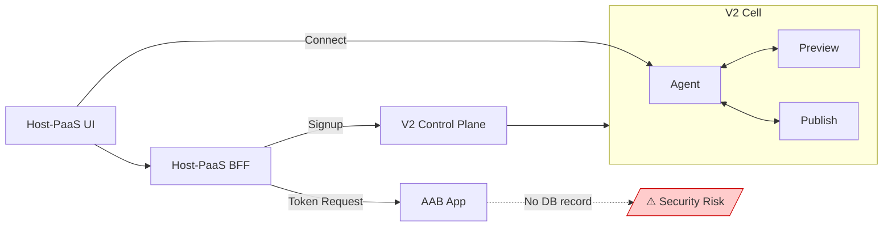
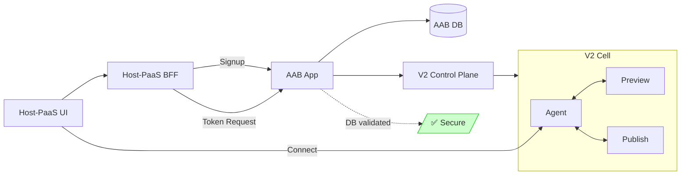

# Host-PaaS and AAB Integration - Design Proposal

**Problem:** Host-PaaS bypasses AAB by calling V2 APIs directly during signup, resulting in no AAB database record. This creates two issues: (1) Transitioning apps from PaaS to AAB requires a defined migration process, and (2) Agent-token generation currently relies on AAB APIs that call V2 directly without local DB validation—if AAB later adds enhanced ownership checks against its own database, the flow will break for PaaS-created apps.

---

## Option 1: Direct V2 API Calls (Current)

| Pros                                | Cons                                          |
| ----------------------------------- | --------------------------------------------- |
| Simpler architecture, no middleware | Security risk - no local ownership validation |
| Less latency (no extra hop)         | Transition requires migration jobs            |
| Capability isolation by default     | Duplicate logic across systems                |
|                                     | No unified audit trail                        |

---

## Option 2: Create Apps via AAB API

| Pros                                              | Cons                                                |
| ------------------------------------------------- | --------------------------------------------------- |
| Secure & consistent                               | Need whitelist-based capability control per product |
| Less effort transitions (capability flag changes) | Additional latency (+1 hop)                         |
| Single source of truth                            | AAB outage affects PaaS                             |
| Unified audit trail                               | Deployment coupling                                 |

---

## Critical Decision Factors

| Factor                 | Option 1                       | Option 2                     |
| ---------------------- | ------------------------------ | ---------------------------- |
| **Security**           | Risk - no local validation     | Secure - DB validation       |
| **Transition**         | High effort (migration jobs)   | Low effort (flag update)     |
| **Capability Control** | Not needed (natural isolation) | Whitelist mechanism required |
| **Data Consistency**   | Risk of drift                  | Guaranteed                   |

---

## Next Steps

1. Review with Host-PaaS and AAB teams
2. Decide based on security vs complexity trade-off
3. Plan migration for existing PaaS apps if Option 2 selected
