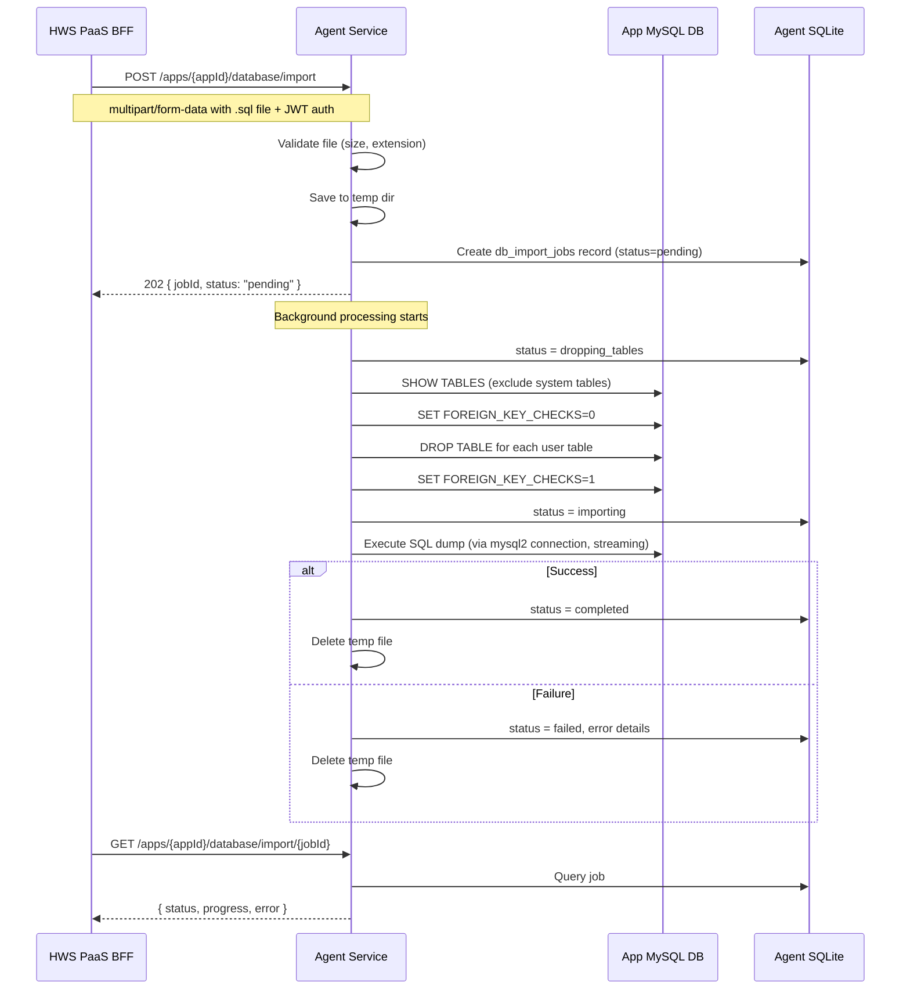
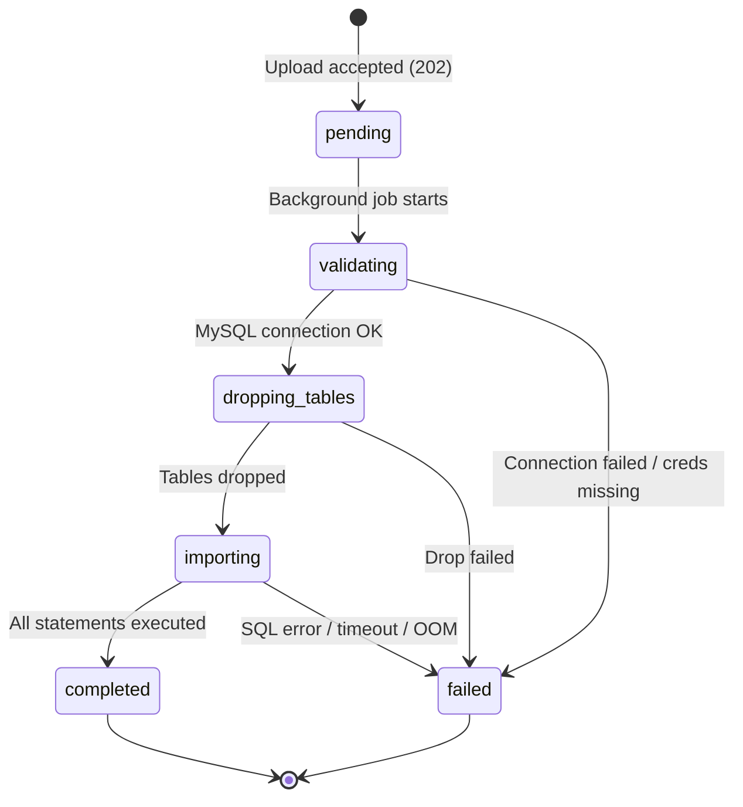

# PaaS Database Import — Design Spec

**Date:** 2026-03-17
**Status:** Draft
**Scope:** MySQL only (extensible to other engines later)

## Problem

PaaS users deploy their own apps via the PaaS flow (zip import or git push). These apps often need a pre-populated database — existing data from development, staging, or migration from another platform. Currently, the platform provisions an empty MySQL database per app, but there's no way to load data into it. Users must manually connect and run SQL, which breaks the self-service model.

## Goal

Enable PaaS users to import a `.sql` dump into their platform-provisioned MySQL database via a dedicated API endpoint on the agents service.

## Requirements

- **Separate API endpoint** on agents service (not bundled with code deployment)
- **Flexible timing** — import works anytime (during or after deployment)
- **Replace mode** — drops all existing user tables, then runs the SQL dump
- **MySQL only** for now (schema allows future engine support)
- **Configurable size limit** — initially up to 100MB (V1), extensible to 250MB+ with Ceph storage
- **Background processing** with status polling (same pattern as zip import)
- **Import only** — no export endpoint in this phase

## Non-Goals

- Bring Your Own Database (connecting to an external DB)
- SQL dump export
- Incremental / diff-based imports
- Non-MySQL database engines (future)
- UI for import (PaaS is headless / API-only)

## Prerequisites & Supported Scenarios

**The app must exist before DB import can be called.** Importing a database without an app is not a supported scenario. The app record in agents SQLite (created during app provisioning via mgmt-airo) is required for:

- JWT ownership validation (`validateAppOwnership` middleware)
- MySQL credential loading (`MySQLUtils.loadCredentialsFromApp`)
- Foreign key integrity (`db_import_jobs.app_id` → `apps.id`)

**Supported call sequences:**

| Scenario             | Flow                                          | Supported        |
| -------------------- | --------------------------------------------- | ---------------- |
| After app deploy     | Create app → deploy code → import DB          | Yes              |
| Parallel with deploy | Create app → (deploy code ∥ import DB)        | Yes              |
| Standalone DB setup  | Create app → import DB (no code deployed yet) | Yes              |
| DB without app       | Import DB (no app created)                    | No — returns 404 |

The key invariant: `POST /sites` (mgmt-airo) must have completed before calling the import endpoint. This is the same precondition as zip import and all other agent endpoints.

---

## Architecture

### High-Level Flow



### Where It Lives

| Component  | Location                                                    | Purpose                |
| ---------- | ----------------------------------------------------------- | ---------------------- |
| Route      | `agents/src/server/routes/db-import.ts`                     | API endpoints          |
| Service    | `agents/src/services/DatabaseImportService.ts`              | Import orchestration   |
| Repository | `agents/src/database/repositories/DbImportJobRepository.ts` | Job tracking (SQLite)  |
| Schema     | `agents/src/database/schema.ts`                             | `db_import_jobs` table |
| Types      | `agents/src/types/db-import.ts`                             | TypeScript interfaces  |

New files plus two existing file modifications (`schema.ts` for table creation, `app.ts` for route mounting).

---

## Infrastructure Constraints & Size Limits

| Constraint                 | Value                                     | Impact                                                         |
| -------------------------- | ----------------------------------------- | -------------------------------------------------------------- |
| Nomad ephemeral disk       | 1 GB shared across all tasks              | 100MB temp file feasible (~10% of total disk)                  |
| Agent Node.js heap         | 1536 MB (`--max-old-space-size=1536`)     | Must stream, cannot load file into memory                      |
| Agent memory max           | 2048 MB                                   | Streaming keeps RSS stable                                     |
| mhp-core API body limit    | 1 MB                                      | Not relevant — upload goes directly to agent, not via mhp-core |
| Cloudflare                 | No CF proxy in front of agent endpoints   | No external body limit                                         |
| MySQL `max_allowed_packet` | Likely 64MB (Aurora default)              | Single SQL statements >64MB will fail                          |
| Temp dir                   | `/tmp/airo-db-imports/` on ephemeral disk | Cleaned up after import                                        |

**V1 size limit: 100MB** (not 250MB).

Rationale:

- 100MB is conservative and safe within 1GB ephemeral disk (leaves room for other tasks, npm cache, etc.)
- Covers the vast majority of use cases (most app databases are <50MB)
- No need for Ceph storage at this size — temp file in `/tmp` is fine
- Avoids `max_allowed_packet` issues for most dumps (individual statements rarely exceed 64MB at this file size)

**Future extension (documented, not built):**

- Increase to 250MB+ by storing upload in Ceph (`/mnt/ceph/{appId}/agent/imports/`) instead of ephemeral `/tmp`
- URL-based import for very large dumps (skip upload entirely, stream from S3/URL)

**`max_allowed_packet` limitation:** Single SQL statements exceeding MySQL's `max_allowed_packet` (likely 64MB) will fail with `ER_NET_PACKET_TOO_LARGE`. This is a MySQL server-side limit we do not control. Workaround: users should export with `--skip-extended-insert` for tables with large rows.

---

## API Design

### `POST /apps/:id/database/import`

Upload a `.sql` dump to import into the app's MySQL database.

**Auth:** JWT (same as existing DB routes, via `validateAppOwnership` middleware)

**Access Control:** Same as existing database routes — JWT ownership validation via `validateAppOwnership` middleware. No additional feature flag or capability gate; the endpoint is available to all authenticated app owners.

**Request:**

```
Content-Type: multipart/form-data
Authorization: Bearer <JWT>

Fields:
  sqlFile: <file.sql>  (required, max 100MB configurable)
```

**Response (202 Accepted):**

```json
{
  "success": true,
  "appId": "abc123",
  "jobId": "job-uuid",
  "status": "pending"
}
```

**Error Responses:**

| Status | Condition                                       |
| ------ | ----------------------------------------------- |
| 400    | No file, wrong extension, empty file            |
| 413    | File exceeds size limit                         |
| 404    | App not found                                   |
| 409    | Another import already in progress for this app |

### `GET /apps/:id/database/import/:jobId`

Poll import job status.

**Response (in progress):**

```json
{
  "jobId": "job-uuid",
  "appId": "abc123",
  "status": "importing",
  "fileName": "dump.sql",
  "fileSize": 15728640,
  "progress": {
    "stage": "importing",
    "statementsExecuted": 4500,
    "statementsTotal": 12000,
    "bytesProcessed": 8500000,
    "bytesTotal": 15728640,
    "message": "Executing SQL import... (4500/~12000 statements)"
  },
  "createdAt": "2026-03-17T10:00:00.000Z",
  "updatedAt": "2026-03-17T10:01:00.000Z"
}
```

**Response (completed):**

```json
{
  "jobId": "job-uuid",
  "appId": "abc123",
  "status": "completed",
  "fileName": "dump.sql",
  "fileSize": 15728640,
  "progress": {
    "stage": "completed",
    "message": "Database import completed successfully"
  },
  "tablesImported": 12,
  "createdAt": "2026-03-17T10:00:00.000Z",
  "completedAt": "2026-03-17T10:02:00.000Z"
}
```

**Response (failed):**

```json
{
  "jobId": "job-uuid",
  "appId": "abc123",
  "status": "failed",
  "fileName": "dump.sql",
  "fileSize": 15728640,
  "progress": {
    "stage": "failed",
    "message": "Import failed"
  },
  "errorStage": "importing",
  "errorCode": "SQL_EXECUTION_FAILED",
  "createdAt": "2026-03-17T10:00:00.000Z",
  "completedAt": "2026-03-17T10:01:30.000Z"
}
```

**Note:** Detailed error output (raw SQL errors, stack traces) is stored in the DB for debugging but NOT returned in the API response (same pattern as zip import).

### `GET /apps/:id/database/import`

List import jobs for an app (most recent first, paginated).

**Query params:** `?page=1&limit=10` (both clamped: `page` min 1, `limit` min 1 / max 100)

**Response:**

```json
{
  "jobs": [
    /* array of job objects */
  ],
  "total": 5,
  "page": 1,
  "limit": 10
}
```

---

## Database Schema

New table in agents SQLite (`db_import_jobs`):

```sql
CREATE TABLE IF NOT EXISTS db_import_jobs (
  id TEXT PRIMARY KEY,
  app_id TEXT NOT NULL,
  status TEXT NOT NULL DEFAULT 'pending' CHECK(status IN (
    'pending', 'validating', 'dropping_tables', 'importing', 'completed', 'failed'
  )),
  file_name TEXT,
  file_size INTEGER,
  tables_dropped INTEGER,
  tables_imported INTEGER,
  statements_executed INTEGER DEFAULT 0,
  statements_total INTEGER,            -- estimated via semicolon pre-scan
  bytes_processed INTEGER DEFAULT 0,
  progress_updated_at DATETIME,        -- throttle SQLite progress writes
  error_message TEXT,
  error_stage TEXT,
  error_code TEXT,
  started_at DATETIME,
  completed_at DATETIME,
  created_at DATETIME DEFAULT CURRENT_TIMESTAMP,
  updated_at DATETIME DEFAULT CURRENT_TIMESTAMP,
  FOREIGN KEY (app_id) REFERENCES apps(id) ON DELETE CASCADE
);
```

**Why a separate table (not reusing `import_jobs`)?**

The existing `import_jobs` table is tightly coupled to code import (zip/git) with columns like `zip_file_name`, `detected_package_manager`, `has_build_script`, etc. Extending it would mean most columns are NULL for DB imports and vice versa. A dedicated table is cleaner and avoids CHECK constraint migrations.

---

## State Machine

### State Transition Diagram



### Transition Table

| From              | To                | Trigger                        | On Failure                                                                     |
| ----------------- | ----------------- | ------------------------------ | ------------------------------------------------------------------------------ |
| `pending`         | `validating`      | Background worker picks up job | N/A (immediate)                                                                |
| `validating`      | `dropping_tables` | MySQL connection test succeeds | → `failed` with `DB_CONNECTION_FAILED` or `DB_CREDENTIALS_NOT_FOUND`           |
| `dropping_tables` | `importing`       | All user tables dropped        | → `failed` with `DROP_TABLES_FAILED`                                           |
| `importing`       | `completed`       | All SQL statements executed    | → `failed` with `SQL_EXECUTION_FAILED`, `SQL_PARSE_ERROR`, or `IMPORT_TIMEOUT` |

**Terminal states:** `completed` and `failed` are final. No retries in V1. User must re-upload to retry.

**Concurrency rule:** Only one non-terminal job per app at a time (enforced at upload time, 409 if violated).

**Stale job handling:** If an agent crashes or restarts with a job in a non-terminal state, the job stays in that state. V1 does not auto-recover stale jobs. A future extension could add a startup sweep that marks stale jobs (non-terminal, `updated_at` > 30min ago) as `failed` with error code `AGENT_RESTART`.

---

## Import Process — Detailed Steps

### 1. Upload & Validation

```
Receive multipart upload
├── Check file extension is .sql
├── Check file size <= MAX_DB_IMPORT_SIZE (env var, default 100MB)
├── Save to temp dir: /tmp/airo-db-imports/{appId}/{jobId}.sql
├── Create db_import_jobs record (status=pending)
└── Return 202 with jobId
```

### 2. Background Processing

```
Start async import (with overall timeout → destroys connection + aborts stream)
├── Update status → validating
├── Load MySQL credentials via MySQLUtils.loadCredentialsFromApp(app)
├── Test MySQL connection (fail fast if DB unreachable)
│
├── Update status → dropping_tables
├── SHOW TABLES (exclude system tables via isSystemTable())
├── SET FOREIGN_KEY_CHECKS = 0
├── DROP TABLE IF EXISTS for each user table
├── SET FOREIGN_KEY_CHECKS = 1
├── Record tables_dropped count
│
├── Update status → importing
├── SET FOREIGN_KEY_CHECKS = 0, SET NAMES utf8mb4
├── Read SQL file as stream (64KB chunks)
├── Split into statements (streaming parser)
├── Execute in transaction batches (N statements per START TRANSACTION/COMMIT)
├── On statement error: ROLLBACK current batch, propagate error
├── Progress writes are non-critical (wrapped in try/catch — don't abort on SQLite error)
├── Record tables_imported count (SHOW TABLES after import)
├── SET FOREIGN_KEY_CHECKS = 1
│
├── On success:
│   ├── Update status → completed
│   └── Delete temp file
│
└── On failure:
    ├── Update status → failed, record error details
    └── Delete temp file
```

### Statement Execution Strategy

For files up to 100MB, we use a **streaming statement splitter with transaction batching**:

1. Read the `.sql` file as a character stream (64KB chunks)
2. Split into individual statements, correctly handling:
   - Semicolons inside string literals (`'foo;bar'`)
   - `DELIMITER` commands (for stored procedures/triggers)
   - Multi-line comments (`/* ... */`)
   - Single-line comments (`-- ...` and `# ...`) — `--` requires following whitespace per MySQL spec, so `SELECT 1--2` is correctly parsed as subtraction, not a comment
3. Execute statements in **transaction batches** — every N statements are wrapped in `START TRANSACTION` / `COMMIT` (N = `DB_IMPORT_TRANSACTION_BATCH_SIZE`, default 1000). This reduces fsync overhead and improves throughput ~6x (from ~780 stmt/sec to ~4,700 stmt/sec in testing with 99MB dumps).
4. Skip empty statements and comments-only blocks
5. On error mid-batch, explicitly `ROLLBACK` the current transaction before propagating the error. Prior committed batches remain in the database (replace-mode already dropped all tables, so partial state is acceptable — user retries by re-uploading).

**Why not pipe to `mysql` CLI?** The `mysql` binary may not be available in the agent container. Using `mysql2` (already a dependency) keeps it self-contained. For 100MB, streaming statement execution is sufficient.

**Why not load the whole file and execute?** Even a 100MB string in memory would spike the agent's heap. Streaming keeps memory usage constant regardless of file size.

**Why transaction batching instead of single-statement execution?** MySQL's InnoDB storage engine performs a disk fsync on every `COMMIT`. Without batching, each statement is an implicit single-statement transaction, resulting in one fsync per statement. Batching N statements per transaction amortizes the fsync cost. Testing showed a 99MB multi-table dump (5 tables, ~148K statements) completing in ~3 minutes with batching vs ~18 minutes without.

### Granular Progress Tracking

For large imports (>100MB, >60s), the coarse status stages (`pending` → `importing` → `completed`) don't give enough visibility. The `importing` stage can last minutes with no progress indication.

**Progress metrics tracked during `importing` stage:**

- `statements_executed` — incremented per statement (exact)
- `statements_total` — estimated via a quick pre-scan pass that counts semicolons in the file (fast, not perfectly accurate, but good enough for a progress bar)
- `bytes_processed` — exact, from stream read position
- `file_size` — exact, known at upload time

**Update throttling:** Progress is written to SQLite every 500 statements or every 5 seconds, whichever comes first. The `progress_updated_at` column prevents excessive writes.

**Resilience:** Progress writes are non-critical. If a SQLite write fails (e.g., "database is locked" under contention), the error is logged and the import continues. This prevents transient infrastructure issues from aborting an otherwise healthy import.

**Note:** `statementsTotal` is approximate — the semicolon pre-scan counts all semicolons, including those inside string literals and comments. The progress message prefixes the estimate with `~` to signal this.

**Schema additions to `db_import_jobs`:**

```sql
statements_executed INTEGER DEFAULT 0,
statements_total INTEGER,            -- estimated via semicolon pre-scan
bytes_processed INTEGER DEFAULT 0,
progress_updated_at DATETIME         -- throttle SQLite progress writes
```

**GET status response includes these fields in the `progress` object:**

```json
{
  "progress": {
    "stage": "importing",
    "statementsExecuted": 4500,
    "statementsTotal": 12000,
    "bytesProcessed": 85000000,
    "bytesTotal": 150000000,
    "message": "Executing SQL import... (4500/~12000 statements)"
  }
}
```

For non-`importing` stages (`pending`, `validating`, `dropping_tables`, `completed`, `failed`), the `progress` object omits statement/byte fields and only includes `stage` and `message`.

### SQL Pre-Processing (Sanitization)

The streaming statement splitter will strip/handle known-problematic patterns before executing each statement. This addresses the most common MySQL import failures:

| Pre-Processing                                    | What it does                                                                                      | Why                                                                        |
| ------------------------------------------------- | ------------------------------------------------------------------------------------------------- | -------------------------------------------------------------------------- |
| Strip DEFINER clauses                             | Remove `DEFINER=\`user\`@\`host\`` from CREATE VIEW/PROCEDURE/TRIGGER/FUNCTION/EVENT              | App MySQL user lacks SUPER/SET_USER_ID; DEFINER is the #1 import failure   |
| Strip `NO_AUTO_CREATE_USER` from sql_mode         | Remove from SET sql_mode statements                                                               | Removed in MySQL 8.0, present in every 5.7 dump                            |
| Strip `SET @@GLOBAL.GTID_PURGED`                  | Remove entirely                                                                                   | Requires SUPER privilege                                                   |
| Strip `CREATE DATABASE` / `DROP DATABASE` / `USE` | Remove entirely                                                                                   | Tenant user lacks privilege; wrong database context                        |
| Strip `LOCK TABLES` / `UNLOCK TABLES`             | Remove entirely                                                                                   | May lack LOCK TABLES privilege; interferes with concurrent access          |
| Strip privilege-escalation statements             | Remove `GRANT`, `REVOKE`, `CREATE USER`, `DROP USER`, `ALTER USER`, `RENAME USER`, `SET PASSWORD` | Prevents imported dumps from escalating DB privileges or creating accounts |
| Strip BOM                                         | Remove UTF-8 BOM from file start                                                                  | Common in Windows-exported files; causes syntax error                      |
| Handle `DELIMITER`                                | Treat as client command, don't send to MySQL                                                      | Not valid SQL; only mysql CLI understands it                               |
| Wrap in `FOREIGN_KEY_CHECKS=0`                    | Set before import, restore after                                                                  | Dumps may omit this; avoids table-order dependency                         |
| Set `SET NAMES utf8mb4`                           | At connection start                                                                               | Ensures correct charset handling                                           |

---

## Security

### File Validation

| Check          | Implementation                                                                     |
| -------------- | ---------------------------------------------------------------------------------- |
| Extension      | Only `.sql` accepted (case-insensitive — `.SQL`, `.Sql` also accepted)             |
| Size limit     | Configurable via `MAX_DB_IMPORT_SIZE` env var (default 100MB)                      |
| Content-type   | Must be `application/sql`, `text/sql`, `text/plain`, or `application/octet-stream` |
| Temp isolation | Files saved to `/tmp/airo-db-imports/` (separate from app directory)               |
| Cleanup        | Temp files deleted after import (success or failure)                               |

### SQL Injection Mitigation

The import executes user-provided SQL — this is intentional (it's the feature). The risk is mitigated by:

1. **Tenant isolation** — each app has its own MySQL database and user. The mysql2 connection uses app-specific credentials with grants limited to that database only.
2. **No cross-database access** — the MySQL user cannot `USE` another database or access `information_schema` writes.
3. **System table protection** — `isSystemTable()` check during the drop phase prevents dropping framework tables (e.g., `__drizzle_migrations`).
4. **No SUPER privilege** — app MySQL users don't have SUPER, so dangerous statements like `CHANGE MASTER` or `SET GLOBAL` will fail.
5. **Privilege-escalation filtering** — the SQL sanitizer strips `GRANT`, `REVOKE`, `CREATE USER`, `DROP USER`, `ALTER USER`, `RENAME USER`, and `SET PASSWORD` statements. Even if the DB user has sufficient privileges, a crafted dump cannot escalate access or create rogue accounts.

### Access Control

Same as existing database routes — JWT ownership validation via `validateAppOwnership` middleware. No additional capability gate or feature flag. The endpoint is available to all authenticated app owners with a valid JWT for the target app.

### Concurrency Guard

Only one import job can be active per app at a time. The check is **atomic** — the repository's `createIfNoActiveJob()` method runs a `SELECT` + `INSERT` inside a single SQLite transaction (using better-sqlite3's synchronous `db.transaction()`). If a non-terminal job exists for the app, it throws `DbImportConflictError`, which the route handler catches and returns as `409 Conflict`. This prevents TOCTOU race conditions where two concurrent upload requests could both pass a separate check-then-create flow.

---

## Configuration

| Env Var                            | Default                | Description                                    |
| ---------------------------------- | ---------------------- | ---------------------------------------------- |
| `MAX_DB_IMPORT_SIZE`               | `104857600` (100MB)    | Max upload size in bytes                       |
| `DB_IMPORT_TEMP_DIR`               | `/tmp/airo-db-imports` | Temp directory for uploads                     |
| `DB_IMPORT_STATEMENT_TIMEOUT`      | `300000` (5min)        | Per-statement execution timeout                |
| `DB_IMPORT_OVERALL_TIMEOUT`        | `1800000` (30min)      | Overall import timeout (all stages combined)   |
| `DB_IMPORT_TRANSACTION_BATCH_SIZE` | `1000`                 | Statements per transaction batch (perf tuning) |

**Hardcoded constants** (not env-configurable):

| Constant                         | Value   | Description                                 |
| -------------------------------- | ------- | ------------------------------------------- |
| `progressWriteInterval`          | 500     | Write progress to SQLite every N statements |
| `progressWriteTimeInterval`      | 5000 ms | Minimum time between progress writes        |
| Stream `highWaterMark`           | 64 KB   | Read stream chunk size                      |
| `estimateStatementCount` timeout | 5s      | Abort pre-scan if file read takes too long  |

**Overall timeout behavior:** When the overall timeout fires, it actively aborts the import by destroying the MySQL connection and aborting the file read stream (via `AbortController`). This ensures the import stops promptly rather than waiting for the current statement to finish (which could take up to `DB_IMPORT_STATEMENT_TIMEOUT`).

---

## Error Codes

| Code                         | Stage            | Description                                                                       |
| ---------------------------- | ---------------- | --------------------------------------------------------------------------------- |
| `FILE_MISSING`               | upload           | No file in request                                                                |
| `FILE_INVALID_EXTENSION`     | upload           | Not a .sql file                                                                   |
| `FILE_TOO_LARGE`             | upload           | Exceeds size limit                                                                |
| `FILE_EMPTY`                 | upload           | Zero-byte file                                                                    |
| `IMPORT_ALREADY_IN_PROGRESS` | upload           | Another import is running                                                         |
| `DB_CONNECTION_FAILED`       | validating       | Cannot connect to app MySQL                                                       |
| `DB_CREDENTIALS_NOT_FOUND`   | validating       | App MySQL credentials missing                                                     |
| `DROP_TABLES_FAILED`         | dropping_tables  | Failed to drop existing tables                                                    |
| `SQL_EXECUTION_FAILED`       | importing        | SQL statement execution error (catch-all for unclassified MySQL errors)           |
| `SQL_PARSE_ERROR`            | importing        | SQL syntax error (auto-classified from MySQL "syntax" / "parse" errors)           |
| `IMPORT_TIMEOUT`             | importing        | Overall import exceeded time limit                                                |
| `STATEMENT_TOO_LARGE`        | importing        | Single statement exceeds MySQL `max_allowed_packet`                               |
| `CONNECTION_LOST`            | importing        | MySQL connection dropped during import                                            |
| `DISK_SPACE_EXHAUSTED`       | importing        | Disk full / no space (auto-classified from MySQL "no space" / "disk full" errors) |
| `UNSUPPORTED_STATEMENT`      | importing        | Statement requires unavailable privilege (logged, skipped)                        |
| `AGENT_RESTART`              | any non-terminal | Agent crashed/restarted mid-import (stale job recovery, future)                   |

---

## Dual-Product Pattern (PaaS vs AAB)

This feature works identically for both AAB and PaaS because the app record is required to exist (see Prerequisites). The credential loading path is straightforward:

```typescript
const app = appRepo.findById(id);
if (!app) {
  return res.status(404).json({ error: "App not found" });
}
const credentials = await mysqlUtils.loadCredentialsFromApp(app);
```

This matches the existing DB routes in `db.ts` exactly. No dual-product branching is needed for this feature — both products have an app record and a provisioned MySQL database by the time import is called.

---

## Observability

Logging follows the existing `logger.info("domain.operation.lifecycle", { data })` pattern:

```
db-import.upload.begin          — file received
db-import.upload.accepted       — 202 returned
db-import.validate.begin        — connection test
db-import.drop.begin            — starting table drops
db-import.drop.complete         — tables dropped
db-import.import.begin          — starting SQL execution
db-import.import.progress       — periodic (every 1000 statements)
db-import.import.complete       — import finished
db-import.import.failed         — import failed with error
db-import.cleanup.complete      — temp file deleted
```

All log entries include `appId`, `jobId`. Sensitive data (SQL content, credentials) is never logged.

---

## Testing Strategy

### Unit Tests

- `DatabaseImportService` — mock mysql2, test each stage
- `DbImportJobRepository` — test CRUD operations
- SQL statement splitter — test edge cases (DELIMITER, string literals, comments)
- File validation — extension, size, content-type checks

### Integration Tests

- Full import flow with test MySQL database
- Concurrent import rejection (409)
- Large file streaming behavior
- Error handling at each stage (connection failure, SQL error, timeout)

### Manual Testing

```bash
# 1. Start agent (no feature flag needed)
pnpm run dev
# Or for local testing without JWT: AUTH_TYPE=none pnpm --filter @airo/agents dev

# 2. Upload SQL dump
curl -X POST http://localhost:4000/apps/{appId}/database/import \
  -H "Authorization: Bearer <JWT>" \
  -F "sqlFile=@dump.sql"

# 3. Poll status
curl http://localhost:4000/apps/{appId}/database/import/{jobId} \
  -H "Authorization: Bearer <JWT>"

# 4. Verify tables
curl http://localhost:4000/apps/{appId}/database/tables \
  -H "Authorization: Bearer <JWT>"
```

---

## Known Limitations (V1)

1. **`max_allowed_packet`**: Single SQL statements exceeding ~64MB will fail with `ER_NET_PACKET_TOO_LARGE`. Users should re-export with `--skip-extended-insert` for large tables.
2. **No automatic retry**: Failed imports must be re-uploaded. No partial resume.
3. **No stale job recovery**: If agent restarts mid-import, the job stays in its last state. Manual re-upload required.
4. **No dump format validation**: We accept any `.sql` file. Dumps from non-MySQL tools or corrupted files will fail during execution.
5. **No URL-based import**: Files must be uploaded directly. For very large dumps, this limits practical size.
6. **WordPress serialized data**: Importing a WordPress DB from another domain will have hardcoded URLs in serialized PHP data. This is an application-level concern, not something the import service fixes.

---

## Future Extensions

These are explicitly out of scope now but the design accommodates them:

1. **Export endpoint** — `GET /apps/:id/database/export` returning a `.sql` dump
2. **Other DB engines** — add `engine` field to schema, engine-specific import strategies
3. **URL-based import** — accept a URL instead of file upload for very large dumps
4. **Partial import** — import specific tables only
5. **Dry run** — validate SQL without executing

---

## File Changes Summary

| File                                                        | Change | Description                          |
| ----------------------------------------------------------- | ------ | ------------------------------------ |
| `agents/src/server/routes/db-import.ts`                     | New    | Import API routes                    |
| `agents/src/services/DatabaseImportService.ts`              | New    | Import orchestration service         |
| `agents/src/services/SqlStatementSplitter.ts`               | New    | Streaming SQL parser                 |
| `agents/src/database/repositories/DbImportJobRepository.ts` | New    | SQLite job tracking                  |
| `agents/src/types/db-import.ts`                             | New    | TypeScript interfaces                |
| `agents/src/database/schema.ts`                             | Modify | Add `db_import_jobs` table + indexes |
| `agents/src/server/app.ts`                                  | Modify | Mount import routes                  |
