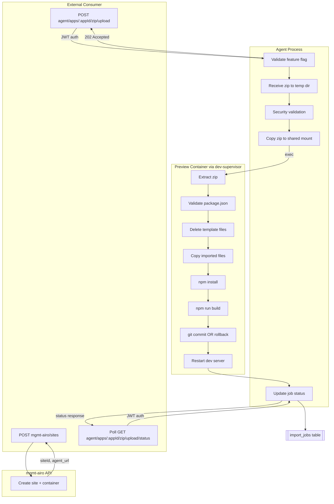
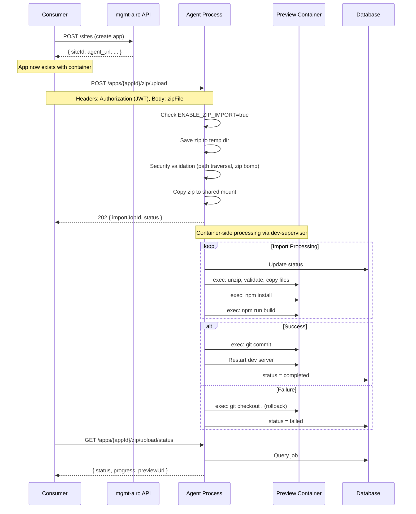

# Zip Import Feature - Architecture

## Overview

Import code into **existing apps** by uploading a zip file. The app must be created first via mgmt-airo, then code can be imported directly to the agent.

## Architecture



## Sequence Diagram



**Benefits:**

- App creation handled by mgmt-airo (source of truth)
- Direct agent access (no proxy overhead)
- Import is idempotent (can re-import/overwrite)
- Git rollback on failure restores previous state

---

## Key Insight

The import feature **overwrites code in an existing app**, not creates a new one:

1. **App creation** → Done by consumer via mgmt-airo API
2. **Code import** → Done directly via agent API
3. **Rollback** → On failure, `git checkout .` restores previous state

## External Consumer Integration

External consumers call **mgmt-airo for app creation** and **agent directly for import**:

```bash
# Step 1: Create app via mgmt-airo (source of truth for app lifecycle)
# NOTE: mgmt-airo uses AWS-based authentication - contact platform team for credentials
curl -X POST https://mgmt-airo.godaddy.com/api/sites \
  -H "Authorization: <mgmt-airo-auth>" \
  -H "Content-Type: application/json" \
  -d '{"name": "My Imported App", "accountId": "acc123"}'

# Response: { "siteId": "abc123", "agent_url": "https://agent.abc123.com", ... }
# App now exists with a running container

# Step 2: Get agent token via App Builder API
curl -X POST https://{app-builder-url}/api/auth/agent-token \
  -H "Authorization: Bearer ${CUSTOMER_JWT}" \
  -H "Content-Type: application/json" \
  -d '{"siteId": "abc123"}'

# Response: { "token": "eyJhbG...", "expires": "...", "siteId": "abc123" }

# Step 3: Replace codebase directly via agent (using agent token)
curl -X POST https://agent.abc123.com/apps/abc123/zip/upload \
  -H "Authorization: Bearer ${AGENT_TOKEN}" \
  -F "zipFile=@project.zip"

# Response: { "success": true, "appId": "abc123", "jobId": "job456", "status": "pending" }

# Step 4: Poll for status directly from agent
curl https://agent.abc123.com/apps/abc123/zip/upload/status \
  -H "Authorization: Bearer ${AGENT_TOKEN}"

# Response: { "status": "completed", "previewUrl": "https://abc123.preview.com" }
```

**Required Credentials:**

- `mgmt-airo auth` - AWS-based credentials for mgmt-airo API (contact platform team)
- `CUSTOMER_JWT` - Customer authentication for App Builder
- `AGENT_TOKEN` - RSA-signed JWT from `/api/auth/agent-token` endpoint

**See [zip-import-plan.md](zip-import-plan.md#authentication) for detailed authentication documentation.**

**Why Direct Agent Access?**

| Benefit                | Description                             |
| ---------------------- | --------------------------------------- |
| Simpler                | No proxy layer, fewer hops              |
| Consumer has agent_url | Returned from mgmt-airo on app creation |
| Consistent             | Same pattern as App Builder frontend    |
| Lower latency          | No proxy overhead                       |

---

## Design Principles

1. **Complete Isolation**: New endpoints/services - NO modifications to existing code
2. **Leverage Existing Infrastructure**: Use Docker containers + dev-supervisor
3. **Security First**: Zip validation before extraction, commands run in container sandbox
4. **Structured Errors**: Unique validation keys for frontend handling
5. **Feature Flag**: `ENABLE_ZIP_IMPORT=true` for controlled rollout

## Implementation Status

### ✅ Completed (Agents Package)

| File                                                      | Purpose                     | Status  |
| --------------------------------------------------------- | --------------------------- | ------- |
| `agents/src/types/import.ts`                              | TypeScript interfaces       | ✅ Done |
| `agents/src/database/repositories/ImportJobRepository.ts` | Job tracking                | ✅ Done |
| `agents/src/services/ZipSecurityService.ts`               | Zip validation + extraction | ✅ Done |
| `agents/src/services/ProjectImportService.ts`             | Import orchestration        | ✅ Done |
| `agents/src/server/routes/import.ts`                      | API routes                  | ✅ Done |
| `agents/src/database/schema.ts`                           | Added import_jobs table     | ✅ Done |
| `agents/src/server/app.ts`                                | Mounted /git routes         | ✅ Done |

### Architecture Note

**No App Builder proxy layer** - Consumers call the agent directly:

- App creation: Consumer → mgmt-airo
- Codebase replacement: Consumer → Agent (`/apps/:appId/zip/upload`)
- Status polling: Consumer → Agent (`/apps/:appId/zip/upload/status`)

## Security Measures

### Zip Extraction (Before Container)

| Check                 | Implementation                             |
| --------------------- | ------------------------------------------ |
| Size limit            | Reject if >100MB                           |
| Path traversal        | Reject entries with `..` or absolute paths |
| Zip bomb              | Abort if ratio >100:1 or extracted >500MB  |
| Symlinks              | Skip all symlinks                          |
| Filename sanitization | Reject control chars, null bytes           |
| Dangerous filenames   | Reject control characters                  |

### Access Control

**Capability-Based (Primary):**

| Capability             | Required For              | Description                    |
| ---------------------- | ------------------------- | ------------------------------ |
| `CODE_SYNC_ZIP_UPLOAD` | `/apps/:appId/zip/upload` | Upload zip to replace codebase |

**Config Structure (`/alloc/config.json`):**

```json
{
  "CAPABILITIES": {
    "VALUE": ["CODE_SYNC_ZIP_UPLOAD"],
    "SYSTEM_MANAGED": true
  }
}
```

**Backward Compatibility:**

| Check        | Layer | Implementation                                |
| ------------ | ----- | --------------------------------------------- |
| Feature flag | Agent | `ENABLE_ZIP_IMPORT=true` env var (DEPRECATED) |
| JWT auth     | Agent | Standard JWT middleware                       |

> **⚠️ DEPRECATED**: `ENABLE_ZIP_IMPORT` is a temporary flag for backward compatibility.
> Once capability config is fully deployed, this flag will be removed and access control
> will rely solely on `CODE_SYNC_ZIP_UPLOAD` capability in `/alloc/config.json`.

### Response Sanitization

| Field                      | Stored | Returned | Reason                             |
| -------------------------- | ------ | -------- | ---------------------------------- |
| `installOutput`            | ✅     | ❌       | May contain verbose npm errors     |
| `buildOutput`              | ✅     | ❌       | May contain build errors           |
| `errorMessage`             | ✅     | ❌       | May contain internal error details |
| `validationErrors.details` | ✅     | ❌       | May contain internal paths         |
| `validationErrors.key`     | ✅     | ✅       | Safe error code                    |
| `validationErrors.message` | ✅     | ✅       | Safe human-readable message        |

### Command Execution (Container Isolation)

| Protection          | Provided By                              |
| ------------------- | ---------------------------------------- |
| Container isolation | Docker                                   |
| Command execution   | dev-supervisor socket                    |
| Timeouts            | TerminalTool (5min install, 10min build) |
| Process limits      | Container resource limits                |

## Database Schema

```typescript
export interface ImportJob {
  id: string;
  appId: string;
  status: ImportJobStatus;
  zipFileName: string;
  zipFileSize: number;
  extractedPath?: string;
  detectedPackageManager?: "npm" | "yarn" | "pnpm";
  hasBuildScript?: boolean;
  hasDevScript?: boolean;
  validationErrors?: string; // JSON: ValidationError[]
  installOutput?: string;
  buildOutput?: string;
  errorMessage?: string;
  errorStage?: string;
  startedAt?: Date;
  completedAt?: Date;
  createdAt: Date;
  updatedAt: Date;
}

export type ImportJobStatus =
  | "pending"
  | "creating_container"
  | "extracting"
  | "validating"
  | "copying"
  | "installing"
  | "building"
  | "committing"
  | "restarting"
  | "completed"
  | "failed";

export type ValidationErrorKey =
  | "ZIP_EMPTY"
  | "ZIP_CORRUPTED"
  | "ZIP_TOO_LARGE"
  | "ZIP_INVALID_FORMAT"
  | "ZIP_PATH_TRAVERSAL"
  | "ZIP_BOMB_DETECTED"
  | "ZIP_SYMLINK_FOUND"
  | "PACKAGE_JSON_NOT_FOUND"
  | "PACKAGE_JSON_INVALID"
  | "PACKAGE_JSON_MISSING_NAME"
  | "NOT_NODE_PROJECT"
  | "NO_DEV_SCRIPT"
  | "NO_BUILD_SCRIPT"
  | "INSTALL_FAILED"
  | "INSTALL_TIMEOUT"
  | "BUILD_FAILED"
  | "BUILD_TIMEOUT"
  | "CONTAINER_CREATION_FAILED"
  | "CONTAINER_NOT_READY"
  | "GIT_COMMIT_FAILED"
  | "DEV_SERVER_START_FAILED";
```

## API Endpoints

### Agent Endpoints (Built ✅)

| Endpoint                         | Method | Description                           |
| -------------------------------- | ------ | ------------------------------------- |
| `/apps/:appId/zip/upload`        | POST   | Replace entire codebase from zip file |
| `/apps/:appId/zip/upload/status` | GET    | Poll replacement job status           |

## Process Flow Detail

### Phase 1: App Creation (Consumer → mgmt-airo)

```
POST mgmt-airo/api/sites
├── Creates site record
├── Spins up container with template code
└── Returns { siteId, agent_url, ... }
```

### Phase 2: Codebase Replacement (Consumer → Agent)

```
POST /apps/:appId/zip/upload (multipart: zipFile)
├── Check ENABLE_ZIP_IMPORT feature flag
├── Validate zip file (size, security, structure)
└── Return { appId, jobId, status: 'pending' }
```

### Phase 3: Background Processing (Agent + Container)

```
Agent-side (security/orchestration):
├── Update job: status = validating
├── Security validation on agent (path traversal, zip bomb, format)
├── Copy validated zip to shared mount → /app/.import-{jobId}.zip

Container-side (via dev-supervisor exec):
├── Update job: status = extracting
├── exec: mkdir + unzip (extract zip in container)
├── Update job: status = validating
├── exec: cat package.json, test -f lock files (validate project)
├── Update job: status = copying
├── exec: find + rm (delete template files, keep .git, node_modules)
├── exec: find + cp (copy imported files to /app)
├── Update job: status = installing
├── exec: npm install (via TerminalTool → dev-supervisor)
├── Update job: status = building
├── exec: npm run build (if script exists)
├── Update job: status = committing
│   ├── On success: exec: git add + commit
│   └── On failure: exec: git checkout . (rollback)
├── Update job: status = restarting
├── Restart dev server via dev-supervisor
├── exec: rm -rf .import-* (cleanup temp files in container)
└── Update job: status = completed

Agent-side (cleanup):
└── Delete original zip from temp directory
```

## Response Formats

**POST /apps/:appId/zip/upload**

```json
{
  "success": true,
  "appId": "uuid",
  "jobId": "job-uuid",
  "status": "pending"
}
```

**GET /apps/:appId/zip/upload/status (in progress)**

```json
{
  "jobId": "job-uuid",
  "appId": "app-uuid",
  "status": "installing",
  "progress": {
    "stage": "installing",
    "stageNumber": 6,
    "message": "Installing dependencies..."
  },
  "createdAt": "2024-01-01T00:00:00.000Z",
  "updatedAt": "2024-01-01T00:01:00.000Z"
}
```

**GET /apps/:appId/zip/upload/status (completed)**

```json
{
  "jobId": "job-uuid",
  "appId": "app-uuid",
  "status": "completed",
  "progress": {
    "stage": "completed",
    "stageNumber": 10,
    "message": "Import completed successfully!"
  },
  "previewUrl": "https://app-uuid.preview.godaddy.com",
  "warnings": [
    { "key": "NO_BUILD_SCRIPT", "message": "No build script found" }
  ],
  "createdAt": "2024-01-01T00:00:00.000Z",
  "updatedAt": "2024-01-01T00:05:00.000Z"
}
```

**GET /apps/:appId/zip/upload/status (failed)**

```json
{
  "jobId": "job-uuid",
  "appId": "app-uuid",
  "status": "failed",
  "progress": {
    "stage": "failed",
    "message": "Import failed"
  },
  "errorStage": "installing",
  "validationErrors": [
    { "key": "INSTALL_FAILED", "message": "npm install failed" }
  ],
  "createdAt": "2024-01-01T00:00:00.000Z",
  "updatedAt": "2024-01-01T00:02:00.000Z"
}
```

**Security Note:** Sensitive fields (`installOutput`, `buildOutput`, `errorMessage`, `details`)
are stored in the database for debugging but NOT returned in API responses.

## Environment Variables

```bash
# DEPRECATED: Temporary backward compatibility flag
# When true: bypasses capability checks (legacy behavior)
# When false/unset: falls back to capability-based checks via /alloc/config.json
ENABLE_ZIP_IMPORT=true

# Optional
IMPORT_TEMP_DIR=/tmp/airo-imports  # Default: /tmp/airo-imports
```

> **Note:** Once capability config is fully deployed, `ENABLE_ZIP_IMPORT` will be removed.
> Use `CODE_SYNC_ZIP_UPLOAD` capability in `/alloc/config.json` instead.

## Testing

### Manual Testing Flow

1. Create app via mgmt-airo to get `siteId` and `agent_url`
2. Start agent with `ENABLE_ZIP_IMPORT=true`
3. Create test zip with valid Node.js project
4. Call `POST {agent_url}/apps/{appId}/zip/upload` with:
   - Header: `Authorization: Bearer {JWT}`
   - Form data: `zipFile`
5. Poll `GET {agent_url}/apps/{appId}/zip/upload/status` until completed
6. Visit preview URL

### Test Cases

- ✅ Valid zip with package.json
- ✅ Missing package.json
- ✅ Invalid zip format
- ✅ Zip bomb detection
- ✅ Path traversal attempt
- ✅ npm install failure (triggers git rollback)
- ✅ Build failure (triggers git rollback)
- ✅ Missing feature flag

## Design Decisions

### Why Use a Separate Temp Directory for Uploads?

**Decision:** Uploaded zip files are written to a separate temp directory (`/tmp/airo-imports/`)
before validation, then copied to the app's shared mount for container-side processing.

**Alternatives Considered:**

1. **Direct write to app directory** - Write the zip directly to the app's shared mount
   (e.g., `/tmp/apps/{appId}/.import.zip`) via custom multer storage, eliminating the copy step.

2. **Stream directly to container** - Stream the upload through dev-supervisor to the container.

**Why We Chose Separate Temp Directory:**

| Reason                 | Explanation                                                                                                                                                                                    |
| ---------------------- | ---------------------------------------------------------------------------------------------------------------------------------------------------------------------------------------------- |
| **Security Isolation** | Untrusted uploads never touch the app directory until they pass security validation (path traversal, zip bombs, format checks). The temp directory acts as a quarantine zone.                  |
| **Simplicity**         | Standard multer disk storage is battle-tested and reliable. Custom storage engines add complexity and potential failure points (database lookups during streaming, error handling edge cases). |
| **Clean Architecture** | Clear boundary between "incoming/untrusted" data and "validated app data". Makes the security model easier to reason about and audit.                                                          |
| **Container Safety**   | The app directory is mounted in the preview container. File watchers or other processes monitoring that directory could react to untrusted zip files appearing, even temporarily.              |
| **Negligible Cost**    | The extra copy is same-filesystem (fast). The real cost is container-side extraction and npm install, which we've optimized by moving to container-side processing.                            |

**Code Reference:** See `agents/src/server/routes/git.ts` - the `TEMP_UPLOAD_DIR` constant
and associated comments explain this decision inline.

---

### Why Container-Side Processing?

**Decision:** After validation on the agent, the zip is copied to the container's shared mount
and all heavy operations (extraction, file manipulation, npm install, build) run inside the
container via dev-supervisor exec commands.

**Previous Approach:** All operations ran on the agent using Node.js fs APIs.

**Why We Changed:**

| Reason                      | Explanation                                                                                                                            |
| --------------------------- | -------------------------------------------------------------------------------------------------------------------------------------- |
| **Resource Isolation**      | Heavy I/O operations (extracting thousands of files) happen in the container, not the agent. Agent can handle more concurrent imports. |
| **Performance**             | File operations within the container are local to that environment, avoiding cross-mount overhead for reads/writes.                    |
| **Environment Consistency** | Files are manipulated in the same environment where they'll run, reducing potential permission or path issues.                         |
| **Scalability**             | Agent's memory/disk isn't impacted by large imports since extraction happens in container.                                             |

**Code Reference:** See `agents/src/services/ProjectImportService.ts` - the `extractZipInContainer`,
`validateProjectInContainer`, and `copyFilesInContainer` methods implement this pattern.

---

## Future Improvements (Technical Debt)

1. **Skip Template Installation**: Create `DevEnvironmentManager.createEmptyContainer()` to avoid double npm install
2. **Retry Mechanism**: Allow retry of failed imports with new zip
3. **Cancel Support**: Allow cancellation of in-progress imports
4. **Progress Streaming**: WebSocket for real-time progress updates
5. **Dependency Caching**: Cache node_modules between imports for speed

## Per-App Agent Architecture Note

Since each app has its own agent container, the current approach is well-suited:

- Import runs in isolation (can't affect other apps)
- No need for job queue (one-time operation per app)
- Failures are contained to the importing app
- Resources are isolated by container limits
