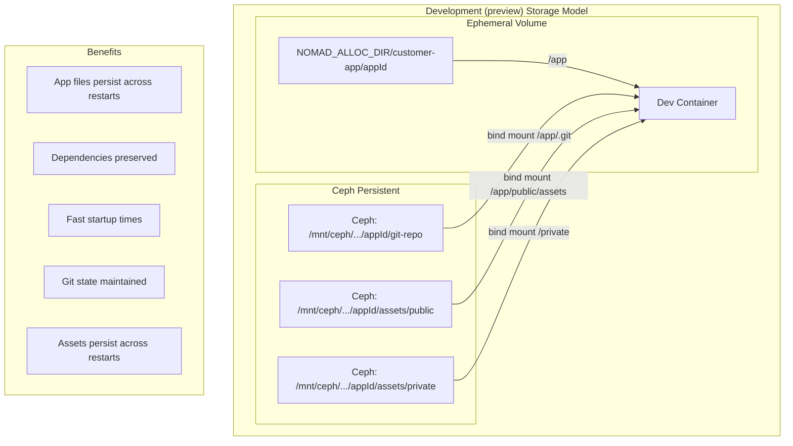
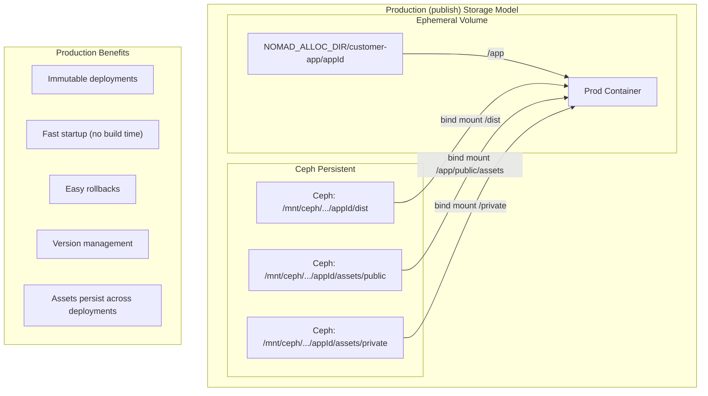
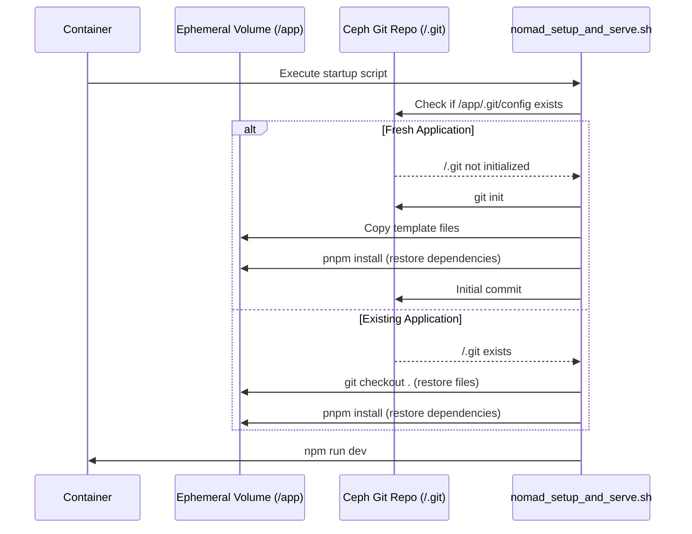
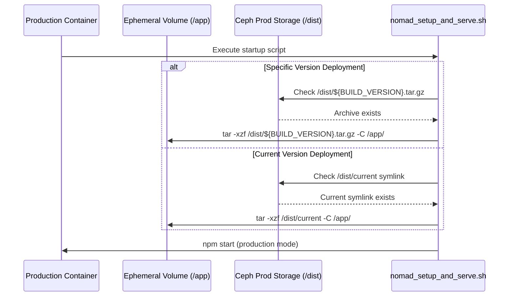

# Persistent Storage Architecture

## Overview

The Persistent Storage Architecture enables applications in the AI Hosting Platform to survive Nomad restarts and supports production deployment workflows. This architecture leverages Ceph network filesystem with strategic bind mounting to ensure application state, dependencies, and version control history persist across container lifecycle events.

## Architecture Goals

- **Application Persistence**: Apps survive Nomad job restarts and redeployments
- **Version Control Continuity**: Git history and state maintained across restarts
- **Dependency Management**: Node modules and build artifacts persist appropriately
- **Production Readiness**: Support for reliable production deployments
- **Development Efficiency**: Fast startup times for existing applications

## Deployment Modes

The persistent storage architecture supports two distinct deployment modes:

- **Development (preview) Mode**: Live development with git repository access, hot reloading, and real-time file editing
- **Production (publish) Mode**: Optimized deployment from pre-built artifacts with versioning and rollback capabilities

## Storage Strategy

### Development (preview) Architecture (Direct Bind Mounts)



### Production (publish) Architecture (Build Artifacts)



## Implementation Details

### Nomad Job Configuration

#### Development (preview) Container Configuration

Strategic bind mounting for live development with git repository access.

Example Nomad Job:

```javascript
// Development (preview) container configuration
Config: {
  volumes: [
    `..${NOMAD_ALLOC_DIR}/customer-app/${appId}:/app`
  ],
  mounts: [
    {
      type: 'bind',
      readonly: false,
      source: `/mnt/ceph/${cephMountId}/${cephDirNumber}/${appId}/git-repo`,
      target: '/app/.git'
    },
    {
      type: 'bind',
      readonly: false,
      source: `/mnt/ceph/${cephMountId}/${cephDirNumber}/${appId}/npm-cache`,
      target: '/npm-cache'
    },
    {
      type: 'bind',
      readonly: false,
      source: `/mnt/ceph/${cephMountId}/${cephDirNumber}/${appId}/assets/public`,
      target: '/app/public/assets'
    },
    {
      type: 'bind',
      readonly: false,
      source: `/mnt/ceph/${cephMountId}/${cephDirNumber}/${appId}/assets/private`,
      target: '/private'
    }
  ]
}
```

#### Production (publish) Container Configuration

Optimized configuration for production deployments from build artifacts.

Example Nomad Job:

```javascript
// Production (publish) container configuration
Config: {
  volumes: [
    `..${NOMAD_ALLOC_DIR}/customer-app/${appId}:/app`
  ],
  mounts: [
    {
      type: 'bind',
      readonly: false,
      source: `/mnt/ceph/${cephMountId}/${cephDirNumber}/${appId}/dist`,
      target: '/dist'
    },
    {
      type: 'bind',
      readonly: false,
      source: `/mnt/ceph/${cephMountId}/${cephDirNumber}/${appId}/npm-cache`,
      target: '/npm-cache'
    },
    {
      type: 'bind',
      readonly: false,
      source: `/mnt/ceph/${cephMountId}/${cephDirNumber}/${appId}/assets/public`,
      target: '/app/public/assets'
    },
    {
      type: 'bind',
      readonly: false,
      source: `/mnt/ceph/${cephMountId}/${cephDirNumber}/${appId}/assets/private`,
      target: '/private'
    }
  ]
}
```

### Storage Hierarchy

```text
/mnt/ceph/${cephMountId}/${cephDirNumber}/
    └── ${appId}/
        ├── agent/                     # Persistent storage for the agent
        ├── npm-cache/                 # NPM package cache for faster installations
        ├── git-repo/                  # Persistent Git repository (development/preview)
        ├── assets/                    # Shared assets (preview and publish)
        │   ├── public/                # Public assets (images, uploads, etc.)
        │   └── private/               # Private assets (outside /app for security)
        └── dist/                      # Published builds (archived by commit hash)
            ├── ba4a3f58c4ccc538407572dc04f36fd54f749877.tar.gz  # First build
            ├── c7e2b1a9d3f4e6a8b0c2d4e6f8a0b2c4d6e8f0a2.tar.gz  # Previous build
            ├── f1a2b3c4d5e6f7a8b9c0d1e2f3a4b5c6d7e8f9a0.tar.gz  # Latest build
            └── current -> f1a2b3c4d5e6f7a8b9c0d1e2f3a4b5c6d7e8f9a0.tar.gz  # Symlink to active version
```

### Container Mount Points

#### Development (preview) Mode Mount Points

| Mount Source                               | Container Target     | Purpose                                         | Persistence |
| ------------------------------------------ | -------------------- | ----------------------------------------------- | ----------- |
| `${NOMAD_ALLOC_DIR}/customer-app/${appId}` | `/app`               | Application runtime directory                   | Ephemeral   |
| `/mnt/ceph/.../git-repo`                   | `/app/.git`          | Git repository and metadata                     | Persistent  |
| `/mnt/ceph/.../npm-cache`                  | `/npm-cache`         | NPM package cache for faster installations      | Persistent  |
| `/mnt/ceph/.../assets/public`              | `/app/public/assets` | Public file assets (shared with publish)        | Persistent  |
| `/mnt/ceph/.../assets/private`             | `/private`           | Private file assets (outside /app for security) | Persistent  |

#### Production (publish) Mode Mount Points

| Mount Source                               | Container Target     | Purpose                                         | Persistence |
| ------------------------------------------ | -------------------- | ----------------------------------------------- | ----------- |
| `${NOMAD_ALLOC_DIR}/customer-app/${appId}` | `/app`               | Production runtime directory                    | Ephemeral   |
| `/mnt/ceph/.../dist`                       | `/dist`              | Built application files (versioned)             | Persistent  |
| `/mnt/ceph/.../npm-cache`                  | `/npm-cache`         | NPM package cache for faster installations      | Persistent  |
| `/mnt/ceph/.../assets/public`              | `/app/public/assets` | Public file assets (shared with preview)        | Persistent  |
| `/mnt/ceph/.../assets/private`             | `/private`           | Private file assets (outside /app for security) | Persistent  |

> **Note**: Assets are shared between preview and publish modes. When a user uploads an image in preview, it's immediately available in the published site without requiring a republish.

## Development Lifecycle Management

### Development Startup Logic Flow



### Development Setup Script Logic

The `nomad_setup_and_serve.sh` script handles both fresh and existing application scenarios:

#### Fresh Application Flow

```bash
if [ ! -f "/app/.git/config" ]; then
    echo "Fresh application detected"

    # Initialize git repository
    git init --initial-branch=main

    # Copy template files
    cp -r "$BASE_APP_DIR"/* /app/

    # Install dependencies
    pnpm install

    # Initial commit
    git add .
    git commit -m "Initial application setup"
fi
```

#### Existing Application Flow

```bash
if [ -f "/app/.git/config" ]; then
    echo "Existing application detected"

    # Restore all tracked files
    git checkout .

    # Restore dependencies
    pnpm install
fi
```

## Production Lifecycle Management

### Production Startup Logic Flow



### Production Setup Script Logic

The production startup flow extracts pre-built archives to the ephemeral volume:

```bash
if [ "$DEPLOYMENT_MODE" = "production" ]; then
    echo "Production deployment detected"

    # Determine build archive to deploy
    if [ -n "$BUILD_VERSION" ]; then
        ARCHIVE_PATH="/dist/$BUILD_VERSION.tar.gz"
        echo "Deploying specific version: $BUILD_VERSION"
    else
        ARCHIVE_PATH="/dist/current"
        echo "Deploying current version (via symlink)"
    fi

    # Verify archive exists
    if [ ! -f "$ARCHIVE_PATH" ]; then
        echo "ERROR: Build archive not found at $ARCHIVE_PATH"
        exit 1
    fi

    # Extract production build to ephemeral volume
    echo "Extracting production build to /app..."
    tar -xzf "$ARCHIVE_PATH" -C /app/

    # Start production server
    cd /app
    npm start
fi
```

## Data Loss Protection

### Problem Statement

When Nomad jobs are killed or restarted (due to resource constraints, node failures, or manual intervention), any uncommitted work in the development environment could be lost. This includes:

- Code changes made through the development agent
- File modifications not yet committed to git
- Work-in-progress that exists only in the ephemeral volume

### Solution: Airo-Supervisor SIGTERM Handling

The airo-supervisor component implements graceful shutdown handling to protect against data loss during Nomad job termination. When receiving a SIGTERM signal, the airo-supervisor performs an emergency commit of any uncommitted changes before allowing the container to shut down.

### Implementation Architecture


## AI Agent Integration

### System Prompt Documentation

The AI agents are provided with filesystem guidance through a system prompt located at `agents/src/prompts/shared/filesystem.md`. This prompt educates the LLM about the persistent storage architecture.

#### Key Information Provided

The system prompt explains:

- **Storage Locations**: Where to store different types of files
  - `public/assets/` - Public persistent files (relative path)
  - `/private/` - Private persistent files (absolute path)
  - Working directory - Ephemeral files (managed by git)

- **Path Conventions**:
  - Use relative paths for application files and public assets
  - Use absolute paths only for `/private/` directory

- **Security Guidelines**:
  - Never expose `/private/` paths publicly
  - Always authenticate before serving private files
  - Validate file paths to prevent directory traversal

- **Storage Decision Matrix**: Quick reference table showing where different file types should be stored

#### Agents Using This Prompt

- **Develop Agent**: Primary user for file storage operations
- **Design Agent**: For storing design assets and generated images
- **Example Agent**: Reference implementation

#### Benefits

- Ensures consistent file storage decisions across all AI agents
- Prevents accidental exposure of sensitive files
- Educates agents about persistence behavior
- Provides clear examples of proper usage

## Security Considerations

### Access Control

#### File System Permissions

All files and folders will be owned by a unique user id (UID) per appId.

```bash
# Git repository (read-write for app user)
chown -R $USER_ID /mnt/ceph/.../git-repo

# Application files (read-write)
chown -R $USER_ID /app
```

#### Container Security

- Git operations run as non-root user
- Ceph mounts use secure authentication
- Network isolation between customer containers

### Data Isolation

#### Customer Separation

```text
/mnt/ceph/${cephMountId}/${cephDirNumber}/
├── app_001/          # Isolated customer, app directory, and owner perms
│   └── git-repo/
|   └── ...
├── app_002/          # Different customer, different app, different directory, and different owner perms
│   └── git-repo/
|   └── ...
```

---

_Document Version: 1.1_
_Last Updated: October 22, 2025_
_Status: Implementation Proposal_
