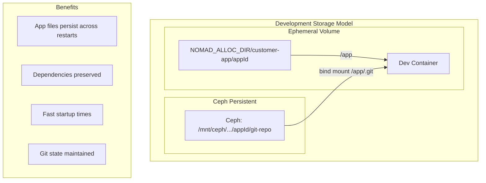
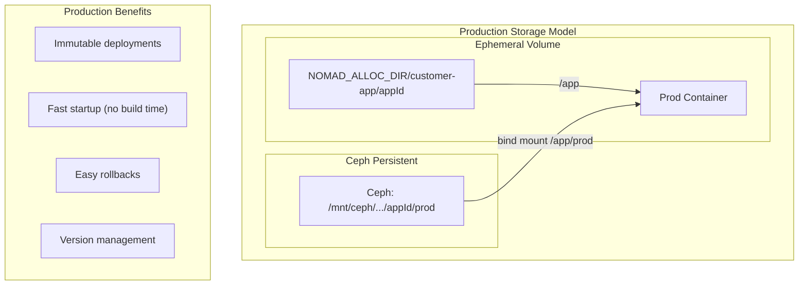
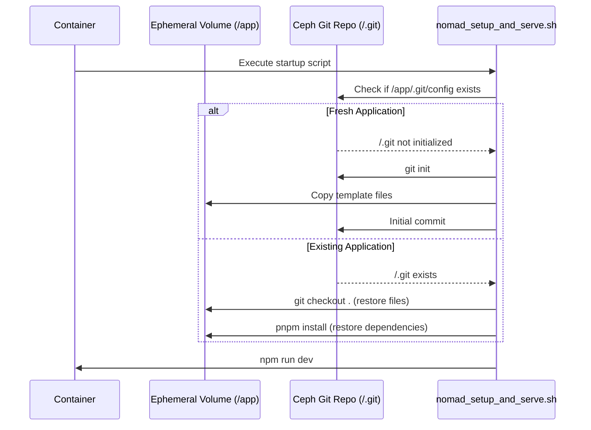
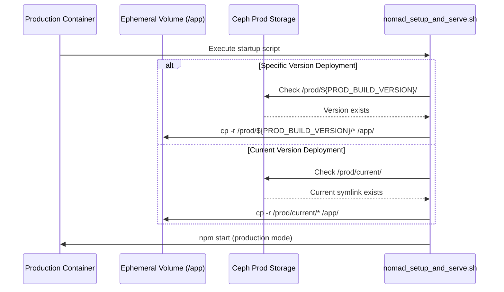
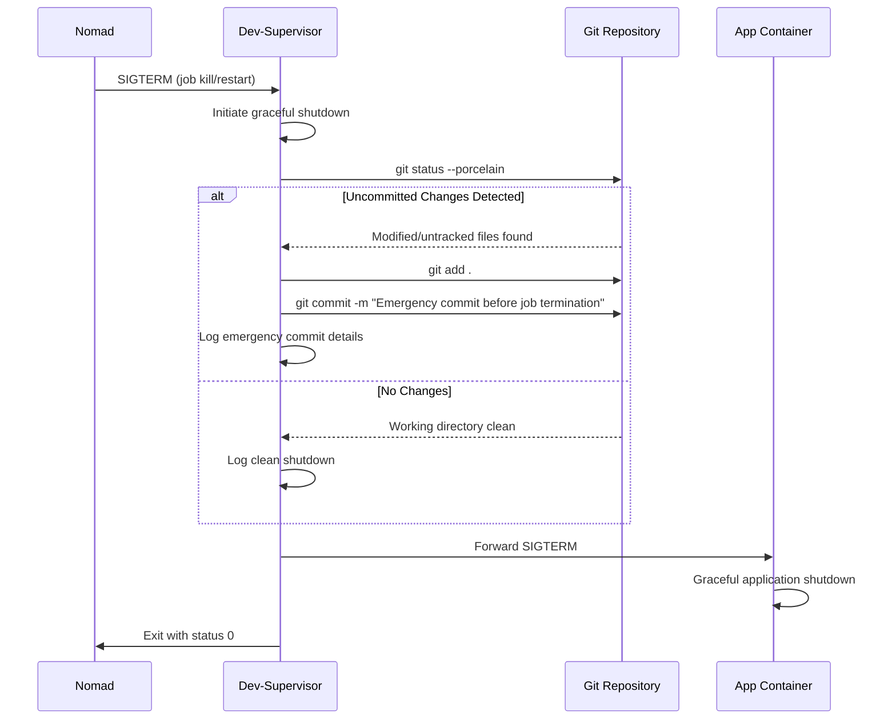

# Persistent Storage Architecture

## Overview

The Persistent Storage Architecture enables applications in the AI Hosting Platform to survive Nomad restarts and supports production deployment workflows. This architecture leverages Ceph network filesystem with strategic bind mounting to ensure application state, dependencies, and version control history persist across container lifecycle events.

## Architecture Goals

- **Application Persistence**: Apps survive Nomad job restarts and redeployments
- **Version Control Continuity**: Git history and state maintained across restarts
- **Dependency Management**: Node modules and build artifacts persist appropriately
- **Production Readiness**: Support for reliable production deployments
- **Development Efficiency**: Fast startup times for existing applications

## Deployment Modes

The persistent storage architecture supports two distinct deployment modes:

- **Development Mode**: Live development with git repository access, hot reloading, and real-time file editing
- **Production Mode**: Optimized deployment from pre-built artifacts with versioning and rollback capabilities

## Storage Strategy

### Development Architecture (Direct Bind Mounts)



### Production Architecture (Build Artifacts)



## Implementation Details

### Nomad Job Configuration

#### Development Container Configuration

Strategic bind mounting for live development with git repository access.

Example Nomad Job:

```javascript
// Development container configuration
Config: {
  volumes: [
    `..${NOMAD_ALLOC_DIR}/customer-app/${appId}:/app`
  ],
  mounts: [
    {
      type: 'bind',
      readonly: false,
      source: `/mnt/ceph/${cephMountId}/${cephDirNumber}/${appId}/git-repo`,
      target: '/app/.git'
    }
  ]
}
```

#### Production Container Configuration

Optimized configuration for production deployments from build artifacts.

Example Nomad Job:

```javascript
// Production container configuration  
Config: {
  volumes: [
    `..${NOMAD_ALLOC_DIR}/customer-app/${appId}:/app`
  ],
  mounts: [
    {
      type: 'bind',
      readonly: false,
      source: `/mnt/ceph/${cephMountId}/${cephDirNumber}/${appId}/prod`,
      target: '/prod'
    }
  ]
}
```

### Storage Hierarchy

```text
/mnt/ceph/${cephMountId}/${cephDirNumber}/
    └── ${appId}/
        ├── git-repo/          # Persistent Git repository (development)
        ├── prod/              # Production build artifacts (production)
        │   ├── v20240915-143022/  # Versioned build (timestamp)
        │   ├── v20240915-151245/  # Previous build
        │   ├── v20240915-163011/  # Latest build
        │   └── current -> v20240915-163011  # Symlink to active version
        ├── assets/            # Large file assets
        └── config/            # Read-only config (db creds, etc)
```

### Container Mount Points

#### Development Mode Mount Points

| Mount Source | Container Target | Purpose | Persistence |
|-------------|------------------|---------|-------------|
| `${NOMAD_ALLOC_DIR}/customer-app/${appId}` | `/app` | Application runtime directory | Ephemeral |
| `/mnt/ceph/.../git-repo` | `/app/.git` | Git repository and metadata | Persistent |
| `/mnt/ceph/.../assets` | `/app/assets` | Large file assets | Persistent |
| `/mnt/ceph/.../config` | `/config` | Read-only config (db creds, etc) | Persistent |

#### Production Mode Mount Points

| Mount Source | Container Target | Purpose | Persistence |
|-------------|------------------|---------|-------------|
| `${NOMAD_ALLOC_DIR}/customer-app/${appId}` | `/app` | Production runtime directory | Ephemeral |
| `/mnt/ceph/.../prod/${version}` | `/prod` | Built application files | Persistent |
| `/mnt/ceph/.../assets` | `/app/assets` | Large file assets | Persistent |
| `/mnt/ceph/.../config` | `/config` | Read-only config (db creds, etc) | Persistent |

## Development Lifecycle Management

### Development Startup Logic Flow



### Development Setup Script Logic

The `nomad_setup_and_serve.sh` script handles both fresh and existing application scenarios:

#### Fresh Application Flow

```bash
if [ ! -f "/app/.git/config" ]; then
    echo "Fresh application detected"
    
    # Initialize git repository
    git init --initial-branch=main
    
    # Copy template files
    cp -r "$BASE_APP_DIR"/* /app/
    
    # Initial commit
    git add .
    git commit -m "Initial application setup"
fi
```

#### Existing Application Flow

```bash
if [ -f "/app/.git/config" ]; then
    echo "Existing application detected"
    
    # Restore all tracked files
    git checkout .
    
    # Restore dependencies
    pnpm install
fi
```

## Production Lifecycle Management

### Production Startup Logic Flow



### Production Setup Script Logic

The production startup flow copies pre-built artifacts to the ephemeral volume:

```bash
if [ "$DEPLOYMENT_MODE" = "production" ]; then
    echo "Production deployment detected"
    
    # Determine build version to deploy
    if [ -n "$PROD_BUILD_VERSION" ]; then
        DEPLOY_PATH="$CEPH_PROD_PATH/$PROD_BUILD_VERSION"
        echo "Deploying specific version: $PROD_BUILD_VERSION"
    else
        DEPLOY_PATH="$CEPH_PROD_PATH/current"
        echo "Deploying current version"
    fi
    
    # Verify build exists
    if [ ! -d "$DEPLOY_PATH" ]; then
        echo "ERROR: Build version not found at $DEPLOY_PATH"
        exit 1
    fi
    
    # Copy production build to ephemeral volume
    echo "Copying production build to /app..."
    cp -r "$DEPLOY_PATH"/* /app/
    
    # Start production server
    cd /app
    npm start
fi
```

## Data Loss Protection

### Problem Statement

When Nomad jobs are killed or restarted (due to resource constraints, node failures, or manual intervention), any uncommitted work in the development environment could be lost. This includes:

- Code changes made through the development agent
- File modifications not yet committed to git
- Work-in-progress that exists only in the ephemeral volume

### Solution: Dev-Supervisor SIGTERM Handling

The dev-supervisor component implements graceful shutdown handling to protect against data loss during Nomad job termination. When receiving a SIGTERM signal, the dev-supervisor performs an emergency commit of any uncommitted changes before allowing the container to shut down.

### Implementation Architecture



## Security Considerations

### Access Control

#### File System Permissions

```bash
# Git repository (read-write for app user)
chown -R agent:agent /mnt/ceph/.../git-repo
chmod 755 /mnt/ceph/.../git-repo

# Application files (read-write)
chown -R agent:agent /app
chmod 755 /app
```

#### Container Security

- Git operations run as non-root user
- Ceph mounts use secure authentication
- Network isolation between customer containers

### Data Isolation

#### Customer Separation

```text
/mnt/ceph/${cephMountId}/${cephDirNumber}/
├── app_001/          # Isolated customer and app directory
│   └── git-repo/
|   └── ...
├── app_002/          # Different customer, different app, different directory
│   └── git-repo/
|   └── ...
```

---

*Document Version: 1.0*
*Last Updated: September 15, 2025*
*Status: Implementation Proposal*
