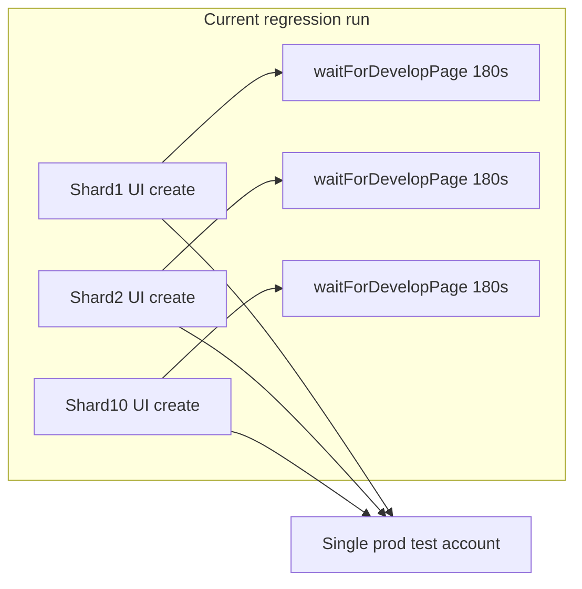
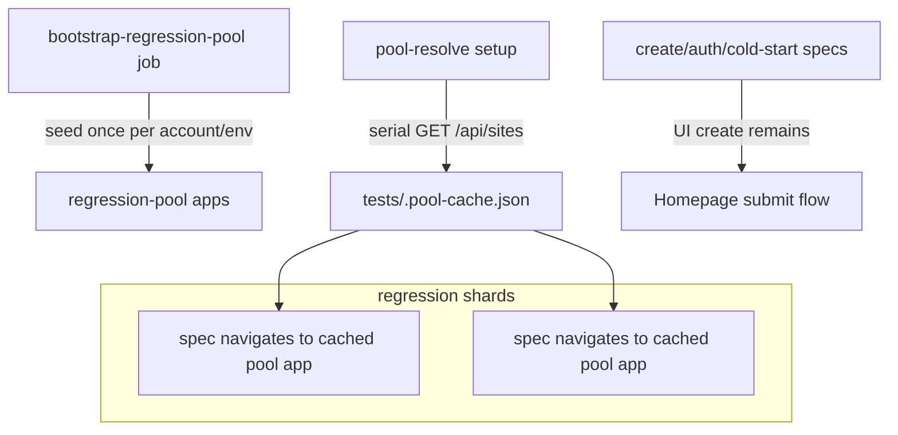

# Regression App Creation / Preview Load Stability

**Status:** Draft for review
**Date:** 2026-06-29
**Context:** Prod regression on `main` (Jun 15–29) showed 41% workflow pass rate; 93% adjusted pass rate after excluding app-create/preview-load failures.

## Overview

Stabilize prod regression CI. The dominant failure is the `preview-iframe` visibility gate timing out at 180s. Rather than commit up front to a large pool + per-shard-account build, this plan **leads with diagnostics** to confirm *why* the gate fails, then applies the structural fixes (hardened create path, regression pool apps, per-shard accounts) that the data supports.

## Migration approach: inline, not a parallel `regression-v2`

This work updates the existing specs under `tests/regression/` **in place**. It deliberately does **not** fork a `tests/regression-v2/` mirroring the `tests/e2e/` → `tests/e2e-v2/` split, because the two conditions that justified that split don't apply here:

1. **No monolith to rewrite.** `tests/e2e/` was a single monolithic `e2e.spec.ts`; splitting it into parallel-safe files was a structural rewrite that warranted a clean dir. `tests/regression/` is **already split per-feature** (13 spec files) — the target structure already exists.
2. **No big-bang needing a fallback.** These changes are incremental hardening, not a coverage rewrite: swap inline create blocks for a shared `createAppViaHomepage()`, add diagnostics to the already-shared `tests/helpers/ui.ts`, and move *some* specs to pool apps + serial mode. The test inventory and assertions are unchanged — only how the app is obtained and the concurrency mode. The PR sequencing (non-behavioral diagnostics in PR1, 2–3 specs per migration PR, M1 decision gate) already provides spec-by-spec rollback safety via git, which is the only thing a parallel dir would buy.

A fork would instead cost: a **three-way** sync burden for every `data-testid`/flow change (`e2e` + `e2e-v2` + `regression-v2`, see the E2E maintenance note in `CLAUDE.md`), and roughly **double CI minutes** on an already ~30+ min suite if both ran in cron. The mixed app-acquisition strategy (some specs UI-create, some use pools) lives fine in one dir — `tests/e2e-v2/` already does exactly this (`create-flow` UI-creates; `develop-ui` reads a pool app).

Revisit this only if scope changes from a stability migration to a coverage rewrite (new flows/assertions), which is not the case here.

## Problem

Prod regression on `main` (Jun 15–29): **41% whole-workflow pass rate** (12/29 runs), but **93% adjusted pass rate** once app-create/preview-load failures are excluded. Most failed runs never got past `waitForDevelopPage()` — stuck waiting for `preview-iframe` (180s) at `tests/helpers/ui.ts:255`.

Two findings from the run breakdown sharpen the picture (full numbers in [Expected impact](#expected-impact)):

- **Scheduled runs fail far more than manual ones:** daily 06:00 UTC scheduled = **12% pass (1/8)**, manual dispatch = **52% pass (11/21)**. Same specs — suggestive of contention when fired as a 10-shard concurrent burst on one account, but confounded by time-of-day and dispatch self-selection. M1 confirms the actual cause.
- **One spec dominates:** `apps-page.spec.ts:39` (the create full-flow) fails **9/29 (31%)** and is the **sole failing test in 6 of 17 failed runs**. Because create *is* the test, it cannot use a pool app — M2 (create hardening), not M3 (pools), is the lever for the single biggest failure.



Candidate root causes (stacked — not yet disambiguated by data):

1. **10 parallel shards** each UI-create an app on **one shared account** (`.github/workflows/playwright-e2e.yml` L157–166 — the workflow itself flags this contention)
2. Regression specs use a **weaker create flow** than e2e-v2 (no 10s hydration wait, no coachmark suppress, no `type=job` → `waitForJobResolution` handling)
3. **No pool apps** for regression — every spec pays full first-build cost (`playwright.config.ts:227` has no `pool-resolve` dependency)
4. **Preview-container readiness** (not build time) may itself be the slow gate — see the critical caveat below

### Critical caveat: pools do not bypass the failing gate

`openDevelop()` (`tests/helpers/ui.ts:301`) and every "navigate to a pre-built app" path still call `waitForDevelopPage` → `waitForChatInput` → **the same `preview-iframe` visible gate at `ui.ts:255`**. A pool app is not exempt from the failure mode; it only skips AI generation + build. The pool strategy therefore rests on an unvalidated hypothesis:

> Booting the preview container for a pre-built app is reliably faster than build+boot for a fresh create.

If the dominant 180s timeout is **preview-container cold-start** (e.g. containers evicted between 06:00 UTC cron runs) rather than **build time**, pools will not move the needle and the fix lives in product/infra (out of scope here). **Milestone 1 exists to settle this question before any pool or per-shard-account work begins.**

## Target architecture (post-diagnostics)



**Success metrics**

- All-runs whole-workflow pass rate: **>80%** (from 41% today)
- Scheduled (06:00 UTC) pass rate: **>80%** (from ~12% today — the figure that matters for a trustworthy daily signal)
- **Guardrail** — Adjusted pass rate (excl. app-create/preview-load failures): **>95%** (currently 93%). This excludes the failures targeted by this work, so it cannot confirm improvement — its only purpose is "don't regress the healthy tests." Not a primary success signal.
- No spec creates an app unless it requires cold-start, auth-path, or create-UX behavior

> **Phased reading of these metrics.** The >80% target applies *after* the gate-selected path (M3 and/or M4) lands. Interim success for PR1+PR2 is narrower: (a) a dominant failure signature is identified from cron data, and (b) the create-helper specs are green. Don't hold PR1/PR2 to the >80% bar — they exist to inform and de-risk the path that gets there.

---

## Expected impact

### Baseline (29 prod regression runs in the window)

| Population                  | Runs | Pass rate         | Note                                              |
| --------------------------- | ---- | ----------------- | ------------------------------------------------- |
| All runs                    | 29   | **41%** (12/29)   | headline figure                                   |
| Scheduled (06:00 UTC daily) | 8    | **12%** (1/8)     | all 10 shards fire concurrently on one account    |
| Manual dispatch             | 21   | **52%** (11/21)   | spread out over the day, far less contended       |
| Adjusted (excl. infra)      | —    | **93%**           | excluding create / `preview-iframe` failures      |

The **4× gap between scheduled (12%) and manual (52%)** is suggestive of contention: identical specs pass far more often when not fired as a 10-shard concurrent burst at 06:00 on a single account. However, n=8 scheduled runs is small and manual dispatch is self-selected (devs run after fixes, varied times) — the gap conflates concurrency with (a) 06:00 UTC time-of-day infra state and (b) selection bias. **Treat this as motivation for M0, not proof of root cause; M1 is the confirmation step.**

### Where failures concentrate

| Spec / test                                   | Fail rate    | Poolable?                     | Primary lever        |
| --------------------------------------------- | ------------ | ----------------------------- | -------------------- |
| `apps-page.spec.ts:39` (create full-flow)     | 9/29 (31%)   | **No** — create *is* the test | M2 create hardening  |
| `develop-analytics-period.spec.ts:122`        | 5/29 (17%)   | Yes                           | M3 pool + M2         |
| `develop-chat.spec.ts:139`                    | 3/29 (10%)   | Yes                           | M3 pool + M2         |
| `develop-publish.spec.ts` (:246, :161)        | 3/29 each    | Yes                           | M3 pool + M2         |

### Projected improvement (data-grounded, conditional on the M1 signature)

- `apps-page:39` was the **sole failing test in 6 of 17 failed runs**. If M2 resolves the create-path failure, those 6 runs flip pass → **~62% all-runs (18/29) from M2 alone**.
- M3 pools then address the develop-spec tier (analytics / chat / publish / share — most of the remaining failed runs), pushing toward the **~93% adjusted ceiling**.
- M4 / stagger closes the scheduled-vs-manual gap so the **daily 06:00 signal** (today 12%) reaches the all-runs target.

**Target end-state:** all-runs pass **>80%** (from 41%), scheduled pass **>80%** (from 12%). Adjusted rate stays **>95%** as a guardrail against regressions in healthy tests.

**Honest floor.** The M2 → ~62% projection assumes `apps-page` dies on the *create / job-resolution* path that M2 hardens. If M1 shows it dies on *preview-container cold-start* (the same `ui.ts:255` gate, product-side latency), M2 won't move it — the create-spec fix then lives in product, out of scope here. This is exactly what the M1 gate measures before any M3/M4 spend.

---

## Milestone 0 — Cap concurrency (ship after M1 diagnostic sample)

**Goal:** Stop the daily 06:00 burst from hammering the single account / preview infra. Workflow-config only: no new accounts, no pool infra, no test-helper code; revert in one commit. **Sequencing: ship this *after* M1 has run 2–3 cron cycles at full 10-shard concurrency** — those runs provide the worst-case contention sample M1 needs to classify the failure signature. Capping before M1 has data undermines the diagnostics-first premise.

### 0.1 The lever

At 06:00 all 10 shards fire at once, and each one logs into the same shopper and (for create-required specs) provisions an app — 10 concurrent logins + creates + `GET /api/sites`. Cap how many run concurrently rather than how many exist.

**Preferred — `strategy.max-parallel`** in the regression matrix of `.github/workflows/playwright-e2e.yml`: keep all 10 shards (test distribution + retry granularity unchanged) but run at most ~4 at a time. The other 6 queue and start as runners free.

```yaml
strategy:
  max-parallel: 4
  matrix: # …existing regression shard entries…
```

> **Scope caveat:** `max-parallel` is matrix-global. Under the `e2e-then-regression` combined dispatch, the e2e job shares the same matrix and would be throttled into the same pool, shifting that dispatch's wall-clock. Apply M0 to the **regression scheduled cron only** — verify the workflow path before landing to avoid side-effects on `e2e-then-regression` runs.

Alternatives if `max-parallel` proves awkward:

- **Lower `REGRESSION_SHARDS`** (10 → ~5, the var already exists ~L168): coarser; each shard runs ~2× the tests, so wall-clock rises.
- **Per-shard sleep stagger:** `sleep $(( (${{ matrix.shard }} - 1) * 30 ))` before Playwright — spreads the burst over ~4.5 min; smoothest but adds the offset to wall-clock.

### 0.2 Cost and limits

- Trades **wall-clock for stability** (runner-minutes stay ~flat — same total test work). No infra dependency.
- **Stopgap, not a fix.** It spreads load on the shared account; it does not isolate it (that's M4) and does not remove the `apps-page` create failure (that's M2). If M1's signature is preview cold-start, capping only makes cold-starts sequential rather than competing — partial help.

### 0.3 Relationship to M1, M3, M4

- **M1 runs first.** Merge M1 (PR1) and let it collect 2–3 full-concurrency cron cycles before applying M0. M1 diagnostics classify *why* each failure happens regardless of concurrency, but the classification is most useful on a worst-case contention sample — capping early biases the signal. Once the dominant signature is confirmed, ship M0.
- **M3 (pools) shrinks M0's necessity but doesn't retire it.** Pooled specs stop creating and stop the concurrent `/api/sites` burst, so concurrent-create count drops naturally. But the unpoolable create specs (incl. `apps-page`, the #1 failure), the shared-account logins, and concurrent preview-container opens all remain. Pools also make the cap *cheaper* (lower per-shard wall-clock → more headroom to absorb it).
- **M4 (per-shard accounts) is what actually retires M0** — it removes the shared-account contention the cap merely spreads.

**Re-evaluate after M2 + M3 land:** if scheduled pass is comfortably >80% without the cap, drop it; if the preview-open burst or unpoolable create specs still drag the daily run down, keep it until M4.

---

## Milestone 1 — Diagnostics first (ship alone, decision gate)

**Goal:** Determine *why* `preview-iframe` never becomes visible, before investing in pools or accounts. This is the only Milestone that should merge before we have data.

### 1.1 Improve `waitForDevelopPage` / `waitForChatInput` failure diagnostics

Wrap the preview-iframe wait so that on timeout it captures:

- Current URL (including whether it is still `?type=job`)
- Result of a `GET /api/sites?site_id=…` poll (job id vs resolved app id, HTTP status)
- Whether `develop-skeleton` / `develop-chat-pane-loader` are still visible
- Elapsed time bucket (build-stage vs preview-boot-stage), computed from the signals above:
  - **Build stage:** `develop-skeleton` or `develop-chat-pane-loader` still visible at timeout
  - **Preview-boot stage:** skeleton/loader gone, app id resolved (not `?type=job`), iframe still missing

These three signals disambiguate the candidate root causes:

| Diagnostic signature | Implies | Fix lives in |
|----------------------|---------|--------------|
| URL still `?type=job`, `/api/sites` returns `type:job` | job never resolved (possible DPP-handoff orphan) | create helper (M2) + product |
| App id resolved, skeleton gone, iframe never visible | preview container cold-start / slow boot | product/infra (out of scope) |
| Build stage never completes (loader visible full 180s) | first-build latency | product (out of scope) — pools may help |

**Logging:** use inline `console.log` for the timeout dump (consistent with existing e2e-v2 test convention — `create-flow.spec.ts`, `ui.ts:276`). `logTestResult` is end-of-test reporting, not inline diagnostics. The `structured-logging` cursor rule targets **app** code, not the Playwright suite.

### 1.2 Decision gate

Run Milestone 1 on the scheduled prod cron (or 2–3 manual `workflow_dispatch` `[regression]` runs) and classify failures by signature:

- **If "job never resolved" dominates** → prioritize M2 (create helper handles `type=job`), and raise a product ticket for the orphan bug. M3 may be **unnecessary** if PR2's `waitForJobResolution` recovers most failures — re-check the cron signature after PR2 before starting pools.
- **If "preview cold-start" dominates** → pools/accounts will NOT fix it. Owner: @jgaffney's team (preview container / mhp-core provisioning). Pinning pool apps to avoid cold-start is not feasible (cold-start behavior is itself worth testing). Coordinate with that team on: (a) expected boot time under prod load, and (b) whether the 180s `PREVIEW_TIMEOUT` gate is correctly calibrated for it. Pause M3/M4 until that conversation produces a number or a fix.
- **If "first-build latency" dominates** → M3 pools are justified (skip build entirely); proceed.

Do not start M3/M4 until this gate produces a signature.

---

## Milestone 2 — Harden shared create helper (low risk, all specs)

**Goal:** One canonical homepage-create path matching proven e2e-v2 behavior. Valuable regardless of the M1 outcome.

### 2.1 Add `createAppViaHomepage()` in `tests/helpers/ui.ts`

Consolidate and replace inline create blocks + outdated `createNewApp` / `createAppAndGetId` / `setupIsolatedApp` usage in regression.

Patterns to incorporate, with their actual sources:

- `localStorage.setItem('airo-intro-tour-shown', 'true')` via `addInitScript` — from `create-flow.spec.ts:68`
- `dismissOverlays()` before submit — from `create-flow.spec.ts:78`
- `expect(submitButton).toBeEnabled()` + **10s hydration wait** before click — from `create-flow.spec.ts:92-94`
- SSO: `detectSsoType` / `handleSsoLogin` fallback — from `create-flow.spec.ts:100-110`
- After `waitForURL(/\/develop\//)`: if the URL is `?type=job`, extract the job id and call `waitForJobResolution()`, then `page.goto(/develop/{realId})`. **Source: `createSiteViaApi` (`tests/helpers/api.ts:412`), not `create-flow.spec.ts`** — the homepage spec does not currently do job resolution (it relies on the front-end polling). Adding explicit resolution here is a deliberate improvement, and per M1 may be the actual fix if "job never resolved" dominates.
- Finally `waitForDevelopPage(page)` and return the app id

> **Note — possible product-bug masking:** explicit `type=job` resolution improves test stability but may paper over the DPP-handoff orphan (cold redirect under a `jobId` orphans the conversation on reload). If M1 shows this signature, file/keep a product ticket — do not treat the test fix as the product fix.

### 2.2 Migrate regression specs to helper (mechanical PR)

Replace duplicated "Step 1: Creating app…" blocks in the specs under `tests/regression/` **except** where create UX is asserted inline in `apps-page.spec.ts` (keep explicit steps there, but still use the hardened submit sequence).

**PR size:** helpers + 2–3 specs first; follow-up PR for remaining specs.

---

## Milestone 3 — Regression pool apps (conditional on M1 gate)

**Goal:** Specs that test develop features (not homepage create) open a **pre-built, warm** app instead of triggering first build during CI.

**Precondition:** M1 decision gate shows "first-build latency" (or mixed) as a material contributor, **and** job-unresolved failures were not already fixed by M2's `waitForJobResolution`. If M1 shows "preview cold-start" dominates, **skip this milestone** — pools navigate through the same `ui.ts:255` gate and will not help. If PR2 alone restores the suite, skip it too.

### 3.1 Resolve pool ownership vs per-shard accounts up front

M3 (shared-account pools) and M4 (per-shard accounts) are in tension and must be designed together:

- Pool apps are resolved via `GET /api/sites` prefix lookup — **visible only to the owning shopper account**.
- If M4 gives each shard a different account, those accounts **cannot see** a single shared-account pool.

**Decision (pick before coding M3):**

- **3.1a — Account-scoped pools (compatible with M4):** seed the regression pool on *each* shard account, using the account-scoped prefix. Cost: N× bootstrap + N× pool apps to maintain.
- **3.1b — Shared-account pools (defer M4):** keep all regression pools on one shopper; do not introduce per-shard accounts. Simpler, but single-account contention persists for create-path specs.

Default to **3.1b** unless M1 shows contention (not preview latency) is the dominant failure — only then is M4's complexity justified.

### 3.2 Pool naming and API helpers

Add `[regression-pool:<purpose>]` prefix in `tests/helpers/api.ts` (mirror `[e2e-pool:*]` — must **not** match `[e2e:` so eviction/cleanup skip automatically):

```ts
export function getRegressionPoolPrefix(purpose: string): string {
  return `[regression-pool:${purpose}]`;
}
```

Add `findRegressionPoolAppId()` / reuse `getPoolAppId` with a prefix param.

### 3.3 Extend bootstrap + resolve

| File | Change |
|------|--------|
| `tests/pool-setup/build-pool-apps.spec.ts` | Add regression pool seeds (idempotent) |
| `tests/pool-resolve/resolve-pool-apps.setup.ts` | Add regression purposes to `POOL_PURPOSES` |
| `playwright.config.ts` | Add `dependencies: ['pool-resolve']` to the `regression` project |

**Initial pool purposes** (one per mutating spec file — avoids cross-spec state leaks):

| Purpose | Spec | Notes |
|---------|------|-------|
| `regression-develop-chat` | `develop-chat.spec.ts` | Mutates chat/publish state |
| `regression-develop-publish` | `develop-publish.spec.ts` | Multiple publish flows |
| `regression-develop-edit` | `develop-edit-interactions.spec.ts` | Two long widget tests — **one pool, serial within file** |
| `regression-develop-analytics` | `develop-analytics-period.spec.ts` | Mocks published URL after nav |
| `regression-develop-share` | `develop-view-share.spec.ts` | Share token state |
| `regression-develop-brand-book` | `develop-brand-book.spec.ts` | Read-heavy |
| `regression-develop-media` | `develop-media.spec.ts` | Media mutations |

**Keep UI create (no pool):**

- `apps-page.spec.ts` — create flow is the test
- `authentication.spec.ts` — auth paths
- `develop-sso.spec.ts` — ent persona fixture
- `develop-dpp-handoff.spec.ts` — cold-start behavior
- `manage-plan.spec.ts` — billing context

Skipped specs (`develop-archive-restore`, skipped media test): no pool work until un-skipped.

### 3.4 Spec migration pattern

For each pooled spec, replace Step 1 create with:

```ts
// beforeAll (serial)
appId = getCachedPoolAppId(env, 'regression-develop-chat');
await loginViaSsoDirect(page);
await openDevelop(page, appId); // or goto + waitForDevelopPage
```

Follow e2e-v2 invariants from `tests/README.md`:

- **Read-only specs**: parallel-safe within file
- **Mutating specs**: `test.describe.configure({ mode: 'serial' })` + idempotent pre-cleanup (see `publish-and-domain.spec.ts` domain disconnect pattern)

Reuse existing e2e-v2 pools where safe **only if** the spec is read-only and doesn't conflict — default to a dedicated `regression-pool` to avoid cross-suite pollution.

### 3.5 Bootstrap in CI

Today `bootstrap-pool` is manual / e2e-v2 CI only. For regression:

- Add a **`bootstrap-regression-pool`** job (or extend the existing bootstrap step) in `.github/workflows/playwright-e2e.yml` that runs **before** the regression matrix when `test_filter=regression`
- Job is **idempotent** — cheap when pools exist; self-heals when deleted
- One-time prod seed: run manually once, then CI maintains
- If 3.1a was chosen, seed per account

---

## Milestone 4 — Per-shard test accounts (CI, highest risk, conditional)

**Goal:** Remove single-account contention at 06:00 UTC when shards login + create/navigate concurrently.

**Precondition:** M1 gate shows **contention** (not preview latency) as a material failure cause, and M3 chose the account-scoped pool design (3.1a).

**Interim, if contention dominates but 10-account infra is slow to provision:** **M0** (concurrency cap) is the cheap stopgap that buys time without committing to per-shard accounts — ship it first and treat M4 as the durable replacement once accounts exist.

### 4.1 Sharding caveat — read before provisioning accounts

Playwright `--shard=i/n` distributes **tests round-robin, not spec files**. There is no guarantee that "shard 3 runs `develop-chat`." Therefore the shard↔spec↔account table below is **not stable** under the default sharding strategy.

Before any account provisioning, resolve one of:

- **Shard-by-file** (custom grouping) so each shard maps to a deterministic spec set and account, or
- **Account-per-shard with shard-agnostic pools** — every account holds the full regression pool (3.1a), so any test on any shard can resolve its pool app regardless of which account it landed on.

The second is more robust but multiplies pool maintenance cost; pick explicitly.

### 4.2 Secrets layout

Current: single secret `/test/airo-app-builder-user` → all shards (`playwright-e2e.yml` L301–441).

Proposed (coordinate with platform/infra):

- **Option A (preferred):** AWS Secrets Manager JSON at `/prod/airo-app-builder-regression-shards` with keys `shard-1` … `shard-10` (username/password pairs)
- **Option B:** Separate secrets per shard (more IAM overhead)

Mirror the e2e-v2 pattern of isolating shoppers by suite if account provisioning is slow.

### 4.3 Workflow wiring

In `playwright-e2e.yml` test job:

- Fetch shard credentials using the `matrix.shard` index
- Export `PROD_USERNAME` / `PROD_PASSWORD` (and other env pairs) from shard-specific values
- `tests/helpers/constants.ts` `getCredentials()` unchanged if env vars are set per job

**Prerequisite:** Provision the prod test shoppers + document in `tests/README.md` / `GETTING_STARTED.md`. Mind the **per-account 100-app cap** — each account's pool apps + transient create apps must stay under it.

---

## Milestone 5 — Observability and tracking

### 5.1 Workflow summary metrics

Add a post-run step to `playwright-e2e.yml` `merge-reports` / Slack job that posts:

- Workflow pass/fail counts (7d rolling — can start manual)
- **Adjusted pass rate** (exclude `preview-iframe` / `ui.ts:255` timeouts) — classify from JUnit/blob reports using the error-signature buckets from M1.1

**Start early — don't wait for PR6.** The signature classification lands in PR1 (M1.1), so adjusted-pass-rate tracking can piggyback on it immediately; PR6 only formalizes the Slack post and README docs. Use the **same Jun 15–29 baseline window** the plan quotes (raw ~12% = 1/8 scheduled runs passed) so the summary and this doc stay comparable.

### 5.2 Document tracking approach

Update `tests/README.md` regression section with:

- Raw vs adjusted pass rate definitions
- Pool bootstrap commands for prod/test
- Which specs require UI create vs pool app

---

## PR sequence (recommended)

| PR | Scope | Risk | Gate |
|----|-------|------|------|
| **PR1** | M1: `waitForDevelopPage` timeout diagnostics + error-signature classification (also seeds M5 adjusted-rate tracking) | Low | **merge first**; collect 2–3 full-concurrency cron cycles |
| **PR0** | M0: cap regression matrix concurrency (`max-parallel: 4`) in `playwright-e2e.yml` (regression scheduled cron only — see scope caveat) | Low | **after PR1 has 2–3 cron cycles at full concurrency** |
| **PR2** | M2: `createAppViaHomepage` (incl. `type=job` resolution) + migrate 3 highest-churn specs (`apps-page`, `develop-edit-interactions`, `develop-analytics-period`) | Low | independent of gate |
| **PR3** | M3: regression pool prefix + bootstrap/resolve + `playwright.config` dependency | Medium | **only if M1 gate ≠ "preview cold-start"** |
| **PR4** | M3: migrate remaining pool-eligible specs (chat, publish, share, brand-book, media) | Medium | after PR3 |
| **PR5** | M4: CI bootstrap job + per-shard secrets + workflow env wiring | High (infra) | **only if M1 gate = "contention"** + 4.1 resolved |
| **PR6** | M5: formalize workflow metrics post + README tracking docs (classification itself ships in PR1) | Low | any time |

Validate each PR with manual `workflow_dispatch` prod `[regression]` before relying on the scheduled cron.

---

## Implementation checklist

- [ ] **M1:** Improve `waitForDevelopPage` timeout diagnostics in `tests/helpers/ui.ts`; classify failures by signature; **ship first** and collect 2–3 full-concurrency cron cycles
- [ ] **M0:** *After M1 has its diagnostic sample* — cap regression matrix (`strategy.max-parallel: 4`) in `.github/workflows/playwright-e2e.yml` (regression scheduled cron only); re-evaluate after M2 + M3
- [ ] **M1 gate:** classify dominant signature (job-unresolved / preview-cold-start / build-latency) and decide M3/M4 scope
- [ ] **M2:** Add `createAppViaHomepage()` with e2e-v2 hardening + `type=job` → `waitForJobResolution`; migrate `apps-page`, `develop-edit-interactions`, `develop-analytics-period`; then remaining specs
- [ ] **M2:** File/keep product ticket if `type=job` resolution is masking the DPP-handoff orphan
- [ ] **M3 (conditional):** Resolve pool-ownership vs per-shard-account design (3.1a vs 3.1b) BEFORE coding
- [ ] **M3 (conditional):** Add `[regression-pool:*]` helpers, extend bootstrap-pool + pool-resolve, wire regression project dependency in `playwright.config.ts`; migrate 7 develop specs to cached pool apps with serial/mutation cleanup
- [ ] **M3 (conditional):** Add idempotent `bootstrap-regression-pool` CI job before the regression matrix
- [ ] **M4 (conditional):** Resolve Playwright sharding determinism (4.1) BEFORE provisioning accounts; provision per-shard prod shoppers in Secrets Manager; wire `matrix.shard` credentials
- [ ] **M5:** Add workflow summary metrics (raw + adjusted pass rate) and document tracking in `tests/README.md`

---

## Out of scope (separate track — but may become in-scope per M1 gate)

- **Product first-build / preview-boot latency** on prod (`PreviewPane` / job provisioning). **If the M1 gate shows "preview cold-start" dominates, this is no longer out of scope — it is the root cause**, and pools/accounts should be paused in favor of escalating it.
- **Increasing `PREVIEW_TIMEOUT`** — masks slowness; not a fix.
- **`createSiteViaApi` for regression** — e2e-v2 found API create unreliable for long AI-streaming gates (`create-flow.spec.ts:19-21`); pools + homepage bootstrap are the proven path.

## Risks and mitigations

| Risk | Mitigation |
|------|------------|
| Pools navigate through the same `ui.ts:255` gate and don't fix preview cold-start | M1 decision gate runs first; M3 is conditional on the gate |
| Pool app state drift between runs | Serial mode + idempotent pre-cleanup per spec |
| Pool ownership incompatible with per-shard accounts | Resolved up front in 3.1 (account-scoped vs shared) |
| Playwright sharding doesn't map shard→spec→account deterministically | Resolved in 4.1 before provisioning; prefer shard-agnostic pools |
| Bootstrap cost on fresh prod account | One-time manual seed; CI job is idempotent |
| Per-account 100-app cap exceeded | Budget pool apps + transient apps per account under the cap |
| `type=job` test fix masks DPP-handoff product bug | Product ticket tracked separately (M2) |
| Cross-env stale pool cache | Existing env-scoped cache in `pool-cache.ts` |
