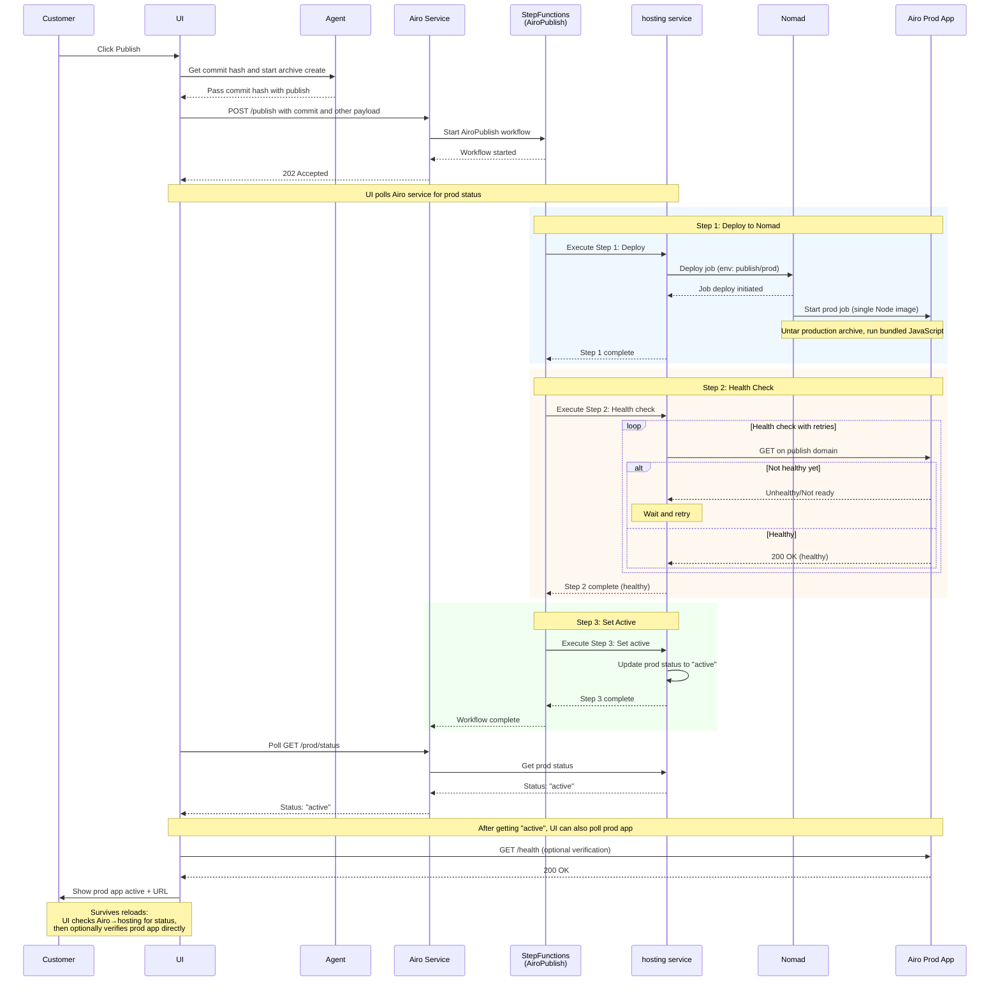
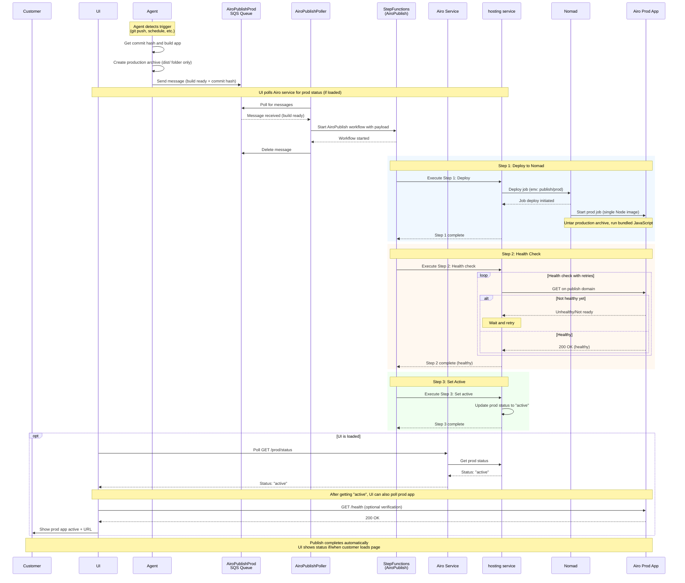

# Airo Publish Workflow

## Chosen Implementation: Customer-Initiated Publish (UI → API → StepFunctions)

### How It Works

1. **Customer initiates publish** - Clicks publish button in UI
2. **Agent prepares build** - UI requests commit hash, Agent builds app and creates production archive (dist/ folder only)
3. **API starts workflow** - UI calls Airo service with commit hash and payload
4. **StepFunctions orchestrates deployment**:
   - **Step 1**: Deploy to Nomad (single Node image, untar archive, run bundled JavaScript)
   - **Step 2**: Health check with retries on publish domain
   - **Step 3**: Mark prod app as "active"
5. **UI polls for status** - Continuously checks Airo service for prod status
6. **Customer sees result** - UI displays active status + prod URL

### Key Characteristics

- **Simple architecture**: 3 components (UI, Airo Service, StepFunctions)
- **Immediate workflow start**: No queue delays
- **Health checks handle build timing**: Retries accommodate archive extraction + build time
- **State persists across reloads**: UI polls hosting service status, survives page refreshes

---

## Future: Agent-Initiated Publish (Agent → SQS → Poller → StepFunctions)

**Use case: Automated publish triggered by Agent (no customer interaction)**

### How It Works

1. **Agent detects trigger** - Git push to main, scheduled publish, or other automation
2. **Agent prepares build** - Gets commit hash, builds app, creates production archive (dist/ folder only)
3. **Message sent to SQS** - Agent sends message to `AiroPublishProd` queue with commit hash and payload
4. **Poller processes queue** - Dedicated poller picks up message and starts StepFunctions workflow
5. **StepFunctions orchestrates deployment** - Same 3-step process as customer-initiated
6. **UI shows status (if loaded)** - Customer can view status if they happen to load the page

### Key Characteristics

- **Fully automated**: No customer interaction required
- **Build guaranteed complete**: Message only sent after Agent finishes build
- **Loose coupling**: Agent doesn't call control plane directly
- **Queue durability**: Message persists even if poller crashes
- **Same deployment process**: Reuses existing StepFunctions workflow

### When to Implement

This approach is planned for future scenarios where:

- Automated publishing on git push is desired
- Scheduled production deployments are needed
- Build completion guarantees are critical (eliminates timing race)
- Agent needs to trigger deploys without UI involvement

---

## Implementation Notes

### Current State Tracking

Both approaches rely on the hosting service tracking prod app status (`active`, `pending`, `failed`). This allows:

- UI to poll for status without knowing about StepFunctions execution
- State to survive page reloads
- Same UI code regardless of trigger mechanism (customer vs. agent)

### Workflow Execution

The StepFunctions `AiroPublish` workflow is identical for both approaches:

1. Deploy to Nomad with `publish/prod` environment
2. Health check with retries on publish domain
3. Set prod status to "active"

The only difference is **how the workflow starts**:

- Customer-initiated: API call from UI
- Agent-initiated: Poller reading from SQS queue
