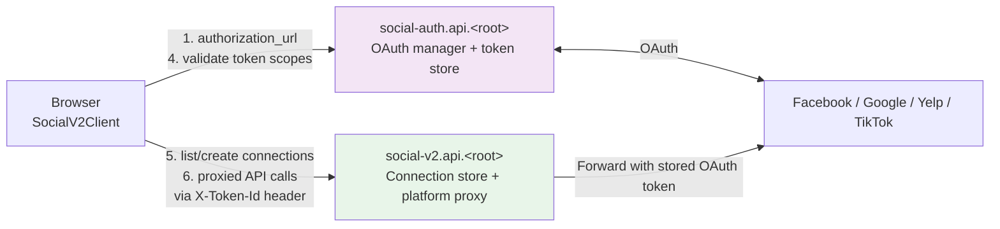

# How It Works

Start here if you're new to the social integration. This explains how Airo Builder talks to social platforms — what `social-auth` is, what `social-v2` is, who owns OAuth tokens, how connections are tied to GoDaddy shoppers, and what the `SocialPlatform` keys actually mean.

For implementation specifics, see [`social-connections-diagrams.md`](./social-connections-diagrams.md), [`post-lifecycle.md`](./post-lifecycle.md), and [`skills-and-api-reference.md`](./skills-and-api-reference.md).

## The two external services

Airo Builder does not implement OAuth or store OAuth tokens. Two external GoDaddy services do that for us:

| Service | URL pattern | Owns | API docs |
| ------- | ----------- | ---- | -------- |
| **social-auth** | `https://social-auth.api.<root>` | OAuth flow management — building authorization URLs, handling callbacks, storing the resulting tokens, exposing token scopes. Tokens never leave this service; we only see opaque `tokenId` strings. | [social-auth.api.godaddy.com/api-docs/](https://social-auth.api.godaddy.com/api-docs/) |
| **social-v2** (referred to internally as the "open social" API) | `https://social-v2.api.<root>` | Connection records (the `socialId` namespace) and a unified proxy to every supported platform's API (Facebook Graph, Google MyBusiness, Yelp, …). "Open" because it abstracts over many platforms behind one shape. | [social-v2.api.godaddy.com/api-docs/](https://social-v2.api.godaddy.com/api-docs/) |

`<root>` resolves via `getRootDomain()` — `godaddy.com` in production, `dev-godaddy.com` in lower envs, etc. The Swagger pages linked above are the **authoritative contract** — when this doc and Swagger disagree, trust Swagger.

**Both are called only from the browser.** The agents service never makes outbound calls to either. The browser is the OAuth user agent (it owns the popup), and it's also the trust boundary that holds the GoDaddy session cookie — see [Identity](#identity-who-owns-a-connection) below.



### Why two services?

- `social-auth` is the **authority on tokens**. It speaks OAuth: redirect URIs, scopes, refresh, expiry. Its callers only see `tokenId`s.
- `social-v2` is the **authority on connections** — the durable record that "user X has a Facebook page Y with token Z". It exposes a uniform shape across platforms and proxies API calls so callers don't have to talk to each platform's SDK directly.

Splitting them means a single shopper's token can power multiple connection records, and rotating a token doesn't require recreating every connection.

## Identity: who owns a connection

Every social-auth and social-v2 fetch in `app/src/lib/social.ts` looks like this:

```ts
fetch(`${SOCIAL_V2_BASE_URL}/social_connections`, {
  credentials: 'include',
  headers: { 'Accept': 'application/json' },
})
```

The `credentials: 'include'` is the load-bearing part. It sends the user's **GoDaddy session cookie** to the API. social-auth and social-v2 use that cookie to resolve a **shopperId** server-side and scope everything to it:

- Tokens issued by `social-auth` are stored against the shopperId, not Airo Builder.
- Connection records in `social-v2` are owned by the shopperId.
- `GET /social_connections` returns "every connection this shopper has, anywhere" — including connections created from other GoDaddy products that use the same auth stack.

That's why the "Link Existing Connection" flow exists: a shopper who already connected their Facebook page in another GoDaddy product can re-use it here without re-doing OAuth. Airo Builder just stores a row in `social_associations` pointing at the existing `socialId`.

The agents service is **token-blind**. It only sees opaque `socialId` strings in `social_associations`. If you need to act on tokens, you do it from the browser via `SocialV2Client`.

## How a connection happens

This is the abridged version; for sequence diagrams see [`social-connections-diagrams.md`](./social-connections-diagrams.md).

1. **Get an OAuth URL.** `GET social-auth/platforms/:provider/authorization_url?app=airo-builder&scopes=...&state=...` returns `{ url, scopes }`. Provider is one of the lowercase OAuth provider IDs (`facebook`, `google`, `tiktok`, …) — not the product key (more on this below).
2. **User completes OAuth in a popup.** social-auth receives the callback, exchanges the code for an access token, stores the token against the shopper, and `postMessage`s `{ success: true, tokenId }` back to the opener window.
3. **Validate scopes.** `GET social-auth/platforms/:provider/tokens/:tokenId` returns the granted scopes. The browser compares them against the platform's required scope list (`app/src/types/social-scopes.ts`).
4. **Fetch platform metadata.** `GET social-v2/<platform>/proxy/...` — for example `GET social-v2/facebook/proxy/v23.0/me/accounts` to list the user's Facebook pages. The request carries the `tokenId` in an `X-Token-Id` header; social-v2 resolves it to a real OAuth token server-side and forwards the call.
5. **Create the connection record.** `POST social-v2/social_connections` with `{ platform, userId, userTokenId, pageId, pageTokenId, ... }` returns `{ socialId }`. The connection is now owned by the shopper.
6. **Link to this app.** `POST <agents>/apps/:id/social/associations` with `{ socialId, platform }` inserts a row in `social_associations`. The app can now find its connection by app-scoped lookup.

Step 5 and step 6 are not transactional. If step 6 fails, the social-v2 record is orphaned — and that's recoverable: the "Link Existing" flow will surface it on next attempt.

## How a published post uses the token

After a connection exists, publishing looks like this:

1. Browser calls `GET social-v2/social_connections/:socialId` to get the stored tokenId references for that connection (e.g. `pageTokenId` for a Facebook page).
2. Browser calls `POST social-v2/facebook/proxy/v23.0/:pageId/feed` with `X-Token-Id: <pageTokenId>` and the post body.
3. social-v2 swaps the `tokenId` for the real OAuth token, forwards to Facebook Graph, returns the platform response.
4. Browser persists the attempt back into Airo Builder via `POST <agents>/apps/:id/social/posts` (state + payload + externalId).

The `X-Token-Id` header is how every proxied call works. We never put the real OAuth token on the wire from the browser.

## `SocialPlatform` keys — the part everyone gets wrong

There are **two** `SocialPlatform`-like enums in this codebase, and they mean different things. Pick the right one based on what layer you're at.

| Enum | Source | Values | Lives at | Used for |
| ---- | ------ | ------ | -------- | -------- |
| `SocialPlatform` (app) | `app/src/types/social.ts` | lowercase: `facebook`, `instagram`, `google`, `google_search_console`, `tiktok`, `yelp`, `whatsapp` | Browser only | **OAuth provider identity** — what `social-auth` calls to get an authorization URL. The OAuth-flow level. |
| `SocialPlatformKey` (app) | `app/src/types/social.ts` | uppercase: `FACEBOOK`, `INSTAGRAM`, `GOOGLE_BUSINESS_PROFILE`, `GOOGLE_SEARCH_CONSOLE`, `TIKTOK`, `YELP`, `WHATSAPP` | Browser, sent to `social-v2` | **Connection / product key** — what social-v2 returns on `GET /social_connections` and what we store in `social_associations.platform`. |
| `SocialPlatform` (agents) | `agents/src/types/social.ts` | uppercase: same values as `SocialPlatformKey` | Agents service, agents DB | Same role as `SocialPlatformKey` on the agents side. The naming clash with the app-side `SocialPlatform` is historical — they are NOT the same enum. |

### The mental model

- **Provider** = "which OAuth integration does social-auth talk to" → app-side lowercase `SocialPlatform`. Used in the social-auth URL path: `GET social-auth/platforms/:provider/authorization_url`. Coarse-grained, one per OAuth identity.
- **Platform key** = "which social-v2 connection record type" → uppercase `SocialPlatformKey`. Sent to social-v2 as the literal `platform` field on `POST /social_connections` and returned verbatim on `GET /social_connections`. Fine-grained, can have multiple per provider when the products are different enough to warrant separate connection records (different scopes, different metadata, different proxy paths).

### The platform key is a social-v2 contract, not an internal enum

This is the bit that matters when adding a new platform: **we don't define the uppercase platform key — social-v2 does.** Our `SocialPlatformKey` (app) and `SocialPlatform` (agents) enums are mirrors of what social-v2 accepts on `POST /social_connections` and returns on `GET /social_connections`. The string `"GOOGLE_BUSINESS_PROFILE"` is a wire-level value owned by social-v2, not a label we picked.

That means:

- You pass the platform key **as-is** to social-v2 — no transformation, no casing change, no prefix. Whatever the [social-v2 Swagger](https://social-v2.api.godaddy.com/api-docs/) says is what goes on the wire.
- Adding a new entry to our enum without social-v2 supporting it produces a connection that nothing on the other side can read. The social-v2 team has to ship the platform first; we mirror it second.
- Renaming a platform key is a coordinated change across both repos — agents would start sending a value social-v2 rejects, or vice versa.

The lowercase **provider** has the same constraint against social-auth — `GET social-auth/platforms/foo/authorization_url` only works if social-auth has a `foo` provider configured.

One provider can fan out to many platform keys. Google is the example:

```
provider: google  (one OAuth integration in social-auth)
   ├─ product key: GOOGLE_BUSINESS_PROFILE   (mybusiness scope, location metadata)
   └─ product key: GOOGLE_SEARCH_CONSOLE     (search-console scope, site verification)
```

The fan-out is encoded in `PLATFORM_STRATEGIES` in `app/src/lib/social-platforms.ts`:

```ts
[SocialPlatform.GOOGLE]:                { provider: SocialPlatform.GOOGLE, requiresPageSelection: true },
[SocialPlatform.GOOGLE_SEARCH_CONSOLE]: { provider: SocialPlatform.GOOGLE, requiresPageSelection: false },
[SocialPlatform.INSTAGRAM]:             { provider: SocialPlatform.FACEBOOK, requiresPageSelection: true },
```

And in `PLATFORM_TRANSFORMS.toApiEnum`, which maps `google` → `GOOGLE_BUSINESS_PROFILE`. Instagram is the same pattern — its OAuth provider is `facebook` (Instagram Business runs on Facebook's permission model), but its product key is `INSTAGRAM`.


### Quick rules

- Building an authorization URL → use the **lowercase provider** (`google`, `facebook`, …) in the URL path.
- Calling `social-v2/social_connections` or storing in `social_associations` → use the **uppercase platform key** (`GOOGLE_BUSINESS_PROFILE`, `FACEBOOK`, …) **verbatim** — it's social-v2's wire value, pass it as-is.
- Going between the two → `PLATFORM_TRANSFORMS.toApiEnum` (provider → platform key) or `.fromApiEnum` (platform key → provider).
- Permission validation for Instagram → use `forValidation('instagram')` which returns `facebook` because Instagram permissions live under Facebook's token.
- Before adding any new enum value → check the [social-v2](https://social-v2.api.godaddy.com/api-docs/) and [social-auth](https://social-auth.api.godaddy.com/api-docs/) Swagger to confirm the upstream service supports it.

## Scopes

Per-platform required scopes live in `app/src/types/social-scopes.ts`. They're grouped by capability tier (e.g. Facebook has `social` for posting/engagement and `ad` for paid). The connect flow passes the relevant scope list to `social-auth/platforms/:provider/authorization_url?scopes=...`, and validates the granted scopes against the same list after the popup callback.

Critical dependencies (documented in the file): some scopes implicitly require others — removing `pages_read_engagement` breaks `pages_manage_posts`, and any `pages_*` scope needs `pages_show_list` + `business_management`. Don't trim scope lists casually.

## Cross-product reuse

Because tokens and connection records are owned by the shopper at the social-auth/social-v2 layer, **any GoDaddy product using this stack sees the same connections**. A user who connects Facebook in product A and later opens product B will see their Facebook page already available in B's "Link Existing Connection" list. The `social_associations` row in Airo Builder's agents DB is just a per-site reference; deleting it leaves the underlying connection intact and reusable.

The flip side: if a user disconnects in another product (revokes the token at Facebook, or deletes the social-v2 connection), our `social_associations` row still points at a now-broken `socialId`. The connect/publish flow surfaces this as a connection-fetch error; the user re-runs the connect flow to create a new `socialId`.
