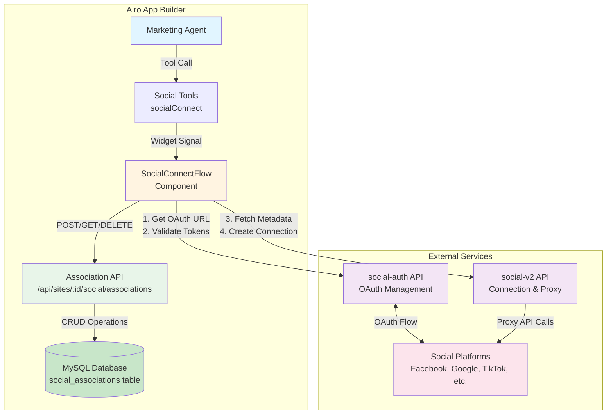
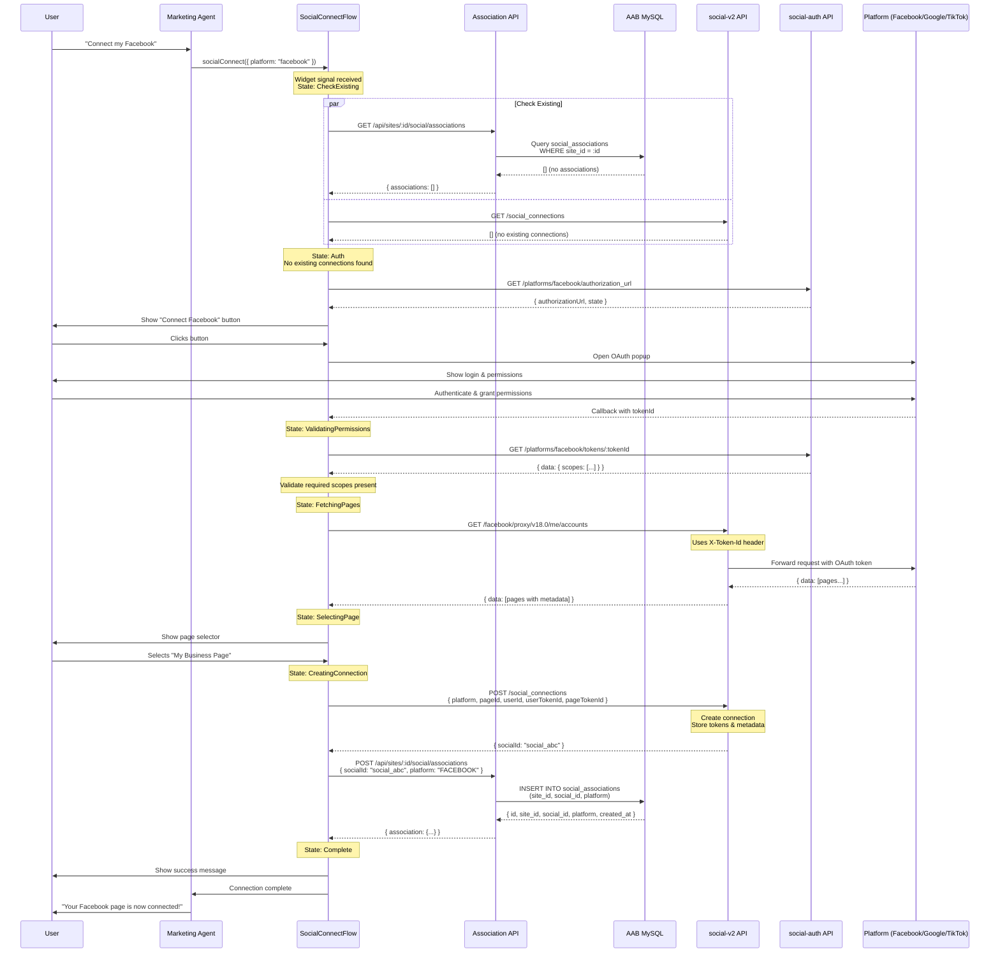
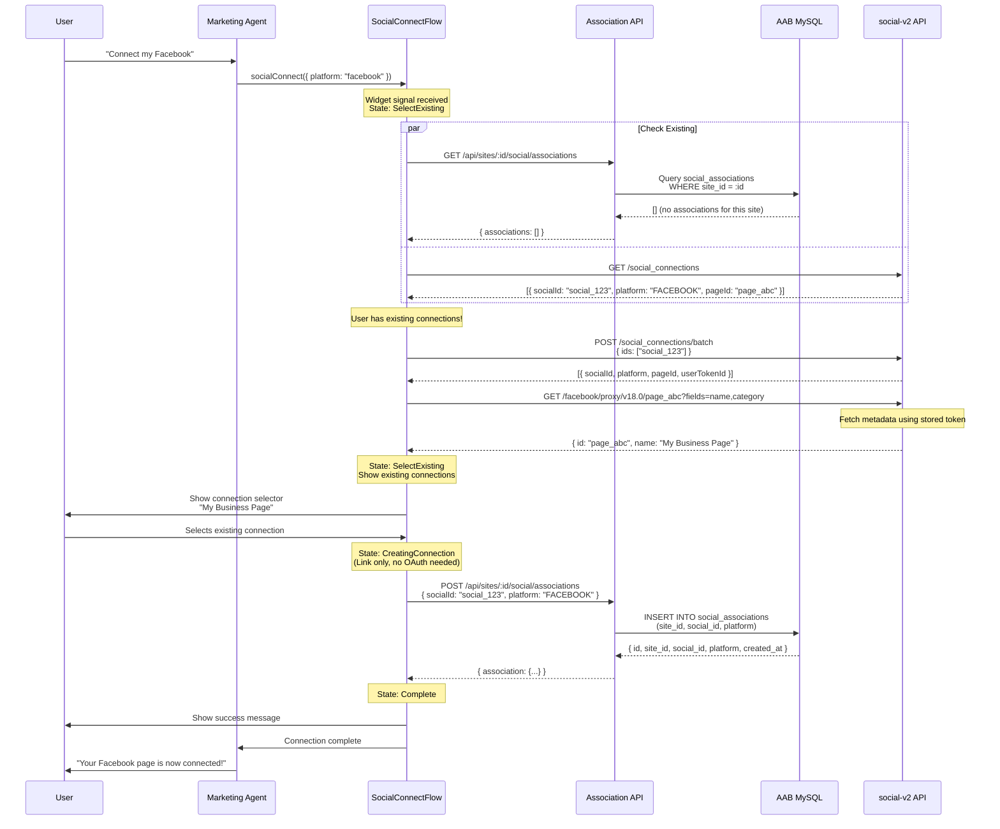
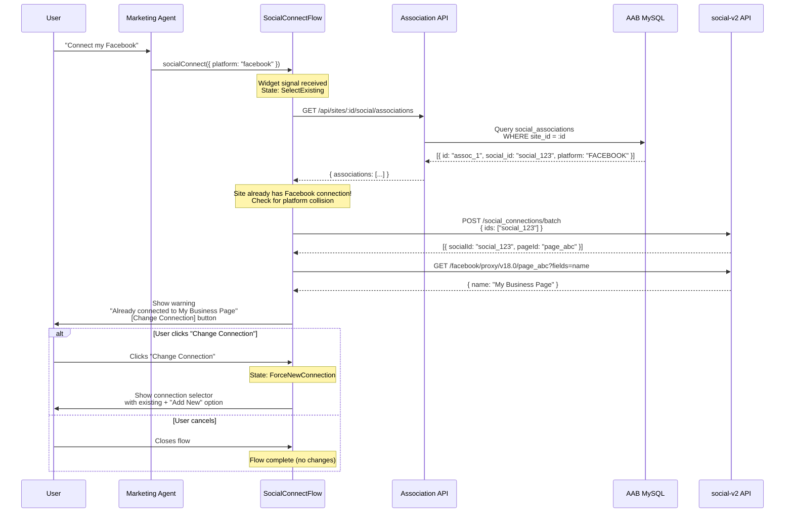
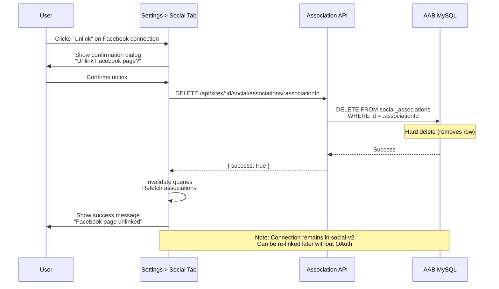
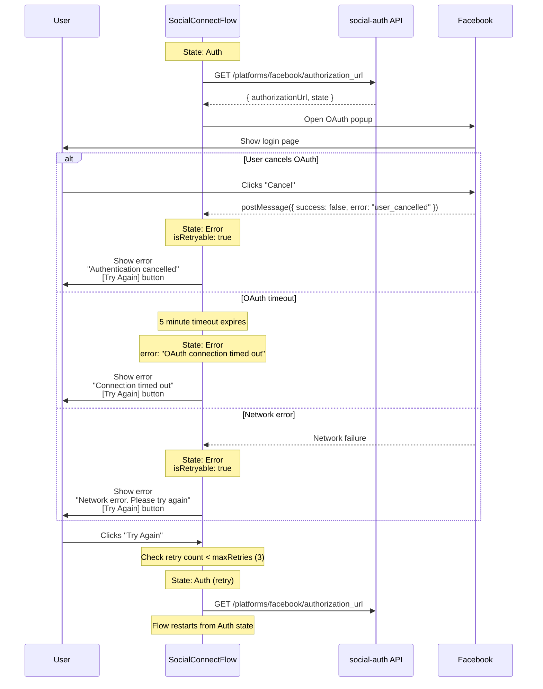
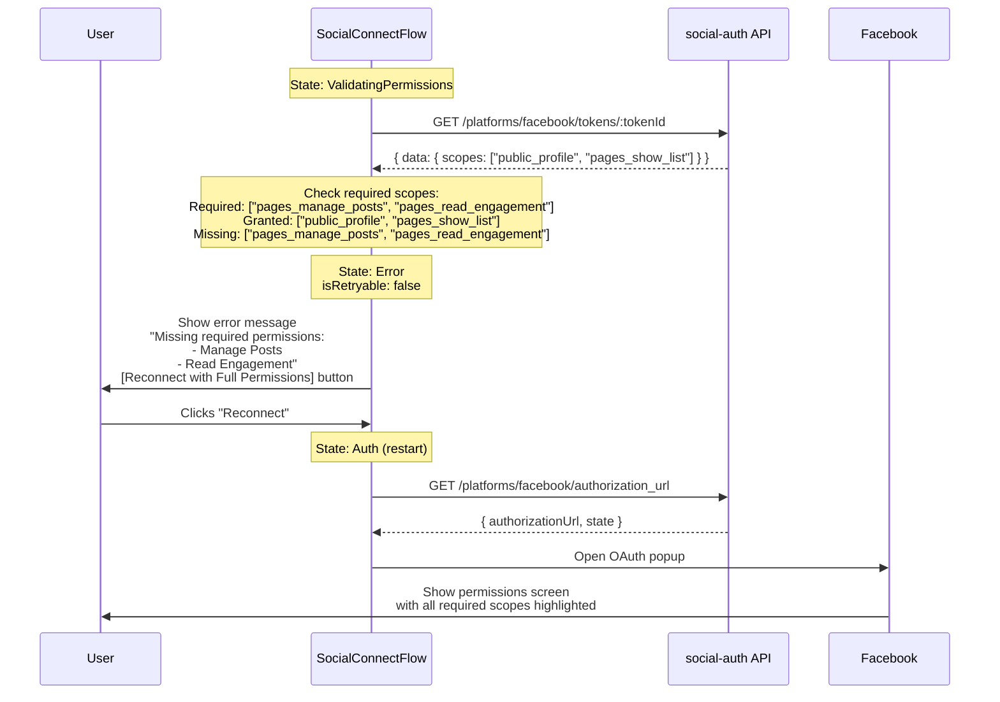
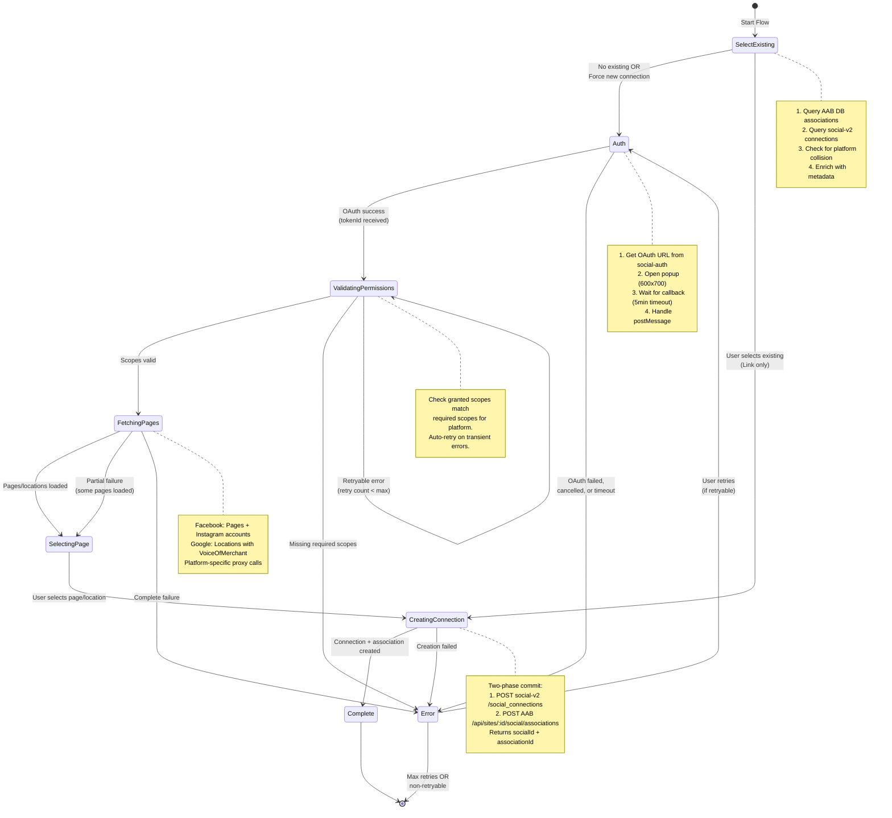
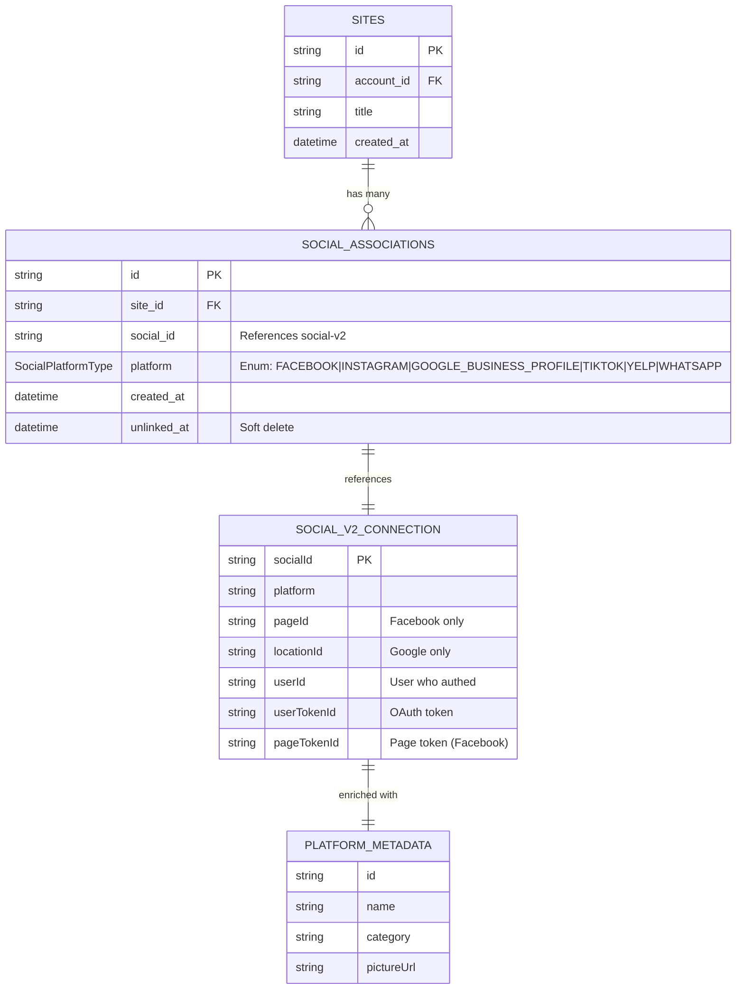

# Social Connections Flow Diagrams

## Table of Contents

1. [High-Level Architecture](#high-level-architecture)
2. **Sequence Diagrams**
   - [New Connection Flow (No Existing Connections)](#new-connection-flow-no-existing-connections)
   - [Link Existing Connection Flow](#link-existing-connection-flow)
   - [Already Connected Flow](#already-connected-flow)
   - [Unlink Connection Flow](#unlink-connection-flow)
   - [OAuth Error & Retry Flow](#oauth-error--retry-flow)
   - [Permission Validation Failure Flow](#permission-validation-failure-flow)
3. [State Machine Flow](#state-machine-flow)
4. [Data Architecture](#data-architecture)

## High-Level Architecture

## New Connection Flow (No Existing Connections)

## Link Existing Connection Flow

## Already Connected Flow

## Unlink Connection Flow

_This flow is only available via Settings > Social Tab_

## OAuth Error & Retry Flow

## Permission Validation Failure Flow

## State Machine Flow

## Data Architecture

### Separation of Concerns

**AAB MySQL Database (`social_associations` table):**

- Stores site-to-connection associations
- Enables one site to have multiple platform connections
- Supports soft deletes via `unlinked_at`
- Enforces unique constraint: `(site_id, social_id)`
- Uses `SocialPlatformType` enum to ensure valid platform values

**social-auth + social-v2 API:**

- Stores OAuth tokens and connection credentials
- Proxies API calls to social platforms
- Returns connection IDs (`socialId`)
- Single source of truth for authentication

**Platform Proxy APIs (via social-v2):**

- Provides metadata (page names, locations, etc.)
- Fetched separately and enriched in frontend
- Not stored permanently, cached in React Query
