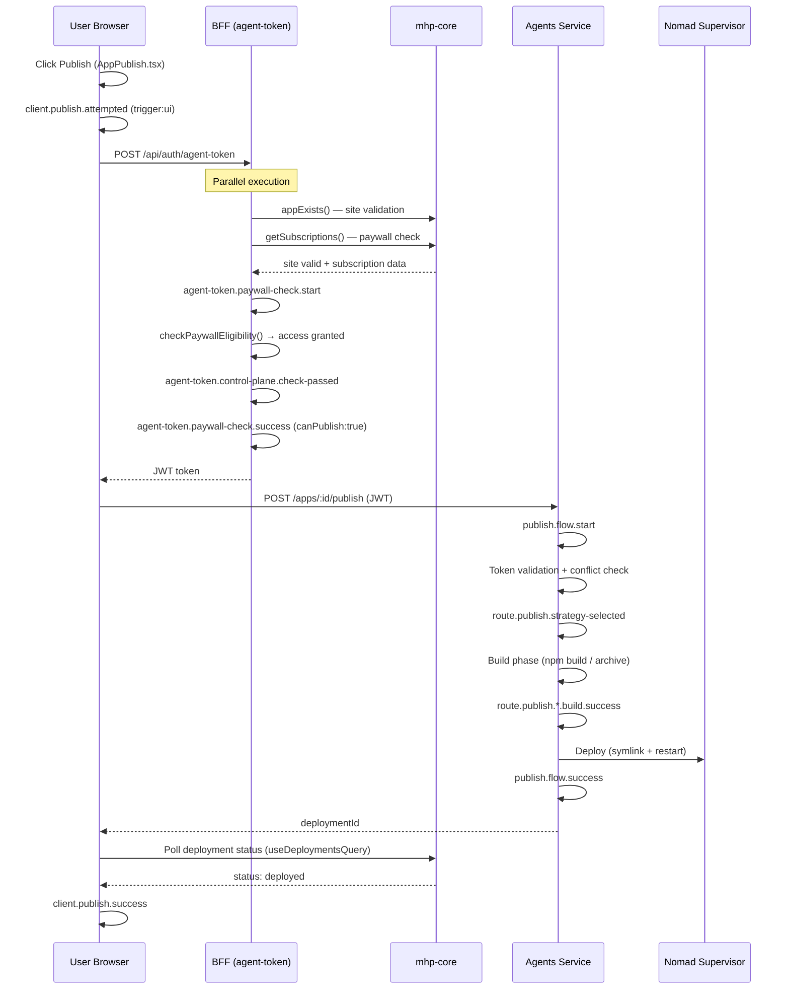
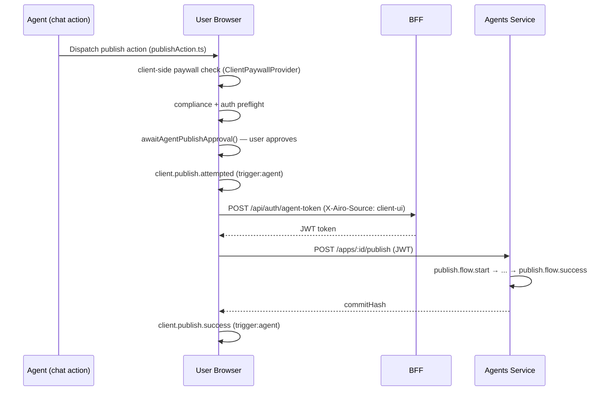
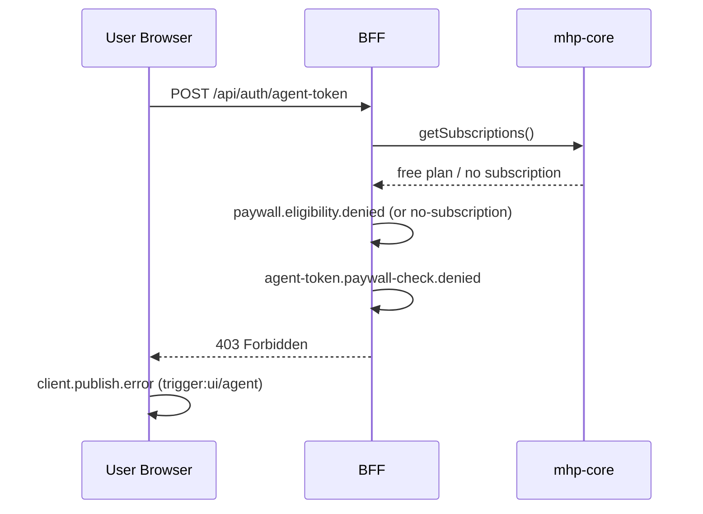

# Publish Flow — End to End Guide

## Table of Contents

1. [Overall Flow](#1-overall-flow)
2. [Components](#2-components)
3. [Sequence Diagrams](#3-sequence-diagrams)
4. [Path 1: UI-Triggered Publish](#4-path-1-ui-triggered-publish)
5. [Path 2: Agent-Triggered Publish](#5-path-2-agent-triggered-publish)
6. [Failure Points](#6-failure-points)
7. [Analytics Events Reference](#7-analytics-events-reference)
8. [Observability Dashboards](#8-observability-dashboards)
9. [Debugging Guide](#9-debugging-guide)
10. [On-Call Guide](#10-on-call-guide)

---

## 1. Overall Flow

A publish attempt travels through three distinct layers. Each layer has its own logging system and observability tooling.

```
Browser (Client)
    │
    │  client.publish.* events → ESSP/Kibana
    ▼
BFF (Next.js / Katana)                    ← app/src/app/api/auth/agent-token/route.ts
    │  agent-token.* events → ESSP/Kibana
    │  paywall.eligibility.* events → ESSP/Kibana
    ▼
mhp-core (mgmt-airo)                      ← mgmt.nstk.net
    │  Site validation + subscription check
    ▼
Agents Service (Express, port 4000)       ← agents/src/server/routes/publish.ts
    │  publish.flow.* events → Loki/Grafana
    ▼
Nomad Supervisor
    │
    ▼
Live Published App
```

**Data sources:**
- `client.*` analytics events → ESSP Kibana (`.ds-logs-gdelastic.katana.app-prod-ecs-*`)
- `agent-token.*` / `paywall.eligibility.*` BFF events → ESSP Kibana (same index)
- `publish.flow.*` agent events → Loki → Grafana

---

## 2. Components

### Browser Client
- **`AppPublish.tsx`** (`app/src/components/layout/AppPublish.tsx`) — UI publish button handler. Runs compliance and DNS gate checks before calling the publish mutation.
- **`publishAction.ts`** (`app/src/hooks/chat/actions/publishAction.ts`) — Agent-triggered publish. Runs client-side paywall check, compliance, HBI auth preflight, and human approval gate before calling agent-token.
- **`usePublishApp.ts`** (`app/src/hooks/usePublishApp.ts`) — React Query mutation. Handles the actual HTTP calls to agent-token BFF and agents service. Manages async polling state.
- **`useDeploymentsQuery.ts`** (`app/src/hooks/useDeploymentsQuery.ts`) — Deployment polling. Polls mgmt-airo for deployment status after a job is created. Emits `client.publish.success/failed` on terminal states.

### BFF (Next.js)
- **`agent-token/route.ts`** (`app/src/app/api/auth/agent-token/route.ts`) — Issues short-lived JWTs for the agents service. Runs paywall eligibility check and site validation in parallel. All calls have `data.action:"publish"` and `data.source:"client-ui"` (if from browser).
- **`paywall/core.ts`** (`app/src/lib/paywall/core.ts`) — Paywall eligibility logic. Checks subscription, plan tier, and published app count. Fail-closed on errors.
- **`jwt-regeneration.ts`** (`app/src/lib/jwt-regeneration.ts`) — Sends `X-Airo-Source: client-ui` header to agent-token, enabling BFF metrics to be scoped to browser-only traffic.

### mhp-core (mgmt-airo)
- Owns subscription data (`GET /v1/subscriptions`) and site validation (`appExists`, `getSite`).
- URL: `https://mgmt.nstk.net`
- Both site validation and subscription checks call this service; failures appear as `TOKEN_EXPIRED`, `CUSTOMER_NOT_REGISTERED`, or connection errors in BFF logs.

### Agents Service
- **`publish.ts`** (`agents/src/server/routes/publish.ts`) — Validates token freshness, checks for conflicts, runs build strategy (default npm or PaaS archive), then deploys via supervisor.
- Logs to Loki. View at `https://grafana.monitoring.gd3p.tools/`

---

## 3. Sequence Diagrams

### 3.1 UI-Triggered Publish (Happy Path)



### 3.2 Agent-Triggered Publish (Happy Path)



### 3.3 Paywall Denial Flow



---

## 4. Path 1: UI-Triggered Publish

### Entry Points
- `AppPublish.tsx` → `handleDeploy()` — publish button in UI toolbar
- Called via `publishMutation.mutateAsync()` → `usePublishApp.ts`

### Client-Side Gate Checks (before BFF)
1. **Compliance block** (`AppPublish.tsx:542`) — `isPublishBlockedByComplianceRules()` — checks subscription + compliance flag
2. **DNS conflict gate** (`AppPublish.tsx:581`) — `runGate()` via `useDnsConflictGate` — checks for domain conflicts

If either gate blocks: `client.publish.attempted` fires with `data.blockedReason`, no BFF call made.

### BFF Call (`usePublishApp.ts` mutation)
1. HBI auth preflight (`authPreflight(3)`) — level-3 expiry check
2. Compliance re-check with fresh server data
3. Secrets sync (`POST /api/secrets/:id/sync`)
4. `regenerateToken()` → `POST /api/auth/agent-token` with `X-Airo-Source: client-ui`
5. `POST {agent_url}/apps/:id/publish` with JWT

### Async Publish Path
- Returns `jobId` → `setDeploymentInProgressId` → `useDeploymentsQuery` starts polling
- `waitForDeploymentComplete` runs fire-and-forget (5-min wait for store update)
- `useDeploymentsQuery` polls mgmt-airo every few seconds for deployment status
- Terminal states: `deployed` → `client.publish.success` | `failed` → `client.publish.failed`

### Analytics Events (UI path)
| Event | When |
|---|---|
| `client.publish.attempted` (blockedReason set) | Gate blocked, BFF never called |
| `client.publish.attempted` (no blockedReason) | All gates passed, publish starting |
| `client.publish.error` | Mutation failed (BFF 403, agent error, network) |
| `client.publish.poll-timeout` | Polling exhausted (usePublishApp or useDeploymentsQuery) |
| `client.publish.success` | useDeploymentsQuery detected deployed |
| `client.publish.failed` | useDeploymentsQuery detected failed |

---

## 5. Path 2: Agent-Triggered Publish

### Entry Point
`publishAction.ts` — dispatched by the chat agent as a client action executor.

### Gate Checks (before BFF)
1. **Client-side paywall** (`publishAction.ts:129`) — `checkPaywallEligibility(ClientPaywallProvider)` — browser-side check using cached subscription
2. **Compliance** (`publishAction.ts:214`) — `isPublishBlockedByComplianceRules()`
3. **HBI auth preflight** (`publishAction.ts:229`) — `authPreflight(3)`
4. **Human approval gate** (`publishAction.ts:252`) — `awaitAgentPublishApproval()` — waits for user to click Approve in UI

If any gate blocks: `client.publish.attempted` fires with `data.blockedReason`. A declined approval fires nothing (silent, by design).

### After All Gates Pass
- `client.publish.attempted` fires (no blockedReason) — true attempt
- `regenerateToken()` → BFF → JWT
- Calls agents service directly via `agentFetch`
- Handles response inline — **does NOT use `useDeploymentsQuery`**

### Analytics Events (agent path)
| Event | When |
|---|---|
| `client.publish.attempted` (blockedReason set) | Gate blocked |
| `client.publish.attempted` (no blockedReason) | All gates passed |
| `client.publish.success` (trigger:agent) | Agent publish returned success |
| `client.publish.error` (trigger:agent) | Agent publish returned error |

---

## 6. Failure Points

### Layer 1: Client Gates (before BFF)

| Failure | Event | Cause |
|---|---|---|
| Paywall modal shown | `client.publish.attempted` + `blockedReason:paywall_denied` | Free user, client-side check caught it |
| DNS conflict dismissed | `client.publish.attempted` + `blockedReason:dns_conflict` | User dismissed the DNS conflict modal |
| Compliance blocked | `client.publish.attempted` + `blockedReason:compliance_*` | Account suspended or subscription non-compliant |
| Auth expired | `client.publish.attempted` + `blockedReason:auth_required` | HBI token expired |
| User declined approval | Nothing logged | User clicked Cancel on agent publish confirmation |

### Layer 2: BFF (agent-token route)

| Failure | Event | Cause |
|---|---|---|
| Site not found | `agent-token.control-plane.site-not-found` | App doesn't exist in mgmt-airo |
| Site validation error | `agent-token.control-plane.app-exists-failed` | mgmt-airo unreachable or 5xx |
| Subscription check error | `paywall.eligibility.check-failed` | mgmt-airo subscription API error |
| Token expired (calling mgmt-airo) | `paywall.eligibility.check-failed` + `data.error:*TOKEN_EXPIRED*` | BFF JWT expired mid-request |
| Customer not registered | `paywall.eligibility.check-failed` + `data.error:*CUSTOMER_NOT_REGISTERED*` | Enterprise user, not in Airo yet |
| No subscription | `paywall.eligibility.no-subscription` | User has no Airo subscription |
| Wrong plan tier | `paywall.eligibility.denied` | Free plan, needs upgrade |
| Publish limit reached | `paywall.eligibility.publish-limit-reached` | Paid user hit published app limit |
| Unhandled error | `agent-token.unhandled-error` | Any unexpected exception in route |

### Layer 3: Agents Service

| Failure | Event | ErrorType |
|---|---|---|
| Token too old | `publish.flow.failure` | `TokenStale` |
| App not in agents DB | `publish.flow.failure` | `AppNotFound` |
| Workspace unavailable | `publish.flow.failure` | `WorkspaceUnavailable` |
| Another publish running | `publish.flow.failure` | `ConflictError` |
| Build failed | `publish.flow.failure` | `BuildError` |
| Preview not running | `publish.flow.failure` | `PreviewNotRunningError` |
| Deploy error | `publish.flow.failure` | `DeployError` |
| Supervisor unavailable | `publish.flow.failure` | `SupervisorUnavailable` |

---

## 7. Analytics Events Reference

### Client Events (`client.publish.*`) — ESSP/Kibana

| Event | File | Trigger | Key fields |
|---|---|---|---|
| `client.publish.attempted` | `AppPublish.tsx`, `publishAction.ts` | Every publish attempt | `data.blockedReason`, `data.trigger` |
| `client.publish.success` | `useDeploymentsQuery.ts`, `publishAction.ts` | Confirmed deployed | `data.trigger` |
| `client.publish.failed` | `useDeploymentsQuery.ts` | Confirmed failed | `data.errorType` |
| `client.publish.error` | `usePublishApp.ts` (onError), `publishAction.ts` | Request/mutation error | `data.error`, `data.trigger` |
| `client.publish.poll-timeout` | `usePublishApp.ts`, `useDeploymentsQuery.ts` | Polling gave up | `data.trigger` |

### BFF Events (`agent-token.*`) — ESSP/Kibana

| Event | Key fields |
|---|---|
| `agent-token.paywall-check.start` | `data.action`, `data.source`, `data.cacheHit` |
| `agent-token.paywall-check.success` | `data.canPublish`, `data.canDownload`, `data.source` |
| `agent-token.paywall-check.denied` | `data.reason`, `data.hasSubscription`, `data.source` |
| `agent-token.control-plane.check-passed` | `data.cacheHit`, `data.source` |
| `agent-token.control-plane.app-exists-failed` | `data.error`, `data.errorType`, `data.source` |
| `agent-token.unhandled-error` | `data.error`, `data.errorType`, `data.source` |

### Paywall Eligibility Events (`paywall.eligibility.*`) — ESSP/Kibana

| Event | Meaning |
|---|---|
| `paywall.eligibility.check.start` | Eligibility check started |
| `paywall.eligibility.access-granted` | User has access |
| `paywall.eligibility.no-subscription` | No subscription found |
| `paywall.eligibility.denied` | Plan upgrade required |
| `paywall.eligibility.publish-limit-reached` | Hit published app limit |
| `paywall.eligibility.check-failed` | Infrastructure error (fail-closed) |
| `paywall.eligibility.published-apps.check-failed` | Published apps count check failed |

### Agent Events (`publish.flow.*`) — Loki/Grafana

| Event | Meaning |
|---|---|
| `publish.flow.start` | Request reached agents |
| `route.publish.strategy-selected` | Passed early guards |
| `route.publish.*.build.begin` | Build phase started |
| `route.publish.*.build.success` | Build succeeded |
| `route.publish.supervisor.begin` | Deploy phase started |
| `publish.flow.success` | Fully deployed |
| `publish.flow.failure` | Failed with `data_errorType` |

---

## 8. Observability Dashboards

### Kibana — BFF + Client Layer
**Dashboard:** [Publish Flow: Paywall & Subscription (BFF)](https://airobuilde-prod-usw2.kb.us-west-2.aws.found.io:9243/app/dashboards#/view/473c2ab7-f50a-48d0-acb4-d5c6e6e6544d?_g=(filters:!()))

Key panels:
- **Client E2E Funnel** — End-to-end from click to deployed (client events only, browser UI)
- **Publish Attempts Blocked** — Client-gate denials by reason and trigger (ui vs agent)
- **Agent Token Paywall Outcomes** — Server-side paywall population breakdown (paid vs free split)
- **Site Validation Success Rate** — mgmt-airo site validation health
- **JWT Issued (Publish Access Granted)** — % of BFF calls that issued a publish JWT
- **All Errors** — Infrastructure error rate (excludes expected denials)
- **Paywall Denial Reasons** — Why users are being denied (plan tier, no subscription, limit)
- **Error Split by Services** — Which service is causing errors (Control Plane vs BFF/Paywall)
- **BFF Error Logs** — Raw error log table for incident investigation

**Index:** `.ds-logs-gdelastic.katana.app-prod-ecs-*`
**Credentials:** `./scripts/essp-creds.sh prod`

### Grafana — Agents Layer
**Dashboard:** [Publish Flow: Agents](https://grafana.monitoring.gd3p.tools/d/ss98vdt/publish-flow3a-agents?orgId=4&from=now-1h&to=now&timezone=browser)

Key panels:
- **Overall Publish Success Rate** — `publish.flow.success / publish.flow.start`
- **Pre-checks Pass Rate** — Requests cleared token/conflict/workspace guards
- **Build Pass Rate** — Build phase success
- **Deploy Pass Rate** — Deploy phase success
- **Failure Breakdown by Error Type** — Which errorType is failing + stack traces
- **Publish Duration Percentiles** — p50/p95/p99 latency
- **Slow Publishes (>60s)** — Publish jobs taking too long
- **Request Drop-off Stages** — Funnel from start to deployed

**Log selector:** `{job="airo-agents", env="prod"}`

---

## 9. Debugging Guide

### Step 1 — Identify which layer failed

Open [Kibana dashboard](https://airobuilde-prod-usw2.kb.us-west-2.aws.found.io:9243/app/dashboards#/view/473c2ab7-f50a-48d0-acb4-d5c6e6e6544d?_g=(filters:!())) → Client E2E Funnel. Look at the stage where count drops:

| Drop | Layer | Where to look |
|---|---|---|
| Stage 1→2 (Publish Clicked → Passed Gates) | Client | "Publish Attempts Blocked" pie — which `blockedReason`? |
| Stage 2→3 (Passed Gates → Reached Deployment) | BFF or Agent | BFF Error panels + Grafana failure breakdown |
| Stage 3→4 (Reached Deployment → Deployed) | Agents | Grafana failure breakdown by `errorType` |

### Step 2 — BFF failures

In Kibana Discover:
```kql
event:(agent-token.paywall-check.denied OR paywall.eligibility.check-failed OR agent-token.unhandled-error) AND data.action:"publish" AND NOT authType:"e2s"
```

Look at `data.error` and `data.reason` to identify the cause:

| Value | Cause | Action |
|---|---|---|
| `TOKEN_EXPIRED 401` | BFF JWT expired calling mgmt-airo | Check HBI token refresh, `authPreflight` config |
| `CUSTOMER_NOT_REGISTERED 404` | Enterprise user, not in Airo | Expected — filter with `NOT data.error:*CUSTOMER_NOT_REGISTERED*` |
| `Unable to verify subscription status` | mgmt-airo subscription API down | Check mgmt-airo health |
| `Subscription upgrade required` | Free user | Expected — not an error |

### Step 3 — Agent failures

In [Grafana](https://grafana.monitoring.gd3p.tools/d/ss98vdt/publish-flow3a-agents?orgId=4&from=now-1h&to=now&timezone=browser) Loki Explore:
```logql
{job="airo-agents", env="prod"}
|= "publish.flow.failure"
| json
| __error__=""
| line_format "{{.data_errorType}} | {{.data_error}} | app={{.app_id}}"
```

Common errors:
| errorType | Meaning | Action |
|---|---|---|
| `BuildError` | npm build failed | Check `data_error` for specific npm error |
| `TokenStale` | JWT >30s old when it reached agents | Reduce latency in BFF or regenerate token closer to agent call |
| `ConflictError` | Another publish in progress | Check if user triggered multiple publishes |
| `SupervisorUnavailable` | Nomad allocation issue | Check Nomad job health |
| `DeployError` | Health check failed after restart | Check app startup, supervisor logs |
| `WorkspaceUnavailable` | Preview container not running | Check Nomad alloc for preview container |

### Step 4 — Correlate a specific user's publish attempt

Find all events for a specific app across both layers:

**Kibana (BFF + Client):**
```kql
data.appId:"<app-id>" AND event:(client.publish.* OR agent-token.paywall-check.* OR paywall.eligibility.*)
```

**Grafana (Agents):**
```logql
{job="airo-agents", env="prod"} |= "<app-id>"
```

Use `trace.id` from BFF logs to correlate the exact request across services.

### Step 5 — Check if issue is widespread or user-specific

```kql
event:paywall.eligibility.check-failed AND data.action:"publish"
```

Aggregate by `customerId` in Discover:
- **1–2 customers** → user-specific (bad token, edge case)
- **50+ customers** → infrastructure issue (mgmt-airo degraded)

---

## 10. On-Call Guide

### Response Playbook

#### High Error Rate (BFF errors)

1. Check `data.error` in BFF Error Logs panel
2. If `TOKEN_EXPIRED` dominant → mgmt-airo auth issue, check HBI config
3. If `ETIMEDOUT` / `ECONNREFUSED` → mgmt-airo down, escalate to control plane team
4. If `500` errors → check mgmt-airo service health
5. **Immediate mitigation:** enable `app-builder-bypass-publish-limit` in Switchboard if mgmt-airo is down

#### High Publish Error Rate (client errors)

1. Check Kibana "Publish Failed or Error" pie for `data.error` breakdown
2. `Build failed` → check Grafana for `BuildError` pattern (user app code issue vs infra)
3. `Health check failed` → `DeployError` or `SupervisorUnavailable` — check Nomad
4. `Failed to fetch` → network issue between browser and agents — check load balancer
5. `Publish polling was cancelled` dominant → users navigating away, not infra issue

#### Deployment Failures Spike

1. Open Grafana → Failure Breakdown by Error Type
2. `DeployError` / `SupervisorUnavailable` → Nomad supervisor issue
3. `BuildError` at scale → shared npm registry or container resource issue
4. Check `#airo-app-builder-prod-alerts` for concurrent infra alerts

#### Success Rate Drop

1. Check all four stages in the Client E2E Funnel
2. If Stage 1→2 drop → client gate issue (paywall/compliance system)
3. If Stage 2→3 drop → BFF or agent failures (check both dashboards)
4. If Stage 3→4 drop → deployment failures (check Grafana)
5. Cross-check recent deployments: `git log --oneline -10` on main

### Key Switchboard Flags

| Flag | Effect | Use when |
|---|---|---|
| `app-builder-bypass-publish-limit` | Bypasses published app count check | Subscription API down, users being incorrectly blocked |
| `appbuilder-suspended-compliance-banner` | Gates compliance suspension banner | Compliance system misbehaving |
| `appbuilder-suspended-nonpayment-banner` | Gates non-payment suspension banner | Payment system issues |

### Useful Log Queries

**Active publish jobs (last hour):**
```logql
{job="airo-agents", env="prod"} |= "publish.flow.start" | json | line_format "{{.app_id}} {{.timestamp}}"
```

**Recent BFF errors (non-enterprise, non-e2s):**
```kql
event:(paywall.eligibility.check-failed OR agent-token.unhandled-error) AND data.action:"publish" AND NOT authType:"e2s" AND NOT data.error:*CUSTOMER_NOT_REGISTERED*
```

**Paywall denial breakdown (last hour):**
```kql
event:(paywall.eligibility.denied OR paywall.eligibility.no-subscription OR paywall.eligibility.publish-limit-reached) AND data.action:"publish"
```

**All events for a specific customer:**
```kql
customerId:"<customer-id>" AND event:(client.publish.* OR agent-token.paywall-check.*)
```

### Contacts

| Area | Team | Escalation |
|---|---|---|
| BFF / Client | Airo Builder (this team) | `#airo-builders` |
| mgmt-airo / mhp-core | Control Plane team | `#airo-app-builder-prod-alerts` |
| Nomad / Supervisor | Infra / SRE | `#airo-app-builder-prod-alerts` |
| Subscription API | Billing team | `#airo-app-builder-prod-alerts` |
