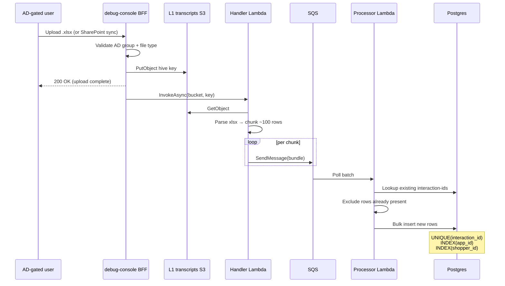

# SupportPlane L1 Transcript Ingestion — Design

**Status:** Phase 1 (S3 landing zone) implemented — see `cdk/lib/feedback-l1-transcript-stack.ts`
**Date:** 2026-06-15
**Owner:** supportplane
**Related:**
- [debug-console/ARCHITECTURE.md](../../../debug-console/ARCHITECTURE.md)
- [FeedbackL1TranscriptStack](../../../cdk/lib/feedback-l1-transcript-stack.ts) — CDK stack (deployed dev + prod)
- [SupportPlane UI](../../../debug-console/src/app/supportplane/page.tsx) — upload + analytics panels
- [SupportPlane AI chat](../../../debug-console/src/app/api/supportplane/ask/route.ts) — future DB query tool

## 1. Summary

Ingest L1 support transcript Excel exports into a queryable store so SupportPlane can analyze customer pain points end-to-end by **appId** or **shopperId**, power batch analytics, and let the SupportPlane AI assistant query structured interaction history.

**Phase 1 (done):** S3 landing bucket via `FeedbackL1TranscriptStack`.

**Phase 2 (planned):** Async pipeline — Handler Lambda chunks xlsx → SQS (~100 rows) → Processor Lambda dedups on `interaction-id` → Postgres.

All upload sources (manual UI upload, SharePoint sync) land in S3 first, then share the same SQS ingestion flow.

## 2. Goals

1. AD-group-gated engineers upload `.xlsx` L1 exports to a durable S3 landing zone
2. Async ingestion never blocks the upload API response
3. Query interactions by **appId** or **shopperId** across the full L1 history
4. Support batch / full-dataset analytics for trend, heatmap, funnel panels
5. Extend `/api/supportplane/ask` with a DB query tool for AI-assisted triage
6. Idempotent ingest: replays and DLQ redrives skip rows whose `interaction-id` already exists

## 3. Non-goals

- Storing or rendering customer PII (name, email, phone) — exports must be pre-redacted
- SQLite as the query store (not viable for shared team analytics)
- Athena as the primary interactive query path for AI chat (batch/lake path may follow later)
- Replacing SharePoint as the upstream source of truth for raw transcript files

## 4. Architecture

### 4.1 End-to-end flow

```mermaid
graph TB
    subgraph "Actors"
        U[AD-group gated user<br/>debug-console /supportplane]
    end

    subgraph "debug-console (Katana ECS)"
        UI[Upload panel<br/>.xlsx]
        SP_SYNC[SharePoint sync<br/>same pipeline entry]
        BFF[POST /api/supportplane/upload<br/>withAuth + AD group check]
        ASK[/api/supportplane/ask<br/>AI + query_l1_transcripts tool]
    end

    subgraph "Phase 1 — implemented"
        S3[(S3: airo-builder-l1-transcripts-env<br/>l1_transcripts/xlsx/year=/month=/day=/)]
    end

    subgraph "Phase 2 — planned"
        HL[Handler Lambda<br/>parse xlsx → ~100-row bundles]
        Q[SQS queue + DLQ]
        PL[Processor Lambda<br/>dedup interaction-id]
        DB[(Postgres<br/>indexed appId · shopperId · interaction-id)]
    end

    subgraph "Consumers"
        PANELS[SupportPlane analytics<br/>trends · heatmap · funnel]
    end

    U --> UI
    U --> SP_SYNC
    UI --> BFF
    SP_SYNC --> BFF
    BFF -->|PutObject| S3
    BFF -.->|async invoke| HL
    S3 --> HL
    HL --> Q
    Q --> PL
    PL -->|ON CONFLICT DO NOTHING| DB
    DB --> PANELS
    DB --> ASK
    S3 -.->|raw replay| HL

    style S3 fill:#e8f5e9
    style DB fill:#e3f2fd
    style HL fill:#fff3e0
    style PL fill:#fff3e0
```

### 4.2 Upload sequence



### 4.3 Component map

| Component | Phase | New / Existing | Role |
|-----------|-------|----------------|------|
| SupportPlane upload UI | 1 | Existing (mock → wire) | `.xlsx` file picker; AD-gated |
| `POST /api/supportplane/upload` | 1 | New | Auth, validate, `PutObject`, trigger handler |
| `FeedbackL1TranscriptStack` | 1 | **Implemented** | S3 bucket + IAM + CloudFormation outputs |
| Handler Lambda | 2 | New | Read xlsx from S3, publish row bundles to SQS |
| SQS + DLQ | 2 | New | Buffer chunks; failed messages → manual replay |
| Processor Lambda | 2 | New | Dedup + bulk insert into Postgres |
| Postgres (RDS) | 2 | New | Query store for appId / shopperId / analytics |
| `/api/supportplane/ask` DB tool | 2 | Extend existing | AI queries Postgres by appId or shopperId |

## 5. S3 layout (Phase 1)

**Bucket:** `airo-builder-l1-transcripts-{env}` (dev + prod)

**Key pattern:**

```
l1_transcripts/xlsx/year=YYYY/month=MM/day=DD/{upload-id}.xlsx
```

**CDK stack:** `FeedbackL1TranscriptStack` — deploy via `cdk deploy FeedbackL1TranscriptStack`

**debug-console env var:** `L1_TRANSCRIPTS_S3_BUCKET` (from stack output `L1TranscriptsS3BucketName`)

**Writers:** console-service Katana ECS task roles (`7794` dev-private, `7797` prod) + Ops

**Readers:** Lake Formation / Athena cross-account roles (future lake path; not primary query store)

## 6. Data model (Phase 2)

One row per L1 interaction line from the xlsx export.

| Column | Type | Notes |
|--------|------|-------|
| `interaction_id` | `text` PK / UNIQUE | Global dedup key; replay-safe |
| `app_id` | `text` | Indexed — primary lookup |
| `shopper_id` | `text` | Indexed — primary lookup |
| `source_s3_key` | `text` | Provenance for replay/debug |
| `chunk_index` | `int` | Which SQS message produced this row |
| `ingested_at` | `timestamptz` | Server-side ingest time |
| `payload` | `jsonb` | Remaining xlsx columns (no PII) |

**Dedup contract:** `INSERT … ON CONFLICT (interaction_id) DO NOTHING`. DLQ replay and duplicate uploads are safe.

## 7. Failure handling

| Step | On failure |
|------|------------|
| BFF `PutObject` | Return 5xx to user; no SQS side effects |
| Handler: corrupt xlsx | Log + DLQ source key; manual fix/re-upload |
| Handler: SQS message > 256 KB | Reduce chunk size or split wide rows |
| Processor: DB timeout | SQS retry → DLQ; replay after DB recovery |
| Processor: partial chunk insert | Use single transaction per chunk |

## 8. Security

- **Upload:** `withAuth` + AD-group membership (same pattern as other debug-console routes)
- **PII:** Not stored; validate export schema at ingest
- **S3:** Block public access, SSE-S3, versioned bucket
- **DB:** VPC-only; credentials in Secrets Manager; least-privilege Lambda role

## 9. Environment variables

| Var | Phase | Source |
|-----|-------|--------|
| `L1_TRANSCRIPTS_S3_BUCKET` | 1 | CDK output → Katana secret |
| `L1_INGEST_HANDLER_FN` | 2 | CDK Lambda function name |
| `L1_TRANSCRIPTS_DB_URL` | 2 | Secrets Manager (Postgres connection string) |

## 10. Deployment order

1. `FeedbackL1TranscriptStack` — S3 bucket (**done**)
2. Wire `L1_TRANSCRIPTS_S3_BUCKET` on debug-console Katana container
3. Implement `POST /api/supportplane/upload` → `PutObject`
4. `L1IngestStack` (new CDK) — Handler Lambda, SQS, DLQ, Processor Lambda, Postgres
5. Add `query_l1_transcripts` tool to `/api/supportplane/ask`
6. Connect analytics panels to Postgres queries

## 11. Open decisions

1. Confirm `interaction-id` is **globally unique** across all exports (required for single-column dedup)
2. Postgres sizing (RDS instance class) based on expected row volume
3. Whether to add optional Athena/Glue table on the S3 prefix for lake-team batch jobs (parallel path, not v1)
