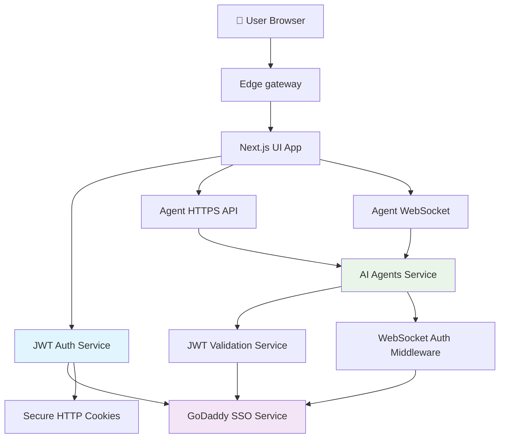
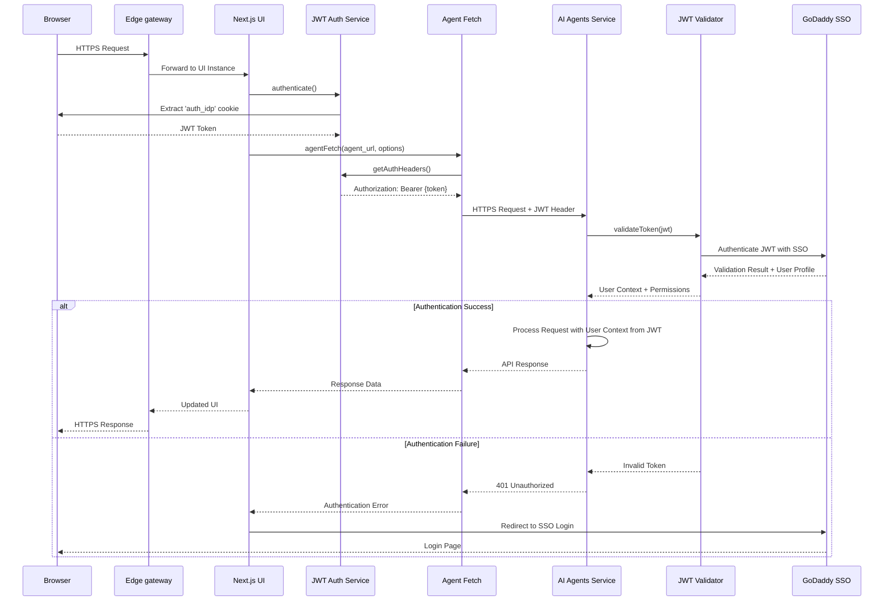
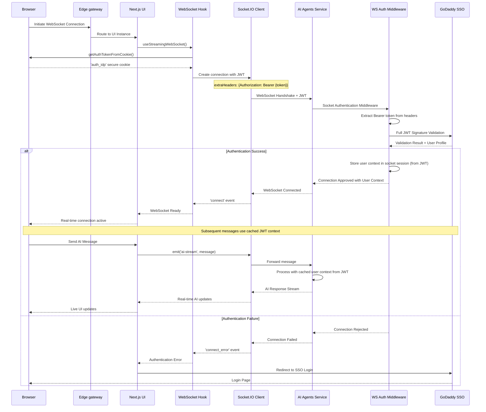
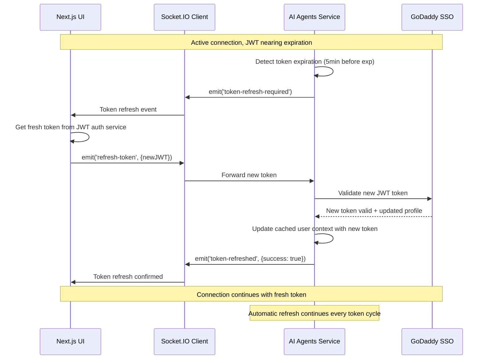
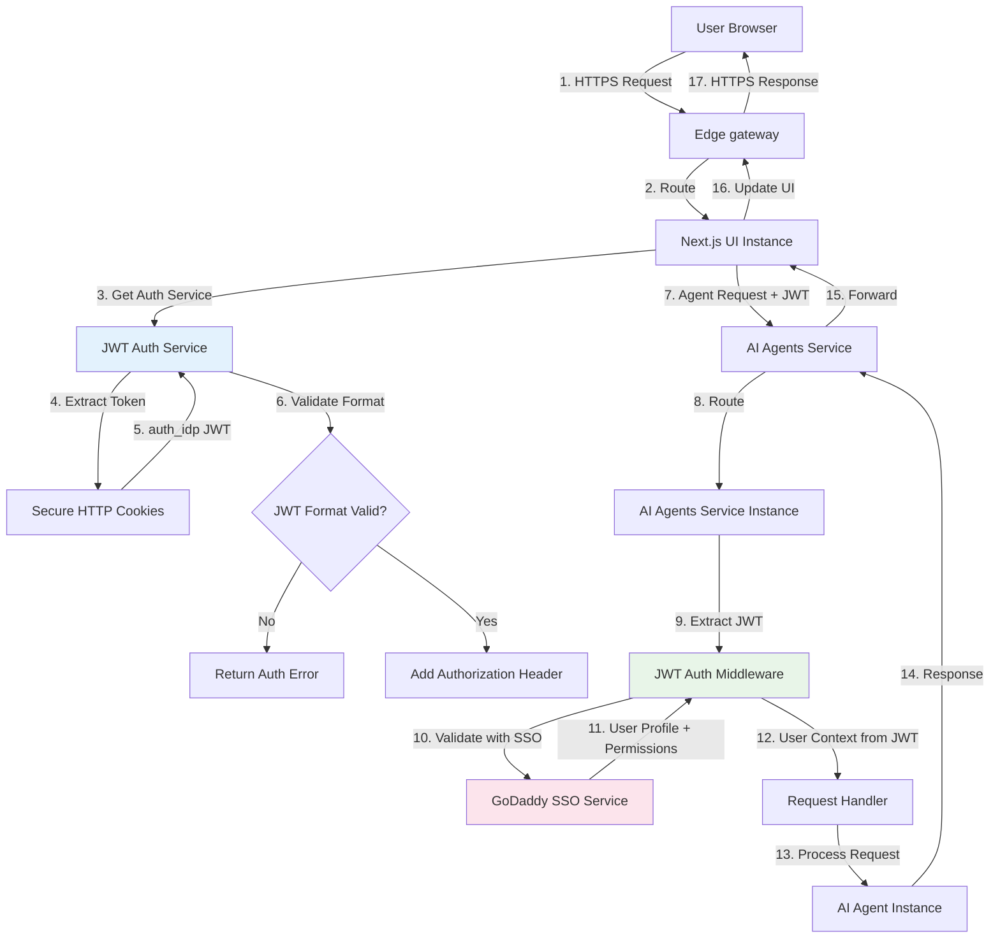
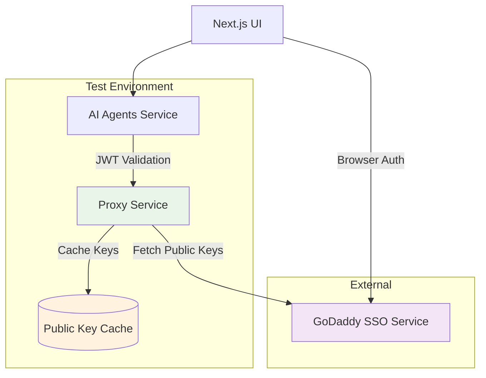
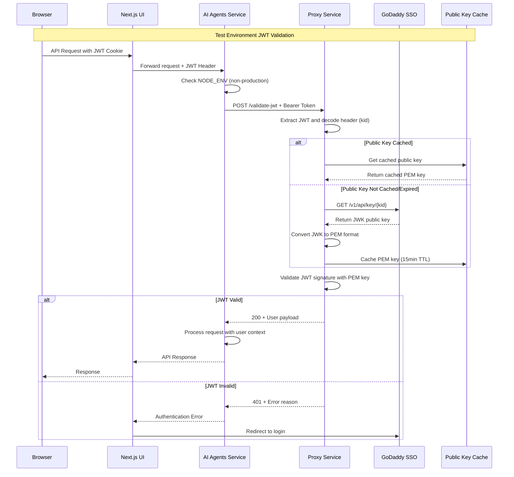

# UI to Agents Authentication Architecture

## Table of Contents

1. [System Overview](#system-overview)
2. [Architecture Diagrams](#architecture-diagrams)
3. [HTTPS Authentication Flow](#https-authentication-flow)
4. [WebSocket Authentication Flow](#websocket-authentication-flow)
5. [Data Flow Diagrams](#data-flow-diagrams)
6. [Test Environment with Proxy SSO Validation](#test-environment-with-proxy-sso-validation)
7. [Service Integration Details](#service-integration-details)

## System Overview

The Airo AI Builder authentication system provides secure communication between the Next.js UI application and the AI Agents Service using both HTTPS REST API calls and WebSocket connections. The system uses JWT-based authentication with GoDaddy SSO integration.

### Core Components

- **UI Application (Next.js)**: Frontend application with JWT authentication
- **Agents Service (Express)**: Backend API with JWT validation
- **GoDaddy SSO Service**: GoDaddy SSO service for JWT token validation
- **Edge gateway**: Content delivery and SSL termination

### Authentication Architecture

The system uses JWT (JSON Web Token) authentication:

- **Token Source**: GoDaddy SSO service
- **Token Storage**: Secure HTTP-only cookies (`auth_idp`)
- **Token Validation**: Full signature verification with SSO service
- **Token Refresh**: Automatic heartbeat and refresh mechanism
- **User Context**: Authenticated user identity and permissions

## Architecture Diagrams

### High-Level Authentication Architecture



## HTTPS Authentication Flow

### JWT Authentication Flow



## WebSocket Authentication Flow

### WebSocket Authentication with Socket.IO



### WebSocket Token Refresh Flow



## Data Flow Diagrams

### Authentication Data Flow



## Test Environment with Proxy SSO Validation

In test and development environments, as GoDaddy SSO API is not reachable, the AI Agents Service uses a proxy service for SSO validation instead of connecting directly to SSO.

### Proxy Service Architecture



### Proxy SSO Validation Flow



### Environment Configuration

The agents service automatically selects validation method based on environment:

**Environment Variables:**

- `NODE_ENV`: When set to `production`, uses direct SSO validation
- `PROXY_URL`: URL of the proxy service
- `SSO_LOGIN_URL`: SSO endpoint URL for public key fetching

**Validation Strategy:**

```typescript
// Production environment
if (NODE_ENV === "production") {
  // Direct SSO validation - fetch public keys directly
  validateJWTWithPublicKey(token);
} else {
  // Test/Dev environment - use proxy service
  validateJWTViaProxy(token);
}
```

### Proxy Service Features

**Public Key Caching:**

- 15-minute TTL for public keys
- Automatic cache cleanup when size limit reached
- Prevents repeated SSO calls for same key IDs

**Security Features:**

- Token size limits (10KB max) to prevent DoS attacks
- SSL/TLS encryption for all communications

## Service Integration Details

### 1. JWT Authentication Service

The system uses a dedicated JWT authentication service for all authentication operations.

**Key Features**:

- Full GoDaddy SSO integration with certificate validation
- Automatic token heartbeat and refresh
- Comprehensive error handling and logging

### 2. Agent API Client

HTTP client for authenticated requests to agents.

**Key Integration Points**:

- Used by all UI components for agent API calls
- Automatic JWT header injection
- Request ID generation for tracing across services
- Comprehensive error logging for monitoring
- Token refresh handling for expired JWTs

### 3. WebSocket Authentication Manager

WebSocket manager with high availability and failover support.

**Key Features**:

- Site-specific agent URL configuration
- Secure JWT extraction from HTTP-only cookies

### 4. Agents Service JWT Validation

Server-side JWT validation for both HTTP and WebSocket with performance optimization.

**Middleware Integration**:

- HTTP requests: Express middleware
- WebSocket: Socket.IO handshake middleware with sticky sessions
- Token caching for performance
