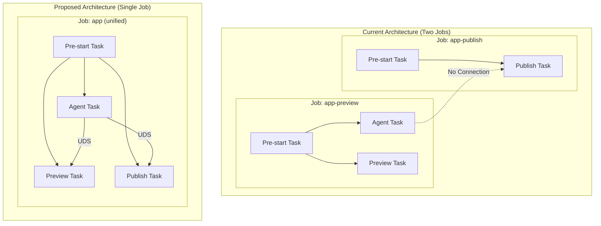
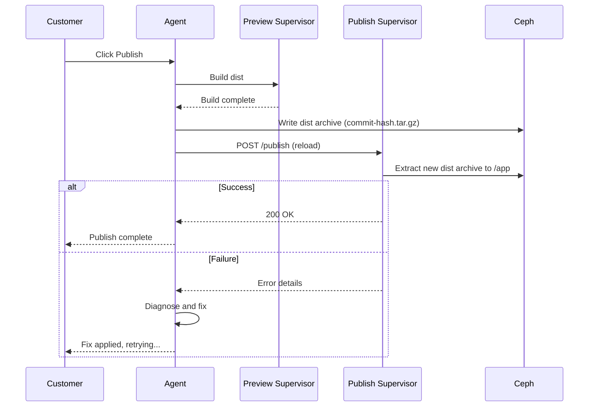
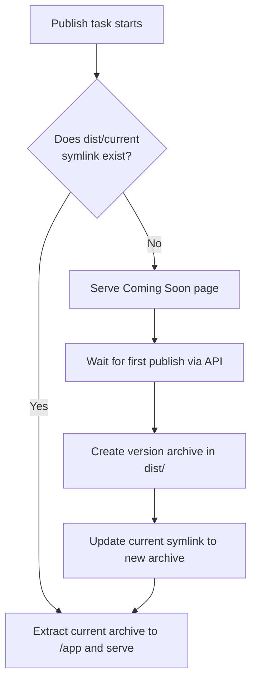
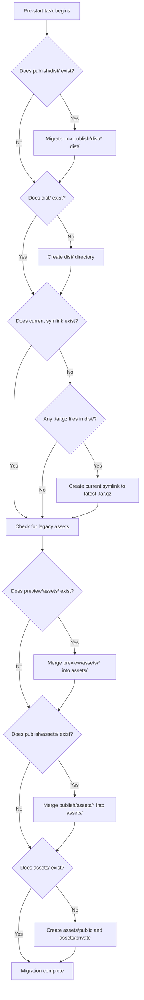
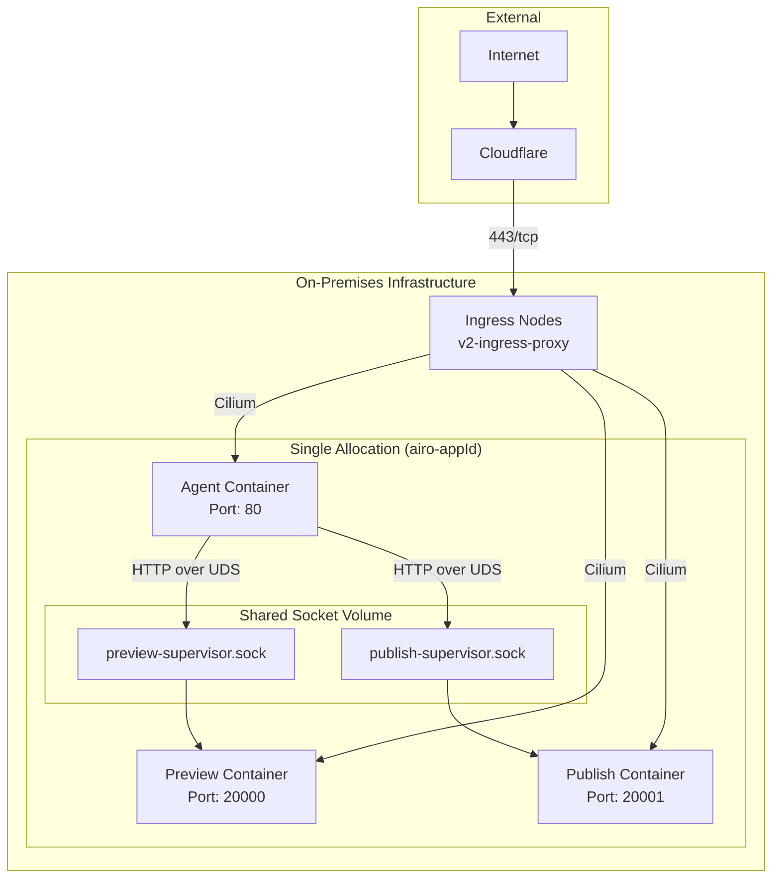
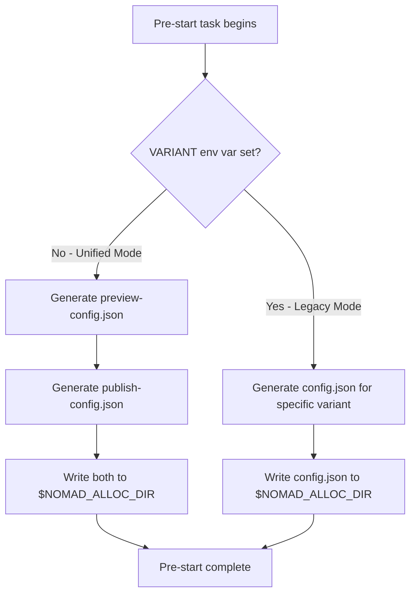
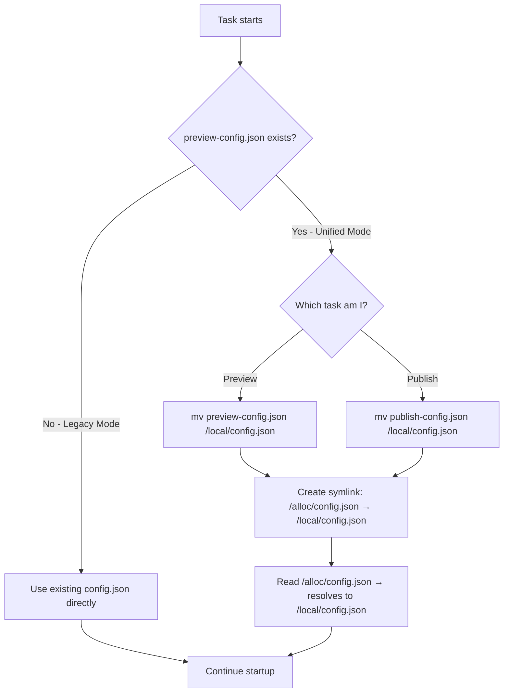
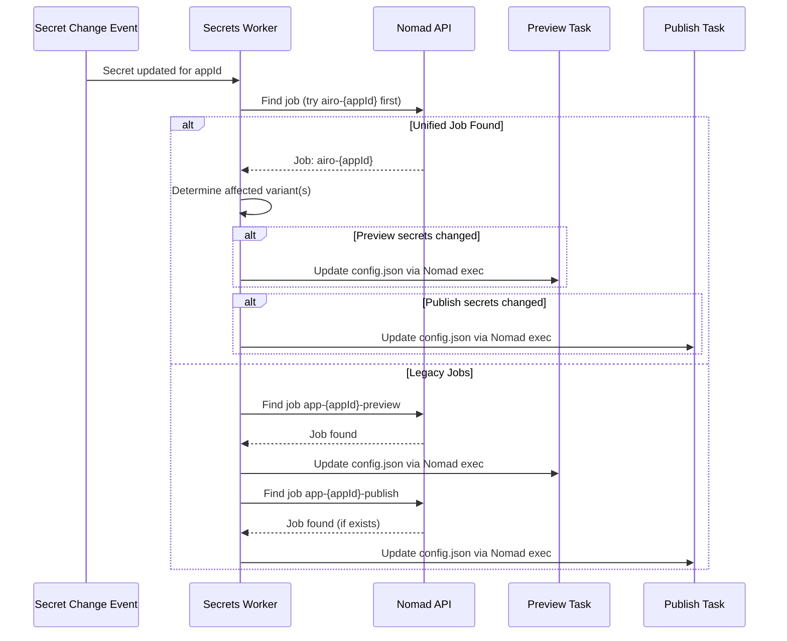
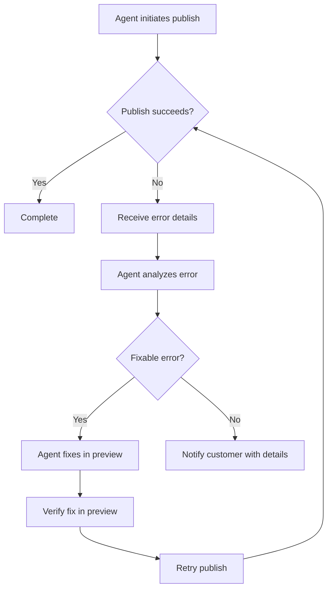

# Unified Nomad Job Architecture

## Overview

This document outlines the plan to consolidate preview and publish application variants into a single Nomad job. This architectural change addresses several critical issues: Cilium endpoint limitations, publishing reliability, and debugging capabilities for production applications.

## Problem Statement

### Current Architecture Limitations

The current architecture runs preview and publish variants as separate Nomad jobs, leading to several issues:

1. **Cilium Endpoint Exhaustion**: Each Nomad job consumes a Cilium endpoint, with a hard limit of 64k endpoints per cell. With two jobs per application (preview + publish), the effective limit is ~32k applications per cell.

2. **Publishing Latency**: Publishing requires provisioning a new job, leading to multi-second startup times. Competitors achieve near-instant publishing by pre-provisioning infrastructure.

3. **No Publishing Failure Feedback**: When publishing fails, the agent has no mechanism to detect the failure, diagnose the issue, or attempt remediation.

4. **Limited Debugging**: The agent cannot access the publish container for debugging, making it impossible to fix production-only issues without customer support intervention.

## Proposed Solution

### Single Job Architecture

Consolidate preview and publish into a single Nomad job with two tasks sharing the same allocation:



### Component Changes

#### dev-supervisor

The supervisor will run on both preview and publish tasks, enabling:

- Direct communication between agent and both tasks via Unix Domain Socket (UDS)
- Publish API for triggering deployment without control plane involvement
- Health monitoring and error reporting back to the agent

#### Publish Task

The publish task runs continuously alongside preview, initially serving a "Coming Soon" page until the first publish:



#### Publish Task Startup Logic

When the publish task starts (or restarts), the dev-supervisor determines what to serve by checking for an existing published version:



This ensures that after a job restart, previously published apps continue serving their content immediately without requiring a republish.

## Architecture Details

### Job Structure

```hcl
job "airo-${appId}" {
  group "airo" {
    task "pre-start" {
      lifecycle {
        hook = "prestart"
        sidecar = false
      }
      # Initialization: directory setup, permissions, etc.
    }

    task "agent" {
      # Agent container with LLM interaction
      # Communicates with both supervisors via UDS
    }

    task "preview" {
      # Development environment
      # Airo-supervisor with preview configuration
    }

    task "publish" {
      # Production environment
      # Airo-supervisor with publish configuration
      # Serves "Coming Soon" until first publish
    }
  }
}
```

### Storage Layout

```text
/mnt/ceph/${cephMountId}/${cephDirNumber}/${appId}/
├── agent/                  # Agent persistent storage
├── git-repo/               # Git repository (preview)
├── npm-cache/              # Shared NPM cache
├── assets/                 # Shared assets (preview and publish)
│   ├── public/             # Public assets (images, files, etc.)
│   └── private/            # Private assets (outside /app for security)
└── dist/                   # Published builds (archived by commit hash)
    ├── ba4a3f58c4ccc538407572dc04f36fd54f749877.tar.gz  # First build
    ├── c7e2b1a9d3f4e6a8b0c2d4e6f8a0b2c4d6e8f0a2.tar.gz  # Previous build
    ├── f1a2b3c4d5e6f7a8b9c0d1e2f3a4b5c6d7e8f9a0.tar.gz  # Latest build
    └── current -> f1a2b3c4d5e6f7a8b9c0d1e2f3a4b5c6d7e8f9a0.tar.gz  # Symlink to active version
```

### Storage Migration Strategy

When migrating from old compositions (v3) to the unified job (v4), the pre-start task detects and migrates legacy storage paths.

> **Important**: In legacy (v3) jobs, the version to use was passed directly to the Nomad task via the `command` argument. In the unified (v4) architecture, we no longer pass this command and instead rely on the `current` symlink to determine which build archive to extract. Therefore, the migration must create this symlink pointing to the latest build archive.

#### Legacy Detection and Migration



#### Migration Script Logic

```bash
# Migrate dist from old location
if [ -d "${CEPH_STORAGE_DIR}/publish/dist" ]; then
    echo "Migrating legacy publish/dist to dist/"
    mkdir -p ${CEPH_STORAGE_DIR}/dist
    mv ${CEPH_STORAGE_DIR}/publish/dist/* ${CEPH_STORAGE_DIR}/dist/
    rmdir ${CEPH_STORAGE_DIR}/publish/dist
    rmdir ${CEPH_STORAGE_DIR}/publish 2>/dev/null || true
fi

# Create current symlink if it doesn't exist
# Legacy jobs passed the version via command; unified jobs use the current symlink
if [ ! -L "${CEPH_STORAGE_DIR}/dist/current" ]; then
    # Find the most recently modified .tar.gz file in dist/
    LATEST_ARCHIVE=$(ls -t ${CEPH_STORAGE_DIR}/dist/*.tar.gz 2>/dev/null | head -1)
    if [ -n "$LATEST_ARCHIVE" ]; then
        ARCHIVE_NAME=$(basename "$LATEST_ARCHIVE")
        echo "Creating current symlink to latest archive: $ARCHIVE_NAME"
        ln -s "$ARCHIVE_NAME" "${CEPH_STORAGE_DIR}/dist/current"
    else
        echo "No .tar.gz archives found in dist/, skipping current symlink creation"
    fi
fi

# Migrate assets from old locations
if [ -d "${CEPH_STORAGE_DIR}/preview/assets" ]; then
    echo "Migrating legacy preview/assets to assets/"
    mkdir -p ${CEPH_STORAGE_DIR}/assets/public ${CEPH_STORAGE_DIR}/assets/private
    cp -rn ${CEPH_STORAGE_DIR}/preview/assets/public/* ${CEPH_STORAGE_DIR}/assets/public/ 2>/dev/null || true
    cp -rn ${CEPH_STORAGE_DIR}/preview/assets/private/* ${CEPH_STORAGE_DIR}/assets/private/ 2>/dev/null || true
    rm -rf ${CEPH_STORAGE_DIR}/preview/assets
    rmdir ${CEPH_STORAGE_DIR}/preview 2>/dev/null || true
fi

if [ -d "${CEPH_STORAGE_DIR}/publish/assets" ]; then
    echo "Migrating legacy publish/assets to assets/"
    mkdir -p ${CEPH_STORAGE_DIR}/assets/public ${CEPH_STORAGE_DIR}/assets/private
    cp -rn ${CEPH_STORAGE_DIR}/publish/assets/public/* ${CEPH_STORAGE_DIR}/assets/public/ 2>/dev/null || true
    cp -rn ${CEPH_STORAGE_DIR}/publish/assets/private/* ${CEPH_STORAGE_DIR}/assets/private/ 2>/dev/null || true
    rm -rf ${CEPH_STORAGE_DIR}/publish/assets
    rmdir ${CEPH_STORAGE_DIR}/publish 2>/dev/null || true
fi
```

> **Note**: The `-n` flag on `cp` ensures existing files are not overwritten during merge. Preview assets take precedence as they represent the latest state.
>
> **Note**: The `current` symlink is created using a relative path (just the filename) so it remains valid regardless of how the dist directory is mounted.
>
> **Note**: If this migration moves `preview/assets` to `assets/`, the `deriveAssetsDir()` function in `agents/src/utils/path-helper.ts` must be updated — it currently derives the assets path as `${CEPH_STORAGE_DIR}/preview/assets` and would need to change to `${CEPH_STORAGE_DIR}/assets`.

### Network Configuration

All tasks share the same allocation, enabling:

- **Single Cilium Endpoint**: One endpoint per job instead of two, doubling capacity per cell
- **Shared Allocation Directory**: Tasks communicate via Unix Domain Sockets in `${NOMAD_ALLOC_DIR}/tmp/`
- **Domain Routing**: Ingress proxy routes traffic to respective tasks based on domain



#### Socket Paths

| Task    | Socket Path                                               |
| ------- | --------------------------------------------------------- |
| Preview | `${NOMAD_ALLOC_DIR}/tmp/${appId}-preview-supervisor.sock` |
| Publish | `${NOMAD_ALLOC_DIR}/tmp/${appId}-publish-supervisor.sock` |

#### Port Assignments

All tasks receive traffic from the ingress proxy via Cilium:

| Task    | Port      | Domain Pattern                              |
| ------- | --------- | ------------------------------------------- |
| Agent   | 80/tcp    | `{appId}.agent.{cell}.{domain}`             |
| Preview | 20000/tcp | `{appId}.preview.{cell}.{domain}`           |
| Publish | 20001/tcp | `{appId}.{cell}.{domain}` or custom domains |

Examples:

- Agent: `yzvmr4wojn.agent.c4.test-airoapp.ai`
- Preview: `yzvmr4wojn.preview.c4.test-airoapp.ai`
- Publish: `yzvmr4wojn.c4.test-airoapp.ai`

> **Note**: Previously both preview and publish used port 20000 since they were in separate jobs. With the unified job, publish moves to port 20001.

#### Infrastructure Changes Required

##### SELinux Policy

The SELinux policy must be updated to allow the new publish port.

File: `pioneer-infra/ansible/roles/selinux/templates/common-policies/ports/airo_app_port.cil`

```cil
; Add port 20001 for publish task
(portcon tcp 20001 (system_u object_r airo_app_port_t ((s0) (s0))))
```

##### Cilium Network Policy

The Cilium network policy must be updated to allow ingress traffic to the publish port.

File: `pioneer-infra/ansible/roles/network-policy/templates/airo-networkpolicy.yaml.j2`

```yaml
# Add port 20001 to ingress rules for publish task traffic
ingress:
  - fromCIDR: { { network_policy_cidrs_ingress } }
    toPorts:
      - ports:
          - port: "80"
            protocol: TCP
          - port: "20000"
            protocol: TCP
          - port: "20001" # Add this for publish task
            protocol: TCP
```

### Secrets Management

The unified job requires a new approach to secrets handling since preview and publish tasks now share the same allocation but may have different secrets configurations.

#### The Challenge

In Nomad, `NOMAD_ALLOC_DIR` (`/alloc`) is shared between all tasks in an allocation. This means we cannot have a single `config.json` file that contains different secrets for preview vs publish tasks.

However, `NOMAD_TASK_DIR` (`/local`) is task-specific - each task has its own isolated `/local` directory.

#### The Symlink Solution

We leverage a symlink that points from the shared directory to the task-specific directory:

```
/alloc/config.json → /local/config.json
```

When Preview reads `/alloc/config.json`, it follows the symlink to **Preview's** `/local/config.json`.
When Publish reads `/alloc/config.json`, it follows the symlink to **Publish's** `/local/config.json`.

This allows existing code that reads from `/alloc/config.json` to continue working without modification.

#### Pre-Start Task: Config File Generation

When no `VARIANT` environment variable is passed (unified job mode), the pre-start task generates separate config files for each task:



#### Task Startup: Config Selection

When each task starts, its entrypoint script moves the appropriate config file to its task-local directory and creates the symlink:



> **Note**: Using `mv` instead of `cp` ensures the variant-specific config files are removed from the shared `NOMAD_ALLOC_DIR` after each task starts. This prevents one task from accessing another task's secrets.
>
> Both tasks create the same symlink, which is idempotent. The second task to start will simply recreate the same symlink pointing to `/local/config.json`.

#### Config File Paths

| Mode    | Pre-Start Output                                                                   | Symlink                                                            | Task Input                                                          |
| ------- | ---------------------------------------------------------------------------------- | ------------------------------------------------------------------ | ------------------------------------------------------------------- |
| Unified | `${NOMAD_ALLOC_DIR}/preview-config.json`, `${NOMAD_ALLOC_DIR}/publish-config.json` | `${NOMAD_ALLOC_DIR}/config.json` → `${NOMAD_TASK_DIR}/config.json` | `${NOMAD_ALLOC_DIR}/config.json` (resolves to task-specific config) |
| Legacy  | `${NOMAD_ALLOC_DIR}/config.json`                                                   | None                                                               | `${NOMAD_ALLOC_DIR}/config.json`                                    |

> **Note**: The symlink target `/local/config.json` is a relative path that resolves differently for each task, since `NOMAD_TASK_DIR` (`/local`) is task-specific in Nomad.

### Secrets Worker Updates

The secrets-worker must be updated to support the unified job architecture while maintaining backwards compatibility with legacy jobs.

#### Job Discovery Changes

The secrets-worker must handle both naming conventions:

| Job Type | Job Name Pattern      | Task Names                 |
| -------- | --------------------- | -------------------------- |
| Legacy   | `app-{appId}-preview` | `airo-preview-application` |
| Legacy   | `app-{appId}-publish` | `airo-publish-$app_id`     |
| Unified  | `airo-{appId}`        | `preview`, `publish`       |

#### Secrets Update Flow



#### Backwards Compatibility

The secrets-worker maintains full backwards compatibility:

1. **Job Discovery Order**: Always try `airo-{appId}` first, then fall back to legacy naming
2. **Task Name Mapping**: Use variant name (`preview`/`publish`) for unified jobs
3. **Config Path**: Config file path remains `${NOMAD_ALLOC_DIR}/config.json` for both architectures
4. **Gradual Migration**: Both job types can coexist during the migration period

## Publish API

### Supervisor Publish Endpoint

The dev-supervisor on the publish task exposes a publish API:

```http
POST /publish
Content-Type: application/json

{
  "version": "v20240915-143022",
  "force": false
}
```

**Response (Success):**

```json
{
  "status": "success",
  "version": "v20240915-143022",
  "startupTime": "1.2s"
}
```

**Response (Failure):**

```json
{
  "status": "error",
  "error": "Build failed: Module not found '@/components/Header'",
  "logs": ["...", "..."],
  "exitCode": 1
}
```

### Error Recovery Flow

When publishing fails, the agent can diagnose and fix issues:



## Implementation Plan

In every phase, this should be implemented in a completely backwards compatible way so that deployments are easy and non breaking.

### Phase 1: Supervisor Enhancement

1. Enhance `dev-supervisor` with publish API
2. Add publish API endpoint
3. Implement dist loading from Ceph
4. Add "Coming Soon" default page
5. Add startup logic to check for `current` symlink and load existing dist or show Coming Soon
6. Update task entrypoint scripts to move variant-specific config to `$NOMAD_TASK_DIR/config.json` and create symlink `$NOMAD_ALLOC_DIR/config.json` → `$NOMAD_TASK_DIR/config.json`

### Phase 2: Infrastructure Changes

1. Update SELinux policy to allow port 20001 (`pioneer-infra`)
2. Update Cilium network policies for new port
3. Update/Create new image names, see Image Naming section

### Phase 3: Control Plane Updates

1. Create unified job composition, probably copy preview as the base
2. Add publish task to unified
3. Update job naming (drop `-preview`/`-publish` suffixes, change app -> airo)
4. Update domain routing for unified job
5. Update backup operations for new job structure
6. Add storage migration logic to pre-start task (migrate `publish/dist/` → `dist/`, merge assets)
7. Update pre-start task to generate both `preview-config.json` and `publish-config.json` when no `VARIANT` env var is set

### Phase 4: Secrets Worker Updates

1. Update job discovery to try `airo-{appId}` before falling back to legacy `app-{appId}-{variant}` naming
2. Update task name mapping: use variant name (`preview`/`publish`) for unified jobs, `runner` for legacy
3. Add support for updating config on specific tasks within the unified job
4. Test backwards compatibility with legacy job structures
5. Add logging/metrics to track unified vs legacy job updates

### Phase 5: Agent Integration

1. Implement publish flow via supervisor API
2. Add error handling and retry logic
3. Enable publish container debugging
4. Add terminal access to publish task

### Phase 6: UI / UX Changes

1. Implement domain change blocking during active conversations
2. Don't allow a conversation during a domain change
3. Update publish button to call any new api flows and handle the errors

### Phase 7: Migration

1. Deploy new composition for new applications
2. Migrate existing applications during maintenance windows
3. Update patching, monitoring and alerting
4. Deprecate separate job compositions

## Benefits

### Operational Benefits

| Benefit                    | Description                                               |
| -------------------------- | --------------------------------------------------------- |
| **Instant Publishing**     | Publish runner already provisioned; no job creation delay |
| **Reduced Endpoints**      | Single Cilium endpoint per app; doubles capacity per cell |
| **Publishing Reliability** | Direct error feedback enables automated recovery          |
| **Local Testing**          | Full publishing flow testable in development              |

### Customer Experience Benefits

| Benefit                | Description                                           |
| ---------------------- | ----------------------------------------------------- |
| **Faster Publishes**   | Sub-second publish times vs. multi-second delays      |
| **Early Domain Setup** | Custom domains can be configured before first publish |
| **Better Debugging**   | Agent can diagnose and fix production issues          |
| **Reduced Support**    | Self-service debugging reduces support tickets        |

### Developer Experience Benefits

| Benefit                     | Description                                   |
| --------------------------- | --------------------------------------------- |
| **Unified Debugging**       | Single context for preview and publish issues |
| **Consistent Environment**  | Same supervisor on both tasks                 |
| **Simplified Architecture** | One job to manage instead of two              |

## Naming Conventions

### Job Naming

Update the job naming to drop the suffix and change app to airo, so that if we need to we can run mixed workloads in a cell.

- **Current**: `app-{appId}-preview`, `app-{appId}-publish`
- **Proposed**: `airo-{appId}` (unified)

The safe_drain.py script will need to be updated to support the new naming convention, we should also verify that nothing else uses these old names.

### Image Naming

Update image naming to avoid confusion on what task it is for:

- **Current**: `agents`, `apps`, `runner`
- **Proposed**: `agent`, `preview`, `publish` (matches task name)

### Task Naming

| Task      | Name        |
| --------- | ----------- |
| Pre-Start | `pre-start` |
| Agent     | `agent`     |
| Preview   | `preview`   |
| Publish   | `publish`   |

## Risks and Mitigations

### Risk: Domain Changes Restart Everything

**Mitigation**: Domain modifications are infrequent. Block changes during active sessions with clear UI messaging. Improved signal handling ensures graceful restarts.

### Risk: Image Updates Restart Everything

**Mitigation**: Image updates are planned maintenance events. Agent durability improvements ensure state recovery. Publish task extracts dist archive from Ceph on startup, so serving continues quickly after restart.

### Risk: Backup Operations

**Mitigation**: Update backup discovery to handle new job naming. Unified job may simplify backup operations since both preview and publish are in the same allocation.

---

_Document Version: 1.0_
_Created: December 10, 2025_
_Classification: Internal_
_Status: Proposal_
_Audience: Platform Engineering & Development Teams_
