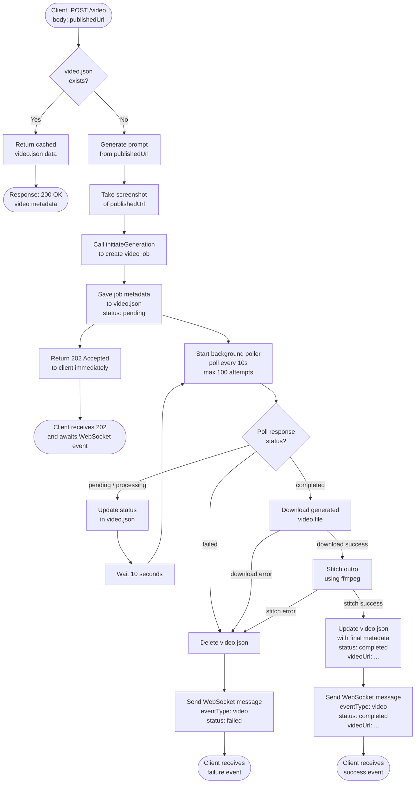
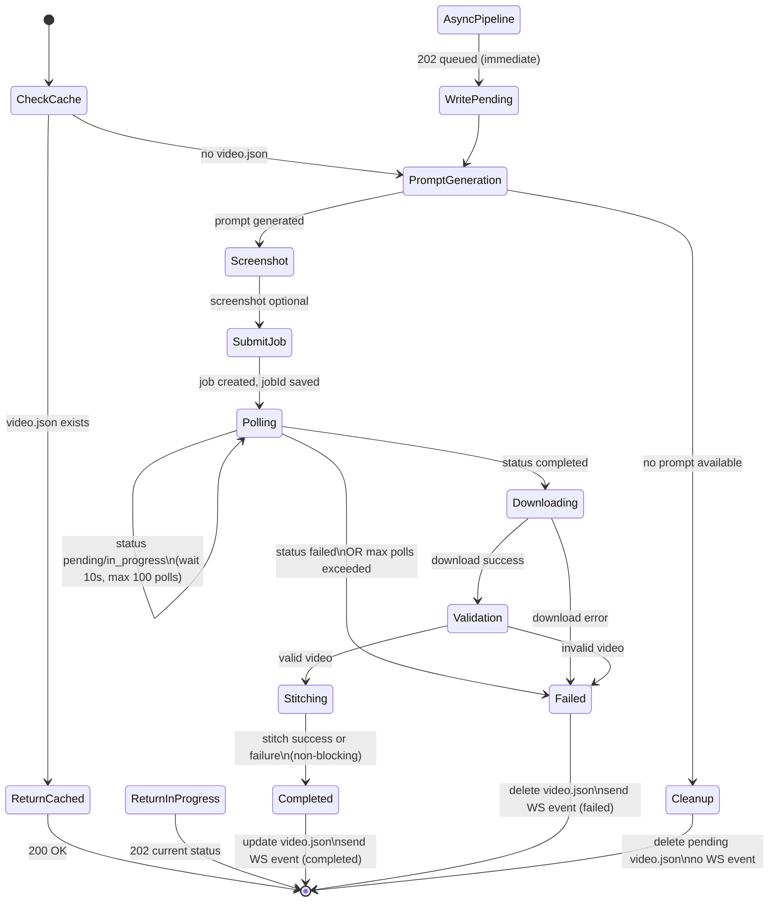
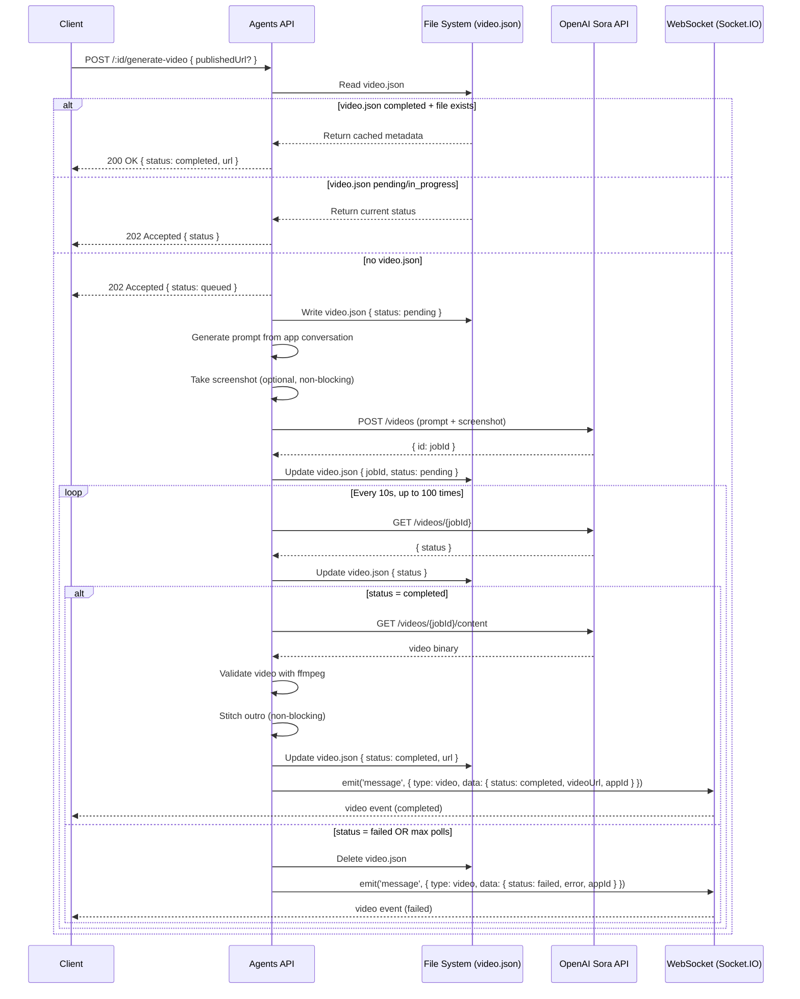

# Video Generation — WebSocket-Based Async Design

## Overview

This document describes the redesigned video generation flow. Instead of the frontend
polling an HTTP endpoint repeatedly, the backend handles all polling internally and pushes
the final result (success or failure) to the client via a WebSocket message with a
dedicated `video` event type.

## Goals

- Remove frontend polling complexity
- Single HTTP request from the client to initiate generation
- Server-side async pipeline: prompt → screenshot → job → poll → download → stitch
- Real-time result delivery via WebSocket
- Idempotent: resume from `video.json` cache if generation already completed

---

## Flow Diagram



---

## State Machine



---

## video.json Schema

The `video.json` file at `{appPath}/.airo/video.json` acts as the persistent state store
for in-progress and completed video generation. It is written before the async pipeline
starts and updated after each poll and after final processing.

```json
{
  "jobId": "string | null",
  "status": "pending | in_progress | completed | failed",
  "createdAt": "ISO8601",
  "updatedAt": "ISO8601",
  "url": "string | null",
  "error": "string | null"
}
```

---

## WebSocket Event Payload

The WebSocket message sent on completion or failure uses a new `video` event type.

### Success

```json
{
  "type": "video",
  "content": "",
  "data": {
    "status": "completed",
    "jobId": "string",
    "videoUrl": "https://preview.domain/public/images/go_live-video-AbCdEf.mp4",
    "appId": "string"
  }
}
```

### Failure

```json
{
  "type": "video",
  "content": "",
  "data": {
    "status": "failed",
    "jobId": "string",
    "error": "string",
    "appId": "string"
  }
}
```

---

## HTTP API

### `POST /:id/generate-video`

Initiates video generation for a given app. Requires `canPublish` permission.

**Request Body:**

```json
{
  "publishedUrl": "https://..."
}
```

**Responses:**

| Status                      | Condition                                      | Body                                                   |
| --------------------------- | ---------------------------------------------- | ------------------------------------------------------ |
| `200 OK`                    | `video.json` completed and video file exists   | `{ success: true, status: "completed", url: "…" }`     |
| `202 Accepted`              | New pipeline started or generation in progress | `{ success: true, status: "queued" }`                  |
| `400 Bad Request`           | Missing app ID or invalid publishedUrl         | `{ error: "…", status: "failed" }`                     |
| `404 Not Found`             | App not found                                  | `{ error: "App not found", status: "failed" }`         |
| `500 Internal Server Error` | Unexpected error                               | `{ error: "Internal server error", status: "failed" }` |

---

## Failure Handling

| Failure Point                   | Action                                                       |
| ------------------------------- | ------------------------------------------------------------ |
| Prompt generation fails         | Async: delete pending video.json, no WS event                |
| Screenshot fails                | Non-blocking: proceeds without screenshot input reference    |
| OpenAI job submission fails     | Async: delete pending video.json, no WS event                |
| Poll returns `failed`           | Delete video.json, send WS failure event                     |
| Max poll attempts (100) reached | Delete video.json, send WS failure event                     |
| Download fails                  | Delete video.json, send WS failure event                     |
| Video validation fails          | Delete video file + video.json, send WS failure event        |
| ffmpeg outro stitch fails       | **Non-blocking**: video is still usable, marked as completed |

Deleting `video.json` on failure ensures the next request will retry the full pipeline
rather than returning stale/corrupted state.

---

## Sequence Diagram


