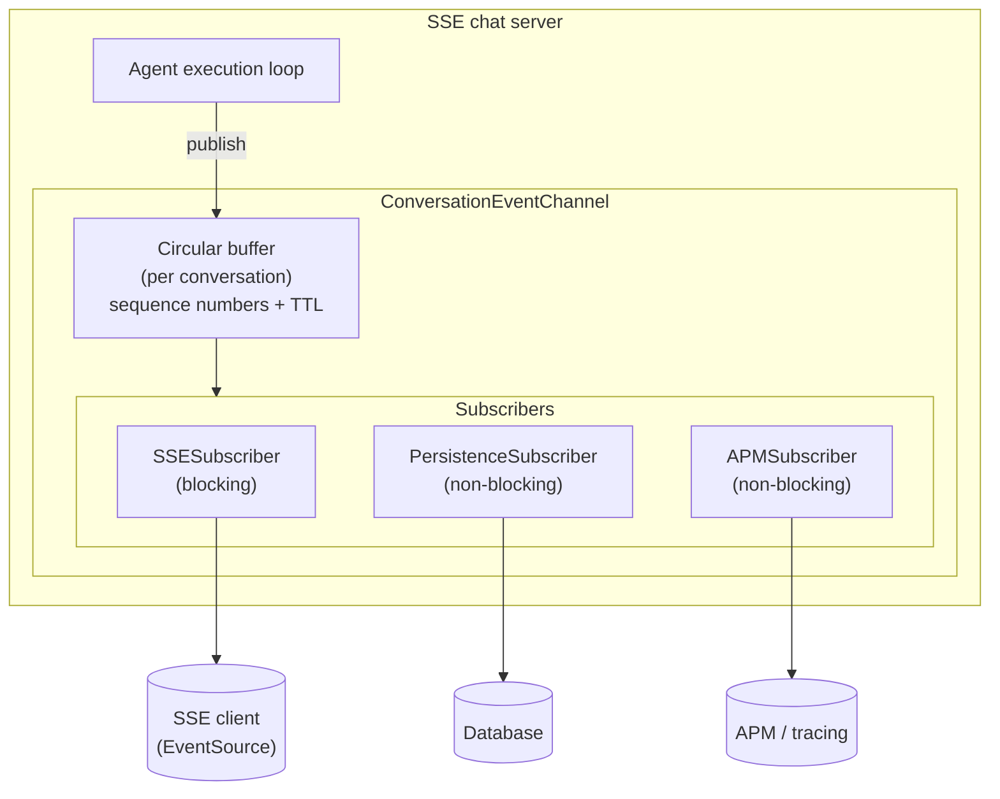

# @airo/ai-transport — Chat Event Infrastructure

Infrastructure for the SSE chat server. Chat streaming uses Server-Sent Events as
the only transport (the Socket.IO WebSocket transport was removed in
AIROBUILD-2629 / AIROBUILD-2632). The SSE adapter
(`agents/src/server/sse/MessageExecutionService.ts`) wires the callbacks; the
behavior lives here.

See [`CLAUDE.md`](./CLAUDE.md) for the callback-seam rules and the reviewer
checklist.

## Architecture Overview

An **event-driven pub/sub architecture** decouples event production (the agent
loop) from delivery (SSE client, persistence, APM):



The agent loop publishes lifecycle events (`step_start`, `chunk`, `tool_start`,
`tool_input_delta`, `tool_call`, `tool_result`, `step_complete`, `complete`,
`error`) to the channel, which assigns a sequence number, buffers them, and
notifies subscribers.

## Reconnection & replay

SSE reconnect is **stateless per request**: the client reconnects with a
`Last-Event-ID` header and the server replays buffered events after that
sequence. There is no connection-state machine, recovery handshake, or ACK
protocol. The channel's per-conversation circular buffer (sequence numbers +
TTL) is what makes replay possible.

## Event Channel Infrastructure

### ConversationEventChannel

`ConversationEventChannel` (exported from `@airo/ai-transport`) provides:

- **Circular buffer** per conversation (default capacity 1000 events)
- **Sequence numbers** for ordering and `Last-Event-ID` replay
- **TTL-based expiration** (default 5 minutes) with periodic cleanup
- **Pub/sub** with typed subscribers

```typescript
import { ConversationEventChannel } from '@airo/ai-transport'

const channel = new ConversationEventChannel(
  { capacity: 1000, ttl: 5 * 60 * 1000 },
  logger,
)

channel.publish(conversationId, event)
channel.subscribe(conversationId, subscriber)

// Replay events a reconnecting client missed (after its Last-Event-ID)
const missed = channel.getEventsSince(conversationId, lastSequence)

// Drop expired conversations (runs on an interval)
const removed = channel.cleanup()
```

### Subscriber types

#### SSESubscriber (blocking)

Delivers events to a connected HTTP client via an `SSEWriter`. Blocking, so a
delivery failure aborts the stream. Coalesces consecutive `chunk` /
`tool_input_delta` events through the shared `EventCoalescer`.

```typescript
const subscriber = new SSESubscriber(writer, appId)
channel.subscribe(conversationId, subscriber)
```

#### PersistenceSubscriber (non-blocking)

Saves events to the database for conversation history. Non-blocking, so database
failures don't interrupt streaming.

```typescript
const subscriber = new PersistenceSubscriber(persistence, context, logger)
channel.subscribe(conversationId, subscriber)
```

#### APMSubscriber (non-blocking)

Tracks tool-execution spans for APM / tracing. Non-blocking.

## Development

```bash
pnpm --filter @airo/ai-transport typecheck
pnpm --filter @airo/ai-transport build
pnpm --filter @airo/ai-transport test
```

Tests live next to each module in `src/__tests__/`. Per the CLAUDE.md rules:
shared chat behavior belongs here behind a callback seam, not inlined into the
SSE adapter; event-shape changes are wire-visible and must update producers,
consumers, and `__tests__/` together.
