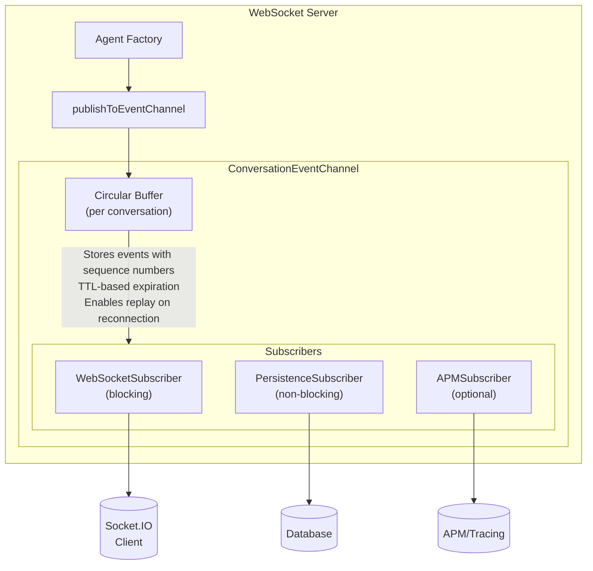
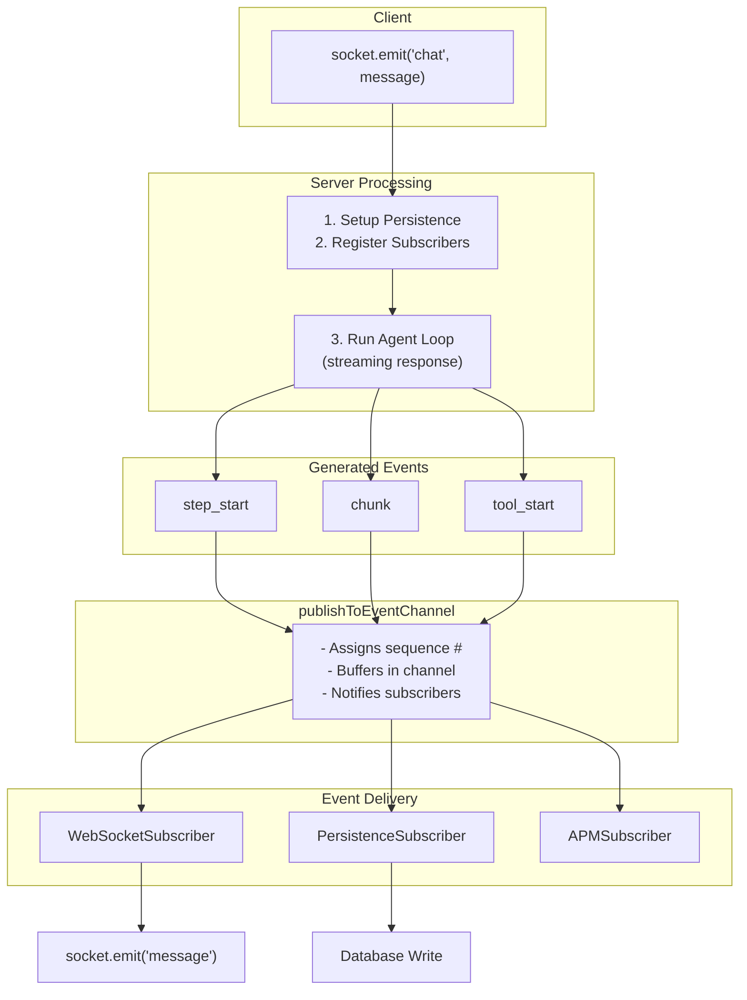
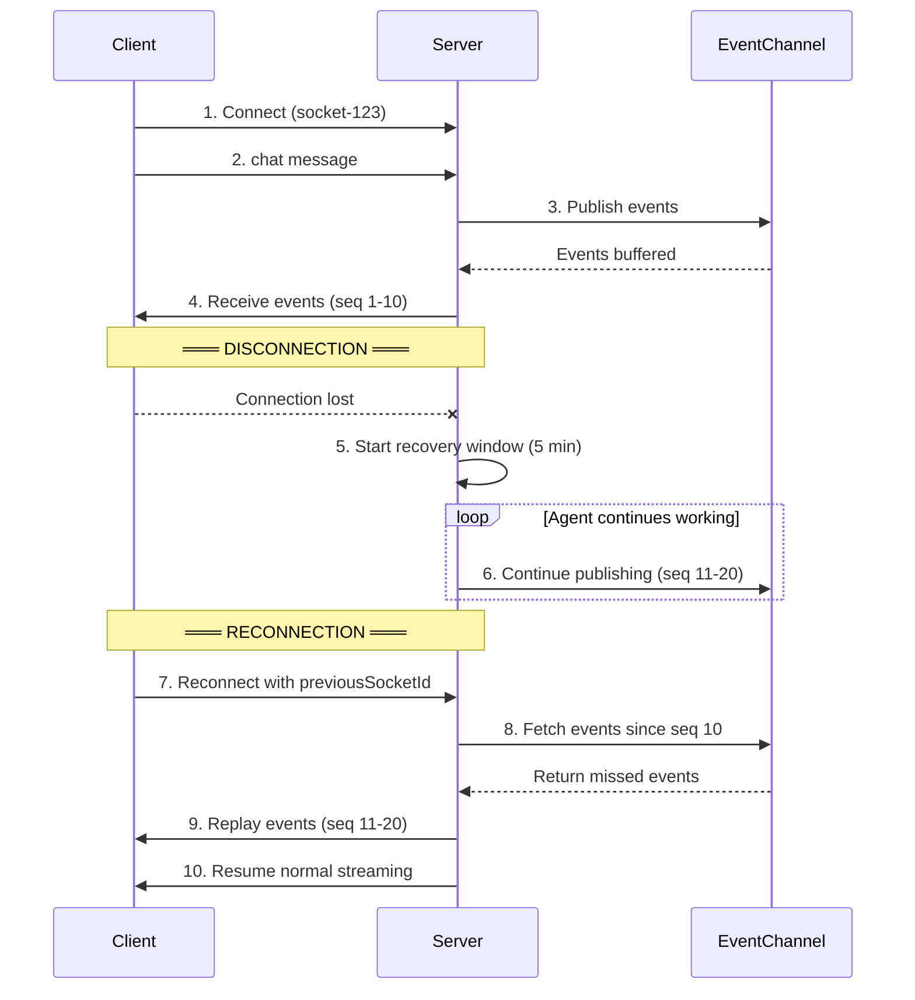

# WebSocket Server

This directory contains WebSocket server implementations for real-time AI agent interactions.

## Architecture Overview

The WebSocket server uses an **event-driven pub/sub architecture** for decoupled event delivery and connection recovery:



### Event Flow



## 🆕 WebSocketServer (Recommended)

The `WebSocketServer` is designed to work with the `AgentFactory` and provides a simplified, more powerful interface.

### Key Features

- **Factory-Based**: Always uses an `AgentFactory` for consistency
- **Multi-Agent Support**: Easy switching between different agents
- **Conversation History**: Built-in support for conversation context
- **Custom Context**: Inject app-specific context into conversations
- **Streaming**: Real-time streaming of agent responses
- **Tool Support**: Full support for agent tools and agentic workflows
- **Connection Recovery**: 5-minute recovery window with event replay
- **Event Buffering**: Configurable circular buffer per conversation
- **Extensible Subscribers**: Pub/sub pattern for event delivery

### Quick Start

#### Single Agent Setup

```typescript
import { createServer } from "http";
import { getModel } from "@airo/ai-lib";
import { createSingleAgentWebSocketServer } from "@airo/ai-lib";

const httpServer = createServer();

const wsServer = createSingleAgentWebSocketServer(
  httpServer,
  "assistant", // Agent name
  {
    name: "AI Assistant",
    system: "You are a helpful AI assistant.",
    model: await getModel("gpt4o-mini"),
    temperature: 0.7,
  },
);

httpServer.listen(3000);
```

#### Multi-Agent Setup

```typescript
import { createServer } from "http";
import { getModel } from "@airo/ai-lib";
import { createAgentFactory } from "@airo/ai-lib";
import { createWebSocketServer } from "@airo/ai-transport";

const agentFactory = createAgentFactory();

const agents = agentFactory.defineAgents({
  general: {
    name: "General Assistant",
    model: await getModel("gpt4o-mini"),
    system: "You are a helpful assistant.",
  },
  creative: {
    name: "Creative Writer",
    model: await getModel("gpt4o"),
    system: "You are a creative writing assistant.",
    temperature: 0.9,
  },
});

const httpServer = createServer();
const wsServer = createWebSocketServer(httpServer, {
  agents,
  defaultAgent: "general",
});

httpServer.listen(3000);
```

### Client Usage

#### Basic Chat

```javascript
const socket = io("http://localhost:3000");

// Send a message
socket.emit("chat", {
  message: "Hello, how are you?",
});

// Listen for normalized events
socket.on("message", (data) => {
  switch (data.type) {
    case "agents_available":
      console.log("Available agents:", data.data.agents);
      break;
    case "step_start":
      console.log("Step started:", data.data.step);
      break;
    case "chunk":
      process.stdout.write(data.content); // Stream text content
      break;
    case "step_complete":
      console.log("Step completed:", data.data.step);
      break;
    case "complete":
      console.log("Done! Agent:", data.data.agentId);
      console.log("Usage:", data.data.usage);
      break;
    case "error":
      console.error("Error:", data.content);
      break;
  }
});
```

#### Multi-Agent Chat

```javascript
// Use specific agent (supports both agentId and agentName)
socket.emit("chat", {
  message: "Write a poem about coding",
  agentId: "creative", // or agentName: 'creative'
});

// Get available agents
socket.emit("get_agents");
```

#### With Context and History

```javascript
socket.emit("chat", {
  message: "Continue our conversation",
  agentId: "general",
  context: {
    userPreferences: { style: "formal" },
    currentProject: "ai-chatbot",
  },
  conversationHistory: [
    { role: "user", content: "I need help with my project" },
    {
      role: "assistant",
      content: "I'd be happy to help! What kind of project?",
    },
  ],
});
```

### Connection Recovery

The server supports automatic connection recovery with a 5-minute window:



**Client-side reconnection:**

```javascript
const socket = io("http://localhost:3000", {
  auth: {
    previousSocketId: localStorage.getItem("socketId"),
  },
});

socket.on("connect", () => {
  localStorage.setItem("socketId", socket.id);
});

// Handle recovery status
socket.on("message", (data) => {
  if (data.type === "recovery_status") {
    console.log(`Recovered ${data.data.replayedEvents} events`);
  }
});
```

#### Recovery Modes

The server handles two recovery scenarios transparently:

| Mode                | Trigger                                     | Behavior                                                                    |
| ------------------- | ------------------------------------------- | --------------------------------------------------------------------------- |
| **Auto-recovery**   | Stream completed during disconnect          | Replays buffered events, sends `recovery_status`                            |
| **Manual recovery** | Stream still running when client reconnects | Migrates state to new socket, replays missed events, resumes live streaming |

Manual recovery supports **sequential reconnects** (A→B→C) - the server tracks socket ID migrations and follows the chain to deliver events to the current socket. This ensures exactly-once delivery even with multiple rapid reconnections.

### Configuration Options

```typescript
interface WebSocketConfig {
  /** Agents object from agentFactory.defineAgents() (required) */
  agents: AgentsCollection;

  /** Default agent name to use if none specified */
  defaultAgent?: string;

  /** Optional state manager for agent handoffs */
  stateManager?: HandoffStateManager;

  /** Context extractor function for processing custom context */
  contextExtractor?: (
    rawContext: Record<string, unknown>,
  ) => Record<string, unknown>;

  /** File path resolver for uploaded files */
  filePathResolver?: (
    appId: string,
    uploadId: string,
    filename: string,
  ) => string;

  /** CORS configuration */
  cors?: {
    origin?: string | string[] | boolean;
    methods?: string[];
  };

  /** Include detailed usage data in responses */
  includeUsageData?: boolean;

  /** Message persistence implementation */
  messagePersistence?: ConversationPersistence;

  /** Message provider for loading conversation history */
  messageProvider?: MessageProvider;

  /** Context provider for loading system context and other contextual messages */
  contextProvider?: ContextProvider;

  /** Optional APM agent for tool execution tracking */
  apmAgent?: APMAgent;

  /** Optional function to get active websocket transaction by socket ID */
  getActiveTransaction?: (socketId: string) => APMAgent | undefined;

  /** Agent routing hook - determines which agent should handle a message */
  agentRouter?: (socketId: string, data: ChatMessage) => string | undefined;

  // === Event Channel Configuration ===

  /** Event channel buffer size per conversation (default: 1000) */
  eventBufferSize?: number;

  /** Event channel TTL in ms (default: 5 minutes, clamped to recovery window minimum) */
  eventBufferTTL?: number;

  // === Event Handlers ===

  onConnection?: (socketId: string) => void | Promise<void>;
  onDisconnection?: (socketId: string) => void | Promise<void>;
  onMessageStart?: (
    socketId: string,
    message: string,
    agentName?: string,
    context?: Record<string, unknown>,
  ) => void | Promise<void>;
  onMessageComplete?: (
    socketId: string,
    result: {
      agentName: string;
      duration: string;
      usage?: any;
      toolCalls?: any[];
    },
    context?: Record<string, unknown>,
  ) => void;
  onError?: (
    socketId: string,
    error: Error,
    message?: string,
    context?: Record<string, unknown>,
  ) => void | Promise<void>;
  onTokenUsage?: (
    usage: {
      inputTokens: number;
      outputTokens: number;
      totalTokens: number;
      cachedInputTokens?: number;
      cacheWriteInputTokens?: number;
    },
    metadata: {
      agentName: string;
      modelName: string;
      conversationId?: string;
      appId?: string;
      context?: Record<string, unknown>;
    },
  ) => void | Promise<void>;

  // === LLM Observability Hooks ===

  onLlmStart?: (data: {
    socketId: string;
    model: string;
    provider: string;
    conversationId?: string;
    appId?: string;
    context?: Record<string, unknown>;
    input?: Array<{ role: string; content: string }>;
    tools?: string[];
    toolChoice?: "auto" | "required" | "none";
  }) => Promise<{ spanId: string; startTime: number } | void>;

  onLlmEnd?: (data: {
    socketId: string;
    spanId?: string;
    startTime?: number;
    model: string;
    provider: string;
    conversationId?: string;
    appId?: string;
    usage?: {
      inputTokens?: number;
      outputTokens?: number;
      totalTokens?: number;
      cachedTokens?: number;
      reasoningTokens?: number;
      totalCost?: number;
    };
    finishReason?: string;
    success: boolean;
    context?: Record<string, unknown>;
    output?: Array<{ role: string; content?: string }>;
    toolCalls?: Array<{
      id: string;
      name: string;
      arguments?: Record<string, unknown>;
    }>;
    responseId?: string;
    reasoningSummary?: string;
  }) => void | Promise<void>;

  // === Tool Observability Hooks ===

  onToolStart?: (data: {
    socketId: string;
    toolName: string;
    toolCallId: string;
    toolInput?: Record<string, unknown>;
    conversationId?: string;
    appId?: string;
    context?: Record<string, unknown>;
  }) => Promise<{ spanId: string; startTime: number } | void>;

  onToolEnd?: (data: {
    socketId: string;
    toolName: string;
    toolCallId: string;
    spanId?: string;
    startTime?: number;
    success: boolean;
    toolResponse?: unknown;
    conversationId?: string;
    appId?: string;
    context?: Record<string, unknown>;
  }) => void | Promise<void>;

  /** Socket.IO server options */
  socketOptions?: Partial<ServerOptions>;
}
```

> **⚡ Performance Note:** `onMessageStart` and `onTokenUsage` are fire-and-forget (non-blocking). Errors are logged but don't fail message processing.

### Message Types

#### Client → Server

```typescript
interface ChatMessage {
  message: string;
  agentName?: string; // Backward compatibility
  agentId?: string; // Preferred
  context?: Record<string, unknown>;
  conversationHistory?: Array<{
    role: "user" | "assistant";
    content: string;
  }>;
}
```

#### Server → Client (Normalized Event Schema)

```typescript
interface WebSocketMessage {
  type:
    | "step_start"
    | "chunk"
    | "tool_start"
    | "tool_input_delta"
    | "tool_call"
    | "tool_result"
    | "step_complete"
    | "complete"
    | "error"
    | "agents_available"
    | "recovery_status";
  content: string;
  data: Record<string, unknown>;
}

// Event Types:
// - agents_available: List of available agents on connection
// - step_start: Beginning of a reasoning step
// - chunk: Streamable text content (AI responses, tool outputs)
// - tool_start: Tool execution beginning
// - tool_input_delta: Streaming tool arguments
// - tool_call: Tool call with complete arguments
// - tool_result: Tool execution completion
// - step_complete: Reasoning step completion
// - complete: Final completion with metadata
// - error: Error occurred
// - recovery_status: Reconnection recovery info
```

## Event Channel Infrastructure

### ConversationEventChannel

The event channel provides:

- **Circular buffer** per conversation (default 1000 events)
- **Sequence numbers** for ordering and replay
- **TTL-based expiration** (minimum 5 minutes to match recovery window)
- **Pub/sub pattern** with typed subscribers

```typescript
import { ConversationEventChannel } from "@airo/ai-lib";

const channel = new ConversationEventChannel(
  {
    capacity: 1000, // Events per conversation
    ttl: 5 * 60 * 1000, // 5 minutes
  },
  logger,
);

// Publish events
channel.publish(conversationId, event);

// Subscribe to events
channel.subscribe(conversationId, subscriber);

// Replay events after reconnection
const missedEvents = channel.getEventsSince(conversationId, lastSequence);

// Cleanup expired conversations
const removedCount = channel.cleanup();
```

### Subscriber Types

#### WebSocketSubscriber (Blocking)

Delivers events to Socket.IO clients. Marked as "blocking" so failures abort the stream.

```typescript
const subscriber = new WebSocketSubscriber(socket, disconnectedStreams);
channel.subscribe(conversationId, subscriber);
```

#### PersistenceSubscriber (Non-blocking)

Saves events to database for conversation history. Non-blocking so database failures don't interrupt streaming.

```typescript
const subscriber = new PersistenceSubscriber(
  persistence,
  conversationId,
  processedContext,
  logger,
);
channel.subscribe(conversationId, subscriber);
```

#### APMSubscriber (Non-blocking)

Tracks tool execution spans for APM/tracing systems.

```typescript
const subscriber = new APMSubscriber(apmAgent, socketId, getActiveTransaction);
channel.subscribe(conversationId, subscriber);
```

## 🎮 Examples

Run the WebSocket examples:

```bash
# Single agent example
npm run example:websocket-single

# Multi-agent example
npm run example:websocket-multi
```

These examples demonstrate:

- Single vs multi-agent setups
- Tool usage with agents
- Conversation history
- Custom context handling
- Error handling and event logging

## 🔧 Development

The WebSocket servers use Socket.IO for WebSocket communication and integrate seamlessly with the AgentFactory for agent management.

### Error Handling

The server provides comprehensive error handling:

- Invalid message formats
- Missing agents
- Agent execution errors
- Connection issues
- Subscriber failures (blocking vs non-blocking)

All errors are emitted to clients with descriptive messages and logged server-side.

### Performance

- Streaming responses for real-time UX
- Abort controllers for canceling streams
- Connection cleanup on disconnect
- Memory-efficient circular buffers with automatic cleanup
- Non-blocking persistence for database resilience
- TTL-based expiration prevents memory leaks

### Memory Management

The server includes automatic memory management:

- **Cleanup interval**: Runs every 60 seconds to remove expired conversations
- **TTL enforcement**: Conversations expire after configured TTL (minimum 5 minutes)
- **Buffer limits**: Circular buffer caps events per conversation

## 📜 Legacy WebSocketServer

The original `WebSocketServer` is still available but deprecated. It supports the older `Agent` class and more complex configuration patterns.

## 🚀 Migration from Legacy WebSocketServer

1. Replace `WebSocketServer` with `WebSocketServer`
2. Use `AgentFactory` instead of individual `Agent` instances
3. Update client message format to new `ChatMessage` interface
4. Update event handlers to new signature format

The new server provides better performance, simpler configuration, and more powerful features for modern AI applications.
